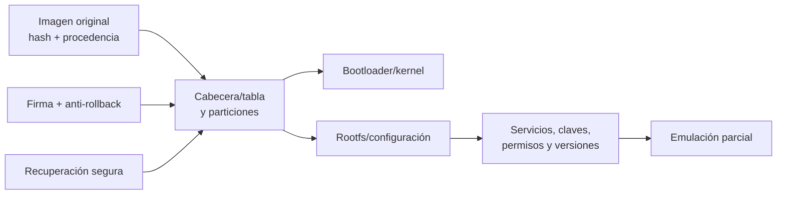
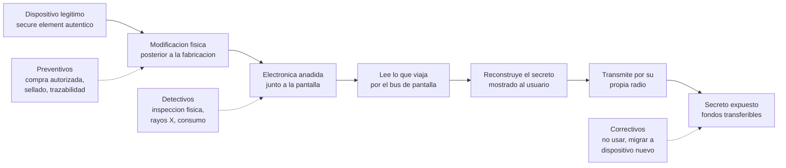

# Clase 267 — Hacking de firmware

> Parte: **13 — Seguridad móvil, IoT e inalámbrica** · Fuente: *Practical IoT Hacking* (Chantzis et al.) y OWASP FSTM
> ⏱️ Duración estimada: **120 min** · Nivel: **Avanzado**

---

## 🎯 Objetivo

Aprender a obtener, desempaquetar y analizar el firmware de un dispositivo embebido para descubrir credenciales, claves, binarios vulnerables y backdoors, y a emular el firmware para pruebas dinámicas. El alumno recorrerá la metodología OWASP FSTM: obtención, extracción del sistema de ficheros, análisis estático, emulación y verificación de la cadena de actualización.

> ⚠️ **Nota ética:** trabaja solo con firmware de dispositivos propios o de descargas oficiales del fabricante para tu equipo, o con imágenes de práctica (DVRF, IoTGoat). No redistribuyas firmware con copyright.

## 📚 Resultados de aprendizaje

Al finalizar, el alumno podrá:

1. **Obtener** firmware por descarga oficial, volcado de flash o interceptación OTA.
2. **Extraer** el sistema de ficheros con `binwalk` y utilidades relacionadas.
3. **Analizar** estáticamente binarios, scripts y configuraciones en busca de secretos.
4. **Emular** el firmware o binarios con QEMU/FAT para pruebas dinámicas.
5. **Evaluar** la seguridad de la actualización (firma, cifrado) del firmware.
6. **Reportar** hallazgos con evidencia reproducible.
7. **Distinguir** autenticidad del componente, integridad del firmware, integridad física y cadena de custodia, y explicar por qué aprobar una no demuestra las otras.
8. **Explicar** causalmente un incidente de manipulación física posterior a la fabricación, separando hechos confirmados, descripciones de terceros y lo que se desconoce.

## 🗺️ Temas

| # | Tema | Por qué importa |
|---|------|-----------------|
| 1 | Obtención del firmware | Sin la imagen no hay análisis |
| 2 | Formatos y `binwalk` | Identifica y extrae componentes |
| 3 | Sistemas de ficheros (SquashFS, JFFS2) | Contienen binarios y configs |
| 4 | Búsqueda de secretos | Credenciales y claves embebidas |
| 5 | Análisis de binarios | Vulnerabilidades en servicios propios |
| 6 | Emulación con QEMU | Prueba dinámica sin el hardware |
| 7 | Seguridad de la actualización | Firma/cifrado del OTA |
| 8 | Raíz de confianza, attestation y secure element | Qué prueba un componente auténtico y qué deja sin probar |
| 9 | Autenticidad, integridad física y cadena de custodia | Tres preguntas distintas que se confunden |
| 10 | Caso Ledger/CryptoBilis (octubre de 2026) | Cadena causal del implante y límites de lo que se sabe |
| 11 | Tamper-evident, tamper-resistant y tamper-responsive | Qué protege cada nivel y qué no |
| 12 | Respuesta, notificación, privacidad y proveedores | Qué hacer cuando el dispositivo ya se usó |

## 🧠 Explicación en profundidad

### Firmware no es sinónimo de un único sistema de archivos

Una imagen puede contener cabecera del fabricante, bootloader, kernel, device tree, rootfs, configuración, particiones de recuperación y firma. `binwalk` reconoce patrones; un patrón es candidato, no prueba. La extracción conserva el original y su hash, identifica arquitectura y offsets y registra cada transformación.



El análisis busca cuentas, scripts de inicio, certificados, claves privadas, servicios y mecanismos de actualización. Una cadena encontrada puede ser una clave pública o dato de prueba; se valida uso. Contraseñas con hash requieren revisar algoritmo y política, no intentar acceso fuera del dispositivo propio.

Firmar actualizaciones protege autenticidad e integridad si la raíz de confianza y la verificación están protegidas. Anti-rollback evita instalar una versión antigua firmada pero vulnerable. NIST SP 800-193 organiza resiliencia en proteger, detectar y recuperar. Cifrar la imagen puede dificultar extracción, pero la clave y el código de descifrado deben existir en algún punto del producto.

La emulación rara vez reproduce hardware, drivers, secure elements o nube. Sirve para observar servicios bajo supuestos y debe marcarse como parcial. Una prueba que funciona en QEMU no demuestra el mismo impacto en el dispositivo.

### Caso razonado: clave privada compartida

Dos imágenes oficiales contienen la misma clave privada de servidor. La evidencia se confirma comparando huellas en unidades propias. El problema no es solo «secreto en firmware»: una clave compartida impide identidad única y complica rotación. La corrección provisiona credenciales por dispositivo y define revocación y actualización.

### Raíz de confianza y autenticidad: qué demuestra un secure element y qué no

Un **secure element** es un chip diseñado para guardar claves y firmar sin revelarlas, con protecciones físicas propias. Su valor se apoya en una **raíz de confianza** (*root of trust*): una clave del fabricante cuya autenticidad se asume y de la que cuelgan las demás. La forma habitual de comprobarlo es una **attestation** (atestación) por desafío y respuesta: un servidor del fabricante envía un número aleatorio, el chip lo firma con una clave privada que nunca sale de él, y el servidor valida la firma y el certificado que encadena esa clave con la raíz. Si la firma es válida, **ese chip posee esa clave** y por tanto es un componente original.

Ahí termina lo que se prueba. La attestation responde a «¿es genuino este chip?», no a «¿es genuino todo lo que lo rodea?». Es como comprobar que la cerradura de una puerta es original sin mirar si alguien ha serrado la bisagra. La documentación de seguridad de Ledger (*Donjon*, modelo de amenazas de autenticidad del dispositivo) lo dice sin ambigüedad: su *Genuine Check* verifica el secure element mediante attestation y **no detecta modificaciones físicas no autorizadas, como implantes espía, si el secure element permanece intacto**; tampoco puede verificar el historial de la cadena de suministro. Esa limitación es una propiedad del método, no un descuido del fabricante.

### Autenticidad, integridad y custodia son tres preguntas distintas

| Pregunta | Qué la responde | Qué NO demuestra |
|---|---|---|
| **Autenticidad del componente** | attestation criptográfica | que el resto de la placa sea el original |
| **Integridad del firmware** | arranque verificado, firmas del firmware | que no se hayan añadido componentes que ni lo tocan |
| **Integridad física** | inspección contra una referencia, radiografía, microscopía, medidas eléctricas | quién lo manipuló, cuándo ni con qué intención |
| **Cadena de custodia** | registro continuo de quién lo tuvo, con sellos y canales autorizados | que el contenido del paquete sea el correcto |

Los cuatro controles son independientes: aprobar uno no prueba los demás. Un dispositivo puede tener secure element auténtico, firmware sin modificar y, aun así, llevar electrónica añadida en una ruta que el firmware no vigila. El laboratorio [`hardware-tamper-defense`](../../../labs/hardware-tamper-defense/README.md) reproduce esta situación con datos ficticios (muestra B).

### El caso Ledger / CryptoBilis (octubre de 2026): una explicación causal

**Estado del conocimiento.** El incidente es reciente y sigue en investigación; lo que sigue separa lo confirmado por la fuente primaria, lo descrito por terceros y lo que se desconoce.

- **Confirmado por Ledger** (comunicado del 10 de octubre de 2026, según la prensa especializada): encontró un implante de hardware no autorizado en un dispositivo de un usuario afectado; el revendedor autorizado CryptoBilis suspendió la venta de su inventario; Ledger no indicó cuántos dispositivos fueron modificados ni que el implante explique todas las pérdidas, y afirmó no tener indicios de compromiso de su infraestructura. Sus recomendaciones: no inicializar dispositivos sin usar comprados a ese revendedor y, si ya se configuraron, mover los fondos a un nuevo dispositivo con una nueva frase de recuperación.
- **Descrito por Tibane Labs** (según la cobertura periodística; no pudimos abrir su informe): microcontroladores adicionales interceptan lo que se envía a la pantalla, reconstruyen la frase de 24 palabras y la transmiten con un módem celular y una eSIM; hay tres generaciones del implante que cambian sobre todo en cuánto se ocultan. Los dos especímenes que Tibane examinó se compraron en mercados japoneses, **no** al revendedor del incidente, y el informe no establece que su diseño sea el usado en los robos vinculados a CryptoBilis.
- **No sabemos:** cuántos dispositivos, cuándo se manipularon, quién lo hizo ni en qué punto de la distribución. Las pérdidas citadas en prensa (unos 91 millones de dólares según Galaxy Digital y unos 93 millones según Bitquery, con otras cifras cercanas a 102 millones en titulares) usan conjuntos de direcciones y métodos distintos y no cuentan los dispositivos manipulados: son estimaciones de terceros, no un total.



Léelo así: el compromiso **no** pasa por romper la criptografía ni el firmware (los dos primeros nodos pueden estar intactos) sino por añadir un observador en el canal que el usuario necesita para verificar lo que ocurre, la pantalla. La razón es estructural: para que una persona pueda confirmar algo, el dispositivo debe mostrárselo, y lo que se muestra pasa por un bus que cualquier componente conectado puede escuchar. Además, el implante lleva **su propia radio**, de modo que no necesita que el dispositivo se conecte a ningún equipo: la exfiltración no atraviesa la red del usuario ni deja registros en sus servidores. La última flecha, desde el secreto expuesto hasta la transferencia, es una **consecuencia posible**, no una prueba: que alguien posea una frase no significa que ya haya movido fondos, y las pérdidas de prensa mezclan causas.

**Lo que este caso NO es.** No es un compromiso de firmware (el firmware puede ser el original), ni una rotura criptográfica (nada de la criptografía falla: se roba el secreto antes o después de que se use), ni una filtración de los servidores del fabricante (Ledger declara no tener indicios de ello). Confundirlos lleva a controles equivocados: parchear firmware o rotar claves del servidor no cambia nada si la placa lleva un observador en el bus.

**Por qué importa la modificación posterior a la fabricación.** Las fases de fabricación, almacenamiento, transporte, reventa y devolución son todas puntos donde alguien puede abrir un dispositivo y volver a cerrarlo. MITRE ATT&CK describe la técnica *Compromise Hardware Supply Chain* (T1195.003) como la manipulación de hardware o firmware antes de que llegue al consumidor; el encaje de este caso en esa técnica es una **lectura interpretativa**, porque la técnica no distingue entre fabricante, intermediario y revendedor. Un cierre intacto, un holograma o una caja sellada no prueban nada por sí solos: Ledger afirma que los sellos antimanipulación son fáciles de clonar y pueden abrirse y cerrarse sin dejar rastro.

### Tamper-evident, tamper-resistant, tamper-responsive

- **Tamper-evident** deja *evidencia* de apertura (sellos, tintas, cierres destructibles). Solo sirve si alguien inspecciona y si el sello no se puede reproducir.
- **Tamper-resistant** dificulta físicamente el acceso (encapsulados, mallas, blindajes).
- **Tamper-responsive** *reacciona* (borra claves al detectar apertura). Protege el secreto guardado dentro del chip; **no** protege lo que sale del chip hacia otros componentes, que es justo lo que explota este caso.

Ninguno de los tres sustituye a la compra por canal autorizado y a la trazabilidad, que es el control preventivo que más reduce la ventana de manipulación.

### Respuesta a incidentes y notificación a usuarios

El principio operativo es **tratar como expuesto cualquier secreto mostrado en un dispositivo cuya integridad no puede garantizarse**. El remedio no es reiniciar el dispositivo (la electrónica añadida sobrevive) sino **rotar el secreto**: generar uno nuevo en un dispositivo de confianza y mover los activos. La comunicación a los afectados debe decir con claridad qué se sabe y qué no, qué hacer ahora, por qué canal oficial recibirán novedades y que nadie les pedirá su frase; tras un incidente de este tipo es habitual que aparezcan falsos «soportes» que la piden. La preservación de evidencia sigue la cadena de custodia de la clase 312: fotografiar cerrado, no energizar, aislar de radiofrecuencia, documentar cada paso y abrir solo con personal cualificado y con el consentimiento del propietario.

**Privacidad y responsabilidades.** Un dispositivo devuelto puede contener datos de su dueño; analizarlo exige base legal y consentimiento. Las obligaciones de notificación (a autoridades, a usuarios, a aseguradoras) dependen de la jurisdicción y de si hay datos personales o pérdidas patrimoniales: este material no asigna ninguna obligación legal concreta y no sustituye a asesoría jurídica. Contractualmente, un revendedor autorizado y un fabricante comparten responsabilidades que deben quedar escritas (ver la clase 284).

### Modelado de amenazas físico con STRIDE

| Categoría | En un dispositivo de custodia | Control |
|---|---|---|
| **S**poofing | dispositivo falso que imita al original | attestation, compra autorizada |
| **T**ampering | placa alterada tras la fabricación | inspección, sellos, trazabilidad, rayos X |
| **R**epudiation | nadie sabe quién lo tuvo | registro de custodia encadenado |
| **I**nformation disclosure | secreto expuesto por el bus de pantalla | no mostrar secretos en dispositivos no verificados; rotación |
| **D**enial of service | dispositivo inutilizado | repuestos, procedimiento de recuperación |
| **E**levation | un componente añadido gana capacidades que no debería | inventario de componentes (BOM) de referencia |

STRIDE ordena la conversación, pero no prioriza: la prioridad sale de la probabilidad de acceso físico, el valor del activo y la dificultad de detectar la manipulación.

### Auditoría de proveedores y controles contractuales

Para un comprador institucional, la pregunta útil no es «¿el dispositivo pasa la verificación?» sino «¿puedo demostrar su recorrido?». Piden: lista de canales autorizados, sellos numerados y registrados, fotografías de empaquetado, política escrita de devoluciones (los dispositivos devueltos no vuelven a venta sin inspección), derecho de auditoría a revendedores, notificación obligatoria de incidentes con plazo, y cláusulas de responsabilidad. NIST SP 800-161 Rev. 1 y NIST IR 8276 ofrecen un marco de gestión de riesgos de cadena de suministro de TIC; son orientaciones generales, no procedimientos específicos de hardware de custodia.

## 📔 Glosario operativo

| Término | Definición útil |
|---|---|
| Rootfs | Sistema de archivos raíz usado por el runtime embebido. |
| Bootloader | Código inicial que prepara y carga etapas posteriores. |
| Anti-rollback | Control que rechaza versiones anteriores aun si están firmadas. |
| Root of trust | Componente protegido en el que comienza una decisión de confianza. |
| Emulación parcial | Ejecución aproximada que no reproduce todo el hardware. |
| Secure element | Chip que guarda claves y firma sin revelarlas, con protecciones físicas propias. |
| Attestation | Prueba por desafío y respuesta de que un componente posee una clave certificada por el fabricante. |
| Tamper-evident | Diseño que deja evidencia de apertura; no impide la apertura. |
| Evil maid | Acceso breve a un dispositivo desatendido para alterarlo y devolverlo. |
| Interdicción | Interceptación de un envío para modificarlo antes de la entrega. |
| Cadena de custodia | Registro continuo de quién tuvo un objeto y en qué estado. |

## ✅ Criterio de dominio

El alumno domina la clase cuando conserva offsets y hashes, distingue detección de validación, explica firma y rollback, identifica una exposición con flujo de uso y limita las conclusiones de la emulación.

## 📖 Definiciones y características

- **binwalk:** herramienta que identifica y extrae firmas de archivos dentro de una imagen de firmware. Característica: automatiza la extracción del sistema de ficheros.
- **SquashFS:** sistema de ficheros comprimido de solo lectura muy común en IoT. Característica: se monta/extrae con `unsquashfs`.
- **Firmware Analysis Toolkit (FAT)/Firmadyne:** entorno de emulación de firmware con QEMU. Característica: permite ejecutar la interfaz web del dispositivo sin hardware.
- **Bootloader (U-Boot):** cargador de arranque de sistemas embebidos. Característica: su consola puede permitir volcar/flashear memoria.
- **Firma de firmware:** verificación criptográfica de integridad y origen del OTA. Característica: si falta, se puede instalar firmware modificado.
- **Entropía:** medida de aleatoriedad; alta entropía sugiere cifrado o compresión. Característica: ayuda a detectar particiones cifradas.

## 🧰 Herramientas y preparación

```bash
# Extracción
binwalk firmware.bin                         # mapa de componentes
binwalk -e firmware.bin                       # extraer recursivamente
unsquashfs squashfs-root.bin                  # extraer SquashFS

# Búsqueda de secretos en el rootfs extraído
grep -rniE "password|passwd|admin|api[_-]?key|BEGIN .*PRIVATE KEY" squashfs-root/
find squashfs-root/ -name "*.conf" -o -name "shadow" -o -name "*.pem"

# Emulación
git clone https://github.com/attify/firmware-analysis-toolkit
./fat.py firmware.bin
```

- **Ghidra** para binarios extraídos; **qemu-user** para ejecutar binarios ARM/MIPS.

## 🧪 Laboratorio guiado

1. **Obtén el firmware:** descarga la imagen oficial de un router propio o usa DVRF/IoTGoat.
2. **Reconoce la imagen:** `binwalk firmware.bin` y observa entropía con `binwalk -E` para detectar cifrado.
3. **Extrae el rootfs:** `binwalk -e` o `unsquashfs`; localiza `/etc`, `/bin`, `/www`.
4. **Caza secretos:** busca `shadow`/`passwd`, claves privadas, certificados, cadenas de conexión y credenciales hardcodeadas.
5. **Analiza binarios:** identifica servicios (httpd, telnetd) y ábrelos en Ghidra buscando funciones peligrosas (`strcpy`, `system`).
6. **Emula:** ejecuta el firmware con FAT/Firmadyne y accede a su interfaz web para pruebas dinámicas.
7. **Revisa el OTA:** analiza si la imagen está firmada/cifrada e intenta comprender el mecanismo de actualización.
8. **Reporta:** documenta credenciales, claves y binarios vulnerables encontrados.

## ✍️ Ejercicios

1. Extrae el sistema de ficheros de una imagen de práctica y lista sus servicios de arranque.
2. Encuentra al menos una credencial o clave embebida y explica su impacto.
3. Calcula la entropía de la imagen y argumenta si está cifrada.
4. Identifica en Ghidra un uso peligroso de `system()` en un binario del firmware.
5. Emula el firmware y accede a su panel web.
6. Determina si la actualización del dispositivo está firmada.
7. Explica por qué un dispositivo puede superar una attestation y llevar electrónica añadida. Usa la muestra B del laboratorio `hardware-tamper-defense`.
8. Completa una tabla STRIDE de un dispositivo de custodia y marca cuáles filas cubre un control de software y cuáles no.
9. Redacta, en menos de 200 palabras, la nota a usuarios de un lote sospechoso: qué se sabe, qué no, qué hacer ya y por qué canal habrá novedades.
10. Una cifra de pérdidas aparece en tres medios con importes distintos. Explica por qué no se pueden sumar ni promediar y cómo la citarías.

## 📝 Reto verificable

Analiza una imagen de firmware (propia o de práctica) y produce un informe con **al menos dos hallazgos**: una credencial/clave embebida y una función potencialmente vulnerable en un binario. **Criterio de aceptación:** para el binario, señalas la dirección/función concreta en Ghidra y explicas por qué el uso es peligroso; para la credencial, indicas el fichero exacto donde la hallaste.

## ⚠️ Errores comunes

| Síntoma / mensaje | Causa y cómo arreglar |
|-------------------|-----------------------|
| `binwalk` no extrae nada | Firmware cifrado (alta entropía); busca la clave o vuelca el flash directamente |
| `unsquashfs` falla | Variante/compresión no estándar (LZMA/XZ); usa binwalk con soporte o sasquatch |
| Emulación no arranca la web | Falta NVRAM/hardware; usa Firmadyne que la simula |
| Binario no corre en QEMU | Arquitectura equivocada; usa `qemu-<arch>` correcto y libs |
| Solo veo un blob | Partición única; segméntala por offsets de binwalk |
| «El dispositivo pasó la verificación, está limpio» | La attestation prueba solo el secure element. Añade inspección física comparada y trazabilidad de la cadena. |
| «Un reinicio de fábrica elimina el problema» | La electrónica añadida no depende del firmware. Rota el secreto en un dispositivo de confianza; no reutilices el sospechoso. |
| «El sello intacto prueba que nadie lo abrió» | Los sellos pueden clonarse o reabrirse sin rastro. Úsalo como trazabilidad, no como garantía. |
| Concluir «implante» por una diferencia visual | Puede ser un cambio de lote o una reparación. Compara con una referencia y contrasta con la orden de servicio. |

## ❓ Preguntas frecuentes

**❓ ¿Cómo obtengo el firmware si no hay descarga oficial?**
Puedes volcarlo del chip de flash por SPI/JTAG (clase 268), interceptar una actualización OTA, o extraerlo desde la app/nube del fabricante.

**❓ ¿Qué hago si el firmware está cifrado?**
Busca la clave en el bootloader o en una versión previa sin cifrar, o vuelca la RAM/flash tras el descifrado en tiempo de ejecución mediante acceso hardware.

**❓ ¿La emulación reemplaza al hardware real?**
Para muchas pruebas de la interfaz web y servicios sí, pero periféricos y comportamiento dependiente de hardware requieren el dispositivo físico.

**❓ ¿Un secure element auténtico significa que mi dispositivo es seguro?**
Significa que ese chip es original. Lo que lo rodea (pantalla, buses, otros componentes) queda fuera de la attestation, y es ahí donde el caso de octubre de 2026 colocó el observador.

**❓ ¿Fue una vulnerabilidad del firmware o de la criptografía?**
Según lo publicado, no: Ledger declara no tener indicios de compromiso de su infraestructura y el mecanismo descrito añade hardware sin necesidad de romper el firmware ni la criptografía. La investigación sigue abierta.

**❓ ¿Cómo sé si el mío está afectado?**
No existe una prueba de software suficiente. Compra por canal autorizado, conserva el embalaje, y si dudas, no inicialices el dispositivo y consulta el canal oficial del fabricante. Si ya generaste una frase en un dispositivo dudoso, trátala como expuesta y migra a uno de confianza.

## 🔗 Referencias

- OWASP Firmware Security Testing Methodology: <https://github.com/scriptingxss/owasp-fstm>
- binwalk: <https://github.com/ReFirmLabs/binwalk>
- Firmware Analysis Toolkit / Firmadyne: <https://github.com/attify/firmware-analysis-toolkit>
- *Practical IoT Hacking*, caps. de firmware — Chantzis et al.
- Ledger Donjon, [Device genuineness (threat model)](https://donjon.ledger.com/threat-model/device-genuineness/) — qué verifica el Genuine Check, cómo se hace la attestation y qué limitaciones declara (implantes físicos, historial de la cadena de suministro, sellos). Consultada el 10 de noviembre de 2026.
- CryptoSlate, [cobertura del caso Ledger](https://cryptoslate.com/ledger-confirms-hidden-implant-in-crypto-wallet-as-93-million-theft-investigation-widens/) — fuente **secundaria** de fechas, cifras de terceros y descripción atribuida a Tibane Labs; no se usa para hechos que la fuente primaria no confirme.
- Tibane Labs, [informe sobre implantes en Ledger Nano X](https://www.tibane.net/research/ledger-nano-x-implant) — fuente primaria **pendiente de verificar**: la página no pudo leerse el 10 de noviembre de 2026; sus afirmaciones se citan solo vía prensa.
- MITRE ATT&CK, [T1195.003 — Compromise Hardware Supply Chain](https://attack.mitre.org/techniques/T1195/003/) y [T1200 — Hardware Additions](https://attack.mitre.org/techniques/T1200/) — modelan manipulación de hardware antes de la entrega y adición de hardware; el encaje de este caso es interpretativo.
- NIST, [SP 800-193 — Platform Firmware Resiliency Guidelines](https://csrc.nist.gov/pubs/sp/800/193/final) (2018) — protección, detección y recuperación del firmware de plataforma; cubre firmware, no electrónica añadida.
- NIST, [SP 800-161 Rev. 1](https://csrc.nist.gov/pubs/sp/800/161/r1/upd1/final) y [IR 8276](https://csrc.nist.gov/pubs/ir/8276/final) — gestión de riesgos de cadena de suministro de TIC; orientación general, no específica de hardware de custodia.
- Laboratorio local [`hardware-tamper-defense`](../../../labs/hardware-tamper-defense/README.md) — datos ficticios del programa; no es evidencia de incidentes reales.

## 📥 Material descargable

- 📄 [Guía en PDF](./clase-267-guia.pdf) — versión imprimible de esta clase.
- 🎞️ [Presentación (PPTX)](./clase-267-presentacion.pptx) — deck para proyectar en clase.

## ⬅️ Clase anterior

[Clase 266 — Seguridad de IoT: panorama y superficie de ataque](../266-seguridad-de-iot-panorama-y-superficie-de-ataque/README.md)

## ➡️ Siguiente clase

[Clase 268 — Análisis de hardware: UART, JTAG/SWD y SPI](../268-analisis-de-hardware-uart-jtag-y-spi/README.md)
