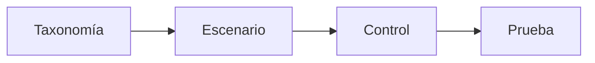
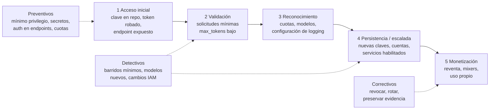

# Clase 295 — OWASP Top 10 para aplicaciones con LLM

> Parte: **15 — Seguridad de IA y machine learning** · Fuente: *OWASP Top 10 for Large Language Model Applications (OWASP Foundation)*
> ⏱️ Duración estimada: **150 min** · Nivel: **Intermedio**

---

## 🎯 Objetivo

Dominar la taxonomía OWASP Top 10 para aplicaciones con LLM como marco de referencia para auditar y asegurar sistemas basados en modelos de lenguaje. El alumno aprenderá a identificar cada riesgo en una arquitectura real, mapearlo a controles y construir una checklist de auditoría reutilizable.

## 📚 Resultados de aprendizaje

Al finalizar, el alumno podrá:

1. **Enumerar** y explicar los 10 riesgos del OWASP Top 10 para LLM.
2. **Identificar** cada riesgo en un diagrama de arquitectura de una app con LLM.
3. **Asociar** cada riesgo con controles de mitigación concretos.
4. **Priorizar** riesgos según el contexto (chatbot, RAG, agente con herramientas).
5. **Construir** una checklist de auditoría OWASP-LLM aplicable a un proyecto.
6. **Distinguir** el LLMjacking de la prompt injection, la extracción de modelos y el cryptojacking, y describir su cadena de intrusión con la evidencia pública disponible.
7. **Clasificar** controles contra el abuso de recursos de IA en preventivos, detectivos, correctivos y compensatorios, y explicar por qué una alerta de presupuesto no limita el gasto.
8. **Medir** un detector de anomalías de consumo (precisión, recall, falsos positivos, latencia) sobre datos sintéticos y declarar sus límites.

## 🗺️ Temas

| # | Tema | Por qué importa |
|---|------|-----------------|
| 1 | LLM01 Prompt Injection | El riesgo estrella; entrada no confiable como instrucción |
| 2 | LLM02 Insecure Output Handling | Salidas del LLM tratadas sin sanear (XSS, SSRF, RCE) |
| 3 | LLM03/04 Poisoning y DoS | Envenenamiento de datos y consumo desbordado de recursos |
| 4 | LLM05 Supply Chain | Modelos, plugins y datasets de terceros |
| 5 | LLM06 Sensitive Info Disclosure | Fuga de datos de entrenamiento o del contexto |
| 6 | LLM07/08 Plugins y Excessive Agency | Herramientas inseguras y permisos excesivos del agente |
| 7 | LLM09/10 Overreliance y Model Theft | Confiar ciegamente y robo del modelo |
| 8 | Ediciones 2023 y 2025 del Top 10 | Los identificadores cambian; un informe debe citar la edición |
| 9 | LLM10:2025 Unbounded Consumption y *Denial of Wallet* | El consumo sin límite es un riesgo económico además de técnico |
| 10 | LLMjacking: definición, historia y diferencias con riesgos vecinos | Evitar confundir abuso de cómputo con injection, extracción o cryptojacking |
| 11 | Anatomía de la intrusión: acceso, validación, reconocimiento, persistencia, monetización | Cada fase ofrece un punto de control distinto |
| 12 | Controles preventivos, detectivos, correctivos y compensatorios | Ninguno basta solo; la posición en la cadena fija el coste |
| 13 | Alertas de presupuesto frente a límites de gasto | Una alerta informa; un límite en línea detiene |
| 14 | Detección explicable y diferencia entre anomalía y atribución | Evita acusar y evita ignorar |

## 🧠 Explicación en profundidad

OWASP Top 10 para LLM organiza riesgos de aplicaciones; no certifica modelos ni sustituye threat modeling. Cada categoría debe mapearse a activos, fronteras, pruebas y evidencia del sistema concreto.

El diagrama debe leerse como una cadena de supuestos: verificar un nodo no demuestra los siguientes. La evaluación declara actor, acceso, datos, métrica, umbral y consecuencia; compara una línea base y conserva fallos, no solo promedios.

### Caso razonado

El equipo marca diez categorías como completas, pero un agente tiene herramienta de borrado sin aprobación. El escenario revela la brecha que el checklist ocultó.

### Una nota sobre la edición del Top 10

Esta clase conserva la numeración de la edición 2023 en la tabla y las definiciones porque las clases 296 y 297 se apoyan en ella, pero la edición vigente es **OWASP Top 10 for LLM Applications 2025**, que reordena y renombra varias categorías. La tabla siguiente evita confundirlas; los identificadores 2025 están tomados de la [página oficial de la lista](https://genai.owasp.org/llm-top-10/).

| Riesgo | Numeración 2023 (usada en el resto de la clase) | Numeración 2025 |
|---|---|---|
| Prompt injection | LLM01 | LLM01:2025 Prompt Injection |
| Divulgación de información sensible | LLM06 | LLM02:2025 Sensitive Information Disclosure |
| Manejo de la salida | LLM02 Insecure Output Handling | LLM05:2025 Improper Output Handling |
| Agencia excesiva | LLM08 Excessive Agency | LLM06:2025 Excessive Agency |
| Consumo de recursos | LLM04 Model Denial of Service | **LLM10:2025 Unbounded Consumption** |

El cambio que importa para esta sección es el último: la edición 2025 deja de hablar solo de «denegación de servicio del modelo» y nombra **consumo no acotado**, categoría que, según su propia ficha, incluye denegación de servicio, **pérdidas económicas**, robo de modelo y degradación del servicio, y cita expresamente el escenario de *Denial of Wallet* (un atacante genera tantas operaciones que el modelo de pago por uso se vuelve insostenible para la víctima). El *robo de modelo* de la numeración 2023 (LLM10) se estudia en la clase 294; en 2025 aparece como una de las consecuencias del consumo no acotado, no como categoría separada. Si citas el Top 10 en un informe, escribe siempre la edición.

### LLMjacking: cuando la capacidad de inferencia es el botín

**Qué es y qué no es.** *LLMjacking* es el uso no autorizado de modelos de lenguaje ajenos, normalmente mediante credenciales robadas o endpoints expuestos, de modo que **otra persona paga el consumo**. El término lo acuñó Sysdig en 2024 al observar una intrusión que usaba credenciales cloud robadas para llegar a servicios de modelos; en 2026 Google Threat Intelligence Group (GTIG) lo describe como una táctica de monetización con picos de cargos fraudulentos que pueden alcanzar, según su análisis, más de 100 000 USD en un día en algunos incidentes. Conviene separarlo de cuatro conceptos vecinos, porque cada uno se defiende de forma distinta:

| Concepto | Qué ataca | Qué obtiene el atacante | Relación con LLMjacking |
|---|---|---|---|
| **Prompt injection** (clase 296) | el comportamiento del modelo, vía texto | que el modelo haga lo que no debe | distinto: no necesita credenciales; aquí el atacante ya tiene acceso legítimo-aparente al modelo |
| **Extracción de modelo** (clase 294) | la funcionalidad aprendida | una copia o sustituto del modelo | distinto: el objetivo es el modelo; en LLMjacking es la *capacidad de cómputo* |
| **Cryptojacking** | cómputo genérico (CPU/GPU) | criptomoneda | análogo en el modelo económico; GTIG señala que el cryptojacking suele consumir de forma gradual y el LLMjacking puede generar cargos enormes en horas |
| **Secuestro de sesión / robo de token** | una identidad autenticada | acceso a lo que esa identidad puede hacer | es un **vector de entrada**, no el objetivo final |

**Por qué existe: dos significados de «token».** En este tema la palabra *token* designa dos cosas que se confunden con facilidad. Un **token de autenticación** (clave de API, token de sesión, token OAuth, credencial temporal) es un secreto portador: quien lo posee es tratado como la identidad que lo emitió. Un **token de inferencia** es la unidad de texto que el modelo lee o produce y que el proveedor factura. LLMjacking es la combinación: el primero abre la puerta y el segundo es lo que se cobra. Como la mayoría de las APIs de modelos se factura por token de entrada y de salida, el coste de cada solicitud es

`coste = tokens_entrada × precio_entrada + tokens_salida × precio_salida`

y crece linealmente con el número de solicitudes y con la longitud de la respuesta. Por eso el atacante que busca daño económico (o capacidad que revender) maximiza tres cosas: el **modelo más caro** al que su credencial le deja llegar, la **longitud de salida** y el **paralelismo**. En el laboratorio de esta clase, 20 solicitudes por minuto con 3 000 tokens de entrada y 2 000 de salida sobre un modelo ficticio caro cuestan unos 39 USD ficticios cada 10 minutos: nada en cada solicitud parece raro, y el total solo se ve al agregarlo.

**Anatomía de una intrusión.** Lo siguiente es un modelo pedagógico construido a partir de los informes públicos; no todos los actores siguen todas las fases ni en este orden. Cada hecho indica su fuente; lo marcado como *hipótesis* o *simulación* no está documentado como observado.

Léelo de izquierda a derecha como una cadena donde cada fase *depende* de la anterior, y las flechas punteadas como los lugares donde un control corta la cadena. Un preventivo en la fase 1 (la clave no está en el repositorio, o está limitada a un modelo) hace innecesarios todos los demás; un detectivo en la fase 2 es barato porque el atacante todavía no ha gastado nada; un correctivo en la fase 5 solo limita el daño que ya se está produciendo. La posición del control determina cuánto cuesta el incidente.

1. **Acceso inicial.** Documentado: GTIG indica que la vía predominante son tokens de identidad cloud robados o expuestos (credenciales IAM, claves de cuentas de servicio, tokens personales de GitHub y tokens de sesión), claves de API de LLM extraídas de repositorios públicos y endpoints de LLM expuestos, como servidores Ollama accesibles desde Internet. En el caso original de Sysdig (2024) el acceso se obtuvo explotando una versión vulnerable de Laravel (CVE-2021-3129) y robando credenciales cloud del sistema comprometido: no hubo «magia de IA», hubo una vulnerabilidad web corriente.
2. **Validación.** Documentado: antes de usar el acceso, el atacante comprueba que funciona. Sysdig observó invocaciones con un parámetro de longitud inválido (`max_tokens_to_sample` con valor −1) cuya respuesta, un error de validación y no un error de acceso denegado, **confirma que la credencial es válida y el servicio está activo sin generar texto facturable**. GTIG describe barridos con `max_tokens=1`. Son técnicas distintas con la misma lógica: obtener un «sí» con coste casi nulo y por debajo de los umbrales de volumen.
3. **Reconocimiento.** Documentado: Sysdig vio consultas a la configuración de registro de invocaciones (`GetModelInvocationLoggingConfiguration`), probablemente para saber si sus prompts quedarían registrados. Que lo consultaran es un hecho; que fuera para evadir detección es la interpretación de los autores.
4. **Persistencia y escalada.** Documentado por GTIG: creación de cuentas IAM o de servicio no autorizadas, inyección de claves SSH en instancias, habilitación de servicios de LLM, creación de claves adicionales y explotación de una vulnerabilidad de escalada en el gateway LiteLLM (CVE-2026-40217). También la técnica «burn and rotate»: crear y borrar cuentas de servicio de vida corta para esquivar límites de tasa.
5. **Monetización.** Documentado por GTIG: los *LLM Mixers* son intermediarios que agrupan claves robadas, balancean la carga y ocultan el origen de las solicitudes para revender acceso. GTIG cita herramientas como `new-api` y `gcli2api` y el caso *Jet Night*, con más de 500 000 llamadas a la API en menos de ocho horas y cerca de un millón de USD en costes trasladados a la víctima; su plan «ilimitado» de unos 60 USD al mes, muy por debajo de precios de mercado, es para GTIG un **indicio** (no una prueba) de que depende de claves robadas.

**Más allá de la reventa (documentado, con límites).** En junio de 2026 Sysdig describió un servidor Ollama mal configurado usado como «motor de razonamiento» de una herramienta ofensiva automatizada: el actor no chateaba ni revendía, sino que usaba el modelo para cada decisión de una herramienta que escanea, relaciona servicios con vulnerabilidades y redacta pruebas de concepto. Sysdig reporta que solo se vieron redes privadas y entornos de práctica del propio actor, y que la intención final es incierta. La Cloud Security Alliance interpreta el caso como un cambio de «desvío de costes» a «primitiva de ataque»; es una lectura analítica, no un hecho medido. Ollama escucha por defecto en `127.0.0.1:11434`, y su FAQ oficial explica cómo cambiar la dirección con `OLLAMA_HOST` (con ejemplos como `0.0.0.0:11434`) sin describir autenticación integrada; de ahí que la recomendación sea poner autenticación en un proxy o en la red. Sysdig cita investigadores que catalogaron unas 175 000 instancias expuestas: es una cifra de terceros que no hemos podido reproducir.

**Daño económico: tres cifras y cómo leerlas.** Sysdig calculó en 2024 hasta unos 46 000 USD diarios en el peor caso (cuotas agotadas en cuatro regiones con un modelo concreto): es una **estimación**, no una factura. GTIG habla de cargos superiores a 100 000 USD en un día y acumulados de hasta un millón en algunas organizaciones: son resultados de sus casos, no un promedio ni una predicción. Hay además un daño que no es dinero: Sysdig advierte de que el ataque puede **agotar la cuota y bloquear el uso legítimo** del modelo, es decir, una denegación de servicio como efecto secundario.

**Responsabilidad compartida.** El proveedor protege la plataforma, la disponibilidad del servicio y las capacidades de control que ofrece; el cliente es responsable de las **identidades, las claves, la configuración de permisos, los límites de consumo y los registros**. Nada de lo anterior es una vulnerabilidad del proveedor: es un fallo de gestión de credenciales y de exposición, y por eso las defensas están casi todas del lado del cliente. No asumas que un registro de invocaciones está activado: en la intrusión de Sysdig el atacante lo consultó precisamente porque puede estar apagado. Compruébalo en tu cuenta.

### Controles: qué hace cada uno y por qué no basta uno solo

| Control | Tipo | Qué corta | Límite |
|---|---|---|---|
| No guardar secretos en el código; *secret scanning* y *pre-commit* (clase 241) | preventivo | fase 1 | un escáner solo ve formatos que conoce y repositorios que le dejas ver |
| Identidades de corta duración y MFA resistente a phishing | preventivo | fase 1 | un token temporal robado vale hasta que expira |
| Mínimo privilegio: denegar por defecto el acceso a modelos y limitar por modelo y entorno | preventivo | fases 3–5 | exige inventario de qué identidades necesitan qué modelos |
| Autenticación y aislamiento de endpoints de inferencia (proxy autenticado, segmentación, egreso restringido) | preventivo | fase 1 | un proxy mal configurado reabre el acceso directo |
| Cuotas, límites de tasa, de concurrencia, de tokens y de gasto en el *gateway* | preventivo / compensatorio | fase 5 | tienen coste colateral: pueden bloquear tráfico legítimo |
| Registro de invocaciones y de auditoría de IAM | detectivo (habilita el resto) | todas | sin registro no hay detección ni forense |
| Alertas de comportamiento: barridos mínimos, modelos nuevos, cambios de permisos, orígenes nuevos | detectivo | fases 2–4 | generan falsos positivos y exigen línea base |
| Alerta de presupuesto | detectivo | fase 5 | llega tarde (ver abajo) |
| Revocar, rotar, quitar permisos añadidos, preservar evidencia | correctivo | fase 5 | actúa después del daño |
| Presupuesto con acción automática que niega la creación de recursos | compensatorio | fase 5 | solo cubre lo que la acción realmente niega |

**Por qué una alerta de presupuesto no es un límite de gasto.** Son dos cosas distintas y la confusión es cara. La documentación de AWS Budgets indica que sus datos se **actualizan hasta tres veces al día**, normalmente con 8–12 horas entre actualizaciones, y advierte de que puede haber un retraso entre el cargo y la notificación, de modo que el gasto puede superar el umbral antes de que te avisen. Una intrusión como la del laboratorio causa su daño en horas: cuando la alerta llega, ya pasó. Además una *alerta* informa; solo una *acción* (por ejemplo, aplicar automáticamente una política que niegue nuevas operaciones, que AWS documenta como posible acción de presupuesto) o un **límite aplicado en línea** (cuota del servicio, límite del gateway) detiene el consumo. La clase 232 plantea el mismo problema para funciones serverless (*denial-of-wallet*, cuotas y concurrencia); aquí se aplica a la inferencia. Otros proveedores tienen sus propios mecanismos y latencias: consulta su documentación actual en lugar de extrapolar. El laboratorio mide esta diferencia con un retraso de 8 h que es un *supuesto de simulación* y te deja cambiarlo.

**Detección con criterio.** Las señales útiles son contextuales y se combinan: desviación del consumo respecto de la línea base propia, identidades o modelos nuevos, actividad fuera del horario habitual, cambios recientes de permisos, solicitudes repetitivas de coste mínimo (el barrido), concurrencia inusual y variaciones en el origen. Una medida robusta de desviación es el **z robusto**, `z = (x − mediana) / max(σ, 0,1·mediana)` con `σ = 1,4826·MAD`; se usa mediana y MAD porque un valor extremo distorsiona la media y la desviación estándar justo cuando más importa detectarlo. Ninguna señal debería bastar sola: la geolocalización, por ejemplo, **nunca es evidencia única**, porque una VPN, un viaje o un proveedor cloud nuevo la disparan y un atacante puede operar desde el mismo país. Y recuerda la diferencia que separa una buena guardia de una mala: **una alerta señala una anomalía, no atribuye un ataque**. La atribución exige correlar identidad, origen, API invocada y facturación, y a veces la respuesta es un lote legítimo que nadie avisó. El laboratorio incluye uno (escenario S8) para que midas qué ocurre cuando lo ignoras.

**Mapeo a marcos (interpretativo).** El mapeo a OWASP está verificado: LLMjacking como *consecuencia* encaja en LLM10:2025 Unbounded Consumption (su ficha cita pérdidas económicas y *Denial of Wallet*), y el uso de un agente con credenciales para gastar encaja con LLM06:2025 Excessive Agency. No se asignan aquí identificadores de técnicas de MITRE ATLAS porque no se pudieron verificar en la matriz durante esta revisión; si los asignas, documenta tu mapeo como **interpretativo** y cita la versión de ATLAS. En NIST AI RMF, el inventario de claves y modelos pertenece a *Map*, las métricas de consumo y detección a *Measure* y la respuesta a *Manage*; es una lectura pedagógica del marco, no una exigencia suya.

### Caso razonado: dos finales para la misma clave

Una clave de servicio queda publicada en un repositorio. **Final A:** el escáner de secretos del pipeline la marca en minutos; se revoca antes de que nadie la use; coste: cero. **Final B:** nadie la ve; un barrido de validación con `max_tokens=1` pasa desapercibido porque cuesta céntimos; luego llega el consumo masivo con el modelo más caro; la alerta de presupuesto llega ocho horas después. La diferencia entre A y B no es el atacante: es en qué fase actuó un control. En la práctica de esta clase reproduces B y mides cuánto habría cambiado cada control (laboratorio [`llmjacking-defense`](../../../labs/llmjacking-defense/README.md)).

## 📔 Glosario operativo

| Término | Definición |
|---|---|
| Taxonomía | Lenguaje común de riesgos, no veredicto. |
| Evaluación | Experimento reproducible ligado a un riesgo y criterio. |
| Riesgo residual | Exposición que permanece tras controles. |
| LLMjacking | Uso no autorizado de modelos de lenguaje ajenos, normalmente con credenciales robadas o endpoints expuestos, de modo que otro asume el coste. |
| Token de autenticación | Secreto portador (clave de API, sesión, OAuth) que identifica a quien lo presenta. |
| Token de inferencia | Unidad de texto que el modelo procesa y que el proveedor factura. |
| Denial of Wallet | Consumo masivo de un servicio de pago por uso para volver insostenible su coste. |
| LLM Mixer | Intermediario que agrupa claves robadas y revende acceso ocultando el origen (término de GTIG). |
| Z robusto | Desviación respecto de la mediana medida en unidades de σ = 1,4826·MAD; resiste valores extremos. |
| Control compensatorio | Medida alternativa que reduce un riesgo cuando el control ideal no es viable. |

## ✅ Criterio de dominio

El alumno demuestra dominio cuando formula un escenario específico, reproduce evidencia, explica límites y diseña controles técnicos y de gobierno sin atribuir certeza al modelo.

## 📖 Definiciones y características

- **LLM01 – Prompt Injection:** entradas (directas o indirectas, vía documentos) que reprograman el comportamiento del modelo. *Característica:* la causa raíz es que datos e instrucciones comparten el mismo canal.
- **LLM02 – Insecure Output Handling:** confiar en la salida del LLM sin validarla antes de renderizarla o ejecutarla. *Característica:* deriva en XSS, SSRF, path traversal o RCE aguas abajo.
- **LLM04 – Model Denial of Service:** entradas que fuerzan consumo excesivo (contextos enormes, bucles). *Característica:* impacta coste y disponibilidad.
- **LLM06 – Sensitive Information Disclosure:** el modelo revela secretos del prompt del sistema, datos de otros usuarios o del entrenamiento. *Característica:* agravado por memorización.
- **LLM08 – Excessive Agency:** el sistema concede al LLM demasiada capacidad de acción (permisos, herramientas, autonomía). *Característica:* un prompt malicioso se convierte en acciones reales.
- **LLM09 – Overreliance:** usuarios o sistemas confían en salidas sin verificar (alucinaciones). *Característica:* riesgo operacional y legal.
- **LLM10 – Model Theft:** exfiltración del modelo propietario (ver clase 294).
- **LLM10:2025 – Unbounded Consumption:** permite inferencias excesivas y sin control, con consecuencias de denegación de servicio, pérdidas económicas, robo de modelo y degradación. *Característica:* es la categoría bajo la que se estudia aquí el abuso de recursos de IA.
- **LLMjacking:** abuso de acceso a modelos ajenos (clave, sesión, endpoint) para consumir o revender inferencia. *Característica:* puede ocurrir sin ninguna vulnerabilidad del modelo; basta una credencial y una factura que paga otro.
- **Control preventivo / detectivo / correctivo / compensatorio:** impide, descubre, repara o suple a otro control que no puede aplicarse. *Característica:* un mismo control (p. ej. una cuota) puede cumplir dos papeles, y por eso se declara el que cumple en cada escenario.

> Nota: la lista OWASP para LLM se actualiza por versiones (2023, 2025); usa la más reciente y verifica los IDs vigentes.

## 🧰 Herramientas y preparación

- Documento oficial **OWASP Top 10 for LLM Applications** (última versión) y sus fichas por riesgo.
- Una app con LLM de ejemplo para auditar (chatbot de soporte con RAG, o un agente con herramientas).
- **garak** y **PyRIT** (clases 296–297) para pruebas prácticas de algunos riesgos.
- Plantilla de checklist en hoja de cálculo o Markdown.
- Para el laboratorio de LLMjacking: Python 3.12 y el directorio [`labs/llmjacking-defense`](../../../labs/llmjacking-defense/README.md) (solo biblioteca estándar; sin red ni claves).

## 🧪 Laboratorio guiado (auditoría aplicada)

Ejercicio de **análisis de arquitectura**, no de explotación.

1. **Elige una app real de referencia.** Ejemplo: "asistente de soporte que consulta una base de conocimiento (RAG) y puede crear tickets vía API".

2. **Dibuja el flujo de datos.** Usuario → prompt → recuperación de documentos → LLM → salida → acciones (crear ticket). Marca cada frontera de confianza.

3. **Recorre el Top 10 riesgo por riesgo.** Para cada uno, responde: ¿aplica a esta app? ¿dónde exactamente? ¿con qué impacto?

4. **Prompt injection (LLM01).** Identifica dónde entra texto no confiable (mensaje del usuario y documentos recuperados). Marca ambos como fuentes de injection directa e indirecta.

5. **Output handling (LLM02).** ¿La respuesta se renderiza en HTML? ¿Se pasa a otra herramienta? Define validación/escape necesarios.

6. **Excessive Agency (LLM08).** Lista las herramientas del agente y sus permisos. Aplica mínimo privilegio: ¿crear ticket necesita aprobación humana?

7. **Sensitive Disclosure (LLM06).** ¿Qué hay en el prompt del sistema? ¿Podría filtrarse? ¿Los documentos recuperados mezclan datos de distintos tenants?

8. **Construye la checklist.** Genera una tabla: Riesgo | ¿Aplica? | Evidencia | Control propuesto | Prioridad. Esta checklist será tu entregable reutilizable.

### Laboratorio B — LLMjacking de extremo a extremo (simulado)

Trabaja en local; el laboratorio no usa red, claves reales ni modelos.

1. Ejecuta `python labs/llmjacking-defense/llmjacking_lab.py run --seed 7 --out labs/llmjacking-defense/salida` y lee `informe.md`.
2. Abre `eventos-ecs.ndjson` y localiza, por escenario, el primer evento malicioso de INC-A. Anota qué lo distingue del tráfico normal **sin usar la IP**.
3. En la tabla de incidentes, compara la exposición bajo cada estrategia. Explica por qué la alerta de presupuesto no ayudó y cuánto retrasa la detección la ventana de 10 minutos.
4. Cambia `retraso_presupuesto_h` a 1 y a 0,25 llamando a `exposicion(...)` desde un intérprete: ¿desde qué retraso empieza a ayudar?
5. Baja `UMBRAL_Z` a 3 y observa qué falsos positivos aparecen. Identifica qué señal los absorbe.
6. Localiza el falso positivo residual de `svc-batch-marketing` y decide si el remedio es el umbral o la revocación.
7. Ejecuta `python -m unittest discover -s labs/llmjacking-defense/tests -v` y `python labs/llmjacking-defense/llmjacking_lab.py robustez --seeds 5`; resume qué demuestran y qué **no** demuestran.
8. Aplica el [playbook](../../../labs/llmjacking-defense/PLAYBOOK-LLMJACKING.md) a INC-A y entrega la línea de tiempo con hechos separados de hipótesis.

## ✍️ Ejercicios

1. Para un chatbot público sin herramientas, prioriza los 3 riesgos más relevantes y justifica.
2. Da un ejemplo concreto de LLM02 que derive en XSS en un frontend.
3. Explica la diferencia entre prompt injection directa e indirecta con un caso.
4. Diseña un control de mínimo privilegio para un agente con acceso a correo.
5. Propón dos mitigaciones para LLM06 en una arquitectura multi-tenant.
6. Mapea tres riesgos del Top 10 a técnicas de MITRE ATLAS.
7. Explica por qué un barrido con `max_tokens=1` puede evitar una alerta de volumen y qué señal alternativa lo detectaría.
8. Una alerta de presupuesto llega 10 horas después de un incidente de 3 horas. Propón dos controles que sí habrían limitado el gasto y el efecto colateral de cada uno.
9. Clasifica en preventivo, detectivo, correctivo o compensatorio: rotar una clave, un límite de gasto por clave, un proxy autenticado delante de Ollama, un registro de invocaciones.
10. Redacta tres hipótesis alternativas (no maliciosas) para un pico de consumo y la evidencia que descartaría cada una.
11. Un compañero afirma «la IP es de otro país, es un ataque». Redacta una respuesta de dos frases que corrija el razonamiento.

## 📝 Reto verificable

Entrega una **auditoría OWASP-LLM** de una aplicación (real o de ejemplo) con un diagrama de arquitectura anotado con fronteras de confianza y una checklist que cubra los 10 riesgos.

**Criterio de aceptación:** cada uno de los 10 riesgos aparece en la checklist con veredicto (aplica/no aplica) justificado, y para cada riesgo aplicable hay al menos un control concreto y una prioridad. Un tercero debe poder usar tu checklist para auditar otra app similar. La checklist cita la edición del Top 10 usada.

**Reto adicional — informe de LLMjacking.** Con los resultados del laboratorio B entrega un informe técnico y un resumen ejecutivo de una página. **Criterio:** el informe separa hechos, inferencias e hipótesis; incluye la tabla de exposición por estrategia con sus supuestos; reporta precisión, recall, falsos positivos y latencia con sus límites; explica el coste colateral de un tope duro; y no atribuye el incidente a un actor.

## ⚠️ Errores comunes

| Síntoma / mensaje | Causa y cómo arreglar |
|-------------------|-----------------------|
| "Solo me preocupa el prompt injection" | Reduce la superficie a un riesgo. Recorre los 10; output handling y agency son igual de graves. |
| Confundir LLM01 y LLM02 | Injection es la entrada; output handling es qué haces con la salida. Son controles distintos. |
| Ignorar la injection indirecta | Solo se filtra la entrada del usuario, no los documentos RAG. Trata todo contenido recuperado como no confiable. |
| Dar al agente todos los permisos | Excessive Agency. Aplica mínimo privilegio y human-in-the-loop para acciones sensibles. |
| Usar una versión desactualizada del Top 10 | Los IDs cambian entre 2023 y 2025. Cita la versión y verifica los códigos. |
| Tratar la alerta de presupuesto como límite de gasto | Informa con retraso; no detiene nada. Añade cuotas y límites en línea, y acciones automáticas. |
| Declarar «ataque» por la IP de origen | La geolocalización sola da falsos positivos y negativos. Correlaciona identidad, API, modelo, permisos y facturación. |
| Validar una clave encontrada «para ver si es real» | Es acceso no autorizado. Repórtala al propietario o revócala si es tuya. |
| Confundir LLMjacking con prompt injection | Uno abusa del acceso; el otro del comportamiento del modelo. Los controles son distintos. |
| Ajustar umbrales hasta que el laboratorio salga perfecto | Sobreajuste al generador. Repite con otras semillas y declara el límite. |

## ❓ Preguntas frecuentes

**❓ ¿El OWASP Top 10 para LLM reemplaza al Top 10 web clásico?**
No. Lo complementa. Una app con LLM sigue siendo una app web con sus riesgos habituales; el Top 10 LLM añade los específicos del modelo.

**❓ ¿Cuál es el riesgo más frecuente en la práctica?**
Prompt injection (LLM01) y mal manejo de salida (LLM02) dominan los hallazgos reales, sobre todo cuando el LLM alimenta otras acciones o se renderiza sin escape.

**❓ ¿Cómo priorizo si tengo recursos limitados?**
Por impacto en tu arquitectura: si el LLM ejecuta acciones (agente), prioriza Excessive Agency e injection; si es solo conversacional, output handling y disclosure.

**❓ ¿El LLMjacking es una vulnerabilidad de los proveedores de modelos?**
Los informes públicos describen robo o exposición de credenciales y servidores mal configurados, no fallos de los modelos. Por eso la defensa descansa en la gestión de identidades, secretos, endpoints, cuotas y registros del cliente.

**❓ ¿Cuánto cuesta un incidente típico?**
No existe un «típico»: las cifras públicas (unos 46 000 USD/día como estimación de peor caso en 2024; más de 100 000 USD en un día y hasta un millón acumulado según GTIG) son resultados concretos o estimaciones, no promedios.

**❓ ¿Puedo usar IA para detectar LLMjacking?**
Puedes, pero no la necesitas para empezar: señales estadísticas sencillas y explicables, con línea base, cubren los patrones documentados. Añade complejidad solo si la mides mejor.

**❓ ¿Sirve para cumplimiento?**
Es un marco técnico, no una norma. Combínalo con NIST AI RMF e ISO/IEC 42001 (clase 300) para el marco de gobernanza y auditoría formal.

## 🔗 Referencias

- OWASP Top 10 for LLM Applications — <https://genai.owasp.org/llm-top-10/>
- OWASP LLM Applications Cybersecurity and Governance Checklist — <https://genai.owasp.org/>
- MITRE ATLAS — <https://atlas.mitre.org/>
- NIST AI 600-1, Generative AI Profile — <https://www.nist.gov/itl/ai-risk-management-framework>
- OWASP Foundation — <https://owasp.org/>
- OWASP, LLM10:2025 Unbounded Consumption (definición, *Denial of Wallet* y mitigaciones) — <https://genai.owasp.org/llmrisk/llm102025-unbounded-consumption/>
- Sysdig Threat Research Team, «LLMjacking: Stolen Cloud Credentials Used in New AI Attack» (6 de mayo de 2024: acceso inicial, validación, reconocimiento de logging y estimación de coste) — <https://www.sysdig.com/blog/llmjacking-stolen-cloud-credentials-used-in-new-ai-attack>
- Sysdig Threat Research Team, «LLMjacking evolved» (17 de junio de 2026: Ollama expuesto como motor de una herramienta ofensiva) — <https://www.sysdig.com/blog/llmjacking-evolved-attackers-are-using-stolen-ai-compute-to-build-offensive-agentic-tools>
- Google Threat Intelligence Group, «The Rise of LLMJacking» (2 de noviembre de 2026: vectores, LLM Mixers, cifras y recomendaciones) — <https://cloud.google.com/blog/topics/threat-intelligence/llmjacking-monetizing-compromised-cloud-models/>
- Cloud Security Alliance AI Safety Initiative, «LLMjacking Evolves» (18 de junio de 2026: interpretación y recomendaciones) — <https://labs.cloudsecurityalliance.org/research/csa-research-note-llmjacking-offensive-ai-tooling-20260618-c/>
- Ollama, FAQ (dirección de escucha por defecto y `OLLAMA_HOST`) — <https://docs.ollama.com/faq>
- AWS, «Managing your costs with AWS Budgets» (frecuencia de actualización y retraso de notificaciones) — <https://docs.aws.amazon.com/cost-management/latest/userguide/budgets-managing-costs.html>
- Chema Alonso, «LLMJacking: cómo los cibercriminales…» (9 de noviembre de 2026; divulgación, fuente secundaria) — <https://www.elladodelmal.com/2026/11/llmjacking-como-los-cibercriminales.html>
- Laboratorio local [`llmjacking-defense`](../../../labs/llmjacking-defense/README.md) — datos sintéticos propios del programa (no son evidencia de incidentes reales).

## 📥 Material descargable

- 📄 [Guía en PDF](./clase-295-guia.pdf) — versión imprimible de esta clase.
- 🎞️ [Presentación (PPTX)](./clase-295-presentacion.pptx) — deck para proyectar en clase.

## ⬅️ Clase anterior

[Clase 294 — Robo y extracción de modelos](../294-robo-y-extraccion-de-modelos/README.md)

## ➡️ Siguiente clase

[Clase 296 — Prompt injection y jailbreaks](../296-prompt-injection-y-jailbreaks/README.md)
