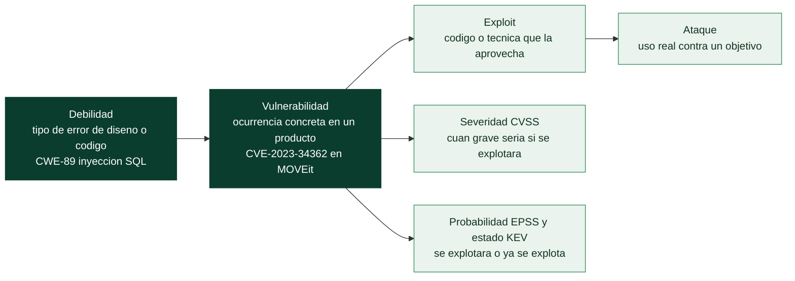
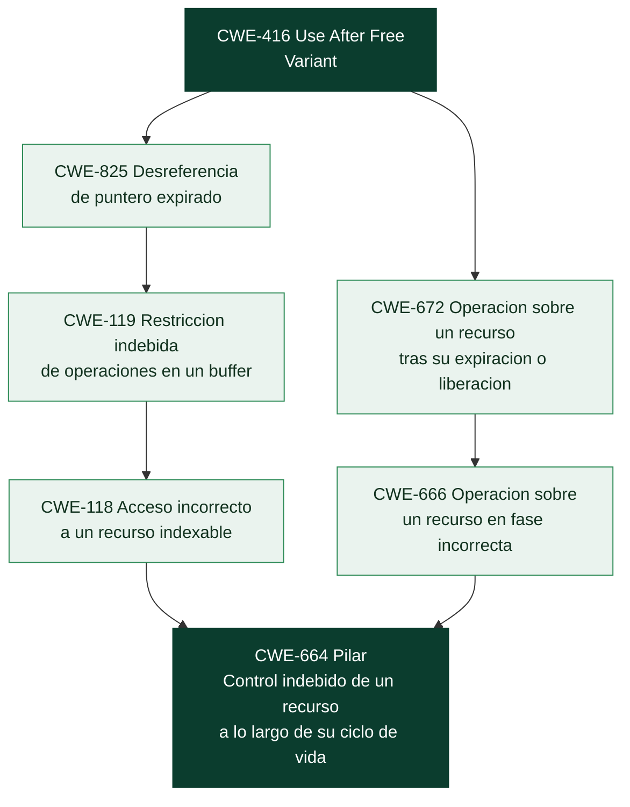

# Clase 361 — CWE: qué es, quién lo mantiene y cómo está construido

> Parte: **20 — Debilidades y vulnerabilidades: CWE, CVE, CVSS y su gestión** · Fuente: *MITRE CWE (lista 5.0, publicada el 2026-10-28)* y glosario oficial de CWE
> ⏱️ Duración estimada: **110 min** · Nivel: **Intermedio**

---

## 🎯 Objetivo

Entender qué es la *Common Weakness Enumeration* (CWE), de dónde viene, quién la mantiene y, sobre todo, **cómo está construida por dentro**: qué tipos de entrada existen (debilidad, agrupación, vista), qué significan los niveles de abstracción (*Pillar*, *Class*, *Base*, *Variant*), por qué una misma debilidad aparece en varios sitios del catálogo y cómo se lee una ficha completa. La meta práctica es que dejes de usar CWE como una lista de números que se copia de un escáner y empieces a usarla como lo que es: un **vocabulario común y estructurado** para nombrar la causa de los fallos de seguridad.

> ⚠️ **Ética:** esta clase es de análisis y consulta; no incluye explotación. Los ejemplos de vulnerabilidades reales se usan para clasificar, no para atacar.

## 📚 Resultados de aprendizaje

Al finalizar, el alumno podrá:

1. **Explicar** la diferencia entre debilidad, vulnerabilidad, exploit y ataque, y situar CWE respecto a CVE, CVSS, CAPEC y ATT&CK.
2. **Describir** la historia y la gobernanza de CWE con fuentes oficiales, sin atribuirle más de lo que dice MITRE.
3. **Distinguir** debilidad, agrupación (antes *Category*) y vista, y los cuatro niveles de abstracción más los compuestos.
4. **Leer** una ficha CWE completa e interpretar sus campos (descripción, relaciones, consecuencias, mitigaciones, detección, ejemplos observados, uso para mapear).
5. **Navegar** la jerarquía de una debilidad hasta su raíz y explicar por qué puede tener varios caminos.
6. **Consultar** el catálogo sin conexión con la herramienta local del programa y reproducir las cifras de esta clase.

## 🗺️ Temas

| # | Tema | Por qué importa |
| --- | --- | --- |
| 1 | Debilidad frente a vulnerabilidad | Es la distinción que ordena todo lo demás |
| 2 | Historia y gobernanza de CWE | Saber de dónde sale el dato permite juzgar cuánto fiarse |
| 3 | Tipos de entrada: debilidad, agrupación y vista | No todo lo que tiene un identificador CWE es una debilidad |
| 4 | Niveles de abstracción y compuestos | Decide qué entrada es útil para clasificar |
| 5 | Identificadores, nombres y estado de madurez | Un número estable no significa un contenido terminado |
| 6 | Anatomía de una ficha | De la ficha salen causa, consecuencia, detección y corrección |
| 7 | Las vistas: cada una responde una pregunta | Elegir la vista correcta ahorra horas de búsqueda |
| 8 | La base de conocimiento local del programa | Consulta reproducible y sin conexión |

## 🧱 Prerrequisitos

No necesitas haber explotado nada. Sí conviene tener claros estos conceptos, que aquí se repasan en una línea cada uno:

- **Tríada CIA** (clase 001): confidencialidad, integridad y disponibilidad. CWE describe las *consecuencias* de una debilidad en estos términos.
- **Entrada no confiable** (clases 087 y 115): un dato que llega de fuera de la frontera de confianza del programa. Muchas debilidades nacen de tratarlo como si fuera de fiar.
- **Identificador estable**: un código (como `CWE-89`) que no cambia aunque el texto de la ficha se reescriba. Sirve para referirse a algo sin ambigüedad entre herramientas y personas.
- **Jerarquía**: relación de padre e hijo. Aquí el padre es más abstracto (describe una familia de fallos) y el hijo más concreto (describe un caso). Es como «mamífero → perro → labrador»: cada nivel añade detalle.
- **Python básico** (clase 015): para el laboratorio, leer un archivo JSON y contar elementos. No hace falta nada más.

## 🧠 Explicación en profundidad

### El problema que CWE resuelve: hablar de lo mismo con las mismas palabras

Imagina tres informes sobre el mismo fallo. El primero dice «inyección SQL en el formulario de login». El segundo, «falta de validación de entrada en el parámetro `user`». El tercero, «el servidor concatena datos del usuario en una consulta». Los tres describen el mismo defecto, pero ninguno se puede cruzar con los otros de forma automática, ni sumar a una estadística, ni asociar a un curso de formación o a una regla de un analizador de código. El vocabulario libre es expresivo pero **no es comparable**.

CWE existe para cerrar esa brecha. Es, según su propia definición, «una lista desarrollada por la comunidad de debilidades comunes de software y hardware». Y define así *debilidad*: **una condición en un componente de software, firmware, hardware o servicio que, bajo ciertas circunstancias, podría contribuir a que se introduzcan vulnerabilidades**. Fíjate en la prudencia de esa frase: una debilidad *podría contribuir*; todavía no es un agujero explotable. Es el tipo de error que cometió quien diseñó o escribió el componente.

### Debilidad, vulnerabilidad, exploit y ataque: cuatro cosas distintas

El programa de CVE define *vulnerabilidad* como **una instancia de una o más debilidades en un producto que puede ser explotada, causando un impacto negativo en la confidencialidad, la integridad o la disponibilidad**. Compara las dos definiciones y verás la relación: la debilidad es el *tipo* de error; la vulnerabilidad es una *ocurrencia concreta* de ese tipo en un producto y versión determinados.

Una analogía ayuda. «Cerradura que se puede abrir con una radiografía» describe un tipo de defecto de diseño de cerraduras (la debilidad). «La cerradura del modelo X-200, fabricada en 2024, tiene ese defecto» es una vulnerabilidad concreta. Que alguien tenga la radiografía y la use para entrar es el *ataque*, y la herramienta o técnica que automatiza la apertura es el *exploit*.



El diagrama se lee de izquierda a derecha como una cadena de concreción creciente. CWE vive en el primer nodo: nombra el *tipo*. CVE vive en el segundo: identifica cada *ocurrencia*. Los nodos de abajo (CVSS, EPSS, KEV) no describen la causa sino cuánto importa esa ocurrencia, y los trataremos en las clases 367 a 369. Mantener separados estos planos evita el error más común del principiante: preguntarle a CWE «¿qué tan grave es?» o a CVSS «¿por qué ocurre?». Ninguno responde esa pregunta.

### De dónde viene CWE, según MITRE

La historia importa porque explica la forma del catálogo. Según la página oficial de historia de CWE, MITRE empezó a trabajar en clasificar debilidades hacia 1999, cuando lanzó la lista CVE: al construirla, su equipo elaboró una clasificación preliminar de vulnerabilidades, ataques y fallos. Esa clasificación bastaba para CVE, pero era demasiado gruesa para la industria de evaluación de código, que necesitaba más detalle y descripciones.

En 2005, dentro del proyecto SAMATE del NIST (financiado por el Departamento de Seguridad Nacional de EE. UU.), MITRE elaboró un documento de trabajo llamado **PLOVER**, con más de 1.500 ejemplos reales de vulnerabilidades identificados por su nombre CVE y organizados en un marco conceptual que enumeraba 290 tipos de debilidades. Fue, dice MITRE, el primer intento realmente *de abajo arriba*: partir de fallos reales observados, abstraerlos y agruparlos en clases más generales. Tras PLOVER, la comunidad definió descripciones aceptables bajo SAMATE, y de ahí salió la **primera versión de CWE en 2006**, que incorporó además estructura de otras fuentes como la taxonomía «Kingdoms» de McGraw y Fortify, los «19 pecados capitales» de Howard, LeBlanc y Viega, y el proyecto CLASP.

Desde entonces el catálogo ha crecido por capas: contenido para aplicaciones móviles en 2014 y debilidades de **hardware** desde 2020. En 2026 el programa CWE cumplió 20 años como esfuerzo público desarrollado por la comunidad. Hoy la lista se actualiza entre tres y cuatro veces al año, y el contenido nuevo se trabaja primero en el *Content Development Repository* público en GitHub. CWE está patrocinado por la agencia CISA del Departamento de Seguridad Nacional y gestionado por el HSSEDI, centro operado por The MITRE Corporation.

Esto tiene una consecuencia práctica que conviene interiorizar desde ya: **CWE es una obra viva y editada por personas**. Entradas que hoy son «Draft» maduran, otras se vuelven obsoletas y la estructura misma cambia (veremos que lo que antes se llamaba *Category* hoy aparece como *Grouping*). Por eso en este programa cada dato lleva versión y fecha de consulta.

### Tres tipos de entrada: debilidad, agrupación y vista

No todo lo que lleva un identificador `CWE-n` es una debilidad. En el catálogo 5.0 hay tres tipos de entrada, y confundirlos es la fuente de muchos errores de clasificación:

**La debilidad** (*Weakness*) es la unidad útil: describe un error, tiene causa, consecuencias, mitigaciones y formas de detectarlo. En el catálogo 5.0 hay **956 debilidades vigentes** (984 si se cuentan 28 obsoletas, que se conservan por trazabilidad). La cifra de 956 coincide con la que publica MITRE en la página de la versión.

**La agrupación** (*Grouping*; en el glosario y en la bibliografía clásica, *Category*) es, según el glosario, «una entrada que contiene un conjunto de otras entradas que comparten una característica común. **No es una debilidad**, sino un elemento estructural que ayuda a encontrar debilidades». Un ejemplo claro: las categorías de la lista OWASP Top 10. «A05:2025 Injection» es una agrupación (`CWE-1440`) que contiene decenas de debilidades; no describe un error concreto. Hay 431 agrupaciones en el catálogo y **todas** llevan la etiqueta «Prohibido para mapear vulnerabilidades reales». La razón es lógica: si una agrupación pudiera asignarse a una vulnerabilidad, se perdería justo la información que queremos (el error exacto).

**La vista** (*View*) es «un subconjunto de entradas CWE que ofrece una forma de examinar el contenido». Puede ser una lista plana (*Slice*) o un grafo con relaciones (*Graph*). Hay 62 vistas en el catálogo 5.0. Una vista no es una debilidad ni agrupa debilidades por un rasgo: es un *punto de vista* sobre el catálogo (por ejemplo, «las 25 más peligrosas de 2025»).

> **Nota de nomenclatura.** El glosario de CWE y la mayoría de los libros dicen *Category*. En el archivo XML del catálogo 5.0 el elemento correspondiente se llama `Grouping`, y las páginas de cada entrada se rotulan «CWE Grouping». Es el mismo concepto con nombre actualizado. Si lees ambos términos, no estás ante dos cosas distintas.

### Niveles de abstracción: cuánto detalle tiene una entrada

Dentro de las debilidades, CWE ordena cada una por su **nivel de abstracción**, que mide cuánta información concreta contiene. El glosario oficial los define así:

- **Pillar** (pilar): el nivel más alto, que «no se puede hacer más abstracto». Son las entradas raíz de la vista de investigación. Describen una idea de error, no dónde ni con qué tecnología. Ejemplo oficial: *Incorrect Calculation* (CWE-682). Hay diez pilares.
- **Class** (clase): muy abstracta, normalmente independiente del lenguaje o la tecnología. Ejemplo oficial: *Uncontrolled Resource Consumption* (CWE-400).
- **Base**: descrita de forma abstracta pero con detalle suficiente para deducir métodos concretos de detección y prevención. Más general que una variante, más específica que una clase. Ejemplo oficial: *Use of Externally-Controlled Format String* (CWE-134).
- **Variant** (variante): ligada a un tipo de producto, típicamente un lenguaje o tecnología concretos. La más específica.

A estos cuatro se suman los **compuestos** (*Compound*): entradas que asocian estrechamente dos o más debilidades. El glosario distingue dos formas. Una **cadena** (*Chain*) es una secuencia en la que una debilidad crea las condiciones para que otra se vuelva explotable; por ejemplo, un desbordamiento de entero (CWE-190) que, al calcular cuánta memoria reservar, desemboca en un desbordamiento de buffer (CWE-120) es la cadena con nombre `CWE-680`. Un **compuesto** (*Composite*) exige que *todas* sus debilidades estén presentes a la vez; quitar una elimina o reduce mucho el riesgo (el ejemplo oficial es el *symlink following*, CWE-61, que solo es posible con una combinación de predictibilidad, permisos inseguros y condiciones de carrera). En el catálogo 5.0 hay siete entradas compuestas, entre ellas **CWE-352 (CSRF)** y **CWE-384 (fijación de sesión)**: dos debilidades que quizá creías «simples» son en realidad combinaciones.

La distribución actual de las 956 debilidades vigentes es: **518 Base, 293 Variant, 128 Class, 10 Pillar y 7 Compound**. La mayoría son Base o Variant, justo los niveles útiles para clasificar. Verás en la clase 362 que MITRE recomienda mapear a Base y Variant siempre que sea posible.

### Una jerarquía real: del fallo concreto al pilar

Los niveles se enlazan por la relación `ChildOf` (hijo de). En la vista de investigación (la 1000) cada debilidad apunta a su padre más abstracto hasta llegar a un pilar. Con la herramienta local puedes ver estos caminos. Para la inyección SQL (`CWE-89`) el camino es:

```text
CWE-89  Inyección SQL (Base)
  └─ ChildOf CWE-943  Neutralización indebida en consultas de datos (Class)
       └─ ChildOf CWE-74  Inyección (Class)
            └─ ChildOf CWE-707  Neutralización indebida (Pillar)
```

La lectura es conceptual: la inyección SQL es un caso de *neutralización indebida de caracteres especiales en consultas de datos*, que a su vez es un caso de *inyección*, que a su vez es una forma de *neutralización indebida* en general. Para un *use-after-free* (`CWE-416`) hay **dos** caminos, porque una debilidad puede tener más de un padre:



El diagrama muestra a `CWE-416` (abajo) subiendo por dos ramas hasta el mismo pilar, `CWE-664`. Una rama lo ve como un problema de **memoria acotada** (119 → 118): se accede a una zona que ya no es válida. La otra lo ve como un problema de **ciclo de vida** (672 → 666): se opera sobre un recurso que ya no existe. Las dos descripciones son ciertas y complementarias. Esta multiplicidad no es un defecto del catálogo; refleja que un mismo error puede explicarse desde ángulos distintos, y es una de las razones por las que la clasificación requiere criterio (clase 362).

### Identificadores, nombres y estado de madurez

El identificador `CWE-n` es **estable**: si MITRE reescribe la ficha, el número se mantiene, de modo que un informe de hace cinco años sigue apuntando a lo mismo. Lo que *no* es estable es el contenido ni su calidad. Cada entrada declara su estado: en las debilidades vigentes, **26 están «Stable», 432 «Draft» y 498 «Incomplete»**. Es una cifra que conviene recordar: solo una de cada treinta y siete debilidades tiene el estado de máxima madurez. «Incomplete» significa que la ficha todavía carece de información; «Draft» que está razonablemente desarrollada pero sin revisión final. No hay que desconfiar de ellas, pero sí tomarlas como contenido en construcción. Una entrada **obsoleta** (*Deprecated*) «no debe usarse más, pero se conserva por trazabilidad histórica»: si un informe antiguo cita una, hay que buscar su sustituta.

Los **nombres** siguen un vocabulario deliberado que conviene aprender a leer, porque te dice el tipo de error antes de abrir la ficha. Los calificadores *Improper* («indebido», 203 entradas), *Missing* («ausente», 38), *Incorrect* («incorrecto», 43) e *Insufficient* («insuficiente», 26) marcan el comportamiento erróneo: *Missing Authorization* significa que la comprobación de autorización no existe; *Incorrect Authorization* que existe pero se hace mal. La diferencia importa para corregir. MITRE también desaconseja ciertos términos: *sanitization* («sanear») tiene «demasiados significados distintos en la industria y puede provocar errores de mapeo», así que el catálogo prefiere *neutralization*, *validation*, *encoding* o *filtering*.

### Anatomía de una ficha: de dónde sale cada respuesta útil

Una ficha completa de debilidad contiene, entre otros, estos campos (los nombres entre paréntesis son los de la herramienta local):

| Campo | Responde a… | Uso práctico |
|---|---|---|
| Descripción y descripción extendida (`descripcion`) | ¿Qué error es exactamente? | Decidir si tu caso encaja |
| Relaciones (`relaciones`) | ¿Cómo se emparenta con otras entradas? | Subir o bajar de nivel, encontrar vecinas |
| Modos de introducción (`introduccion`) | ¿En qué fase del desarrollo aparece? | Saber *dónde* corregirlo (diseño, implementación, operación) |
| Consecuencias comunes (`consecuencias`) | ¿Qué se pierde (CIA) y qué puede hacer el atacante? | Estimar el impacto técnico |
| Métodos de detección (`deteccion`) | ¿Cómo se encuentra y con qué eficacia? | Elegir SAST, DAST o revisión manual |
| Mitigaciones potenciales (`mitigaciones`) | ¿Cómo se corrige o se contiene, y en qué fase? | Diseñar la corrección |
| Ejemplos observados (`ejemplos_observados`) | ¿Qué CVE reales la ilustran? | Aprender de casos y contrastar tu clasificación |
| Uso para mapear (`notas_mapeo`) | ¿Puedo asignarla a una vulnerabilidad real? | Evitar clasificar con entradas inadecuadas |
| Mapeos a otras taxonomías (`taxonomias`) | ¿Cómo se relaciona con OWASP, CERT, etc.? | Cruzar marcos |

El campo **uso para mapear** merece una mención aparte porque es el que más se ignora. Cada debilidad declara una de cuatro etiquetas: *Allowed* (puede usarse para mapear vulnerabilidades reales), *Allowed-with-Review* (con revisión cuidadosa de las notas), *Discouraged* (no debería usarse) y *Prohibited* (no debe usarse). En las 956 debilidades vigentes: **755 son «Allowed», 100 «Allowed-with-Review», 44 «Discouraged» y 57 «Prohibited»**. Es decir, aproximadamente una de cada diez debilidades no es apta para clasificar una vulnerabilidad, aunque su identificador exista. En la clase 362 verás qué hacer con esa información.

### Las vistas: cada una responde una pregunta distinta

Una vista es un punto de vista sobre el mismo catálogo. Las más útiles para este programa son:

| Vista | Qué contiene | Cuándo usarla |
|---|---|---|
| **1000 — Research Concepts** | Todas las debilidades en un árbol profundo con diez pilares en la raíz | Buscar de arriba abajo o entender la jerarquía |
| **699 — Software Development** | Unas 400 debilidades de nivel Base organizadas en unas 40 categorías de conceptos de desarrollo, solo dos niveles de profundidad | Si piensas como programador y no sabes cómo se llama tu error |
| **1003 — Simplified Mapping** | Un subconjunto de unas 130 debilidades que usa habitualmente NVD | Entender qué asigna NVD y por qué hay tan pocos CWE distintos en sus fichas |
| **1400 — Software Assurance Trends** | Todas las debilidades, en 22 categorías de interés para investigación | Estudiar tendencias por familia |
| **1435 — CWE Top 25 (2025)** | Las 25 debilidades más peligrosas de 2025 | Priorizar formación y revisión de código |
| **1194 — Hardware Design** | Unas 100 debilidades de diseño de hardware | Seguridad de hardware (Parte 13) |

Fíjate en un matiz que sorprende: la vista de investigación (1000) y la de Software Assurance (1400) contienen **todas** las debilidades pero organizadas de forma distinta, mientras que la 699 solo recoge un subconjunto. Una debilidad, por tanto, puede aparecer en varias vistas a la vez; en la herramienta local, el campo `vistas` de cada entrada lista a cuáles pertenece. La inyección SQL (`CWE-89`), por ejemplo, forma parte de once vistas, entre ellas el Top 25 de 2025.

## 📖 Definiciones y características

- **Debilidad (*weakness*):** condición en un componente que, bajo ciertas circunstancias, podría contribuir a introducir vulnerabilidades. *Clave:* es un *tipo* de error, no un fallo concreto.
- **Vulnerabilidad:** instancia de una o más debilidades en un producto que puede ser explotada con impacto en confidencialidad, integridad o disponibilidad. *Clave:* tiene producto, versión y, normalmente, un CVE.
- **Agrupación (*Grouping*, antes *Category*):** entrada que contiene otras que comparten una característica. *Clave:* no es una debilidad y está prohibida para mapear.
- **Vista (*View*):** subconjunto de entradas que ofrece un punto de vista (lista plana o grafo). *Clave:* no es una debilidad.
- **Pilar, clase, base, variante:** niveles de abstracción, de más general a más específico. *Clave:* para clasificar se prefieren base y variante.
- **Compuesto (*Compound*):** entrada que asocia varias debilidades, ya sea en secuencia (cadena) o en conjunción (compuesto). *Clave:* CSRF es un compuesto.
- **Entrada obsoleta (*Deprecated*):** entrada que no debe usarse y se conserva por trazabilidad. *Clave:* hay que buscar su sustituta.
- **Uso para mapear (*mapping usage*):** etiqueta (Allowed, Allowed-with-Review, Discouraged, Prohibited) que indica si una entrada sirve para clasificar vulnerabilidades reales.

## 📔 Glosario

| Término | Definición concisa |
|---------|--------------------|
| CWE | Lista comunitaria de tipos de debilidades de software y hardware, mantenida por MITRE |
| Debilidad | Tipo de error que podría contribuir a introducir vulnerabilidades |
| Vulnerabilidad | Ocurrencia concreta de una debilidad en un producto, explotable con impacto en CIA |
| MITRE | Organización sin ánimo de lucro que opera el centro HSSEDI y mantiene CWE y CVE |
| PLOVER | Documento de trabajo de 2005 con más de 1.500 ejemplos reales que precedió a CWE |
| Agrupación | Entrada que agrupa otras por una característica; antes llamada categoría |
| Vista | Punto de vista sobre el catálogo, en forma de lista plana o de grafo |
| Pilar | Nivel de abstracción más alto; raíz de la jerarquía de investigación |
| Clase | Nivel muy abstracto, independiente de lenguaje o tecnología |
| Base | Nivel con detalle suficiente para deducir detección y prevención |
| Variante | Nivel más específico, ligado a un lenguaje o tecnología |
| Compuesto | Entrada que combina varias debilidades, en cadena o en conjunción |
| Cadena | Secuencia donde una debilidad crea las condiciones de la siguiente |
| ChildOf | Relación «es hijo de»: de una entrada concreta a otra más abstracta |
| Estado de madurez | Stable, Draft, Incomplete o Deprecated: cuánto está desarrollada la ficha |
| Uso para mapear | Etiqueta que dice si una entrada sirve para clasificar vulnerabilidades reales |
| Neutralización | Asegurar que una entrada o salida tenga ciertas propiedades antes de usarla |
| Identificador estable | Código CWE-n que no cambia aunque se reescriba la ficha |

## 🧰 Herramientas y preparación

La base de conocimiento local del programa está en `knowledge/cwe/` y se maneja con `scripts/cwe_kb.py`. Solo usa la biblioteca estándar de Python; no necesita claves ni instalar nada. Si trabajas con una copia del repositorio ya preparada, los datos ya están importados. Si no, se importan **una sola vez** (requiere red):

```bash
# Descarga el catálogo oficial de MITRE y lo convierte a JSON local (una vez)
python scripts/cwe_kb.py importar --descargar

# Comprueba qué versión y qué fecha tiene lo importado
python scripts/cwe_kb.py procedencia
```

A partir de ahí todo funciona sin conexión. Los datos están separados en capas: lo original descargado (`original/`, no se versiona por tamaño), lo normalizado (`normalizado/`), el contenido pedagógico propio (`pedagogico/`) y los índices derivados (`indices/`). La licencia de MITRE, que exige reproducir su aviso de copyright, está en `knowledge/cwe/LICENCIA-MITRE.md`.

## 🧪 Laboratorio guiado

> Entorno propio, sin objetivos de terceros. Todo es consulta local.

1. **Verifica la procedencia de lo que vas a usar.** Anota versión, fecha y número de entradas:

   ```bash
   python scripts/cwe_kb.py procedencia
   ```

   Con el catálogo de esta clase verás la versión `5.0`, la fecha `2026-10-28` y `1415` entradas (956 debilidades vigentes, 28 obsoletas y 431 agrupaciones). Si tu catálogo es más reciente, las cifras cambiarán: es normal y es justo lo que registra la procedencia.

2. **Lee una ficha completa** y localiza cada campo de la tabla de anatomía:

   ```bash
   python scripts/cwe_kb.py mostrar CWE-89
   python scripts/cwe_kb.py mitigaciones CWE-89
   ```

3. **Recorre la jerarquía** de dos debilidades y compara cuántos caminos tiene cada una:

   ```bash
   python scripts/cwe_kb.py relaciones CWE-89
   python scripts/cwe_kb.py relaciones CWE-416
   ```

   La primera tiene un camino hasta `CWE-707`; la segunda, dos caminos hasta `CWE-664`.

4. **Comprueba que una agrupación no es una debilidad.** Pide los miembros de la categoría OWASP «Injection» de 2025 y la ficha de la propia agrupación:

   ```bash
   python scripts/cwe_kb.py miembros CWE-1440
   python scripts/cwe_kb.py mostrar CWE-1440
   ```

   Observa en la segunda salida la línea «Uso para mapear vulnerabilidades: Prohibited».

5. **Reproduce las cifras del catálogo** con un script propio. Cada línea está comentada para que entiendas qué hace:

   ```python
   import collections   # contador de ocurrencias
   import json          # lectura de JSON
   from pathlib import Path

   # Cada línea de cwe.jsonl es una entrada del catálogo en formato JSON.
   ruta = Path("knowledge/cwe/normalizado/cwe.jsonl")
   entradas = [json.loads(linea) for linea in ruta.read_text(encoding="utf-8").splitlines()]

   # Nos quedamos con las debilidades (no agrupaciones) que no están obsoletas.
   vigentes = [e for e in entradas if e["tipo"] == "weakness" and e["estado"] != "Deprecated"]

   print(len(vigentes))                                         # cuántas debilidades vigentes
   print(collections.Counter(e["abstraccion"] for e in vigentes))   # por nivel de abstracción
   print(collections.Counter(e["estado"] for e in vigentes))        # por madurez
   print(collections.Counter(e["notas_mapeo"]["uso"] for e in vigentes))  # por uso para mapear
   ```

   Resultado esperado con el catálogo 5.0: `956`; `Base 518, Variant 293, Class 128, Pillar 10, Compound 7`; `Incomplete 498, Draft 432, Stable 26`; `Allowed 755, Allowed-with-Review 100, Discouraged 44, Prohibited 57`.

6. **Busca una debilidad por su nombre en inglés** y por un alias en español, y fíjate en que el catálogo oficial solo está en inglés:

   ```bash
   python scripts/cwe_kb.py buscar "use after free"
   python scripts/cwe_kb.py buscar "inyeccion sql"
   ```

## ✍️ Ejercicios

1. Con tus palabras, explica la diferencia entre *debilidad* y *vulnerabilidad* usando una analogía distinta a la de la cerradura.
2. Clasifica cada identificador como debilidad, agrupación o vista, usando solo la herramienta local: `CWE-79`, `CWE-1345`, `1435`, `CWE-664`, `CWE-1436`. Después explica qué pasa al pedir `mostrar 1344`.
3. Para `CWE-352`, `CWE-190` y `CWE-119`, indica su nivel de abstracción y por qué una de ellas es «sorprendente».
4. Sube por la jerarquía de `CWE-120` (*Buffer Copy without Checking Size of Input*) hasta su pilar. ¿Cuántos pasos hay y qué dice cada uno?
5. Busca tres debilidades «Prohibited» o «Discouraged» entre las del Top 25 de 2025 y explica por qué MITRE las desaconseja.
6. Explica por qué la inyección SQL aparece en once vistas y qué implica eso para quien la busca.
7. Redacta una frase que distinga el *estado* «Draft» del *uso para mapear* «Discouraged»: ¿pueden coincidir en una misma entrada?

## ✅ Soluciones razonadas

1. Una posible analogía: la **debilidad** es «un tipo de bombilla que se funde si la tensión sube»; la **vulnerabilidad** es «la bombilla del pasillo de tu oficina, que es de ese tipo»; el **ataque** sería alguien que sube la tensión a propósito. Lo esencial es que la debilidad describe una *clase* de error y la vulnerabilidad una *ocurrencia* en un producto concreto.
2. `CWE-79` es una **debilidad** (Base). `CWE-1345` es una **agrupación** (la categoría OWASP A01:2021). `1435` es una **vista** (la del Top 25 de 2025): comparte la numeración de las entradas, pero `mostrar` no la encuentra como entrada y responde «no existe en el catálogo cargado»; las vistas se consultan con `miembros 1435`. Por eso en este programa las vistas se escriben «vista 1435», sin el prefijo CWE que reservamos para las entradas. `CWE-664` es una debilidad de nivel **Pilar**. `CWE-1436` es una **agrupación** (OWASP A01:2025). Lo mismo le ocurre a `1344`: es la *vista* que reúne las categorías OWASP de 2021, no una entrada. La lección: el número no te dice qué tipo de cosa es; hay que mirar la ficha o preguntar a la herramienta.
3. `CWE-352` es **Compound** (una combinación; sorprende porque se suele enseñar como una debilidad simple); `CWE-190` es **Base**; `CWE-119` es **Class** (y está «Discouraged» para mapear porque es demasiado general). La sorpresa de `CWE-352` es que el propio catálogo la describe como «un compuesto bien conocido de varias debilidades que deben darse simultáneamente», y su ficha declara que *requiere*, entre otras, la validación defectuosa del origen (`CWE-346`) y el control externo de un estado crítico (`CWE-642`). Como en cualquier compuesto, eliminar uno de los componentes elimina o reduce mucho el riesgo; por eso las defensas contra CSRF combinan varias comprobaciones en lugar de apoyarse en una sola.
4. `CWE-120 → CWE-787 → CWE-119 → CWE-118 → CWE-664`: cuatro pasos hasta el pilar. Lee: «copiar sin comprobar tamaño» es un caso de «escribir fuera de límites» (787), que es una «restricción indebida de operaciones en un buffer» (119), que es un «acceso incorrecto a un recurso indexable» (118), que es, en general, un «control indebido de un recurso a lo largo de su ciclo de vida» (664). Cada subida pierde detalle y gana generalidad.
5. Del Top 25 de 2025, `CWE-20` (*Improper Input Validation*), `CWE-284` (*Improper Access Control*, un pilar) y `CWE-200` (*Exposure of Sensitive Information*) son «Discouraged». MITRE los desaconseja por ser abstractos: asignar «validación de entrada indebida» a una vulnerabilidad dice poco sobre *qué* falló y por tanto sobre cómo corregirlo. Aparecen en el Top 25 porque la lista de 2025 usó los mapeos tal como los publican los CNA, sin normalizarlos (ver clase 362).
6. Porque las vistas son puntos de vista independientes: forma parte del Top 25, de listas históricas, de la sección de seguridad de varios estándares de codificación, etc. Para quien busca, significa que **encontrar una debilidad en una vista no dice nada sobre su calidad**; hay que mirar su ficha, no su pertenencia.
7. **Sí pueden coincidir**, y de hecho lo hacen: `CWE-200` es «Draft» y «Discouraged». Son dimensiones distintas: el *estado* mide cuánto está desarrollada la ficha; el *uso para mapear* mide si la entrada es adecuada para clasificar. Una ficha puede estar muy madura (`CWE-20` es «Stable») y aun así ser desaconsejada por demasiado general.

## 📝 Reto verificable

Construye una **ficha comparativa de una familia**. Elige una (por ejemplo, la inyección: `CWE-74`, `CWE-77`, `CWE-78`, `CWE-89`, `CWE-94`) y entrega un documento con: (a) el diagrama de jerarquía de esas entradas; (b) para cada una, su nivel de abstracción, su estado y su uso para mapear; (c) cuál usarías para clasificar una vulnerabilidad concreta y cuál no, con una frase de motivo; y (d) las cifras de procedencia (versión, fecha) del catálogo que usaste.

**Criterio de aceptación:** todos los datos coinciden con `python scripts/cwe_kb.py mostrar` y `relaciones` para esas entradas; el documento distingue explícitamente al menos una entrada que *no* usarías para mapear y explica por qué; y declara la versión del catálogo consultado.

## ⚠️ Errores comunes

| Síntoma / mensaje | Causa y cómo arreglar |
| --- | --- |
| «Esta CVE es CWE-89 con CVSS 9.8» como si fueran lo mismo | CWE nombra la causa, CVSS mide la severidad. Escribe siempre las dos cosas por separado |
| Asignar una categoría OWASP (p. ej. A05) como «el CWE» | Una categoría OWASP es una agrupación (`CWE-1440`), prohibida para mapear. Elige la debilidad concreta que contiene |
| Citar `CWE-119` o `CWE-20` como causa y quedarse ahí | Son clases y están desaconsejadas: baja a Base o Variant (`CWE-787`, `CWE-125`, `CWE-89`…) |
| Asumir que «Stable» significa «correcta» y «Incomplete» «sospechosa» | El estado mide madurez de la *ficha*, no corrección de tu clasificación |
| Confiar en una cifra sin fecha («hay 900 debilidades») | El catálogo cambia 3 o 4 veces al año: anota versión y fecha, como hace la procedencia |
| Buscar en español en la herramienta y no encontrar nada | El catálogo oficial está en inglés; usa el término técnico o los alias en español del mapa curricular |
| Tomar una entrada obsoleta de un informe antiguo | Está *Deprecated*: busca su sustituta; `python scripts/cwe_kb.py referencias` detecta estos casos en el temario |

## ❓ Preguntas frecuentes

**❓ ¿CWE y CVE son lo mismo?** No. CWE clasifica *tipos* de debilidad; CVE identifica *vulnerabilidades concretas*. Una vulnerabilidad (CVE) suele apuntar a una o varias debilidades (CWE) como causa raíz. Lo desarrollamos en las clases 362 y 367.

**❓ ¿Por qué el catálogo está en inglés y yo estudio en español?** Porque es la fuente oficial y las herramientas del sector (escáneres, informes, CVE) la usan tal cual. Por eso el programa conserva el texto original de MITRE en la capa de datos y pone la explicación en español en las clases; traducir el original lo convertiría en una paráfrasis sin fuente.

**❓ ¿Hay que memorizar los números?** No. Sí conviene reconocer los de las familias que más verás (89, 79, 78, 22, 502, 416, 787…) y, sobre todo, saber *consultar* y *razonar* cuál aplica. La herramienta local existe para eso.

**❓ ¿Cada cuánto cambia el catálogo?** Entre tres y cuatro veces al año según MITRE. Por eso la importación es reproducible y el programa guarda la huella (SHA-256) del archivo oficial usado.

**❓ ¿Puedo usar CWE comercialmente?** MITRE permite su uso libre, incluso comercial, con la condición de reproducir su aviso de copyright y su licencia en cualquier copia. Esa es la razón del archivo `LICENCIA-MITRE.md` junto a los datos.

## 🔗 Referencias

- MITRE CWE, *About CWE* — <https://cwe.mitre.org/about/index.html> — definición oficial de *weakness*, gobernanza y frecuencia de actualización de la lista.
- MITRE CWE, *History* — <https://cwe.mitre.org/about/history.html> — cronología de CVE (1999), PLOVER y SAMATE (2005), primera versión de CWE (2006), móvil (2014) y hardware (2020).
- MITRE CWE, *Glossary* — <https://cwe.mitre.org/documents/glossary/index.html> — definiciones de Pillar, Class, Base, Variant, Category, View, Chain y Composite usadas en esta clase.
- MITRE CWE, *Current Version (CWE List Version 5.0)* — <https://cwe.mitre.org/data/index.html> — cifra de 956 debilidades de la versión consultada y lista de vistas.
- MITRE CWE, *Terms of Use* — <https://cwe.mitre.org/about/termsofuse.html> — condición de reproducir el aviso de copyright y la licencia al redistribuir datos.
- CVE Program, *Glossary* — <https://www.cve.org/ResourcesSupport/Glossary> — definición oficial de *vulnerability* usada para contrastarla con la de debilidad.
- MITRE CWE, descarga del catálogo (XML) — <https://cwe.mitre.org/data/xml/cwec_latest.xml.zip> — archivo del que se importan los datos locales, con huella SHA-256 registrada.

## 📥 Material descargable

- 📄 [Guía en PDF](./clase-361-guia.pdf) — versión imprimible de esta clase.
- 🎞️ [Presentación (PPTX)](./clase-361-presentacion.pptx) — deck para proyectar en clase.

## ⬅️ Clase anterior

[Clase 360 — Capstone: incidente completo de Game Security](../../parte-19-seguridad-de-videojuegos-cheats-y-anticheat/360-capstone-incidente-completo-game-security/README.md)

## ➡️ Siguiente clase

[Clase 362 — Del síntoma a la causa raíz: relaciones, cadenas y mapeo CWE](../362-del-sintoma-a-la-causa-raiz-mapeo-cwe/README.md)
