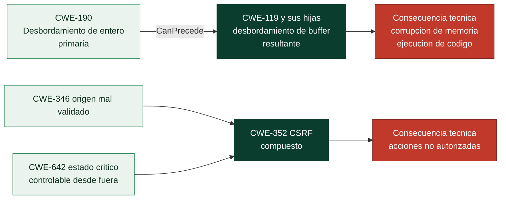

# Clase 362 — Del síntoma a la causa raíz: relaciones, cadenas y mapeo CWE

> Parte: **20 — Debilidades y vulnerabilidades: CWE, CVE, CVSS y su gestión** · Fuente: *MITRE CWE — guía de mapeo por causa raíz (v1.1, 2024), metodología del CWE Top 25 2025 y OWASP Top 10:2025*
> ⏱️ Duración estimada: **120 min** · Nivel: **Intermedio–Avanzado**

---

## 🎯 Objetivo

Aprender a **asignar el CWE correcto a una vulnerabilidad**, que es la habilidad que separa a quien copia una etiqueta de un informe de quien entiende el defecto. Verás cómo distinguir el lenguaje de *debilidad* del de *prerrequisito* y de *impacto técnico*, cómo usar las relaciones del catálogo (jerarquía, cadenas, compuestos) para elegir la entrada más precisa, qué hacer cuando una vulnerabilidad refleja varias debilidades, por qué los asignadores profesionales a veces discrepan —con casos reales de Log4Shell, Struts, regreSSHion o HTTP/2— y qué límites tiene toda clasificación. Cierra con la diferencia entre CWE, CVE, CVSS, CAPEC, ATT&CK y OWASP, que casi todo el mundo mezcla.

> ⚠️ **Ética:** se trabaja con descripciones públicas de vulnerabilidades ya divulgadas y corregidas. No hay explotación.

## 📚 Resultados de aprendizaje

Al finalizar, el alumno podrá:

1. **Separar** en una descripción de vulnerabilidad lo que es debilidad, prerrequisito de explotación e impacto técnico.
2. **Aplicar** el método de mapeo por causa raíz y justificarlo por escrito, citando la guía oficial.
3. **Elegir** el nivel de abstracción adecuado (preferir *Base* y *Variant*) y explicar cuándo es legítimo usar una *Class*.
4. **Interpretar** las relaciones `ChildOf`, `CanPrecede`, `PeerOf`, `Requires` y las ordinalidades *Primary* y *Resultant* para decidir entre candidatos.
5. **Tratar** vulnerabilidades con varias debilidades (cadenas y compuestos) sin inflar ni omitir.
6. **Evaluar** un mapeo ajeno —del CNA, de NVD o de una herramienta— y detectar cuándo es demasiado genérico, equivocado o discutible.
7. **Distinguir** CWE, CVE, CVSS, EPSS, KEV, CAPEC, ATT&CK y las categorías OWASP, y explicar por qué una categoría OWASP no es un CWE.

## 🗺️ Temas

| # | Tema | Por qué importa |
| --- | --- | --- |
| 1 | Qué es mapear por causa raíz y por qué casi nunca se hace bien | Sin esto, las estadísticas y las correcciones se apoyan en etiquetas vacías |
| 2 | Debilidad, prerrequisito e impacto: tres lenguajes en una frase | La confusión más común del principiante |
| 3 | Relaciones entre entradas | Permiten bajar de lo genérico a lo accionable |
| 4 | Cadenas, compuestos y ordinalidad | Cuando hay más de una debilidad, cuál es la raíz |
| 5 | Método de mapeo en ocho pasos | Un procedimiento repetible y defendible |
| 6 | Ambigüedad y mapeos múltiples con casos reales | Asumir que dos expertos pueden discrepar sin que ninguno esté «mal» |
| 7 | Marcadores de NVD y el vocabulario sin catálogo | `NVD-CWE-noinfo` y `NVD-CWE-Other` no son debilidades |
| 8 | CWE, CVE, CVSS, CAPEC, ATT&CK y OWASP | Evitar mezclar planos distintos |
| 9 | Límites de la clasificación | Saber cuánto fiarse de una etiqueta |

## 🧱 Prerrequisitos

- **Clase 361:** debes saber qué es una debilidad, una agrupación y una vista, y qué significan *Pillar*, *Class*, *Base* y *Variant*. Aquí se usa todo eso sin volver a definirlo.
- **Causa raíz** (*root cause*): el defecto más profundo cuya corrección elimina el problema, a diferencia del *síntoma* (lo que se observa) o la *consecuencia* (lo que provoca). En un coche que no arranca, la causa raíz puede ser una batería sulfatada; el síntoma, que el motor no gira.
- **Vector de ataque / precondición:** las condiciones que debe cumplir quien ataca («sin autenticación», «desde la red»). No son la debilidad: son el contexto en que se aprovecha.
- **Entrada no confiable y frontera de confianza** (clases 087 y 115), porque muchos de los ejemplos son de esa familia.
- **CNA y NVD** (se desarrollan en la clase 367): por ahora basta saber que el **CNA** es quien asignó el CVE y escribió su registro, y que **NVD** es la base de datos del NIST que lo enriquece.

## 🧠 Explicación en profundidad

### Qué es mapear por causa raíz y por qué casi nunca se hace bien

MITRE define el **mapeo por causa raíz** (*root cause mapping*) como «la identificación de la causa o causas subyacentes de una vulnerabilidad», y lo hace correlacionando registros CVE, informes de errores o tickets con entradas de CWE. Su propia guía añade una frase incómoda: **hoy esto no se hace con precisión a escala en el ecosistema de gestión de vulnerabilidades**. No es un reproche retórico, es una limitación documentada que verás cuantificada más adelante.

¿Por qué importa tanto acertar? Según la guía, un mapeo preciso ilumina dónde invertir y qué prácticas cambiar, y permite: eliminar *clases* enteras de vulnerabilidades alimentando el ciclo de desarrollo, ahorrar dinero (cuantas menos debilidades se introduzcan, menos vulnerabilidades habrá que gestionar tras el despliegue), analizar tendencias (¿cuánto pesa la seguridad de memoria frente a la inyección?) y, de forma más sutil, anticipar atención adversaria (las inyecciones de comandos suelen recibir más interés de ciertos actores). Un mapeo de baja calidad destruye todo eso: si el 40 % de tus hallazgos están etiquetados «validación de entrada incorrecta», no sabes qué corregir.

### Debilidad, prerrequisito e impacto: tres lenguajes en una frase

El mayor obstáculo para clasificar bien está en el idioma. Las descripciones de los CVE suelen redactarse describiendo **qué consigue el atacante**, no **por qué es posible**. La guía de MITRE lo ilustra con un ejemplo que conviene memorizar, porque contiene los tres elementos:

> «*Insecure Direct Object Reference (IDOR)* en MyProduct 10.1 a 10.6 permite a un **atacante no autenticado** **leer datos sensibles y ejecutar funciones con derechos de administrador** mediante el parámetro `page` de la API.»

- **Debilidad** (lo que hay que clasificar): *Insecure Direct Object Reference*.
- **Prerrequisito de explotación** (contexto): «atacante no autenticado». Suena a control de acceso, pero **no describe una debilidad**: describe quién puede explotarla.
- **Impacto técnico** (resultado): «leer datos sensibles», «ejecutar funciones con derechos de administrador». Tampoco es la debilidad; es lo que ocurre después.

La guía da frases que *sí* describen debilidades: «autenticación ausente», «comprobación de límites incorrecta», «desbordamiento de buffer en la pila». Y frases de impacto que **no** lo son: «saltarse la autorización», «obtener privilegios», «ejecutar código malicioso». La consecuencia práctica es una regla de lectura: cuando una descripción solo dice «permite a un atacante remoto ejecutar código arbitrario», no hay información de causa y cualquier CWE que elijas será una conjetura. En ese caso lo honesto es leer las referencias (aviso del fabricante, parche) o declarar la incertidumbre.

### Las relaciones entre entradas: la herramienta para afinar

Una vez que sabes qué error es, el catálogo te ayuda a **encontrar la entrada exacta** mediante las relaciones. En el catálogo 5.0 las relaciones declaradas se reparten así: `ChildOf` (1.324 enlaces), `CanPrecede` (148), `PeerOf` (103), `CanAlsoBe` (28), `Requires` (13), `StartsWith` (3) y `Overlaps` (3). Además, las agrupaciones se enlazan con sus miembros mediante `Has_Member`. Cada una responde una pregunta distinta:

| Relación | Significa | Ejemplo real del catálogo |
|---|---|---|
| `ChildOf` | «Es un caso concreto de…» (de lo específico a lo general) | `CWE-364` (condición de carrera en manejador de señales) es hija de `CWE-362` (concurrencia con sincronización indebida) |
| `CanPrecede` | «Puede ocurrir antes de…»: esta debilidad puede desembocar en la otra | `CWE-364` puede preceder a `CWE-416` (*use after free*), `CWE-415` (*double free*) y `CWE-123` |
| `PeerOf` | «Se parece a…» pero no es padre ni hijo | `CWE-917` (inyección en lenguaje de expresiones) es par de `CWE-1336` (inyección en motor de plantillas) |
| `Requires` | «Exige la presencia de…»: típico de compuestos | `CWE-352` (CSRF) exige, entre otras, `CWE-346` (error de validación de origen) y `CWE-642` (control externo de estado crítico) |
| `CanAlsoBe` | «Puede ser también…» | Entradas que se solapan según el contexto |
| `StartsWith`, `Overlaps` | Cadenas con punto de partida; entradas parcialmente solapadas | Poco frecuentes: 3 y 3 casos |

Hay un detalle de lectura que ahorra confusión: `CanPrecede` va **de causa a efecto**. Que `CWE-20` (validación de entrada incorrecta) pueda preceder a `CWE-22`, `CWE-74` o `CWE-119` significa que una mala validación *puede ser la raíz* de un path traversal, una inyección o un fallo de memoria, pero **no** que esas debilidades sean lo mismo.

### Cadenas, compuestos y ordinalidad: cuando hay más de una debilidad

Muchas vulnerabilidades reales no son un error aislado sino varios encadenados. El glosario oficial lo recoge con dos conceptos y un par de calificadores.

Una **cadena** es «una secuencia de dos o más debilidades separadas que pueden estar estrechamente ligadas»: una debilidad X crea las condiciones necesarias para que otra, Y, se vuelva explotable. En ese caso CWE llama a X **primaria** respecto a Y, y a Y **resultante** de X. El ejemplo oficial es el desbordamiento de entero (`CWE-190`) que, al calcular cuánta memoria reservar, termina en un desbordamiento de buffer (`CWE-120`): es la **cadena con nombre** `CWE-680`. Los calificadores aparecen en cada ficha bajo *Weakness Ordinalities*: `CWE-190` figura como *Primary* y *Resultant*; `CWE-787` (escritura fuera de límites) solo como *Resultant*, porque normalmente es consecuencia de otra cosa; `CWE-680` es *Primary*.

Un **compuesto** exige lo contrario: que **todas** las debilidades estén presentes **a la vez** para que exista el riesgo, de modo que eliminar una lo elimina o lo reduce mucho. CSRF (`CWE-352`) es un compuesto. Esta diferencia tiene un efecto directo en cómo se corrige: ante una cadena, atacas **el eslabón raíz** (si evitas el desbordamiento de entero, desaparece el de buffer); ante un compuesto, **cualquier** componente sirve, y lo prudente es reforzar más de uno.



El diagrama contrasta las dos estructuras. A la izquierda, una **cadena**: la flecha tiene sentido temporal, y el nodo rojo es la consecuencia técnica, que **no** es una debilidad sino lo que se ve desde fuera. A la derecha, un **compuesto**: dos requisitos confluyen en un único nodo y *ambos* hacen falta. Observa que en los dos casos el nodo final de consecuencia no lleva identificador CWE: esa es la razón por la que «ejecución de código» nunca es una causa raíz.

### Un método de mapeo en ocho pasos

La guía de MITRE ofrece varios métodos de búsqueda; a partir de ella y de la práctica se puede fijar un procedimiento repetible. Los pasos 1 a 5 y la preferencia por *Base* y *Variant* provienen directamente de la guía; el resto es una **síntesis pedagógica** de este programa, que conviene escribir en cada informe:

1. **Separa los tres lenguajes** de la descripción: debilidad, prerrequisito, impacto. Quédate solo con la debilidad.
2. **Genera candidatos**: busca por palabras clave, recorre la vista de desarrollo (699), la de investigación (1000) o sube desde una hija conocida. La búsqueda por palabra clave suele dar el candidato correcto entre los primeros resultados.
3. **Prefiere *Base* y *Variant***. Usa una *Class* solo si no existe una Base o Variant que encaje con exactitud.
4. **Lee el «uso para mapear»** y sus notas: *Allowed* sí; *Allowed-with-Review* con la nota delante; *Discouraged* evítala; *Prohibited* nunca (todas las agrupaciones lo son: **nunca se mapea a una categoría**).
5. **Revisa las relaciones** del candidato: ¿hay una hija más específica que describa mejor tu caso?, ¿es el candidato *Resultant* de otra debilidad que sea la verdadera raíz?
6. **Si hay varias debilidades presentes de verdad**, mapea cada una y marca cuál es la primaria (la que, corregida, elimina las demás). No añadas CWE «por si acaso».
7. **Documenta la justificación y la incertidumbre**: qué frase de la descripción apoya la elección y qué otras entradas se descartaron y por qué.
8. **Pide revisión** de alguien con otra experiencia: la guía de MITRE lo recomienda expresamente como buena práctica.

Si, tras agotar la búsqueda, ninguna entrada encaja, la guía dice algo útil: es posible que hayas encontrado una **laguna del catálogo**, y MITRE invita a proponer una entrada nueva.

### Ambigüedad y mapeos múltiples: casos reales

Con el método en la mano, veamos qué hacen los asignadores profesionales. Los datos siguientes proceden de las fuentes oficiales consultadas el 2026-10-30 y están guardados en `labs/devsecops-pipeline/datos/casos-cwe-cve.json`.

**Log4Shell (CVE-2021-44228): cuatro CWE y ninguno «primario».** El CNA (Apache) asignó `CWE-20`, `CWE-400` y `CWE-502`; NVD añadió `CWE-917`. En NVD las cuatro figuran como *Secondary*: no hay ninguna marcada *Primary*. La descripción dice que las funciones JNDI «no protegen frente a endpoints LDAP controlados por el atacante». Entre las cuatro, `CWE-20` es una clase desaconsejada (demasiado genérica); `CWE-502` (deserialización de datos no confiables) y `CWE-917` (neutralización indebida en una sentencia de lenguaje de expresiones) describen mecanismos concretos y son pares razonables. Lección: **varias asignaciones simultáneas son legítimas**, pero un informe útil dice cuál es la que guía la corrección.

**regreSSHion (CVE-2024-6387): el CNA elige la hija, NVD el padre.** La descripción habla de «una condición de carrera que lleva a sshd a manejar algunas señales de forma insegura». El CNA (Red Hat) asignó `CWE-364` (*Signal Handler Race Condition*, Base); NVD asignó `CWE-362` (concurrencia con sincronización indebida, una *Class*). Como `CWE-364` es hija de `CWE-362`, ambas son correctas, pero la guía de MITRE favorece la más específica. Además `CWE-364` puede preceder a `CWE-416` y `CWE-415`, lo que explica por qué un fallo de «señales» acaba siendo un problema de memoria.

**Struts (CVE-2017-5638): la causa no es la «inyección» que parece.** NVD asignó `CWE-755` (*Improper Handling of Exceptional Conditions*). La descripción dice: «manejo incorrecto de excepciones y generación de mensajes de error durante intentos de subida de archivos, lo que permite ejecutar comandos mediante una cabecera manipulada». La palabra «ejecutar comandos» es **impacto**; la **debilidad** es el mal manejo de excepciones. Quien se deja llevar por el impacto elegiría inyección de comandos (`CWE-78`) y desviaría la corrección.

**Rapid Reset de HTTP/2 (CVE-2023-44487): el catálogo no da una respuesta limpia.** El CNA (el CNA de último recurso de MITRE) no asignó ningún CWE; NVD marca `NVD-CWE-noinfo`; y quien aporta `CWE-400` es el ADP de CISA (Vulnrichment), una *Class* desaconsejada. La descripción dice que «la cancelación de peticiones puede reiniciar muchos flujos rápidamente». Candidatos de nivel más útil: `CWE-405` (consumo asimétrico de recursos, una *Class* con revisión) o `CWE-770` (asignación de recursos sin límites, *Base*). Además es un defecto **del protocolo**, común a muchas implementaciones, lo que complica asignarle una única debilidad de código. Es un caso para documentar la incertidumbre, no para fingir precisión.

**Heartbleed (CVE-2014-0160): `CWE-125`, no «desbordamiento de buffer».** La descripción habla de «sobrelectura de buffer» («buffer over-read»). NVD y CISA asignan `CWE-125` (*Out-of-bounds Read*, Base) y no `CWE-119`, la clase genérica que muchos textos antiguos usan. Leer fuera de límites y escribir fuera de límites (`CWE-787`) son debilidades distintas con consecuencias distintas: la primera filtra datos, la segunda corrompe memoria.

**CVE-2023-50716 (Fast DDS): un mapeo discutible.** La descripción dice que un submensaje inválido provoca «un error *bad-free*» porque un miembro del objeto «intentará liberar memoria sin inicializar». Tanto el CNA como NVD asignaron `CWE-416` (*Use After Free*), que describe *reutilizar* memoria **ya liberada**. El texto habla de *liberar* un puntero **sin inicializar**, lo que se acerca más a `CWE-763` (*Release of Invalid Pointer or Reference*) o `CWE-824` (*Access of Uninitialized Pointer*). Es **discutible, no un error demostrado**: los asignadores pueden conocer el código y yo solo leo la descripción. El valor pedagógico es ver que hasta los mapeos oficiales merecen una lectura crítica.

### Los marcadores de NVD que no son debilidades

En los datos de NVD aparecen dos valores que parecen identificadores de debilidad pero no lo son: `NVD-CWE-noinfo` (no hay información suficiente para decidir) y `NVD-CWE-Other` (hay causa, pero no está entre las debilidades que NVD suele usar). Tienen origen histórico: NVD enriquece sus registros con un subconjunto simplificado de unas 130 debilidades, la **vista 1003**, y todo lo que queda fuera cae en «Other». Por eso, durante años, muchas estadísticas basadas en NVD «aplanaban» las debilidades hacia unos pocos ancestros genéricos. Al trabajar con datos de NVD, trata esos dos valores como *ausencia de dato*, nunca como una causa.

### CWE, CVE, CVSS, CAPEC, ATT&CK y OWASP: seis planos distintos

El error más repetido es mezclar estos catálogos. Cada uno responde una pregunta diferente:

| Catálogo | Pregunta que responde | Ejemplo | Quién lo mantiene |
|---|---|---|---|
| **CWE** | ¿Qué *tipo* de error de diseño o código es? | `CWE-89` inyección SQL | MITRE |
| **CVE** | ¿Qué *vulnerabilidad concreta* es, en qué producto? | `CVE-2023-34362` (MOVEit) | CVE Program (CNA que lo asigna) |
| **CVSS** | ¿Cuán grave sería si se explotara? | 9.8 (v3.1) | FIRST |
| **EPSS** | ¿Qué probabilidad hay de que se explote en 30 días? | 0.9993 (valor del 2026-10-30; cambia a diario) | FIRST |
| **KEV** | ¿Ya se explota, de forma documentada? | Sí (2023-06-02) | CISA |
| **CAPEC** | ¿Cómo suele *atacarse* esa debilidad? (patrones de ataque) | `CWE-89` enlaza con `CAPEC-66` y otros cinco | MITRE |
| **ATT&CK** | ¿Qué *técnicas* usan los adversarios durante una intrusión? | T1190 explotar aplicación expuesta | MITRE |
| **OWASP Top 10** | ¿Qué *categorías de riesgo* de aplicaciones web importan más? | A05:2025 Injection | OWASP |

La última fila merece una explicación aparte porque es la más confundida. Una categoría OWASP **no es un CWE ni se asigna a una vulnerabilidad**: es una agrupación de muchos CWE bajo un nombre de riesgo. OWASP lo explica con precisión en su edición 2025: la lista tiene **248 CWE repartidos en diez categorías**, con un tope de 40 por categoría, y se construyó priorizando **la causa raíz sobre el síntoma**. El catálogo de MITRE refleja esas categorías como diez agrupaciones (`CWE-1436` a `CWE-1445`), todas *Prohibidas* para mapear, con estos miembros: A01 Broken Access Control 40, A02 Security Misconfiguration 16, A03 Software Supply Chain Failures 6, A04 Cryptographic Failures 32, A05 Injection 37, A06 Insecure Design 39, A07 Authentication Failures 36, A08 Software or Data Integrity Failures 14, A09 Logging & Alerting Failures 5 y A10 Mishandling of Exceptional Conditions 24 (249 en total). OWASP cita 248 en su texto y cifras ligeramente distintas en alguna categoría: dos fuentes que se actualizan por separado nunca coinciden al céntimo, y por eso conviene citar **fuente y fecha**.

Lo más instructivo es cruzar el Top 25 de MITRE con las categorías OWASP. Con la herramienta local (`python scripts/cwe_kb.py top25`) se ve que `CWE-79` y `CWE-89` caen en A05 *Injection*; `CWE-352`, `CWE-862`, `CWE-22` y `CWE-918` (SSRF, que OWASP integró en A01 en 2025) caen en A01; `CWE-434` (subida de archivos) en A06 *Insecure Design*; `CWE-476` en A10; y **ninguna de las debilidades de seguridad de memoria del Top 25** (`CWE-787`, `CWE-416`, `CWE-125`, `CWE-120`, `CWE-121`, `CWE-122`) **ni `CWE-770`** pertenece a categoría OWASP alguna. No es un error: la lista de OWASP está centrada en aplicaciones web, y la de MITRE en software en general. Es la mejor demostración de que **los dos marcos no se solapan por completo y no se pueden sustituir uno por otro**.

### Límites de la clasificación

Toda clasificación tiene límites, y conviene conocerlos con datos.

**Límite 1: la calidad del mapeo a escala es baja y MITRE lo sabe.** Al preparar el CWE Top 25 de 2025, MITRE analizó **39.080 registros CVE** publicados entre el 1 de junio de 2024 y el 1 de junio de 2025. Una revisión automatizada marcó para *remapeo* **9.468 registros (el 24 %)**, publicados por 281 CNA, porque su CWE era demasiado abstracto o discrepaba de una búsqueda por palabras clave. Se pidió revisión a los CNA: respondieron sobre **2.459 registros (26 % de lo pedido) y 170 CNA (60 % de los contactados)**. Es decir, la mayoría de las dudas de calidad **no obtuvo respuesta**. Un análisis por CWE basado en estos datos es, por tanto, una aproximación.

**Límite 2: el ranking depende de cómo se cuente.** El Top 25 de 2025 usó por primera vez los mapeos «tal como los publican los CNA», sin forzarlos a los ancestros de la vista 1003 como se hacía antes. Por eso aparecen entradas como `CWE-120`, `CWE-121` y `CWE-122` (nuevas en la lista) y otras como `CWE-287` o `CWE-798` bajan de la lista, aunque el mundo no haya cambiado tanto: cambió el método. La puntuación combina frecuencia y severidad **CVSS v3.0/3.1** normalizadas; los registros que solo tienen CVSS v4.0 quedaron fuera del cálculo.

**Límite 3: el catálogo no cubre todo.** Si no hay entrada que encaje, puede ser una laguna del catálogo. Lo veremos en la clase 366 con contenedores y nube, donde no existen entradas específicas.

**Límite 4: un CWE no es una medida de riesgo.** Un CWE no dice cuánto importa un fallo en tu organización. Para eso están la severidad, la probabilidad, la exposición y el valor del activo (clases 368 y 369).

## 📖 Definiciones y características

- **Mapeo por causa raíz:** asignar a una vulnerabilidad la debilidad que está en su origen. *Clave:* se mapea la causa, no el impacto ni el contexto.
- **Lenguaje de debilidad / de prerrequisito / de impacto:** tres tipos de frase en una descripción. *Clave:* solo el primero es clasificable.
- **Cadena (*chain*):** secuencia en la que una debilidad primaria crea las condiciones de otra resultante. *Clave:* se corrige el eslabón raíz.
- **Compuesto (*composite*):** conjunto de debilidades que deben darse a la vez. *Clave:* eliminar un componente basta, reforzar varios es prudente.
- **Ordinalidad:** *Primary* (causa inicial), *Resultant* (aparece tras otra) o *Indirect*. *Clave:* orienta cuál corregir primero.
- **Uso para mapear:** Allowed, Allowed-with-Review, Discouraged o Prohibited. *Clave:* las agrupaciones son siempre Prohibited.
- **`NVD-CWE-noinfo` / `NVD-CWE-Other`:** marcadores de NVD, no entradas del catálogo. *Clave:* equivalen a «sin dato».
- **Categoría OWASP:** agrupación de CWE bajo un nombre de riesgo. *Clave:* no se asigna a una vulnerabilidad.

## 📔 Glosario

| Término | Definición concisa |
|---------|--------------------|
| Mapeo por causa raíz | Asignar a una vulnerabilidad la debilidad CWE que la origina |
| Causa raíz | Defecto más profundo cuya corrección elimina el problema |
| Prerrequisito de explotación | Condición que debe cumplir el atacante, como no tener cuenta |
| Impacto técnico | Resultado de explotar el fallo, como leer datos o ejecutar código |
| Cadena | Secuencia de debilidades en la que una crea las condiciones de la siguiente |
| Compuesto | Conjunto de debilidades que deben coincidir para que exista riesgo |
| Cadena con nombre | Cadena tan frecuente que tiene identificador propio, como CWE-680 |
| Ordinalidad | Si una debilidad es primaria, resultante o indirecta respecto a otras |
| CanPrecede | Relación que indica que una debilidad puede desembocar en otra |
| PeerOf | Relación entre entradas parecidas sin parentesco jerárquico |
| Requires | Relación que indica qué debilidades exige un compuesto |
| NVD-CWE-noinfo | Marcador de NVD cuando no hay información suficiente para clasificar |
| NVD-CWE-Other | Marcador de NVD cuando la causa no está en su conjunto simplificado |
| Vista 1003 | Subconjunto simplificado de unas 130 debilidades usado por NVD |
| CAPEC | Catálogo de patrones de ataque asociado a las debilidades |
| ATT&CK | Base de conocimiento de técnicas de adversarios durante intrusiones |
| Categoría OWASP | Agrupación de CWE bajo un riesgo web; no es una debilidad |
| ADP | Entidad autorizada que enriquece registros CVE publicados por otros |

## 🧰 Herramientas y preparación

Todo se hace con `scripts/cwe_kb.py` y los datos locales de la clase 361. Comandos de esta clase:

```bash
python scripts/cwe_kb.py relaciones CWE-364     # padres, hijos y relaciones no jerárquicas
python scripts/cwe_kb.py mostrar CWE-20          # lee el «uso para mapear» y sus notas
python scripts/cwe_kb.py miembros CWE-1440       # miembros de la categoría OWASP A05:2025
python scripts/cwe_kb.py top25                   # Top 25 con puntuación, KEV y categoría OWASP
```

Y la instantánea de casos reales con CWE de CNA y de NVD por separado: `labs/devsecops-pipeline/datos/casos-cwe-cve.json`.

## 🧪 Laboratorio guiado

> Solo se leen descripciones públicas de vulnerabilidades ya corregidas.

1. **Lee las descripciones sin ver las respuestas.** Este script imprime solo la descripción de seis casos (el campo `descripcion_en` es el texto oficial de NVD, en inglés):

   ```python
   import json
   from pathlib import Path

   # La instantánea guarda, por caso, la descripción y los CWE de cada fuente.
   datos = json.loads(Path("labs/devsecops-pipeline/datos/casos-cwe-cve.json").read_text(encoding="utf-8"))
   elegidos = ["CVE-2024-27565", "CVE-2024-2021", "CVE-2021-3156", "CVE-2024-6387", "CVE-2017-5638", "CVE-2023-34362"]

   for caso in datos["casos"]:
       if caso["cve"] in elegidos:
           print(caso["cve"], "→", caso["descripcion_en"][:260])   # solo la descripción, ¡sin el CWE!
           print()
   ```

2. **Aplica el método** a cada una: subraya la frase de *debilidad*, tacha prerrequisito e impacto, busca candidatos con `cwe_kb.py buscar` y baja al nivel *Base* o *Variant*. Escribe tu CWE y una línea de justificación **antes** de seguir.

3. **Compara con las fuentes** imprimiendo los CWE que asignaron el CNA y NVD:

   ```python
   for caso in datos["casos"]:
       if caso["cve"] in elegidos:
           nvd = [(c["id"], c["tipo"], c["fuente"]) for c in caso["cwe_nvd"]]   # (CWE, Primary/Secondary, quién)
           print(caso["cve"], "| CNA:", caso.get("cwe_cna"), "| NVD:", nvd)
   ```

4. **Mira las relaciones** de los candidatos que descartaste y de los que elegiste (`relaciones CWE-364`, `mostrar CWE-20`) y anota si el catálogo desaconseja alguno.

5. **Reevalúa dos mapeos ajenos** del apartado «Ambigüedad»: el de Rapid Reset (`CVE-2023-44487`) y el de Fast DDS (`CVE-2023-50716`). Escribe qué CWE usarías tú y qué información adicional pedirías antes de decidir.

## ✍️ Ejercicios

1. Descompón esta frase en debilidad, prerrequisito e impacto: «Una vulnerabilidad de inyección de comandos en el panel de administración permite a un usuario autenticado de bajos privilegios ejecutar comandos como root mediante el parámetro `host`».
2. Para cada frase, di si describe una debilidad, un prerrequisito o un impacto: «falta de autenticación», «sin interacción del usuario», «obtener privilegios de administrador», «comprobación de longitud ausente».
3. Explica con tus palabras por qué `CWE-20` figura en el Top 25 de 2025 y, sin embargo, MITRE desaconseja usarla para mapear.
4. Un compañero etiqueta un hallazgo como «OWASP A05:2025». ¿Es un CWE válido? ¿Qué le pedirías?
5. Para la cadena `CWE-190 → CWE-119`, ¿qué debilidad corregirías primero y por qué? ¿Y si fuera un compuesto en lugar de una cadena?
6. Un informe trae `NVD-CWE-Other` para un CVE. ¿Qué información real aporta y qué harías para completarla?
7. Reordena de más a menos preferible para mapear una vulnerabilidad de «escritura fuera de límites en el montón»: `CWE-119`, `CWE-787`, `CWE-122`, `CWE-118`.
8. Describe un caso en el que dos asignadores diferentes eligen CWE distintos y ambos tengan razón, y otro en que uno se equivoque.

## ✅ Soluciones razonadas

1. **Debilidad:** inyección de comandos (el parámetro `host` llega sin neutralizar a un intérprete de órdenes). **Prerrequisito:** «usuario autenticado de bajos privilegios» (quién puede explotarlo; no es una debilidad de autenticación). **Impacto:** «ejecutar comandos como root». Mapeo: `CWE-78`. Fíjate en que «autenticado» y «bajos privilegios» no justifican añadir `CWE-287` o `CWE-269`.
2. «Falta de autenticación» → **debilidad** (`CWE-306`, ausencia de una comprobación). «Sin interacción del usuario» → **prerrequisito** (describe condiciones de explotación, es un concepto de CVSS). «Obtener privilegios de administrador» → **impacto**. «Comprobación de longitud ausente» → **debilidad** (apunta a `CWE-120`/`CWE-787`).
3. Porque la lista de 2025 contó los mapeos **tal como los publican los CNA**, y muchos CNA siguen usando clases genéricas. `CWE-20` figura en la lista por frecuencia y severidad media, pero MITRE la desaconseja porque es una clase de nivel 1 «comúnmente mal usada en informes con poca información, no útil para análisis de tendencias» (según sus notas de mapeo). Que aparezca en el ranking dice algo sobre las **prácticas de mapeo** de la industria, no sobre que sea una buena etiqueta.
4. **No es un CWE válido**: una categoría OWASP es una agrupación de CWE, prohibida para mapear. Le pediría la debilidad concreta (p. ej. `CWE-89` o `CWE-78`) y, si quiere conservar la categoría, que la anote aparte como «categoría de riesgo».
5. En una **cadena**, el desbordamiento de entero (`CWE-190`) es la *primaria*: corregirlo (comprobar el rango antes de calcular el tamaño) impide que llegue al desbordamiento de buffer. En un **compuesto**, cualquier componente sirve para romper el riesgo, pero lo prudente es corregir más de uno, porque cada componente puede reaparecer por otra vía.
6. Aporta casi nada: dice que NVD no encontró la causa en su conjunto simplificado. Para completarla: leer la descripción y el parche, aplicar el método de ocho pasos y, si el CNA publicó CWE, usar los suyos; si no, proponer el mapeo y anotar la incertidumbre.
7. De más a menos preferible: **`CWE-122`** (Variant: escritura en el montón; la más específica y la que mejor describe el caso), **`CWE-787`** (Base: escritura fuera de límites, válida si no se quiere precisar la región), **`CWE-119`** (Class, desaconsejada), **`CWE-118`** (más abstracta aún, aleja de la causa). El criterio: la más específica que *describa realmente* lo ocurrido.
8. **Ambos con razón:** regreSSHion; `CWE-364` y `CWE-362` son hija y padre, y las dos describen el fallo con distinta precisión. **Uno equivocado:** quien se guía por el *impacto* («permite ejecutar comandos») y etiqueta como inyección de comandos (`CWE-78`) un fallo que, según su descripción, es de manejo de excepciones, como en Struts. NVD asignó `CWE-755` y esa lectura sí sigue el texto de la descripción.

## 📝 Reto verificable

Redacta una **nota de mapeo** de cinco vulnerabilidades de la instantánea de casos (elige una con varios CWE, una con discrepancia CNA/NVD y una con `noinfo`). Para cada una entrega: (a) la frase de debilidad subrayada; (b) el CWE elegido y el nivel de abstracción; (c) los candidatos descartados con su motivo; (d) lo que hicieron el CNA y NVD y si coincides; (e) el grado de certeza (alto, medio, bajo) y qué dato lo subiría.

**Criterio de aceptación:** todas las entradas citadas existen en el catálogo local y no son agrupaciones ni obsoletas (`python scripts/cwe_kb.py referencias` pasa en tu documento); ninguna justificación se apoya en el *impacto*; y al menos una nota declara incertidumbre en lugar de forzar una respuesta.

## ⚠️ Errores comunes

| Síntoma / mensaje | Causa y cómo arreglar |
| --- | --- |
| Mapear «ejecución remota de código» como causa | Es un impacto. Lee qué falló antes de que hubiera código ejecutándose |
| Añadir `CWE-287` porque el ataque es «sin autenticar» | «No autenticado» es un prerrequisito, no una debilidad de autenticación |
| Usar `CWE-20` para todo lo que tenga «entrada» | Es una clase desaconsejada; baja a la entrada concreta (`CWE-89`, `CWE-78`, `CWE-22`...) |
| Asignar una categoría OWASP como CWE | Las agrupaciones son *Prohibited*. Elige una debilidad |
| Poner cuatro CWE «por si acaso» | Mapea solo lo presente y señala la primaria; el relleno diluye la corrección |
| Dar por válido un mapeo porque lo puso NVD | Asignadores profesionales discrepan (CNA vs NVD). Léelo con espíritu crítico |
| Tratar `NVD-CWE-noinfo` como una causa | Es ausencia de dato; complétalo tú |
| Citar cifras de un ranking sin método ni fecha | El Top 25 de 2025 cambió su método de conteo; cita fuente y año |

## ❓ Preguntas frecuentes

**❓ ¿Y si dos CWE me parecen igual de válidos?** Mapea la más específica que describa la causa y anota la otra como alternativa con su motivo. Si las dos son debilidades presentes a la vez, mapea ambas y marca la primaria.

**❓ ¿Puedo fiarme de lo que asigna el CNA?** Es la fuente que mejor conoce el producto, y MITRE reconoce que los CNA están mejor situados que terceros para mapear. Pero en la práctica muchos usan clases genéricas. Es una fuente de calidad variable, no una verdad.

**❓ ¿Por qué hay vulnerabilidades sin CWE?** Porque la descripción no da información de causa, o porque nadie lo ha asignado todavía (los registros recientes suelen estar pendientes de enriquecimiento, como verás en la clase 367).

**❓ ¿Un CVE puede tener varios CWE?** Sí. Un CVE es una vulnerabilidad concreta y puede reflejar varias debilidades; los datos de Log4Shell lo muestran.

**❓ ¿Sirve la lista de OWASP para clasificar un fallo concreto?** Para comunicar un riesgo a un público amplio, sí. Para clasificar un fallo concreto, no: usa el CWE. OWASP no cubre, además, la seguridad de memoria.

## 🔗 Referencias

- MITRE CWE, *CVE → CWE «Root Cause Mapping» Guidance* (v1.1, 2024) — <https://cwe.mitre.org/documents/cwe_usage/guidance.html> — método de mapeo, preferencia por Base y Variant, etiquetas de uso y vistas de ayuda.
- MITRE CWE, *Glossary* — <https://cwe.mitre.org/documents/glossary/index.html> — definiciones de cadena, compuesto, debilidad primaria y resultante, y cadena con nombre.
- MITRE CWE, *2025 CWE Top 25 Methodology* — <https://cwe.mitre.org/top25/archive/2025/2025_methodology.html> — cifras de remapeo, participación de los CNA, fin de la normalización a la vista 1003 y fórmula de puntuación.
- MITRE CWE, *2025 CWE Top 25 Most Dangerous Software Weaknesses* — <https://cwe.mitre.org/top25/archive/2025/2025_cwe_top25.html> — ranking, puntuaciones y número de CVE en KEV por debilidad.
- OWASP, *Top 10:2025 — Introducción* — <https://top10.owasp.org/2025/0x00_2025-Introduction/> — metodología, 248 CWE en diez categorías, tope de 40 y criterio de causa raíz frente a síntoma.
- NIST NVD, API de vulnerabilidades 2.0 — <https://nvd.nist.gov/developers/vulnerabilities> — origen de los CWE y los estados de NVD usados en los casos (consultada vía API, 2026-10-30).
- CVE Program, *Glossary* — <https://www.cve.org/ResourcesSupport/Glossary> — definiciones de CNA, ADP y vulnerabilidad para distinguir quién asigna qué.
- MITRE CAPEC — <https://capec.mitre.org/> — catálogo de patrones de ataque enlazado desde cada debilidad.

## 📥 Material descargable

- 📄 [Guía en PDF](./clase-362-guia.pdf) — versión imprimible de esta clase.
- 🎞️ [Presentación (PPTX)](./clase-362-presentacion.pptx) — deck para proyectar en clase.

## ⬅️ Clase anterior

[Clase 361 — CWE: qué es, quién lo mantiene y cómo está construido](../361-cwe-que-es-y-como-esta-construido/README.md)

## ➡️ Siguiente clase

[Clase 363 — Familias CWE (1): entradas no confiables](../363-familias-cwe-entradas-no-confiables/README.md)
