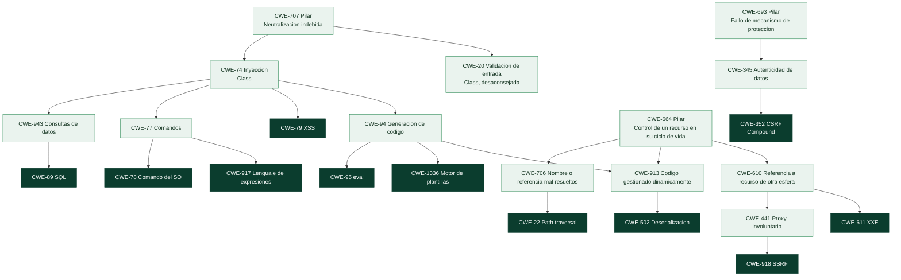

# Clase 363 — Familias CWE (1): entradas no confiables

> Parte: **20 — Debilidades y vulnerabilidades: CWE, CVE, CVSS y su gestión** · Fuente: *MITRE CWE 5.0 (fichas de CWE-20, 22, 74, 77, 78, 79, 89, 94, 95, 352, 434, 502, 611, 918), CWE Top 25 2025 y laboratorio `appsec-code`*
> ⏱️ Duración estimada: **130 min** · Nivel: **Intermedio**

---

## 🎯 Objetivo

Comprender la familia de debilidades que nace de **tratar como seguro un dato que viene de fuera**, y aprender a clasificarlas, corregirlas y verificar la corrección con criterio. El hilo conductor es una idea que el catálogo CWE hace explícita: aunque la raíz sea siempre una entrada no confiable, **cada debilidad se define por el mecanismo concreto que falla** —un intérprete SQL, un shell, un navegador, un evaluador de código, un resolutor de rutas, un deserializador, un cliente HTTP—, y por eso se previene y se detecta de forma distinta. Verás cómo se ubican en la jerarquía, qué dice MITRE de su prevención y detección, qué ocurre en vulnerabilidades reales y cómo demostrar con una prueba que una corrección funciona.

> ⚠️ **Ética:** los ejemplos de explotación se ejecutan solo contra el laboratorio local `labs/appsec-code`, deliberadamente vulnerable. No se prueba contra sistemas ajenos.

## 📚 Resultados de aprendizaje

Al finalizar, el alumno podrá:

1. **Explicar** por qué inyección SQL, de comandos, de código, XSS, path traversal, deserialización y SSRF son la misma clase de error en distintos intérpretes.
2. **Ubicar** cada debilidad en la jerarquía CWE y justificar por qué path traversal o deserialización *no* cuelgan de «Inyección».
3. **Elegir** la defensa estructural (separar datos de instrucciones) antes que el filtrado, y explicar por qué.
4. **Neutralizar** una salida según su contexto (cuerpo HTML, atributo, URL) y entender por qué una sola función de escape no vale para todo.
5. **Reconocer** CSRF como debilidad compuesta y describir sus componentes.
6. **Aplicar** una lista permitida y comprobación de direcciones para mitigar SSRF, y señalar sus límites.
7. **Leer** las estrategias de mitigación y los métodos de detección de MITRE y la eficacia que les atribuye.
8. **Demostrar** una corrección con una prueba que falla antes y pasa después.

## 🗺️ Temas

| # | Tema | Por qué importa |
| --- | --- | --- |
| 1 | Un error, muchos intérpretes | Es la idea que unifica la familia |
| 2 | Dónde cuelga cada debilidad en CWE | La jerarquía revela el mecanismo, no el nombre del ataque |
| 3 | Inyección en consultas: SQL y similares (CWE-943, 89) | La más enseñada y todavía la segunda del Top 25 |
| 4 | Inyección de comandos (CWE-77, 78) | La de más CVE en KEV dentro del Top 25 |
| 5 | Inyección de código, expresiones y plantillas (CWE-94, 95, 917, 1336) | El puente hacia ejecución remota |
| 6 | XSS y neutralización de salida por contexto (CWE-79) | La número 1 del Top 25 y la que más depende del contexto |
| 7 | CSRF, el compuesto (CWE-352) | Una debilidad que no es «un fallo» |
| 8 | Rutas, deserialización, XXE y SSRF (CWE-22, 502, 611, 918) | Misma raíz, otros intérpretes |
| 9 | Subida de archivos y validación de entrada (CWE-434, 20) | Dónde falla la validación y por qué no basta |
| 10 | Prevención, detección y verificación | De la teoría a la evidencia |

## 🧱 Prerrequisitos

- **Clases 361 y 362** (qué es una debilidad, jerarquía, abstracción y método de mapeo).
- **Frontera de confianza y entrada no confiable** (clases 087 y 115): un dato que cruza de un dominio menos confiable a uno más confiable. En una aplicación web, todo lo que llega en una petición HTTP (parámetros, cabeceras, cookies, cuerpo) es no confiable aunque el navegador «parezca» el cliente propio.
- **Intérprete:** cualquier componente que *ejecuta o interpreta* texto con una sintaxis propia: el motor de SQL, el shell, el navegador al leer HTML y JavaScript, el motor de plantillas, `eval`. Un intérprete distingue entre *datos* e *instrucciones* según la sintaxis.
- **Neutralizar:** asegurar que un dato tenga ciertas propiedades antes de usarlo, de modo que el intérprete lo trate siempre como dato. Es el verbo que usa el catálogo (en lugar de «sanear», desaconsejado).
- **Clases 091, 095, 096–098, 105–108 y 115** (técnicas de ataque y defensa de cada una). Esta clase **no repite** esa técnica: la reorganiza desde el punto de vista del catálogo y de la corrección verificable.

## 🧠 Explicación en profundidad

### Un error, muchos intérpretes

Si escribes un programa que construye una frase juntando texto fijo con texto del usuario y se la entrega a un intérprete, hay un momento en que el intérprete **no sabe qué parte de la frase la puso el programador y cuál el usuario**. Todo le llega como una única cadena. Si el usuario escribe algo con la sintaxis del intérprete —una comilla, un punto y coma, una etiqueta `<script>`, `../`—, ese fragmento se interpreta como *instrucción*. Ese es el mecanismo común. Lo único que cambia es el intérprete:

| El dato del usuario llega a… | …que lo interpreta como… | Debilidad |
|---|---|---|
| El motor de bases de datos | Una consulta SQL | `CWE-89` |
| El shell del sistema operativo | Una orden | `CWE-78` |
| El navegador de la víctima | HTML y JavaScript | `CWE-79` |
| Un evaluador de código (`eval`, plantillas, expresiones) | Código del lenguaje | `CWE-94`, `95`, `917`, `1336` |
| El sistema de archivos | Una ruta que sale de su directorio | `CWE-22` |
| Un deserializador | Una descripción de objetos y código a reconstruir | `CWE-502` |
| Un cliente HTTP del servidor | Una dirección a la que conectarse | `CWE-918` |
| Un analizador de XML | Una referencia a recursos externos | `CWE-611` |

Esta tabla es la clave para estudiar: cuando veas una vulnerabilidad nueva con un intérprete desconocido (un motor de reglas, un lenguaje de consultas de grafos, un formato de configuración), preguntarte «¿qué intérprete recibe el dato y cómo distingue datos de instrucciones?» te llevará a la debilidad y a la defensa casi siempre.

### Dónde cuelga cada una en CWE: el mecanismo, no el nombre del ataque

La jerarquía del catálogo (vista 1000) revela algo que sorprende: aunque todas nazcan de una entrada no confiable, **no todas cuelgan de «Inyección»**. Las que sí lo hacen comparten el pilar `CWE-707` (*Improper Neutralization*) y la clase `CWE-74` (*Injection*); las demás cuelgan de ramas distintas porque lo que falla es otra cosa.



El diagrama tiene tres «continentes». A la izquierda, bajo el pilar de *neutralización* (`CWE-707`), vive la **inyección en sentido estricto**: SQL, comandos, expresiones, XSS y código. Allí el defecto es que el dato modifica la *estructura* de lo que interpreta otro componente. En el centro, bajo el pilar de **ciclo de vida de recursos** (`CWE-664`), cuelgan el path traversal (`CWE-22`: la referencia a un archivo se *resuelve mal*), la deserialización (`CWE-502`: se gestiona código de forma dinámica) y SSRF (`CWE-918`: el servidor actúa como *proxy involuntario*). A la derecha, el pilar de **mecanismos de protección** (`CWE-693`) aloja a CSRF (`CWE-352`), un fallo de *verificación de autenticidad*. Observa también que `CWE-94` tiene **dos** padres, `CWE-74` y `CWE-913`: el código generado dinámicamente es a la vez una inyección y un problema de gestión de código dinámico.

¿Importa esto en la práctica? Mucho. Si clasificas path traversal como «inyección» buscarás la defensa equivocada: neutralizar caracteres especiales (`../`) es una defensa frágil; la correcta es **resolver la ruta y comprobar el resultado contra el directorio permitido**, que es lo que dice su rama (*resolución indebida de nombres*).

### Inyección en consultas: `CWE-943` y `CWE-89`

`CWE-89` es una debilidad *Base*, de uso «Allowed», hija de `CWE-943` (neutralización indebida en la lógica de consultas de datos), que a su vez cuelga de la inyección. En el Top 25 de 2025 ocupa el **puesto 2** con 28,72 puntos, y MITRE contabiliza **4 CVE de la lista KEV** asociados. El mecanismo se entiende con tres líneas (ya las viste en la clase 091 y en el laboratorio):

```python
# VULNERABLE: la cadena final contiene la entrada del usuario dentro de la sintaxis SQL.
consulta = "SELECT * FROM users WHERE name = '" + nombre + "'"
# Con nombre = x' OR '1'='1  la consulta se convierte en WHERE name = 'x' OR '1'='1'  (siempre verdadera)

# CORRECTO: la consulta es una constante con un marcador (?) y el valor viaja aparte.
conn.execute("SELECT * FROM users WHERE name = ?", (nombre,))
```

La corrección estructural no «limpia» la entrada: **cambia el canal**. En la versión correcta el motor recibe la consulta (instrucciones) y el valor (dato) por separado, de modo que nada de lo que escriba el usuario puede alterar la estructura. MITRE lo recoge entre sus mitigaciones con los nombres *Parameterization* (parametrización) y *Libraries or Frameworks* (usar un marco que ya separe datos de código), y menciona también la validación de entrada como defensa **adicional**, no principal. La ficha incluye una advertencia sobre el firewall de aplicaciones: la eficacia que le atribuye es *Moderate*, porque puede no cubrir todos los vectores de entrada.

**Caso profesional: MOVEit Transfer (CVE-2023-34362).** Una inyección SQL (`CWE-89`) sin autenticación en una aplicación de transferencia de archivos. Está en KEV desde el 2023-06-02 con uso en campañas de ransomware marcado como *Known*, y tiene CVSS 9.8 según NVD y según CISA-ADP. Es el ejemplo de manual de una debilidad «simple» con un impacto organizativo enorme, porque el producto custodiaba datos de terceros. **Contraste:** `CVE-2024-2021`, otra inyección SQL (`CWE-89`) en un equipo de red, tiene CVSS 9.8 según NVD y 6.3 según su CNA, **no** está en KEV y su EPSS es 0,0074: misma debilidad, trayectorias totalmente distintas. La debilidad no determina la prioridad; es el punto de partida (clases 368 y 369).

### Inyección de comandos: `CWE-77` y `CWE-78`

`CWE-78` (comando del sistema operativo) es hija de `CWE-77` (comando en general). Ocupa el **puesto 9** del Top 25 y, dato revelador, es la entrada del Top 25 con **más CVE en KEV: 20**, por encima de la primera de la lista (XSS, 7). Es decir, que algo sea muy frecuente (XSS) no implica que sea lo más explotado en la práctica: la inyección de comandos da ejecución directa en el servidor, y los atacantes la aprovechan mucho más.

La corrección sigue la misma lógica de separar canales: **no pasar por el shell**. Con `subprocess.run(["ping", "-c", "1", host])` cada elemento de la lista es un argumento que se entrega tal cual al programa, sin que ningún intérprete reinterprete `;`, `&&` o `$(...)`. La validación del valor (una lista permitida de hosts válidos) es una segunda barrera que, además, impide que una entrada como `-f` se interprete como opción. MITRE incluye entre las mitigaciones la parametrización, el uso de bibliotecas, la reducción de superficie de ataque, la neutralización de la salida y, como defensa de contención, entornos aislados (*Sandbox or Jail*) con eficacia *Limited*.

### Inyección de código, expresiones y plantillas: `CWE-94`, `95`, `917` y `1336`

Aquí el intérprete es el propio lenguaje. `CWE-94` (generación de código) es una *Base* que MITRE etiqueta «Allowed-with-Review»; su hija `CWE-95` es la variante específica de `eval` y similares; `CWE-1336` cubre los **motores de plantillas** (la clase 107, SSTI) y `CWE-917` los **lenguajes de expresiones**. Fíjate en lo que MITRE señala en la propia ficha de `CWE-95`: la primera mitigación es **refactorizar para no necesitar `eval()`**, y registra una *práctica común desaconsejada* muy instructiva. En Python se recomienda con frecuencia `ast.literal_eval()` como sustituto de `eval`, porque está diseñada para no ejecutar código; pero, advierte la ficha, un adversario aún puede provocar un consumo excesivo de memoria o de pila con estructuras muy anidadas. Es decir: incluso la alternativa «segura» más obvia tiene un límite. La defensa robusta es **no evaluar entrada como código** o permitir un subconjunto cerrado y *acotado*, como el evaluador aritmético del laboratorio, que recorre el árbol sintáctico, solo acepta números y operadores y limita la longitud de la expresión.

**Caso profesional: Spring4Shell (CVE-2022-22965).** `CWE-94` en el *data binding* de Spring. La descripción oficial insiste en una condición que cambia el riesgo: la explotación exige JDK 9 o superior y despliegue como WAR en Tomcat; si la aplicación es un jar ejecutable de Spring Boot (lo habitual), no es vulnerable al exploit descrito. Está en KEV, pero para *tu* organización el riesgo depende de **cómo despliegas**. Es exactamente el tipo de dato de contexto que ninguna base de datos de vulnerabilidades puede darte (clase 369).

### XSS y neutralización de salida por contexto: `CWE-79`

XSS es la **número 1 del Top 25 de 2025**, con 60,38 puntos (más del doble que la segunda), aunque con solo 7 CVE en KEV. Es una *Base* hija de la inyección. Su peculiaridad es que **el intérprete es el navegador de otra persona**, y que el mismo dato debe neutralizarse de forma distinta según *dónde* se inserta en la página:

```python
import html

entrada = '<script>alert(1)</script>'
html.escape(entrada)                          # &lt;script&gt;alert(1)&lt;/script&gt;   -> seguro en el cuerpo del HTML

atributo = '" onmouseover="alert(1)'
html.escape(atributo, quote=True)             # &quot; onmouseover=&quot;alert(1)     -> seguro dentro de un atributo con comillas

destino = 'javascript:alert(1)'
html.escape(destino)                          # javascript:alert(1)   -> ¡SIN CAMBIOS! El escapado HTML no neutraliza un esquema peligroso en un href
```

El tercer ejemplo es el que más enseña. El escapado HTML protege el *cuerpo* y los *atributos entre comillas*, pero no sirve en un `href` (hay que validar el esquema: permitir `https:`, rechazar `javascript:`), ni dentro de un bloque `<script>` (hay que codificar para JavaScript), ni en una URL (hay que codificar como URL). Por eso MITRE recoge como estrategias *Output Encoding* y, de nuevo, *Libraries or Frameworks*: los motores de plantillas modernos con **escapado contextual automático** evitan que cada programador resuelva esto a mano. La neutralización correcta es una propiedad de *dónde* va el dato, no del dato.

### CSRF: un compuesto, no un fallo suelto: `CWE-352`

En la clase 361 viste que `CWE-352` es de nivel *Compound*. MITRE la describe como un compuesto bien conocido de varias debilidades que deben darse **a la vez**, aunque de naturaleza orientada al ataque. Sus componentes incluyen la validación defectuosa del origen de la petición (`CWE-346`) y el control externo de un estado crítico (`CWE-642`). El mecanismo: el navegador de la víctima adjunta automáticamente las cookies de sesión a cualquier petición hacia tu sitio, incluso si la origina otra página; si el servidor se fía de «esta petición trae una sesión válida» sin verificar que *la intención* era del usuario, un tercero puede provocar acciones.

Al ser compuesto, la defensa suma capas, y romper cualquiera de los componentes rompe el ataque: un **token anti-CSRF** impredecible por petición que el atacante no puede conocer, **atributos de cookie `SameSite`** que impiden adjuntar la sesión en peticiones cruzadas, y **comprobación del origen** (`Origin`/`Referer`) en las operaciones que cambian estado. Es la debilidad del Top 25 con el contraste más llamativo entre ranking y explotación observada: **puesto 3 y 0 CVE en KEV**. Frecuente y de severidad notable, pero rara vez es el vector de los incidentes que acaban en la lista de explotación conocida.

### Rutas, deserialización, XXE y SSRF: misma raíz, otros intérpretes

**Path traversal (`CWE-22`).** Puesto 6, con **10 CVE en KEV**. Cuelga de «resolución indebida de nombres», no de inyección, y su corrección lo refleja: no bloquear la cadena `..` (que se puede escribir de muchas formas), sino **resolver la ruta final y comprobar que sigue dentro del directorio permitido**. Dos detalles frecuentes: comparar con `commonpath` y no con `startswith` (porque `/datos-secretos` empieza igual que `/datos`) y resolver también los enlaces simbólicos. **Caso:** `CVE-2021-41773` (Apache HTTP Server 2.4.49), con KEV y uso en ransomware *Known*. Es instructivo por cómo se puntuó: **NVD 9.8 y CISA-ADP 7.5** (el CNA, Apache, no publicó puntuación en el registro). La descripción dice que, si los archivos fuera de los directorios configurados no están protegidos por la configuración habitual `require all denied`, la petición puede acceder a ellos: el impacto depende de la *configuración*, y cada evaluador asumió un escenario distinto.

**Deserialización (`CWE-502`).** Puesto 15, **11 CVE en KEV**. Deserializar datos no confiables con un formato nativo que puede reconstruir objetos arbitrarios (como `pickle`) equivale a dejar que quien envía los bytes decida qué código se ejecuta. MITRE recomienda evitar deserializar datos no confiables o usar formatos que solo describen datos, y añade defensa de red (*Firewall*, eficacia *Moderate*). En el laboratorio, la corrección es cambiar a JSON y la prueba demuestra que el objeto malicioso se rechaza.

**XXE (`CWE-611`).** Cuelga de las referencias a recursos de otra esfera de control. El defecto está en el analizador de XML que sigue entidades externas definidas en el propio documento; la corrección es configurar el analizador para que no las resuelva (desactivar DTD y entidades externas).

**SSRF (`CWE-918`).** Puesto 22; 0 CVE en KEV. Cuelga de «proxy involuntario»: el servidor hace una petición a una dirección que decide el atacante, y la hace *con la posición de red del servidor*, que puede alcanzar servicios internos o metadatos de nube. La defensa sensata combina una **lista permitida de destinos**, la comprobación de las **direcciones IP que resuelve** el nombre (rechazando privadas, de bucle local, de enlace local y reservadas) y el uso del esquema `https`:

```python
import ipaddress
import socket
from urllib.parse import urlparse

HOSTS_PERMITIDOS = {"api.ejemplo.org", "cdn.ejemplo.org"}     # lista PERMITIDA, no lista de prohibidos


def ip_es_publica(ip: str) -> bool:
    d = ipaddress.ip_address(ip)
    # Rechaza todo lo que no sea una dirección alcanzable públicamente.
    return not (d.is_private or d.is_loopback or d.is_link_local
                or d.is_reserved or d.is_multicast or d.is_unspecified)


def url_permitida(url: str, resolver=socket.getaddrinfo) -> bool:
    p = urlparse(url)
    if p.scheme != "https" or not p.hostname:        # solo https y con host
        return False
    if p.hostname not in HOSTS_PERMITIDOS:           # solo destinos conocidos
        return False
    try:
        direcciones = {r[4][0] for r in resolver(p.hostname, p.port or 443, type=socket.SOCK_STREAM)}
    except socket.gaierror:
        return False
    # TODAS las direcciones resueltas deben ser públicas (un nombre puede devolver varias).
    return bool(direcciones) and all(ip_es_publica(ip) for ip in direcciones)
```

El parámetro `resolver` existe para poder probar la función **sin red**, inyectando un resolutor falso. Con él se comprueba que un nombre permitido que resuelve a `169.254.169.254` (dirección de metadatos de muchos proveedores) se rechaza, que uno que devuelve una pública y una interna también se rechaza, y que `https://api.ejemplo.org@evil.com/` se interpreta con host `evil.com` y se descarta. **Límites que debes conocer:** hay una ventana entre la resolución de la comprobación y la de la petición real (es una carrera de tipo *time-of-check/time-of-use*, `CWE-367`, que veremos en la clase 365), de modo que lo robusto es conectar a la IP ya validada y no seguir redirecciones sin revalidar. **Caso:** `CVE-2024-27565`, SSRF (`CWE-918`) con CVSS 9.8 y EPSS de 0,0066, no está en KEV: severidad máxima, probabilidad baja, producto de nicho. Otra vez, la debilidad no es la prioridad.

### Subida de archivos y validación de entrada: `CWE-434` y `CWE-20`

`CWE-434` (subida sin restricción de archivos de tipo peligroso) cuelga de la transferencia de recursos entre esferas; está en el puesto 12 y con 4 CVE en KEV. La defensa no es una sola comprobación sino un diseño: aceptar solo los tipos necesarios por **lista permitida**, no confiar en el nombre ni en el tipo declarado por el cliente, **renombrar** el archivo y guardarlo **fuera** del directorio que el servidor ejecuta o sirve directamente, y no darle nunca permisos de ejecución.

`CWE-20` (validación de entrada incorrecta) merece una advertencia propia. Está en el puesto 18 del Top 25 y, sin embargo, MITRE la marca «Discouraged» para mapear: es una *Class* de nivel 1, se usa mal en informes con poca información y «no sirve para el análisis de tendencias». Su ficha insiste en una distinción valiosa: *validar* (comprobar si una entrada ya es segura) es distinto de *transformar* en algo seguro (filtrar o escapar) y de *procesar* de forma segura (parametrizar). Cuando tu corrección es parametrizar o escapar, la causa raíz **no** es «falta de validación», aunque se parezca.

### Por qué filtrar no es lo mismo que separar canales

Todo lo anterior converge en un principio de diseño. Hay dos tipos de defensa:

1. **Estructurales:** hacen *imposible* que el dato altere la estructura, porque viajan por canales distintos o porque el intérprete no acepta más que un subconjunto cerrado. Ejemplos: consultas parametrizadas, lista de argumentos sin shell, evaluador sobre el árbol sintáctico, `commonpath` tras resolver, JSON en lugar de `pickle`.
2. **De filtrado:** intentan «detectar y quitar» lo peligroso. Ejemplos: listas de caracteres prohibidos, expresiones regulares que rechazan `../` o `<script>`.

Las segundas fallan porque exigen anticipar **todas** las formas de escribir lo peligroso (codificaciones, mayúsculas, variantes del dialecto) y el atacante solo necesita **una** que no previste. Por eso MITRE coloca la validación de entrada entre las defensas adicionales y no entre las primarias. La validación sigue siendo útil —como *defensa en profundidad* y para reducir la superficie—, pero la corrección que cierra la debilidad es la estructural.

### Detección según MITRE y qué eficacia atribuye

Las fichas registran qué métodos detectan cada debilidad y con qué eficacia, lo que ayuda a elegir herramientas. Para `CWE-89`, la **análisis estático de binario o bytecode** y el **análisis dinámico con interpretación automática de resultados** se califican *High*; el análisis dinámico automatizado, *Moderate*. Para `CWE-79`, el análisis estático automatizado y la caja negra se califican *Moderate*. Para `CWE-352`, el **análisis manual** es *High* y el estático automatizado solo *Limited*: es una debilidad de *diseño* que una herramienta rara vez ve. Para `CWE-22`, los análisis estáticos y los dinámicos con interpretación se califican *High*. La conclusión de lectura: **ninguna técnica detecta todo**, y las debilidades de diseño (CSRF, subida de archivos) piden revisión humana y pruebas. En el laboratorio lo viste: Bandit no detectó el path traversal.

## 📖 Definiciones y características

- **Inyección (`CWE-74`):** neutralización indebida de elementos especiales en lo que se envía a otro componente. *Clave:* clase, desaconsejada para mapear; baja a SQL, comandos, etc.
- **Inyección SQL (`CWE-89`):** el dato altera la estructura de una consulta. *Clave:* se corrige parametrizando.
- **Inyección de comandos (`CWE-78`):** el dato llega a un shell. *Clave:* no pasar por el shell.
- **Inyección de código (`CWE-94`, `CWE-95`):** el dato se evalúa como código. *Clave:* no evaluar entrada.
- **XSS (`CWE-79`):** el dato se interpreta como HTML o JavaScript en el navegador de otra persona. *Clave:* codificar según el contexto.
- **CSRF (`CWE-352`):** compuesto que permite provocar acciones con la sesión de la víctima. *Clave:* token, `SameSite`, comprobación de origen.
- **Path traversal (`CWE-22`):** una ruta construida con entrada sale del directorio permitido. *Clave:* resolver y comprobar contra el directorio.
- **Deserialización insegura (`CWE-502`):** reconstruir objetos a partir de datos no confiables. *Clave:* formatos de solo datos.
- **SSRF (`CWE-918`):** el servidor hace peticiones a donde decide el atacante. *Clave:* lista permitida y comprobación de IP.
- **Defensa estructural:** la que impide por diseño que el dato modifique la estructura. *Clave:* preferible al filtrado.

## 📔 Glosario

| Término | Definición concisa |
|---------|--------------------|
| Entrada no confiable | Dato que llega de fuera de la frontera de confianza del programa |
| Intérprete | Componente que ejecuta o interpreta texto con sintaxis propia, como un motor SQL o un shell |
| Neutralización | Asegurar que un dato se trate siempre como dato antes de pasarlo a un intérprete |
| Parametrización | Enviar la consulta y los valores por canales separados |
| Codificación de salida | Transformar un dato para que sea inerte en el contexto donde se inserta |
| Contexto de salida | Lugar donde va el dato: cuerpo HTML, atributo, URL o script |
| Lista permitida | Conjunto de valores aceptados; todo lo demás se rechaza |
| Lista de prohibidos | Conjunto de valores rechazados; frágil porque exige anticipar todas las variantes |
| Defensa estructural | Defensa que impide por diseño que el dato altere la estructura de lo interpretado |
| Defensa en profundidad | Varias barreras independientes, de modo que el fallo de una no basta |
| Path traversal | Salir del directorio permitido mediante rutas relativas o absolutas |
| Deserialización | Reconstruir objetos en memoria a partir de bytes o texto |
| SSRF | Falsificación de petición del lado del servidor |
| Proxy involuntario | Servidor que actúa de intermediario por orden de un tercero |
| Token anti-CSRF | Valor impredecible por petición que el atacante no puede conocer |
| SameSite | Atributo de cookie que limita su envío en peticiones entre sitios |
| Dirección de enlace local | Dirección no enrutable fuera del segmento, usada p. ej. para metadatos de nube |
| Escapado contextual | Codificación que se elige automáticamente según el contexto de inserción |

## 🧰 Herramientas y preparación

```bash
# Pruebas de regresión del laboratorio: cada corrección se demuestra con un ataque que funciona
# contra la app vulnerable y falla contra la corregida.
python -m unittest discover -s labs/appsec-code/tests -v

# Relaciona los hallazgos de Bandit (medidos con la versión 1.9.4) con el catálogo CWE
# y los contrasta con el CWE que el laboratorio considera correcto.
python scripts/cwe_kb.py sast labs/appsec-code/tests/datos/bandit-1.9.4-app.json --mapa labs/appsec-code/cwe-map.json

# Estrategias de mitigación y de detección de MITRE para una debilidad
python scripts/cwe_kb.py mitigaciones CWE-89
python scripts/cwe_kb.py relaciones CWE-79
```

Bandit no es necesario para estos comandos: la salida real ya está guardada. Si quieres ejecutarlo tú (`pip install bandit`; con `uv`, `uv tool install bandit`), guarda su salida con `-f json -o bandit.json` y pásala a `cwe_kb.py sast`.

## 🧪 Laboratorio guiado

> Solo contra `labs/appsec-code`, que es insegura a propósito. No la despliegues.

1. **Identifica el intérprete de cada defecto.** Abre `labs/appsec-code/vulnerable_app/app.py` y, para cada una de las rutas `/user`, `/ping`, `/load`, `/read` y `/calc`, escribe qué intérprete recibe el dato y qué CWE le corresponde. Compara con `labs/appsec-code/cwe-map.json` **solo después**.
2. **Mide el contraste herramienta/catálogo:**

   ```bash
   python scripts/cwe_kb.py sast labs/appsec-code/tests/datos/bandit-1.9.4-app.json --mapa labs/appsec-code/cwe-map.json
   ```

   Localiza los hallazgos marcados «DIFIERE» y «válido pero menos específico» y explica con tus palabras por qué `eval` aparece etiquetado `CWE-78`.
3. **Comprueba que la corrección se demuestra con una prueba.** Ejecuta las pruebas y busca la de inyección SQL:

   ```bash
   python -m unittest labs/appsec-code/tests/test_correcciones.py -k inyeccion_sql -v
   ```

   Lee el código de la prueba: usa `x' OR '1'='1`, que devuelve **todas** las filas en la app original y **ninguna** en la corregida. Esa pareja de resultados es la evidencia de la corrección.
4. **Rompe una defensa a propósito.** En una copia de `app_corregida.py`, cambia `abort(403)` de `read_file` por una comprobación con `startswith`, y ejecuta la prueba de path traversal. Observa que falla solo con el directorio hermano `datos-secretos`: un buen ejemplo de por qué la prueba incluye ese caso.
5. **Prueba el filtro SSRF sin red.** Copia `url_permitida` del texto a un archivo, escribe un resolutor falso que devuelva `169.254.169.254` y comprueba que se rechaza; después añade el caso de un nombre que resuelve a una pública y una privada a la vez.

## ✍️ Ejercicios

1. Dibuja la ruta de `CWE-95` hasta su pilar y la de `CWE-22`. ¿Por qué no coinciden pese a ser ambas «entrada no confiable»?
2. Clasifica cada fragmento con su CWE y propón la corrección estructural: (a) `os.system("convert " + archivo + " out.png")`; (b) `f"<p>Hola {nombre}</p>"` devuelto como HTML; (c) `open(base + "/" + ruta)`; (d) `yaml.load(texto)` con YAML de un usuario; (e) `requests.get(request.args["url"])`.
3. Explica por qué `html.escape` no protege un `href="{destino}"`. ¿Qué harías?
4. Compara XSS (puesto 1, 7 CVE en KEV) y la inyección de comandos (puesto 9, 20 CVE en KEV). ¿Qué dice esa diferencia sobre usar el ranking del Top 25 para priorizar?
5. Explica por qué un token anti-CSRF por sí solo no «arregla» CSRF si la cookie de sesión se envía también en peticiones entre sitios *y* hay otra debilidad que lo anule. (Pista: es un compuesto.)
6. Una compañera propone «bloquear las peticiones que contengan `../`» como corrección de path traversal. Redacta tres objeciones.
7. Diseña la lista permitida para un servicio que solo debe descargar imágenes de `cdn.ejemplo.org`. ¿Qué comprobaciones añadirías además del nombre?
8. Para `CWE-352` MITRE califica el análisis estático automatizado como *Limited* y el análisis manual como *High*. ¿Qué implica para tu estrategia de pruebas?

## ✅ Soluciones razonadas

1. `CWE-95 → CWE-94 → CWE-74 → CWE-707` (y también `CWE-94 → CWE-913 → CWE-664`, porque `CWE-94` tiene dos padres). `CWE-22 → CWE-706 → CWE-664`. No coinciden porque el *mecanismo* que falla es distinto: en `CWE-95` un dato altera la *estructura de código* evaluado (neutralización); en `CWE-22` una *referencia a un archivo se resuelve mal*. Ambas parten de entrada no confiable, pero se previenen distinto.
2. (a) `CWE-78`: pasar una lista de argumentos sin shell (`subprocess.run(["convert", archivo, "out.png"])`) y validar `archivo`. (b) `CWE-79`: plantilla con escapado contextual automático, o `html.escape` en el cuerpo. (c) `CWE-22`: resolver con `realpath` y comprobar con `commonpath`. (d) `CWE-502`: usar `yaml.safe_load`, que solo construye tipos simples; el cargador por defecto puede instanciar objetos arbitrarios. (e) `CWE-918`: lista permitida de destinos y comprobación de IP resuelta.
3. Porque `html.escape` neutraliza `<`, `>`, `&` y comillas, y `javascript:alert(1)` no contiene ninguno: llega intacto al `href`. Lo que hay que hacer es **validar el esquema** (permitir `https:`/`http:`, rechazar `javascript:` y `data:`) o construir la URL a partir de partes validadas.
4. Que el ranking mide **frecuencia × severidad media** de CVE publicados (método de MITRE), no *explotación observada*. XSS es muy frecuente y de severidad media-alta, por eso puntúa más; la inyección de comandos es menos frecuente pero da ejecución directa y es la más presente en KEV. Para priorizar tu trabajo, el Top 25 sirve para decidir *qué enseñar y revisar*, y KEV/EPSS para decidir *qué parchear ya*.
5. Porque CSRF es un compuesto: depende de varias condiciones a la vez, y el token solo rompe una de ellas (que el atacante pueda construir la petición válida). Si hay otra debilidad (por ejemplo, un XSS que permite leer el token, o endpoints que aceptan el token por GET filtrado en el `Referer`), el atacante recupera la condición. Por eso se combinan token, `SameSite` y verificación de origen, y se resuelven los XSS.
6. (i) Hay muchas formas de escribir lo mismo (`..%2f`, `%2e%2e/`, `..\\`, codificaciones dobles) y el filtro debe anticiparlas todas. (ii) Un filtro sobre la entrada no ve lo que ocurre *después* de decodificar o normalizar; la comprobación debe hacerse sobre la ruta **resuelta**. (iii) No cubre rutas absolutas ni enlaces simbólicos. Alternativa estructural: `realpath` + `commonpath` contra el directorio permitido.
7. Esquema `https`, host exacto en la lista (sin permitir `*.ejemplo.org` si no hace falta), puerto esperado, comprobación de las IP resueltas, **no seguir redirecciones** o revalidarlas, límite de tamaño y tiempo, y comprobar el `Content-Type` y el contenido real de la imagen antes de procesarla.
8. Que no basta con ejecutar un SAST: CSRF es una debilidad de *diseño* (qué endpoints cambian estado y cómo se verifica la intención) y requiere revisión manual de la lista de operaciones y pruebas dinámicas que intenten la petición cruzada. Un SAST puede complementarlo (p. ej., detectar la ausencia de middleware CSRF en un marco concreto), pero no sustituirlo.

## 📝 Reto verificable

**Añade a `app_corregida.py` una ruta `/fetch`** que descargue el contenido de una URL indicada por el usuario, protegida contra SSRF con la técnica de esta clase, y entrega **pruebas que no usen red**. Las pruebas deben demostrar, con un resolutor falso inyectado: (1) una URL de un host permitido que resuelve a pública se acepta; (2) el mismo host resolviendo a `169.254.169.254`, a `127.0.0.1` y a una dirección privada se rechaza; (3) un host que devuelve una pública y una privada se rechaza; (4) un esquema `http` y una URL con `@` y otro host se rechazan; (5) si el host no se resuelve, se rechaza. Añade además una prueba que compruebe que, contra una versión **sin** la protección, el caso (2) *sí* pasa (así la prueba demuestra algo).

**Criterio de aceptación:** las pruebas pasan con `python -m unittest`; la versión sin protección falla exactamente los casos (2) y (3); y el documento explica en cinco líneas el límite de la ventana entre comprobación y uso y cómo lo mitigarías (conectar a la IP validada).

Solución de referencia (mírala **después** de intentarlo): `labs/appsec-code/practicas/ssrf.py`, con sus pruebas en `labs/appsec-code/tests/test_practicas_ssrf_y_subida.py`. Ese módulo, y `practicas/subida.py` para la sección de subida de archivos (`CWE-434`), demuestran cada defensa con una prueba que falla contra la versión vulnerable y pasa contra la corregida.

## ⚠️ Errores comunes

| Síntoma / mensaje | Causa y cómo arreglar |
| --- | --- |
| «Escapo las comillas y ya no hay inyección SQL» | El escape manual depende del dialecto y de acertar con cada carácter. Parametriza |
| Usar `html.escape` para todo | Solo vale en cuerpo y atributos con comillas; en `href`, script y URL hace falta otra codificación o validación |
| Validar con una lista de caracteres prohibidos | Exige anticipar todas las variantes. Usa listas permitidas y, mejor, defensas estructurales |
| Clasificar path traversal como inyección | Cuelga de resolución indebida de nombres: la defensa es resolver y comprobar, no escapar |
| `startswith` para comprobar el directorio | `/datos-secretos` empieza como `/datos`. Compara componentes con `commonpath` |
| Confiar en el tipo MIME declarado al subir archivos | Lo declara el cliente. Valida contenido, renombra y guarda fuera del directorio ejecutable |
| Mapear todo a `CWE-20` | Es una clase desaconsejada; localiza el intérprete y baja a la entrada concreta |
| Suponer que SSRF es «solo web interna» | También alcanza metadatos de nube y servicios locales; comprueba las IP resueltas |

## ❓ Preguntas frecuentes

**❓ ¿Qué defensa uso primero?** La estructural: separar canales o restringir a un subconjunto cerrado. Añade validación como defensa en profundidad, no como la única barrera.

**❓ ¿Un WAF resuelve esto?** MITRE lo cita como mitigación de operación con eficacia *Moderate*: puede frenar ataques conocidos, pero puede no cubrir todos los vectores de entrada. Es contención, no corrección.

**❓ ¿Por qué CWE-89 es «Allowed» y CWE-74 «Discouraged»?** Porque la primera es una *Base* específica que identifica el mecanismo y la corrección, y la segunda es una *Class* general. Al clasificar, baja siempre a la más específica que describa tu caso.

**❓ ¿Importa tanto el ranking del Top 25 si KEV me dice lo que se explota?** Responden preguntas distintas: el Top 25 orienta *prevención y formación* (qué errores se cometen más y con más gravedad), KEV orienta *respuesta* (qué ya se explota). Úsalos juntos.

**❓ ¿Y NoSQL, LDAP o GraphQL?** Misma lógica con otro intérprete. En el catálogo, la neutralización en consultas de datos de otros motores cuelga de la misma rama de `CWE-943`.

## 🔗 Referencias

- MITRE CWE, fichas de CWE-74, CWE-77, CWE-78, CWE-79, CWE-89, CWE-94, CWE-95, CWE-352 y CWE-707 — <https://cwe.mitre.org/data/definitions/89.html> (ejemplo de ficha; el resto sigue el mismo patrón en `/data/definitions/<n>.html`) — jerarquía, uso para mapear, estrategias de mitigación y eficacia de detección citadas.
- MITRE CWE, fichas de CWE-22, CWE-434, CWE-502, CWE-611, CWE-918 y CWE-20 — <https://cwe.mitre.org/data/definitions/22.html> — rama de resolución indebida de nombres, notas de mapeo de CWE-20 y mitigaciones.
- MITRE CWE, *2025 CWE Top 25 Most Dangerous Software Weaknesses* — <https://cwe.mitre.org/top25/archive/2025/2025_cwe_top25.html> — puesto, puntuación y número de CVE en KEV de cada debilidad de la clase.
- CISA, Known Exploited Vulnerabilities Catalog — <https://www.cisa.gov/known-exploited-vulnerabilities-catalog> — estado KEV y uso en ransomware de MOVEit y Apache 2.4.49.
- OWASP Cheat Sheet Series — <https://cheatsheetseries.owasp.org/> — defensas de consulta parametrizada, prevención de XSS, CSRF, SSRF y deserialización contrastadas con las de MITRE.
- Python, documentación de `ipaddress`, `html`, `subprocess` y `sqlite3` — <https://docs.python.org/3/library/ipaddress.html> — propiedades de dirección usadas en el filtro SSRF y APIs de las correcciones.

## 📥 Material descargable

- 📄 [Guía en PDF](./clase-363-guia.pdf) — versión imprimible de esta clase.
- 🎞️ [Presentación (PPTX)](./clase-363-presentacion.pptx) — deck para proyectar en clase.

## ⬅️ Clase anterior

[Clase 362 — Del síntoma a la causa raíz: relaciones, cadenas y mapeo CWE](../362-del-sintoma-a-la-causa-raiz-mapeo-cwe/README.md)

## ➡️ Siguiente clase

[Clase 364 — Familias CWE (2): identidad, acceso, criptografía y exposición de información](../364-familias-cwe-identidad-acceso-criptografia-informacion/README.md)
