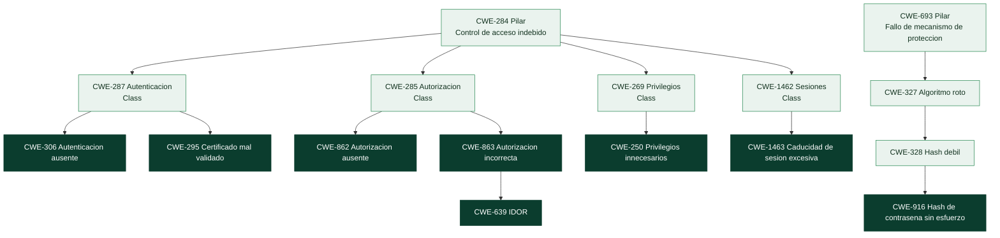

# Clase 364 — Familias CWE (2): identidad, acceso, criptografía y exposición de información

> Parte: **20 — Debilidades y vulnerabilidades: CWE, CVE, CVSS y su gestión** · Fuente: *MITRE CWE 5.0 (CWE-284, 285, 287, 306, 307, 327, 384, 639, 798, 862, 863, 916, 1462 y relacionadas), CWE Top 25 2025 y OWASP Top 10:2025*
> ⏱️ Duración estimada: **130 min** · Nivel: **Intermedio–Avanzado**

---

## 🎯 Objetivo

Estudiar la segunda gran familia de debilidades: la que no trata de qué datos entran, sino de **quién es quien actúa, qué se le permite y cómo se protege lo que se guarda y se transmite**. Aprenderás a separar con precisión *autenticación* (¿quién eres?) de *autorización* (¿qué puedes hacer?), a distinguir una comprobación *ausente* de una *incorrecta*, a razonar sobre sesiones, credenciales y criptografía sin inventar nada, y a ver por qué el control de acceso roto es a la vez el fallo más frecuente y el más difícil de detectar con herramientas automáticas. Practicarás con una **matriz de acceso**, la prueba que realmente atrapa la autorización rota, y con una medición de por qué guardar contraseñas exige un algoritmo deliberadamente lento.

> ⚠️ **Ética:** las prácticas se ejecutan sobre modelos en memoria y sobre el laboratorio local. No se prueba contra cuentas ni sistemas reales.

## 📚 Resultados de aprendizaje

Al finalizar, el alumno podrá:

1. **Distinguir** autenticación de autorización y ubicar sus debilidades en la jerarquía CWE.
2. **Explicar** por qué «Missing Authorization» (`CWE-862`) e «Incorrect Authorization» (`CWE-863`) se corrigen de forma distinta.
3. **Reconocer** y clasificar un IDOR (`CWE-639`) y explicar por qué un identificador impredecible no sustituye a la autorización.
4. **Diseñar** una matriz de acceso que cubra todas las parejas usuario-recurso y usarla como prueba de regresión.
5. **Razonar** sobre sesiones: fijación, caducidad y atributos de cookie, y su correspondencia en el catálogo.
6. **Elegir** cómo almacenar credenciales (función adaptativa y con sal) y por qué no basta con «cifrar».
7. **Clasificar** problemas de criptografía sin forzar un CWE y reconocer los de generación de aleatoriedad, validación de certificados y algoritmos débiles.
8. **Identificar** fugas de información por mensajes de error, registros y respuestas distinguibles (`CWE-200`, `209`, `532`).

## 🗺️ Temas

| # | Tema | Por qué importa |
| --- | --- | --- |
| 1 | Seis preguntas que debe responder un sistema | Estructura mental de toda la familia |
| 2 | Autenticación: ausente, débil y repetible (CWE-287, 306, 307, 521, 798, 1392) | Quién eres |
| 3 | Sesiones y cookies (CWE-1462, 1463, 384, 614, 1004, 1275) | Cuánto dura que seas tú |
| 4 | Autorización: ausente frente a incorrecta (CWE-862, 863, 639, 285, 284) | Qué puedes hacer |
| 5 | Privilegios (CWE-269, 250) | Con qué poder se ejecuta todo |
| 6 | Credenciales y criptografía (CWE-916, 759, 327, 328, 330, 338, 321, 295) | Cómo se guarda y se transmite lo secreto |
| 7 | Exposición de información (CWE-200, 209, 532, 312, 319) | Lo que ve quien no debe |
| 8 | Por qué el control de acceso es tan difícil de detectar | Qué dicen las fichas sobre las herramientas |
| 9 | Matriz de acceso y otras pruebas de verificación | De la teoría a la evidencia |
| 10 | Caso Strapi (CVE-2023-22894, KEV octubre de 2026) | Un filtro de consulta como canal para inferir datos sensibles |

## 🧱 Prerrequisitos

- **Clases 361 a 363:** jerarquía CWE, mapeo por causa raíz y la idea de que el mecanismo que falla determina la defensa.
- **Autenticación y autorización** (clases 001 y 101–105): *autenticar* es comprobar la identidad que alguien afirma; *autorizar* es decidir qué puede hacer una identidad ya comprobada. La primera sucede una vez al entrar; la segunda, en **cada** acceso a un recurso.
- **Sesión:** el estado que el servidor (o un token) mantiene entre peticiones para recordar quién es el usuario. Sin ella habría que autenticarse en cada clic.
- **Hash, sal y derivación de claves** (clase 021 y Parte 2): un *hash* es una función de un solo sentido; una *sal* es un valor aleatorio único por contraseña que impide reutilizar cálculos; una *función de derivación* lenta encarece cada intento de adivinar.
- **IDOR** (clase 105): acceder a un objeto ajeno cambiando un identificador en la petición.

## 🧠 Explicación en profundidad

### Seis preguntas que debe responder un sistema

Casi todas las debilidades de esta familia son una pregunta mal respondida (o sin responder). Ordenarlas así ayuda a no confundirlas:

| Pregunta | Si falla… | Entradas representativas |
|---|---|---|
| ¿Quién eres? | Autenticación | `CWE-287`, `306`, `307`, `521`, `798`, `1392` |
| ¿Sigues siendo tú? | Gestión de sesión | `CWE-1462`, `1463`, `384`, `614`, `1004`, `1275` |
| ¿Qué puedes hacer? | Autorización | `CWE-285`, `862`, `863`, `639` |
| ¿Con qué poder actúa el programa? | Privilegios | `CWE-269`, `250` |
| ¿Cómo se protege lo secreto? | Credenciales y criptografía | `CWE-916`, `759`, `327`, `330`, `338`, `295` |
| ¿Qué ve quien no debe? | Exposición de información | `CWE-200`, `209`, `532`, `312`, `319` |

La jerarquía del catálogo respalda esta división. Bajo el pilar `CWE-284` (*Improper Access Control*, desaconsejado para mapear por demasiado general) cuelgan dos clases hermanas: `CWE-287` (autenticación) y `CWE-285` (autorización), junto con `CWE-269` (gestión de privilegios) y `CWE-1462` (gestión de sesiones). Los mecanismos criptográficos, en cambio, cuelgan de otro pilar, `CWE-693` (*Protection Mechanism Failure*), porque lo que falla es un *mecanismo de protección*, no el control de acceso en sí.



El diagrama muestra cómo se separan las ramas. Las entradas de la derecha-abajo (criptografía) no son «acceso» sino «protección», por eso comparten raíz con otros fallos de mecanismos de seguridad. Y fíjate en `CWE-639` (el IDOR): es hija de `CWE-863` (autorización *incorrecta*), no de la ausente. Eso tiene una lectura sutil que se aclara en la sección de autorización.

### Autenticación: ausente, débil y repetible

**Ausente (`CWE-306`).** Una función crítica que no pide identidad. Es una *Base* «Allowed», puesto 21 del Top 25 de 2025 con **11 CVE en KEV**, una cifra alta para su posición: cuando existe, es muy explotada, porque no hay barrera que superar. Los ejemplos observados que MITRE enlaza lo muestran bien: un producto de compartición de archivos que no comprueba si el usuario ha iniciado sesión al servir bibliotecas PHP de un directorio interno (`CVE-2024-11680`), o protocolos industriales sin autenticación (`CVE-2022-29951`). La mitigación que recoge el catálogo es de **diseño**: dividir el software en áreas anónimas, normales, privilegiadas y administrativas, identificar cuáles exigen identidad probada, **duplicar en el servidor** cualquier comprobación hecha en el cliente, **evitar autenticaciones caseras** y usar el marco o biblioteca que aporte esa capacidad.

**Débil.** La clase `CWE-1390` (*Weak Authentication*), hija de `CWE-287`, recoge, entre otras, `CWE-521` (requisitos de contraseña débiles) y `CWE-1391` (*Use of Weak Credentials*), de la que cuelgan `CWE-798` (credenciales codificadas en el programa, con su variante `CWE-259` para contraseñas) y `CWE-1392` (credenciales por defecto, con `CWE-1393` para contraseñas por defecto). La diferencia entre las dos últimas importa para corregir: una credencial *codificada* está dentro del código y se corrige sacándola y rotándola; una *por defecto* es un valor de fábrica que el usuario debería cambiar y se corrige forzando el cambio en la primera puesta en marcha. Ejemplos del catálogo: un producto con credenciales codificadas que filtraba datos de salud (`CVE-2022-40263`) o una placa con contraseña por defecto que daba acceso de administrador (`CVE-2021-38759`).

**Repetible (`CWE-307`).** Si el sistema acepta intentos ilimitados, la autenticación más robusta se vuelve una cuestión de tiempo. `CWE-307` es *Improper Restriction of Excessive Authentication Attempts*. La práctica `labs/appsec-code/practicas/limites.py` incluye un `ControlDeIntentos` que bloquea tras N fallos. El matiz de diseño: un bloqueo permanente por cuenta permite a un atacante **bloquear a propósito** a un usuario legítimo (denegación de servicio selectiva); por eso los bloqueos son temporales y se combinan con límites por origen.

### Sesiones y cookies

Autenticarse una vez y mantener la identidad exige una sesión, y la sesión es una debilidad en sí misma si se gestiona mal. El catálogo agrupa los fallos bajo `CWE-1462` (*Improper Session Management*, clase «Allowed-with-Review», hija del control de acceso). Un detalle de vigencia útil: **`CWE-613` («Insufficient Session Expiration») está obsoleta** —su ficha dice que se retiró «por no ser suficientemente clara» y remite a `CWE-1462` y sus descendientes—; su sustituta concreta es `CWE-1463` (*Insufficient Session Timeout Value*). Si encuentras `CWE-613` en un informe antiguo, ya sabes qué hacer.

Tres atributos de la cookie de sesión tienen cada uno su propia entrada, lo que ilustra que el catálogo es granular:

| Atributo | Qué impide | Entrada |
|---|---|---|
| `Secure` | Que la cookie viaje por HTTP sin cifrar | `CWE-614` (*Sensitive Cookie in HTTPS Session Without 'Secure' Attribute*) |
| `HttpOnly` | Que un script de la página (por ejemplo, tras un XSS) lea la cookie | `CWE-1004` (*Sensitive Cookie Without 'HttpOnly' Flag*) |
| `SameSite` | Que la cookie se adjunte a peticiones originadas en otros sitios (defensa parcial contra CSRF) | `CWE-1275` (*Sensitive Cookie with Improper SameSite Attribute*) |

La **fijación de sesión** (`CWE-384`) es, como `CWE-352`, una entrada *Compound*: el atacante fija o conoce el identificador de sesión *antes* de que la víctima se autentique, y el servidor no lo renueva al iniciar sesión. La corrección es una regla de oro: **regenerar el identificador de sesión en cada cambio de nivel de privilegio** (al autenticarse, al elevar permisos).

### Autorización: ausente frente a incorrecta

Aquí está el centro de gravedad de la familia. `CWE-862` (*Missing Authorization*) y `CWE-863` (*Incorrect Authorization*) son clases hermanas bajo `CWE-285`, y su diferencia es la diferencia entre dos arreglos:

- **Ausente:** no hay comprobación. El arreglo es **añadirla**, en el servidor, en la propia operación, con *denegación por defecto*.
- **Incorrecta:** hay comprobación, pero comprueba lo equivocado: el rol en vez de la relación con el recurso, la interfaz en vez del servidor, un dato que el cliente controla. El arreglo es **cambiar qué se comprueba**; añadir *otra* comprobación encima sin entender la anterior solo multiplica el error.

Un ejemplo ayuda a ver la sutileza. En la práctica de esta clase la función `leer_con_error` sí «autoriza»: deja pasar a quien tenga rol `usuario` o `admin`. Pero todos los usuarios corrientes tienen rol `usuario`, así que cualquiera lee cualquier documento. La comprobación existe y es inútil, y por eso es `CWE-863` y no `CWE-862`.

**IDOR (`CWE-639`).** *Authorization Bypass Through User-Controlled Key*: el atacante cambia un identificador (`/documento/1` por `/documento/2`) y accede a un objeto ajeno. Está bajo `CWE-863`, no bajo la ausente, porque en un IDOR *normalmente sí hay* una comprobación («¿está autenticado?; ¿existe ese documento?») pero no la que importa («¿es suyo?»). MITRE enlaza un caso: una aplicación educativa que no restringe los identificadores de archivo a su usuario y permite adivinarlos por fuerza bruta (`CVE-2021-36539`). Una creencia extendida y falsa es que usar identificadores aleatorios (UUID) lo arregla. **No:** dificulta *adivinar* identificadores, pero si el identificador se filtra (en un correo, en un registro, en una URL compartida) o se conoce legítimamente, sin comprobación de propiedad el acceso sigue abierto. La autorización se comprueba, no se oculta.

La práctica `labs/appsec-code/practicas/autorizacion.py` lo hace tangible con tres funciones de lectura y una **matriz de acceso**:

```python
# Política: (usuario, documento) -> ¿debe poder leerlo?  ana sólo el 1, luis sólo el 2, root ambos.
POLITICA_LECTURA = {("ana", 1): True, ("ana", 2): False, ("luis", 1): False,
                    ("luis", 2): True, ("root", 1): True, ("root", 2): True}

def matriz_de_acceso(funcion, usuarios=USUARIOS, documentos=DOCUMENTOS):
    """Ejecuta `funcion` para TODAS las parejas usuario-documento y devuelve quién pudo leer qué."""
    resultado = {}
    for u in usuarios:
        for d in documentos:
            try:
                funcion(u, d); resultado[(u, d)] = True
            except Denegado:
                resultado[(u, d)] = False
    return resultado
```

La matriz es la herramienta más eficaz contra autorización rota por una razón simple: **comprueba todas las parejas, no las que se le ocurren a quien programa**. Con ella, `leer_vulnerable` y `leer_con_error` violan exactamente dos parejas (`ana-2` y `luis-1`: cada uno lee lo ajeno) y `leer_correcto` ninguna. Fíjate además en una decisión de la versión correcta: responde **igual** a «no existe» y «no es tuyo». Si distinguiera, el atacante podría recorrer identificadores y deducir cuáles existen (enumeración, que es exposición de información, `CWE-200`).

### Privilegios: `CWE-269` y `CWE-250`

`CWE-250` (*Execution with Unnecessary Privileges*, «Allowed», cuelga de `CWE-269`) describe un programa que corre con más poder del que necesita. Es una debilidad *amplificadora*: no abre la puerta, pero convierte cualquier otro fallo (una inyección de comandos, una subida de archivos) en un compromiso total. Un servicio web que corre como administrador transforma un `CWE-78` en control de la máquina; el mismo fallo bajo un usuario sin privilegios queda contenido. La mitigación es el **mínimo privilegio**: cuentas de servicio dedicadas, permisos acotados y, en contenedores, no ejecutar como superusuario (se desarrolla en la clase 366).

### Credenciales y criptografía: guardar sin inventar

**Contraseñas (`CWE-916`).** *Use of Password Hash With Insufficient Computational Effort* es la entrada precisa para el MD5 sin sal del laboratorio. Cuelga de `CWE-328` (hash débil), hija de `CWE-327`. MITRE recomienda para su mitigación **una función hash adaptativa** cuyo coste computacional (iteraciones, memoria) se pueda ajustar, y advierte de no saltarse pasos costosos de las técnicas aprobadas (`CWE-325`). Hay una variante para la ausencia de sal, `CWE-759`. Los ejemplos observados incluyen routers sin sal y un servidor de bases de datos que usaba el nombre de usuario como sal.

¿Por qué *lenta*? Porque quien roba una base de datos de hashes puede probar contraseñas fuera de línea a la velocidad que permita su hardware. Una función rápida ayuda al atacante; una lenta y que gasta memoria encarece cada intento. Se puede medir con un ejemplo cuyo código se explica línea a línea:

```python
import hashlib, os, time

def tasa(funcion, repeticiones):
    """Hashes por segundo: cuántas veces se ejecuta `funcion` en el tiempo medido."""
    inicio = time.perf_counter()
    for i in range(repeticiones):
        funcion(i)
    return repeticiones / (time.perf_counter() - inicio)

sal = os.urandom(16)  # sal aleatoria única, como se guardaría junto al hash
md5 = tasa(lambda i: hashlib.md5(b"clave%d" % i).hexdigest(), 200_000)
scrypt = tasa(lambda i: hashlib.scrypt(b"clave%d" % i, salt=sal, n=2**14, r=8, p=1,
                                       maxmem=2**26, dklen=32), 30)
print(f"md5 {md5:,.0f}/s · scrypt {scrypt:,.1f}/s · razón {md5/scrypt:,.0f}x")
```

En una ejecución del autor (Python 3.12 en un equipo de desarrollo, 2026-10-30) salieron unos **985.000 hashes por segundo con MD5** frente a **16 con scrypt (N=2¹⁴)**, una razón de unas 61.000 veces; con N=2¹⁷ (el valor que recomienda OWASP como primera opción de scrypt) el cociente supera las 500.000. Tu cifra será otra, pero el orden de magnitud sí. Un atacante con GPU lo agrava en ambos lados, y justo por eso la recomendación actual de OWASP pone **Argon2id** en primer lugar y admite scrypt con parámetros mínimos documentados (N=2¹⁷, r=8, p=1, o combinaciones equivalentes de memoria y paralelismo).

**Aleatoriedad (`CWE-330`, `338`, `331`).** `CWE-338` es el uso de un generador de números pseudoaleatorios criptográficamente débil. En Python, el módulo `random` está pensado para simulaciones: su documentación indica que no debe usarse con fines de seguridad y remite a `secrets`. Un token de recuperación de contraseña generado con `random` es predecible; con `secrets.token_urlsafe(32)` no. La regla general: **todo valor que deba ser impredecible** (tokens de sesión, de restablecimiento, claves, sales) **se genera con el generador criptográfico del sistema**.

**Algoritmos y claves (`CWE-327`, `1240`, `321`).** Usar un algoritmo roto, un modo inadecuado (el ejemplo de MITRE: TEA en modo ECB, que filtra patrones) o implementar criptografía propia. `CWE-327` es una *Class* «Allowed-with-Review». Una *clave* escrita en el código es `CWE-321`, variante de `CWE-798`. La regla es la de siempre: **no inventes criptografía**; usa bibliotecas y primitivas probadas con parámetros actuales.

**Certificados (`CWE-295`).** *Improper Certificate Validation* cuelga de la autenticación (`CWE-287`): si no se valida el certificado, un intermediario puede suplantar al servidor. Los casos del catálogo son muy didácticos: un `goto` duplicado que se saltaba la verificación en una biblioteca SSL de Apple (`CVE-2014-1266`, el conocido «goto fail») y una rutina de actualización de firmware de un router que llamaba a `curl` con la opción `-k` (inseguro) y desactivaba la validación (`CVE-2021-22909`). La moraleja práctica: la opción «ignorar errores de certificado» **nunca** debe llegar a producción.

### Exposición de información: `CWE-200`, `209`, `532`, `312`, `319`

`CWE-200` (*Exposure of Sensitive Information to an Unauthorized Actor*, puesto 20) es una clase desaconsejada; las entradas útiles son sus hijas. `CWE-209` es la generación de **mensajes de error con información sensible** (rastros de pila, rutas, consultas SQL, y también la distinción entre «usuario inexistente» y «contraseña incorrecta», que permite enumerar usuarios). `CWE-532` es insertar información sensible **en los registros**. `CWE-312` es guardarla en claro y `CWE-319` transmitirla en claro. El hilo común es que la información **está disponible para quien no debería** por un camino lateral: un error, un log, un respaldo, un canal sin cifrar. La corrección combina minimizar lo que se guarda y se muestra, mensajes de error genéricos hacia el usuario (el detalle va al registro interno, protegido) y cifrado en tránsito y en reposo.

### Por qué el control de acceso es tan difícil de detectar

OWASP coloca **A01 Broken Access Control** en primer lugar en su edición 2025, y es la categoría con más debilidades asociadas (40, el tope que OWASP se fijó). Las fichas de MITRE explican por qué es tan difícil de cazar con herramientas: para `CWE-862` y `CWE-863`, el **análisis estático automatizado** figura con eficacia *Limited* y el **análisis manual** con *Moderate*; para `CWE-306`, el estático automatizado también es *Limited*. La razón es conceptual: una herramienta puede ver que falta una comprobación sintáctica, pero **no sabe qué política de negocio debería existir** («¿debería poder un gestor ver las nóminas de otro departamento?»). Esa política solo la conoce el negocio. Por eso la defensa se construye con **requisitos explícitos y pruebas** (la matriz de acceso) más que con escáneres, y por eso conviene que la política esté escrita antes de que exista el código.

Datos del Top 25 de 2025 que lo ilustran: `CWE-862` (autorización ausente) es el **puesto 4** con 13,28 puntos pero **0 CVE en KEV**; `CWE-863` (incorrecta) es el 17 con 4 en KEV; `CWE-306` es el 21 pero con **11** en KEV; `CWE-639` (IDOR) es el 24 con 0. Es decir, que las más *frecuentes* no son las más *explotadas*, y que las de ausencia total de autenticación, aunque menos numerosas, se aprovechan mucho (clase 369).

### Verificar: la matriz y tres pruebas más

Todas las correcciones de esta familia se demuestran con una prueba que **fallaba antes**:

1. **Matriz de acceso** (autorización): todas las parejas usuario-recurso y usuario-operación contra una política escrita.
2. **Respuesta indistinguible** (enumeración): comparar la respuesta ante «no existe» y «no es tuyo»; deben ser iguales en contenido y forma.
3. **Hash de contraseña:** dos hashes de la misma contraseña difieren (sal), el hash incluye los parámetros y una verificación con parámetros alterados falla (lo comprueba `test_correcciones.py`).
4. **Secretos:** ningún literal sensible en el código ni en el historial (se escanean con herramientas de detección de secretos).

<!-- octubre-2026-364 -->
### Caso real de octubre de 2026: el filtro que revela lo que no devuelve

`CVE-2023-22894` (Strapi, hasta la versión 4.5.5; `CWE-312`, almacenamiento de información sensible en texto claro) se publicó en abril de 2023 y entró a KEV el **2026-10-08**. El registro describe un atacante **con acceso al panel de administración** que, al filtrar usuarios por columnas con información sensible, puede *inferir* un valor a partir de las respuestas de la API; con rol de superadministrador podría descubrir el hash de la contraseña y el token de restablecimiento de todos los usuarios. Tiene CVSS 3.1 de 7,2 y un EPSS de solo 4,1 %.

Dos ideas de esta clase se ven con claridad. Primero, **la información se filtra aunque nunca se devuelva**: cada respuesta del tipo «hay coincidencias / no hay coincidencias» revela un bit, y la suma de bits reconstruye el valor (una consulta *oráculo*). La defensa no es ocultar el campo en la respuesta, sino **no permitir filtrar, ordenar ni buscar por campos sensibles** en ninguna capa. Segundo, el almacenamiento de secretos —el hash de contraseña o un token de restablecimiento— merece el mismo cuidado que su transmisión: tokens de un solo uso, de vida corta y almacenados solo como huella (*hash*). Que un caso de 2023 entrara a KEV en 2026 no dice cuándo se explotó por primera vez; solo que CISA tiene evidencia de explotación (véase la clase [367](../367-cve-identificar-vulnerabilidades-concretas/README.md)).

## 📖 Definiciones y características

- **Autenticación (`CWE-287`):** comprobar la identidad afirmada. *Clave:* una vez, al entrar.
- **Autorización (`CWE-285`):** decidir qué puede hacer una identidad. *Clave:* en cada acceso, en el servidor.
- **Autorización ausente (`CWE-862`) / incorrecta (`CWE-863`):** no hay comprobación / hay una equivocada. *Clave:* se corrigen de forma distinta.
- **IDOR (`CWE-639`):** acceso a un objeto ajeno cambiando un identificador. *Clave:* los identificadores aleatorios no sustituyen a la comprobación.
- **Fijación de sesión (`CWE-384`):** el atacante conoce el identificador antes del inicio de sesión. *Clave:* regenerarlo al autenticarse.
- **Credencial codificada (`CWE-798`) / por defecto (`CWE-1392`):** dentro del código / valor de fábrica. *Clave:* rotar y sacar / forzar el cambio.
- **Hash con esfuerzo insuficiente (`CWE-916`):** función rápida para guardar contraseñas. *Clave:* usar una adaptativa con sal.
- **Mínimo privilegio (`CWE-250`):** ejecutar solo con el poder necesario. *Clave:* amplificador de otros fallos.
- **Matriz de acceso:** prueba que ejecuta todas las parejas usuario-recurso. *Clave:* detecta lo que no se le ocurrió al programador.

## 📔 Glosario

| Término | Definición concisa |
|---------|--------------------|
| Autenticación | Comprobar que quien actúa es quien dice ser |
| Autorización | Decidir qué acciones y recursos puede usar una identidad ya comprobada |
| Control de acceso | Conjunto de mecanismos que limitan quién puede hacer qué |
| IDOR | Acceso a un objeto ajeno manipulando un identificador de la petición |
| Matriz de acceso | Tabla usuario-recurso que se usa como política y como prueba |
| Denegación por defecto | Principio de rechazar todo lo que no esté permitido expresamente |
| Sesión | Estado que recuerda la identidad del usuario entre peticiones |
| Fijación de sesión | Ataque que impone un identificador de sesión conocido antes de autenticarse |
| Cookie Secure | Atributo que impide enviar la cookie por conexiones sin cifrar |
| Cookie HttpOnly | Atributo que impide que scripts de la página lean la cookie |
| Cookie SameSite | Atributo que limita enviar la cookie en peticiones entre sitios |
| Credencial codificada | Usuario, contraseña o clave escritos en el código |
| Credencial por defecto | Valor de fábrica que el usuario debería cambiar |
| Sal | Valor aleatorio único por contraseña que se mezcla antes de calcular el hash |
| Función adaptativa | Función de hash cuyo coste se ajusta para encarecer los intentos de adivinar |
| scrypt | Función de derivación de claves que consume tiempo y memoria |
| PRNG criptográfico | Generador de números aleatorios apto para valores impredecibles |
| Mínimo privilegio | Dar a cada componente solo los permisos que necesita |
| Enumeración | Deducir qué existe observando diferencias en las respuestas |

## 🧰 Herramientas y preparación

```bash
# Prácticas de la clase: autorización (matriz de acceso), límites de intentos y de tasa
python -m unittest discover -s labs/appsec-code/tests -v

# Jerarquía y miembros de las ramas de la clase
python scripts/cwe_kb.py relaciones CWE-639
python scripts/cwe_kb.py miembros CWE-1436     # categoría OWASP A01:2025 Broken Access Control (40 CWE)
python scripts/cwe_kb.py mitigaciones CWE-862
```

Mide tú mismo la razón MD5/scrypt con el fragmento de la explicación. Si quieres escanear secretos en un repositorio propio, `gitleaks` y `detect-secrets` son herramientas habituales (se tratan en la clase 241).

## 🧪 Laboratorio guiado

> Todo sobre modelos en memoria y el laboratorio local.

1. **Ejecuta la matriz de acceso** contra las tres versiones y compara las violaciones:

   ```python
   import sys; sys.path.insert(0, "labs/appsec-code/practicas")
   import autorizacion as A

   for nombre, f in (("vulnerable", A.leer_vulnerable), ("con error", A.leer_con_error), ("correcta", A.leer_correcto)):
       print(f"{nombre:10} violaciones: {A.violaciones(f)}")
   ```

   Resultado esperado: `vulnerable` y `con error` violan `('ana', 2)` y `('luis', 1)`; `correcta`, ninguna.
2. **Modifica la política** añadiendo un tercer documento y un usuario nuevo; vuelve a ejecutar. ¿Tu implementación correcta sigue cumpliéndola sin tocar la política? Si no, ¿qué suposición ocultaba?
3. **Comprueba la enumeración.** Compara el mensaje de `leer_correcto("luis", 1)` (ajeno) con el de `leer_correcto("luis", 999)` (inexistente). Después escribe una variante que devuelva «no existe» para el segundo y «prohibido» para el primero y explica qué información regala.
4. **Mide MD5 frente a scrypt** con el fragmento de la explicación en tu equipo y anota la razón.
5. **Genera tokens** con `random` y con `secrets` (`secrets.token_urlsafe(32)`), repite la ejecución con la misma semilla (`random.seed(1)`) y verifica que el primero es reproducible (predecible) y el segundo no.
6. **Clasifica con el catálogo** cada uno de estos hallazgos y justifica nivel y entrada: «la aplicación acepta hasta 10.000 intentos de contraseña por minuto», «la cookie de sesión viaja sin `Secure`», «el panel de administración responde sin sesión», «la contraseña se guarda con SHA-1 sin sal», «el error muestra la consulta SQL».

## ✍️ Ejercicios

1. Explica con tus palabras por qué `CWE-639` cuelga de la autorización *incorrecta* y no de la *ausente*, usando el ejemplo `/documento/1`.
2. Un compañero afirma: «Usamos UUID para los identificadores, así que no hay IDOR». Redacta tu respuesta con un escenario concreto de fuga del identificador.
3. Para cada frase di si es `CWE-862` o `CWE-863` y por qué: (a) «el botón *Borrar* solo se muestra a los administradores, pero la API acepta la petición de cualquiera»; (b) «la API comprueba que el usuario está autenticado y que el pedido existe, pero no que sea suyo»; (c) «la API comprueba el rol `gestor` pero los gestores de una región ven los pedidos de todas».
4. Diseña la política y la matriz de acceso de un sistema con tres roles (`cliente`, `soporte`, `admin`) y los recursos `pedido`, `ficha_cliente` y `facturacion`. ¿Cuántas parejas hay que probar?
5. Explica por qué guardar contraseñas «cifradas con AES» no es la solución correcta al `CWE-916`.
6. Distingue `CWE-798` y `CWE-1392` y propón la corrección de cada una.
7. La ficha de `CWE-862` califica el análisis estático como *Limited*. ¿Qué parte del problema no puede ver y cómo la cubrirías?
8. Explica qué es una fijación de sesión y cuál es la corrección de una línea (conceptual) que la elimina.
9. Caso Strapi (octubre de 2026). Diseña una API de usuarios que permita filtrar por `nombre` y `rol` pero nunca por `hash` ni `token`, y escribe la prueba que lo demuestre. *Solución razonada:* una lista blanca de campos filtrables (no una lista negra de campos prohibidos), aplicada en la capa de datos y no solo en la interfaz, y una prueba que intente filtrar por cada campo sensible y espere un error de validación; el criterio es que un campo nuevo sensible quede bloqueado por omisión.

## ✅ Soluciones razonadas

1. En un IDOR **sí hay comprobaciones** (autenticado, el documento existe), pero no la que importa: la relación entre el usuario y el recurso. Eso es autorización *incorrecta*: se comprueba algo, no lo adecuado. Si no hubiera ninguna comprobación (cualquiera, incluso sin sesión), sería ausente (`CWE-862`). La distinción importa porque el arreglo es cambiar *qué* se comprueba.
2. Un UUID dificulta *adivinar* el identificador, pero no lo protege: aparece en correos, en URL compartidas, en registros del servidor, en el historial del navegador y en respuestas de listados. Escenario: un usuario comparte un enlace a su documento con un colega; el colega reenvía el enlace; el tercero, que no debería tener acceso, lo abre y lo lee porque el servidor solo comprueba que el documento existe. La defensa es comprobar la propiedad en el servidor, no ocultar el identificador.
3. (a) **`CWE-862`**: no hay autorización en el servidor; ocultar un botón es presentación, no control. (b) **`CWE-863`** (el patrón IDOR/`CWE-639`): se comprueba autenticación y existencia, no propiedad. (c) **`CWE-863`**: la comprobación existe pero usa un criterio demasiado amplio (rol, sin acotar a la región): comprueba lo equivocado.
4. Con tres roles y tres recursos, para *lectura* hay 3 × 3 = 9 combinaciones rol-recurso a decidir; si además distingues *quién es dueño* de cada pedido, hay que probar con al menos **dos usuarios por rol** para detectar accesos laterales (cliente A frente a cliente B): eso lleva las parejas a 18 o más. La matriz se escribe *antes* que el código: `cliente` solo sus pedidos y su ficha y nada de facturación global; `soporte` pedidos y fichas de todos pero no facturación; `admin` todo. El punto clave es probar entre usuarios del *mismo* rol.
5. Porque «cifrar» es reversible: quien tenga la clave recupera todas las contraseñas, y la clave suele estar en el mismo servidor. Las contraseñas no deben poder recuperarse (`CWE-257`: *Storing Passwords in a Recoverable Format*): se guarda un hash adaptativo con sal, y se verifica recalculando. Un hash rápido (`CWE-916`) o cifrado reversible (`CWE-257`) son debilidades distintas.
6. `CWE-798`: credencial **escrita en el código**; se corrige sacándola a un gestor de secretos o a variables de entorno, **rotándola** (la publicada ya no sirve) y escaneando el historial. `CWE-1392`: valor **de fábrica**; se corrige obligando a cambiarlo en el primer arranque y no desplegando con valores por defecto.
7. No puede ver la **política de negocio**: sabe que falta una comprobación sintáctica, no que «un gestor no debería ver las nóminas de otro departamento». Se cubre con una política escrita, una matriz de acceso automatizada como prueba de regresión y revisión manual de cada operación sensible (pruebas por rol).
8. El atacante hace que la víctima use un identificador de sesión que él ya conoce (o fija) antes de autenticarse; si el servidor no lo cambia al iniciar sesión, el atacante comparte la sesión autenticada. La corrección conceptual: **emitir un identificador de sesión nuevo cada vez que cambia el nivel de privilegio** (al autenticarse) e invalidar el anterior.

## 📝 Reto verificable

**Escribe y prueba la autorización de un mini sistema de pedidos.** Parte de `practicas/autorizacion.py`: añade el recurso «pedido» (dueño y estado), el rol `soporte` (lee pero no modifica) y las operaciones `leer`, `modificar` y `cancelar`. Entrega: (a) la **política** como tabla; (b) una implementación vulnerable y otra correcta de cada operación; (c) una **matriz de acceso** que cubra todas las parejas usuario-pedido-operación; y (d) una prueba que demuestre que la implementación vulnerable viola la política y la correcta no.

**Criterio de aceptación:** `python -m unittest` pasa; la matriz cubre al menos 3 usuarios × 3 pedidos × 3 operaciones (27 casos); la versión vulnerable falla al menos un caso de cada tipo (lectura ajena, modificación por `soporte`, cancelación por usuario corriente); y la respuesta ante «no existe» y «no autorizado» es indistinguible.

## ⚠️ Errores comunes

| Síntoma / mensaje | Causa y cómo arreglar |
| --- | --- |
| «Está autenticado, así que puede» | Autenticación no es autorización. Comprueba permisos en cada acceso, en el servidor |
| Ocultar el botón para proteger la función | La petición se construye a mano. Comprueba el rol en la propia operación |
| Comprobar el rol y olvidar la propiedad del recurso | Es `CWE-863`: comprueba la relación usuario-recurso, no solo el rol |
| Confiar en identificadores impredecibles | Se filtran. Comprueba la propiedad siempre |
| Probar la autorización con uno o dos casos | Usa una matriz que cubra todas las parejas, incluido entre usuarios del mismo rol |
| Mensajes distintos para «no existe» y «prohibido» | Permiten enumerar. Responde igual en contenido y forma |
| Guardar contraseñas con un hash rápido o cifradas | Función adaptativa con sal (Argon2id o scrypt), no reversible |
| Usar `random` para tokens | Predecible. Usa un generador criptográfico (`secrets`) |
| Dejar `-k` o `verify=False` «temporalmente» | Desactiva la validación de certificados y casi nunca se retira. Prohíbelo por revisión y análisis estático |

## ❓ Preguntas frecuentes

**❓ ¿Por qué el control de acceso roto es el nº 1 de OWASP si lo sabemos hace años?** Porque no se resuelve con una biblioteca: depende de una política de negocio específica de cada sistema, que las herramientas no conocen, y cada nueva funcionalidad abre un recurso nuevo que hay que proteger.

**❓ ¿Un WAF protege contra IDOR?** No. Para el WAF, `/documento/2` es una petición legítima; solo la aplicación sabe quién es el dueño.

**❓ ¿Qué es mejor, Argon2id o scrypt?** OWASP recomienda Argon2id como primera opción y acepta scrypt con parámetros mínimos documentados; elige la que tu plataforma ofrezca bien soportada. Lo que no es aceptable es un hash rápido o sin sal.

**❓ ¿La autenticación multifactor resuelve `CWE-306`?** No: MFA fortalece *cómo* te autenticas, pero si una función crítica no exige autenticación, el MFA nunca se invoca.

**❓ ¿Cómo sé si una entrada de mi informe está obsoleta?** `python scripts/cwe_kb.py referencias` y `mostrar` te lo indican; por ejemplo, `CWE-613` está obsoleta y remite a `CWE-1462`.

## 🔗 Referencias

- MITRE CWE, fichas de CWE-284, 285, 287, 306, 307, 862, 863 y 639 — <https://cwe.mitre.org/data/definitions/862.html> — jerarquía, uso para mapear, mitigaciones de diseño y eficacia de detección citadas.
- MITRE CWE, fichas de CWE-1462, 1463, 384, 614, 1004 y 1275 — <https://cwe.mitre.org/data/definitions/1462.html> — gestión de sesiones, atributos de cookie y la obsolescencia de CWE-613.
- MITRE CWE, fichas de CWE-916, 759, 327, 330, 338 y 295 — <https://cwe.mitre.org/data/definitions/916.html> — mitigación con función adaptativa y ejemplos observados de criptografía.
- OWASP Cheat Sheet Series, *Password Storage* — <https://cheatsheetseries.owasp.org/cheatsheets/Password_Storage_Cheat_Sheet.html> — Argon2id como primera opción y parámetros mínimos de scrypt (N=2^17, r=8, p=1 y equivalentes).
- OWASP, *Top 10:2025* — <https://top10.owasp.org/2025/> — A01 Broken Access Control y A07 Authentication Failures y su número de CWE.
- MITRE CWE, *2025 CWE Top 25* — <https://cwe.mitre.org/top25/archive/2025/2025_cwe_top25.html> — puestos, puntuaciones y CVE en KEV de CWE-862, 863, 306, 284, 200 y 639.
- Python, módulo `secrets` — <https://docs.python.org/3/library/secrets.html> — generación de valores impredecibles frente al módulo `random`.
- CVE Program, registro de `CVE-2023-22894` — <https://www.cve.org/CVERecord?id=CVE-2023-22894> — descripción, versiones afectadas, CWE y CVSS.

## 📥 Material descargable

- 📄 [Guía en PDF](./clase-364-guia.pdf) — versión imprimible de esta clase.
- 🎞️ [Presentación (PPTX)](./clase-364-presentacion.pptx) — deck para proyectar en clase.

## ⬅️ Clase anterior

[Clase 363 — Familias CWE (1): entradas no confiables](../363-familias-cwe-entradas-no-confiables/README.md)

## ➡️ Siguiente clase

[Clase 365 — Familias CWE (3): memoria, enteros, concurrencia y recursos](../365-familias-cwe-memoria-enteros-concurrencia-recursos/README.md)
