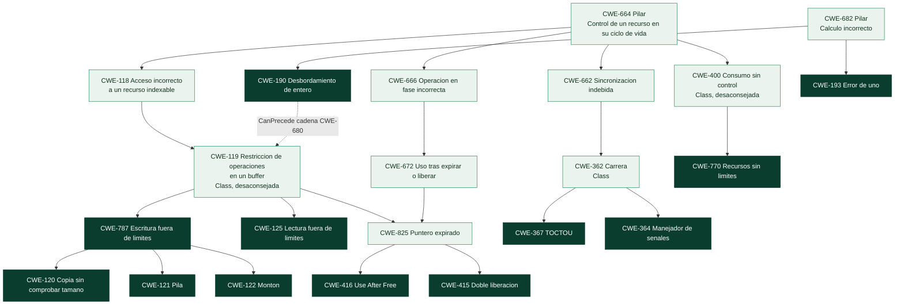

# Clase 365 — Familias CWE (3): memoria, enteros, concurrencia y recursos

> Parte: **20 — Debilidades y vulnerabilidades: CWE, CVE, CVSS y su gestión** · Fuente: *MITRE CWE 5.0 (CWE-119, 125, 190, 193, 362, 364, 367, 400, 415, 416, 476, 680, 770, 787), CWE Top 25 2025 y casos reales de la instantánea del programa*
> ⏱️ Duración estimada: **130 min** · Nivel: **Avanzado**

---

## 🎯 Objetivo

Estudiar la familia de debilidades que no nace de datos mal interpretados sino de **cómo un programa gestiona la memoria, los números, el tiempo y los recursos finitos**. Son las debilidades dominantes en el software escrito en C y C++ y, aunque la lista de OWASP para web apenas las menciona, ocupan los primeros puestos entre las **vulnerabilidades realmente explotadas**. Aprenderás a distinguir una lectura fuera de límites de una escritura, un uso tras liberar de una doble liberación, una condición de carrera de una comprobación mal ubicada, y a ver cómo un error aritmético minúsculo (una multiplicación que «da la vuelta») es el primer eslabón de una cadena que acaba en ejecución de código. Todo se practica **sin compilador ni riesgo**, con memoria simulada y concurrencia determinista.

> ⚠️ **Ética:** la memoria es simulada y las carreras están forzadas por diseño; no se ataca ningún sistema. Para ver el efecto real en C, usa los laboratorios de la Parte 5 en tu entorno aislado.

## 📚 Resultados de aprendizaje

Al finalizar, el alumno podrá:

1. **Clasificar** un fallo de memoria entre lectura fuera de límites, escritura fuera de límites, uso tras liberar, doble liberación y desreferencia nula.
2. **Explicar** la cadena CWE-680 (de desbordamiento de entero a desbordamiento de buffer) y por qué se corrige en el eslabón raíz.
3. **Identificar** un error de uno (`CWE-193`) y las condiciones de carrera (`CWE-362`, `CWE-367`, `CWE-364`).
4. **Aplicar** la aritmética segura (comprobar los operandos antes de calcular) y los cerrojos que hacen atómica una comprobación y su uso.
5. **Leer** las mitigaciones de MITRE distinguiendo la corrección real (lenguaje, bibliotecas, comprobación) de la *defensa en profundidad* (ASLR, DEP).
6. **Diseñar** límites de tamaño y de tasa que mitiguen el agotamiento de recursos (`CWE-770`, `CWE-400`).
7. **Interpretar** casos reales (Heartbleed, BlueKeep, libwebp, sudo, regreSSHion) con sus CWE, su puntuación y su estado de explotación.
8. **Elegir** técnicas de detección adecuadas (fuzzing, análisis estático, sanitizers) según la eficacia que MITRE documenta.

## 🗺️ Temas

| # | Tema | Por qué importa |
| --- | --- | --- |
| 1 | Tres ideas sobre memoria: espacio, tiempo e inicialización | Ordena una familia con decenas de entradas |
| 2 | Dónde cuelga cada debilidad en CWE | Revela qué falla en cada caso |
| 3 | Enteros: de la multiplicación que se desborda a la escritura fuera de límites | La cadena que dio nombre a CWE-680 |
| 4 | Espacio: lectura y escritura fuera de límites (CWE-119, 125, 787, 120, 121, 122) | Heartbleed frente a libwebp |
| 5 | Tiempo: uso tras liberar, doble liberación, puntero nulo (CWE-416, 415, 476) | BlueKeep y el caso discutible de Fast DDS |
| 6 | Concurrencia: carreras y TOCTOU (CWE-362, 367, 364) | regreSSHion y la ventana invisible |
| 7 | Recursos: consumo sin límites (CWE-400, 770) | Disponibilidad y Rapid Reset |
| 8 | Defensa real frente a defensa en profundidad | Lo que MITRE llama *Defense in Depth* |
| 9 | Detección y verificación | Fuzzing, análisis estático, sanitizers y pruebas |
| 10 | Casos KEV de octubre de 2026: PHP, Brotli, GitLab, kernel Linux | Memoria y enteros en productos de uso masivo |

## 🧱 Prerrequisitos

- **Clases 361 a 364.** Aquí se usa la jerarquía, la distinción causa/consecuencia y la noción de cadena.
- **Memoria de un proceso** (clases 023–024 y 116): la pila (*stack*) guarda variables locales y direcciones de retorno; el montón (*heap*) la memoria reservada dinámicamente; un *buffer* es una zona contigua de tamaño fijo; un *puntero* es una dirección. Si no los dominas, repasa esas clases antes de seguir.
- **Entero con y sin signo, y su ancho** (clase 128): un `uint32` guarda valores de 0 a 4.294.967.295; al superar el máximo «da la vuelta» (*wraparound*) a 0. Esto es comportamiento *definido* en los enteros sin signo, y por eso es peligroso: no produce error.
- **Hilo y sección crítica:** un hilo es una secuencia de ejecución; varios hilos comparten memoria. Una *sección crítica* es el trozo de código que solo un hilo debe ejecutar a la vez.
- **Los laboratorios de la Parte 5** (clases 119, 126–128) enseñan la *explotación*; esta clase se centra en **clasificar, corregir y verificar**.

## 🧠 Explicación en profundidad

### Tres ideas sobre memoria: espacio, tiempo e inicialización

Casi todos los fallos de memoria son una de tres cosas, y conviene fijarlas antes de aprender nombres. (Es una organización **pedagógica** de este programa; el catálogo CWE no la usa como tal.)

- **Espacio:** el programa accede a una dirección **fuera** de la zona que le pertenece: antes del inicio, después del final. Leer fuera de límites filtra datos; escribir fuera de límites corrompe memoria vecina.
- **Tiempo:** el programa accede a una zona **que ya no es válida** porque se liberó (*use after free*, *double free*) o a una dirección nula.
- **Inicialización:** el programa usa memoria **antes de darle valor** y obtiene lo que hubiera allí.

Los lenguajes con gestión automática de memoria (Python, Java, Go, Rust en su modo seguro) previenen la mayoría por construcción. En C y C++ la responsabilidad es del programador, y cada decisión (cuánto reservar, cuándo liberar, cuántos bytes copiar) es una oportunidad de error. Por eso MITRE pone como **primera** mitigación de casi todas estas fichas la *selección de lenguaje*.

### Dónde cuelga cada una en CWE



El diagrama muestra que **la mayoría cuelga del pilar de ciclo de vida de recursos (`CWE-664`)**, pero por ramas distintas: la rama de *acceso indexable* (`CWE-118`/`119`) agrupa los problemas de espacio; la de *fase incorrecta del ciclo de vida* (`CWE-666`/`672`) los de tiempo; la de *sincronización* (`CWE-662`/`362`) las carreras; y la de *consumo* (`CWE-400`/`770`) el agotamiento. Los errores aritméticos (`CWE-190`, `CWE-193`) cuelgan de **otro pilar**, `CWE-682` (*Incorrect Calculation*): no son un problema de memoria en sí sino de cálculo, y por eso son la raíz que *precede* a muchos fallos de memoria (la flecha discontinua es la relación `CanPrecede`). Observa también que `CWE-119` está marcada «Discouraged» para mapear por demasiado general: se usa siempre alguna de sus hijas.

### Enteros: de una multiplicación que se desborda a una escritura fuera de límites

La práctica `labs/appsec-code/practicas/memoria_y_carreras.py` simula la memoria para ver la cadena completa sin compilador. El mecanismo, paso a paso:

```python
MASCARA_32 = 0xFFFF_FFFF            # un entero sin signo de 32 bits solo guarda los 32 bits bajos

def tamano_vulnerable(n, tam_elemento):
    return (n * tam_elemento) & MASCARA_32      # el producto «da la vuelta» si no cabe en 32 bits

tamano_vulnerable(0x2000_0000, 8)   # -> 0     (el producto real es 2**32, que en 32 bits vale 0)
tamano_vulnerable(0x2000_0001, 8)   # -> 8     (2**32 + 8 vale 8)
```

Con `n = 0x20000000` (536.870.912 elementos de 8 bytes) el cálculo real es `2³²`, que en 32 bits vale **0**: el programa reserva un buffer de tamaño cero para guardar 536 millones de elementos. A partir de ahí, cada escritura se sale de los límites. En la práctica, `copiar_vulnerable(0x20000000)` produce un buffer de tamaño 0 y **1000 escrituras fuera de límites** (el programa se detiene a las 1000 por brevedad; el patrón es el mismo). Es la cadena que el catálogo nombra `CWE-680` (*Integer Overflow to Buffer Overflow*): `CWE-190` es la debilidad **primaria**, `CWE-787` la **resultante**.

La corrección cierra el eslabón raíz con aritmética segura, que consiste en **comprobar los operandos antes de calcular**, no el resultado ya desbordado:

```python
def tamano_correcto(n, tam_elemento):
    if n < 0 or tam_elemento <= 0 or n > MASCARA_32 // tam_elemento:     # ¿cabe el producto?
        raise OverflowError("el tamaño solicitado no cabe en 32 bits")
    return n * tam_elemento
```

Corregir `tamano_correcto` hace innecesario «arreglar» la escritura: la prueba demuestra que con la comprobación previa desaparecen las escrituras fuera de límites. Es la lección de las cadenas de la clase 362: se ataca el eslabón raíz. MITRE respalda varias medidas para `CWE-190`: elegir un lenguaje que no permita la debilidad o con construcciones que la faciliten evitar, validar el rango de cualquier entrada numérica, entender cómo se representan los números en el lenguaje, y **eliminar las advertencias del compilador** sobre discordancias de signo. Su detección tiene eficacia *High* con análisis estático y con análisis manual.

**Error de uno (`CWE-193`).** Un bucle con `<=` en vez de `<` escribe un elemento de más: `range(n + 1)` en un buffer de `n`. Es una *Base* hija del pilar de cálculo incorrecto. Un solo byte basta si ese byte es un metadato o el byte bajo de un puntero. La práctica incluye `rellenar_vulnerable(n)` y `rellenar_correcto(n)`, y comprueba el caso límite `n = 0` (una de las comprobaciones que más se olvidan).

### Espacio: lectura y escritura fuera de límites

La lectura y la escritura fuera de límites tienen consecuencias distintas y MITRE las separa en dos entradas *Base*:

- **`CWE-787` (escritura fuera de límites):** corrompe memoria vecina. Puede llevar a ejecución de código. Es el puesto **5** del Top 25 de 2025, con **12 CVE en KEV**. Sus hijas son `CWE-120` (copia sin comprobar el tamaño, «el desbordamiento clásico») y las variantes `CWE-121` (en la pila) y `CWE-122` (en el montón), que además cuelgan de `CWE-788` (acceso a memoria después del final del buffer); son las que debes usar cuando sepas dónde ocurrió.
- **`CWE-125` (lectura fuera de límites):** **filtra** información. Puesto **8**, **3 CVE en KEV**.

**Caso: Heartbleed (CVE-2014-0160), `CWE-125`.** La descripción habla de «sobrelectura de buffer» en la extensión *Heartbeat* de OpenSSL, mediante la cual un atacante remoto obtenía contenido de la memoria del proceso, incluidas claves privadas. NVD y CISA lo clasifican como `CWE-125`, no como desbordamiento. Es el ejemplo perfecto de por qué importa clasificar bien: aquí **no se escribe nada**; se *lee* de más, y la consecuencia es la fuga de secretos, no la ejecución de código. Su CVSS en NVD es **7,5** (confidencialidad alta, nada más), por debajo de muchas «críticas», y sin embargo está en KEV y su EPSS es de 0,99999 (consultado el 2026-10-30). La severidad numérica *subestima* una debilidad de impacto devastador cuyo daño no es «técnico» sino de confianza.

**Caso: libwebp (CVE-2023-4863), `CWE-787`.** Un desbordamiento de montón en una biblioteca de imágenes embebida en el navegador Chrome y en muchas aplicaciones. La descripción oficial dice que permitía «una escritura fuera de límites» mediante una página HTML manipulada, con severidad crítica según Chromium (la puntuación base de NVD es 8,8, porque exige que el usuario abra la página). Está en KEV desde 2023-09-13. Aquí el problema es doble: el defecto (`CWE-787`) y el **canal de distribución**: una biblioteca que viaja *dentro* de decenas de productos, cada uno con su propio ciclo de parches (clase 366 y la gestión de dependencias).

**Qué dice MITRE para corregir y qué solo mitiga.** En las fichas de `CWE-787` y `CWE-120` las mitigaciones se distinguen con una etiqueta de eficacia:

| Mitigación | Tipo | Etiqueta de MITRE |
|---|---|---|
| Usar un lenguaje que no permita la debilidad | Corrección por diseño | *Language Selection* |
| Usar una biblioteca o marco comprobado | Corrección por diseño | *Libraries or Frameworks* |
| Sustituir funciones de copia sin límite por equivalentes con longitud (`strcpy` por `strncpy` y similares) | Corrección de implementación | Eficacia *Moderate* |
| Detección automática de desbordamiento incorporada por el compilador | Contención en compilación | *Environment Hardening*, *Defense in Depth* |
| ASLR (disposición aleatoria del espacio de direcciones) | Contención en ejecución | *Environment Hardening*, *Defense in Depth* |
| DEP/NX (memoria no ejecutable) | Contención en ejecución | *Environment Hardening*, *Defense in Depth* |

La columna final es la clave de lectura: ASLR, DEP y las protecciones del compilador están etiquetadas por MITRE como **defensa en profundidad**, no como solución. Dificultan *explotar* un desbordamiento pero **no lo eliminan**: el defecto sigue ahí y puede provocar caída o fuga. Quien se apoya solo en ellas tiene una vulnerabilidad *menos explotable*, no *corregida*.

### Tiempo: uso tras liberar, doble liberación y puntero nulo

**`CWE-416` (use after free).** Variante de `CWE-825` (desreferencia de puntero expirado). Puesto **7** del Top 25, con **14 CVE en KEV**, la cifra más alta de todas las debilidades de memoria. Ya viste en la clase 361 que tiene dos caminos en la jerarquía: es a la vez un fallo de memoria acotada y de ciclo de vida. Un puntero sigue apuntando a una zona que se liberó y que puede haberse reasignado, de modo que quien escribe a través del puntero antiguo escribe en un objeto ajeno. MITRE recoge como corrección elegir un lenguaje con gestión automática de memoria, y como práctica de contención **poner el puntero a `NULL` tras liberarlo**, etiquetada *Defense in Depth*: sirve para el puntero concreto, pero falla cuando hay varias copias del puntero o estructuras complejas. Su detección tiene eficacia **High** con *fuzzing* y análisis estático.

**Caso: BlueKeep (CVE-2019-0708), `CWE-416`.** Ejecución remota de código en Servicios de Escritorio Remoto sin autenticación previa. CVSS 9,8, en KEV desde 2021-11-03 y con uso en ransomware *Known*. Los puntos de decisión SSVC que publica CISA lo describen como **automatizable** (un adversario puede automatizar todos los pasos) y de impacto técnico **total**. Es lo que el lenguaje común llama *wormable*: la combinación de ausencia de autenticación, red y automatización es la que hace que un fallo de memoria se convierta en una crisis.

**`CWE-415` (doble liberación)** tiene hasta cuatro caminos en la jerarquía porque se explica por ciclo de vida, por puntero expirado y por gestión de recursos. La mitigación de MITRE es sencilla de enunciar y difícil de cumplir: liberar cada reserva **una sola vez**.

**`CWE-476` (desreferencia de puntero nulo).** Puesto 13, **0 CVE en KEV**; suele producir caída (disponibilidad), no ejecución de código. La corrección es comprobar el puntero antes de usarlo, comprobar los valores devueltos por las funciones que pueden devolver nulo e inicializar las variables. Es un buen ejemplo de debilidad *frecuente* y *poco explotada*.

**Un caso discutible: Fast DDS (CVE-2023-50716).** En la clase 362 viste que su descripción habla de liberar memoria *sin inicializar* («bad-free») y que el CNA y NVD la asignaron a `CWE-416`. Con el criterio de esta clase, la lectura más natural es de **inicialización** (tiempo/estado) más que de uso tras liberar: `CWE-763` o `CWE-824` encajarían mejor. Lo importante no es quién acierta sino ejercitar el método: *qué hace el código con el puntero y en qué orden*.

### Concurrencia: carreras y la ventana invisible

Una **condición de carrera** (`CWE-362`, una *Class* «Allowed-with-Review») ocurre cuando el resultado depende del orden en que se intercalan operaciones sobre un recurso compartido. Su variante más famosa en seguridad es `CWE-367` (*Time-of-check Time-of-use*, TOCTOU): se **comprueba** una condición y, un instante después, se **usa** el recurso, pero entre ambos algo pudo cambiar. Y `CWE-364` es la carrera en un *manejador de señales*, que puede interrumpir al programa en cualquier punto.

La práctica lo hace tangible con una cuenta bancaria. La versión vulnerable comprueba el saldo y, **después**, lo descuenta:

```python
def retirar(self, monto):
    if self.saldo >= monto:        # COMPROBAR
        self.saldo -= monto        # USAR  (entre ambos, otro hilo puede haber hecho lo mismo)
        return True
    return False
```

Con saldo 100 y dos retiradas simultáneas de 80, **ambos hilos pasan la comprobación** (100 ≥ 80) antes de que ninguno descuente, y el saldo queda en **−60**. La práctica fuerza esa intercalación con una barrera para que sea **determinista** (en un programa real ocurre solo a veces, y por eso estas debilidades son tan difíciles de reproducir y de detectar). La corrección convierte comprobar y usar en **una sola operación atómica** con un cerrojo (`with self._cerrojo:`): el segundo hilo espera, ve saldo 20 y falla. Fíjate en que **una prueba secuencial no detecta nada**: la versión vulnerable se comporta bien sin concurrencia, que es justo el peligro. MITRE recoge para `CWE-362` usar primitivas de sincronización *solo alrededor de lo crítico*, minimizar recursos compartidos, operaciones atómicas (y desconfiar de construcciones «inocentes» como `x++`, que no son atómicas) y evitar el *double-checked locking*; para `CWE-367`, el consejo básico es **no comprobar antes de usar** y, si no hay más remedio, bloquear *antes* de la comprobación.

**Caso: regreSSHion (CVE-2024-6387).** La descripción lo define como una *regresión de seguridad* de un fallo antiguo (CVE-2006-5051) en el servidor `sshd`: una condición de carrera hace que el servidor maneje algunas señales de forma insegura, explotable por un atacante remoto sin autenticar. Como vimos, el CNA lo asignó a `CWE-364` y NVD a `CWE-362`. Su ficha explica por qué un fallo de «señales» acaba siendo grave: `CWE-364` **puede preceder** a `CWE-416` y `CWE-415`, es decir, la carrera desemboca en corrupción de memoria. Es un caso rico para priorizar (clase 369): **no está en KEV**, pero su EPSS es de **0,995** (consultado el 2026-10-30); los datos SSVC de CISA lo dan como **no automatizable** (la explotación exige muchos intentos, precisamente porque depende del azar de la carrera), con impacto técnico **total** y prueba de concepto pública. Un EPSS tan alto sin estar en KEV es una señal que **no** debes ignorar.

### Recursos: consumo sin límites

Un recurso finito (memoria, CPU, conexiones, descriptores de archivo, espacio en disco) que un cliente puede consumir sin tope es una puerta a la **denegación de servicio**. `CWE-400` (*Uncontrolled Resource Consumption*) es la clase general, desaconsejada para mapear; `CWE-770` (*Allocation of Resources Without Limits or Throttling*, **puesto 25** del Top 25) es la *Base* que debes usar cuando falta un límite. MITRE recomienda diseñar **mecanismos de limitación** en la arquitectura, fijar límites por usuario, definir mínimos y máximos esperados, poner límites de escala en los protocolos y, si hay que fallar, hacerlo **cerrado** y con elegancia. Su detección es más difícil: en `CWE-400` el análisis estático automatizado se califica *Limited* y el *fuzzing*, en `CWE-400` y `CWE-770`, solo *Opportunistic*.

La práctica `labs/appsec-code/practicas/limites.py` incluye dos defensas que se prueban sin reloj real:

- **Límite de tamaño** (`leer_acotado`): pide `máximo + 1` bytes; si llegan, el cuerpo excede el límite. La prueba demuestra que, con un cuerpo de 10 MB y un límite de 1000 bytes, **solo se lee un byte de más**, no el cuerpo entero.
- **Cubo de fichas** (`LimitadorDeTasa`): cada cliente tiene un cubo que se rellena a un ritmo fijo; cada petición gasta una ficha. Permite ráfagas cortas y bloquea el ritmo sostenido. El reloj es inyectable, por lo que las pruebas avanzan el tiempo a mano.

**Caso: HTTP/2 Rapid Reset (CVE-2023-44487).** Un defecto del *protocolo*: la cancelación de peticiones permite reiniciar muchos flujos rápidamente y agotar los recursos del servidor, explotado «en estado salvaje entre agosto y octubre de 2023». Está en KEV y su EPSS es de 0,99999. Es un ejemplo de que las limitaciones deben pensarse **en el diseño del protocolo y de la implementación** (la propia ficha de MITRE pide «límites de escala» en los protocolos), no solo como un parche posterior.

### Por qué la memoria domina la explotación aunque no aparezca en OWASP

En la clase 362 viste que ninguna debilidad de memoria del Top 25 pertenece a una categoría OWASP. Sin embargo, mira los **CVE en KEV por debilidad** de la lista de MITRE: `CWE-78` (inyección de comandos) 20, `CWE-416` (use after free) **14**, `CWE-787` (escritura fuera de límites) **12**, `CWE-502` y `CWE-306` 11, `CWE-22` 10. Dos de las tres primeras (`CWE-416` y `CWE-787`) son de memoria. Esto no contradice a OWASP: su lista es de *riesgos de aplicaciones web* y está construida con datos de pruebas de aplicaciones; la de MITRE es de *software en general* y se calcula con CVE. Son lentes distintas, y quien trabaja en software de bajo nivel (navegadores, sistemas operativos, bibliotecas, firmware, servicios de red) debe mirar la segunda. Tampoco olvides que el ranking de 2025 «bajó» `CWE-119` al puesto 39 y `CWE-190` al 30 **por un cambio de método** (dejaron de normalizarse hacia ancestros genéricos), no porque dejaran de existir.

### Detección y verificación

Las fichas son claras sobre qué técnica detecta cada cosa. Para los fallos de memoria que se prueban con *fuzzing*, MITRE califica de **High** tanto el *fuzzing* como el análisis estático en `CWE-125`, `CWE-416` y `CWE-415`. Para aritmética (`CWE-190`) el análisis estático y el manual son *High*. Para carreras (`CWE-362`) el análisis estático de binarios es *High* y el dinámico automatizado *Moderate*. La combinación práctica es:

- **Sanitizers** (`AddressSanitizer`, `UndefinedBehaviorSanitizer`) en las compilaciones de prueba: convierten la corrupción silenciosa en un error con su pila. En la clase 128 viste que **UBSan no detecta el desbordamiento *sin signo*** (es comportamiento definido) y que hace falta el sanitizer específico.
- **Fuzzing** (clase 136): genera entradas aleatorias o guiadas y observa caídas; encuentra justo los casos que nadie pensó en probar.
- **Análisis estático**, con las salvedades de eficacia de cada ficha.
- **Una prueba de regresión por cada hallazgo**: conservar la entrada que provocó el fallo (la «semilla») y comprobar que ahora se rechaza o no corrompe nada. Es lo que hacen las pruebas de esta clase con `0x20000000`.

<!-- octubre-2026-365 -->
### Casos reales de octubre de 2026: la memoria en productos que todos usan

Siete de los 36 CVE incorporados a KEV en octubre de 2026 pertenecen a las familias de esta clase. Sus registros (consulta del 2026-11-10) permiten ver cómo se materializa cada debilidad y, sobre todo, **qué cambia de un caso a otro**.

| CVE | Producto | CWE (registro) | Mecanismo según el registro | Corregido en | CVSS | EPSS |
|---|---|---|---|---|---|---|
| `CVE-2026-109618` | PHP | 416, 755, 824, 1325, 1419 | tras un error de memoria agotada, PHP sale del contexto con `longjmp()`; en algunos contextos la memoria de la petición queda sin inicializar y la limpieza posterior la lee o ramifica sobre ella | 8.2.35, 8.3.36, 8.4.27, 8.5.12 | 9,2 (v4.0) | 99,999 % |
| `CVE-2026-109619` | PHP | los mismos cinco | estado global que apunta a memoria de la petición y no se restablece bien: tras liberarla, una petición posterior lo lee antes de inicializarlo | las mismas | 9,2 (v4.0) | 99,999 % |
| `CVE-2026-111497` | Google Brotli (decodificador) | 252, 787 | un flujo comprimido manipulado corrompe el estado adyacente del decodificador; puede revelar memoria, denegar servicio o, potencialmente, ejecutar código | 1.0.10, 1.1.1, 1.2.1 | 9,2 (v4.0) | 82,6 % |
| `CVE-2026-97229` | GitLab CE/EE | 190 | desbordamiento de enteros en el compilador de expresiones regulares, alcanzable con una expresión manipulada en la configuración de CI/CD | 19.2.8, 19.3.5, 19.4.2 | 10,0 (v3.1) | 65,2 % |
| `CVE-2026-46300` | Kernel Linux | 123, 456 | al fusionar fragmentos de paquetes se pierde la marca «fragmentos compartidos»; el procesamiento ESP descifra «en sitio» sobre páginas de la caché de archivos | ramas estables (p. ej. 5.10.257, 5.15.208) | 7,8 (v3.1) | 16,1 % |
| `CVE-2026-88779` | Citrix NetScaler ADC y Gateway | 119 | el aviso lo describe como desbordamiento de memoria que lleva a denegación de servicio | 14.1-73.41, 13.1-64.28 | 8,7 (v4.0) | 11,4 % |
| `CVE-2026-76418` | Cisco ASA/FTD | 690 | errores de lógica en la autenticación secundaria de la VPN SSL; recarga inesperada | según el aviso de Cisco | 8,6 (v3.1) | 0,8 % |

**Cómo leer estos casos.**

1. **PHP: la debilidad está en el flujo de error, no en el flujo normal.** `longjmp()` salta fuera de la función actual sin ejecutar el código que habría dejado la memoria en un estado coherente; si en ese punto había una asignación a medias, el código de limpieza posterior opera sobre datos no inicializados. Es la combinación de tres de las debilidades de la tabla: *uso de memoria liberada* (`CWE-416`), *acceso a un puntero sin inicializar* (`CWE-824`) y *manejo inadecuado de condiciones excepcionales* (`CWE-755`). Los dos CVE son hermanos: comparten CWE, versiones y puntuación, pero tienen **identificadores y avisos de GitHub distintos** porque son defectos distintos (uno nace del agotamiento de memoria; el otro, de estado global que sobrevive a la petición). Para el equipo que parchea es una sola actualización; para el que analiza la causa raíz son dos lecciones. El registro y KEV indican explotación, no el método.
2. **Kernel Linux: un invariante que no se propaga.** El kernel mantiene un indicador (`SKBFL_SHARED_FRAG`) para saber si los fragmentos de un paquete pertenecen a otra estructura, como la caché de archivos. Al fusionar paquetes la marca se pierde y el procesamiento posterior supone, equivocadamente, que puede escribir en sitio. No es un desbordamiento clásico: es un **fallo de coherencia entre componentes** que acaba en una escritura donde no debía. El registro indica que afecta desde la versión 3.9 del kernel, que se publicó el **2026-05-23** y que entró a KEV el **2026-10-28**, cinco meses después: la gravedad no cambió, lo que cambió fue la evidencia de explotación.
3. **PHP y kernel Linux no están relacionados.** Un análisis previo sugería estudiarlos como cadena; los registros no sostienen ninguna relación: viven en capas distintas (intérprete frente a pila de red del kernel), tienen mecanismos distintos y ni los avisos ni KEV los vinculan. Compartir semana de KEV no es compartir causa. Hasta que una fuente demuestre otra cosa, se estudian por separado.
4. **No toda debilidad de memoria es «ejecución remota».** NetScaler (`CVE-2026-88779`) y Cisco (`CVE-2026-76418`) figuran como **denegación de servicio** y aun así están en KEV. Para un firewall o un VPN, perder disponibilidad es un incidente operativo, y su EPSS bajo (0,8 % el segundo) no equivale a inocuo. Compárese con los CVE antiguos `CVE-2015-5477` (BIND, aserción alcanzable desde una consulta TKEY) y `CVE-2016-3081`: la edad no retira un CVE de KEV.
5. **Un componente compartido multiplica el alcance.** Brotli (`CVE-2026-111497`) es una biblioteca de compresión: el aviso de Node.js de octubre de 2026 la corrige en su versión, y KEV advierte de que otros productos pueden verse afectados por el mismo componente. Sin un inventario (SBOM, clase de gestión de dependencias) nadie sabe en cuántos sitios está. GitLab (`CVE-2026-97229`) lo muestra desde otro ángulo: KEV señala que otros productos pueden compartir el defecto subyacente de la biblioteca de expresiones regulares de Ruby (Onigmo).

**Cómo se previene y cómo se verifica.** Las medidas de fondo son las de la clase: lenguajes con seguridad de memoria donde sea viable, validación de longitudes y rangos, *fuzzing* con sanitizadores (ASan, UBSan, MSan) sobre decodificadores y analizadores, y pruebas de errores de asignación. Verificar una corrección es más que comprobar la versión: es **reproducir el estado de error** (por ejemplo, forzar fallos de asignación en una compilación de pruebas) y comprobar que no queda memoria sin inicializar ni punteros colgantes. En este curso no se publican cargas de explotación de estos CVE; la práctica está en leer los avisos, asociar cada mecanismo a su CWE y calcular el plazo (ejercicio siguiente). Para practicar mecánica de memoria en un entorno controlado usa el laboratorio de [pwn-binarios](../../../labs/pwn-binarios/README.md).

**Límite honesto.** Los registros de KEV no dicen cuántas organizaciones fueron afectadas ni con qué método. Lo que sustenta la prioridad es que existe evidencia de explotación; el resto (cadenas, objetivos, atribución) queda fuera de lo que estas fuentes afirman.

## 📖 Definiciones y características

- **Desbordamiento de entero (`CWE-190`):** el resultado excede el máximo del tipo y «da la vuelta». *Clave:* en enteros sin signo es comportamiento definido; no da error.
- **Escritura fuera de límites (`CWE-787`):** escribir fuera del buffer. *Clave:* corrompe memoria vecina.
- **Lectura fuera de límites (`CWE-125`):** leer fuera del buffer. *Clave:* filtra datos (Heartbleed).
- **Use after free (`CWE-416`):** usar memoria ya liberada. *Clave:* el puntero antiguo apunta a un objeto ajeno.
- **Doble liberación (`CWE-415`):** liberar dos veces la misma reserva. *Clave:* corrompe la gestión del montón.
- **Error de uno (`CWE-193`):** límite desplazado en una unidad. *Clave:* un byte puede bastar.
- **Condición de carrera (`CWE-362`) y TOCTOU (`CWE-367`):** resultado dependiente del orden de ejecución; comprobar y usar no es atómico. *Clave:* una prueba secuencial no la detecta.
- **Consumo sin límites (`CWE-770`):** recursos asignados sin tope ni limitación de tasa. *Clave:* disponibilidad.
- **Cadena CWE-680:** desbordamiento de entero seguido de desbordamiento de buffer. *Clave:* se corrige el eslabón raíz.
- **Defensa en profundidad (*Defense in Depth*):** medida que dificulta explotar pero no elimina el defecto. *Clave:* ASLR y DEP lo son.

## 📔 Glosario

| Término | Definición concisa |
|---------|--------------------|
| Buffer | Zona contigua de memoria de tamaño fijo |
| Pila (stack) | Memoria de variables locales y direcciones de retorno |
| Montón (heap) | Memoria reservada dinámicamente en ejecución |
| Puntero | Variable que guarda una dirección de memoria |
| Wraparound | Un entero que supera su máximo vuelve a empezar desde cero |
| Aritmética segura | Comprobar los operandos antes de calcular, no el resultado desbordado |
| Cadena con nombre | Cadena de debilidades frecuente con identificador propio, como CWE-680 |
| Use after free | Uso de memoria liberada a través de un puntero que quedó colgando |
| Puntero colgante | Puntero que apunta a memoria que ya no es válida |
| Doble liberación | Liberar dos veces la misma zona de memoria |
| Error de uno | Error de una unidad en un límite, típico de `<=` en lugar de `<` |
| Condición de carrera | Resultado que depende del orden de operaciones concurrentes |
| TOCTOU | Se comprueba una condición y se usa el recurso después, con un cambio posible entre ambos |
| Sección crítica | Código que solo un hilo debe ejecutar a la vez |
| Cerrojo (mutex) | Mecanismo que garantiza exclusión mutua en una sección crítica |
| Operación atómica | Operación que ningún otro hilo ve a medias |
| ASLR | Colocación aleatoria de las zonas de memoria de un proceso |
| DEP / NX | Marcar memoria de datos como no ejecutable |
| Cubo de fichas | Algoritmo de limitación de tasa que permite ráfagas y limita el ritmo sostenido |
| Fuzzing | Probar con entradas generadas automáticamente para provocar fallos |
| Sanitizer | Instrumentación del compilador que detecta errores de memoria o comportamiento indefinido |

## 🧰 Herramientas y preparación

```bash
# Pruebas de las prácticas: cadena entero -> buffer, error de uno, carrera y límites (todo determinista)
python -m unittest discover -s labs/appsec-code/tests -v

# Consulta de las fichas de la clase
python scripts/cwe_kb.py relaciones CWE-416
python scripts/cwe_kb.py mitigaciones CWE-787
python scripts/cwe_kb.py top25
```

Para ver el efecto **real** en C necesitas un compilador (`gcc` o `clang`) en un entorno aislado de la Parte 5: compila con `-fsanitize=address,undefined -g` para obtener errores con pila. No hace falta para esta clase.

## 🧪 Laboratorio guiado

> Memoria simulada y concurrencia forzada: sin riesgo y sin compilador.

1. **Reproduce la cadena entero → buffer:**

   ```python
   import sys; sys.path.insert(0, "labs/appsec-code/practicas")
   import memoria_y_carreras as M

   print(M.tamano_vulnerable(0x2000_0000, 8))                 # 0  -> el producto da la vuelta
   buf = M.copiar_vulnerable(0x2000_0000)
   print(buf.tamano, len(buf.fuera_de_limites))              # 0 1000 -> buffer vacío y 1000 escrituras fuera de límites
   try:
       M.copiar_correcto(0x2000_0000)
   except OverflowError as e:
       print("rechazado:", e)                                 # la comprobación previa corta la cadena en su raíz
   ```

2. **Encuentra el error de uno** comparando `M.rellenar_vulnerable(8).fuera_de_limites` (`[8]`) con `M.rellenar_correcto(8).fuera_de_limites` (`[]`) y repite con `n = 0`.
3. **Provoca la carrera de forma determinista:**

   ```python
   import threading
   cuenta = M.CuentaVulnerable(100, threading.Barrier(2))
   print(M.retirada_concurrente(cuenta, 80), cuenta.saldo)    # [True, True] -60
   cuenta = M.CuentaCorrecta(100, threading.Barrier(2))
   print(sorted(M.retirada_concurrente(cuenta, 80)), cuenta.saldo)   # [False, True] 20
   ```

   Después, quita la barrera y repite varias veces la versión vulnerable: comprobarás que **a veces** pasa y a veces no, que es lo que hace tan difícil estos fallos.
4. **Pon límites a un servicio:** usa `leer_acotado` con un flujo de 10 MB y límite de 1000 bytes y comprueba con `flujo.tell()` que solo se leyó un byte de más; luego crea un `LimitadorDeTasa(capacidad=3, fichas_por_segundo=1, reloj=...)` con un reloj falso y observa `[True, True, True, False]`.
5. **Clasifica con el catálogo** y justifica nivel y entrada: «lee 64 KB de una petición que declara 1 byte» (Heartbleed), «una multiplicación de 32 bits antes de `malloc`», «un puntero usado tras `free`», «dos hilos actualizan un contador sin cerrojo», «el servidor carga el cuerpo completo antes de comprobar su tamaño».
6. **Compara fuentes de prioridad** con los casos reales: `python scripts/cwe_kb.py top25` y la instantánea `labs/devsecops-pipeline/datos/casos-cwe-cve.json` (Heartbleed, BlueKeep, libwebp, sudo, Fast DDS, regreSSHion).

## ✍️ Ejercicios

1. Explica con tus palabras la diferencia entre `CWE-125` y `CWE-787` y pon un ejemplo de consecuencia para cada una.
2. Calcula a mano en 32 bits: `0x20000000 * 8`, `0x20000001 * 8` y `0x10000000 * 16`. ¿Cuáles desbordan y qué valor resulta?
3. En la cadena `CWE-190 → CWE-787`, ¿cuál es la debilidad primaria y cuál la resultante? ¿Qué corrección cierra toda la cadena?
4. Para un bucle `for (i = 0; i <= n; i++) buf[i] = x;` con `buf` de `n` elementos, ¿qué CWE aplica y por qué `n = 0` es un caso especialmente traicionero?
5. ¿Por qué ASLR y DEP no «corrigen» un desbordamiento? ¿Qué etiqueta les pone MITRE?
6. Explica por qué una prueba unitaria secuencial del método `retirar` no detecta la condición de carrera. ¿Cómo la forzarías de forma determinista?
7. Para cada caso, elige la entrada CWE más específica: (a) copia con `memcpy` sin comprobar longitud en una variable local de la pila; (b) el servidor libera dos veces la misma estructura; (c) un servidor acepta cuerpos de cualquier tamaño; (d) un manejador de señal modifica una estructura compartida sin protección.
8. regreSSHion no está en KEV pero tiene EPSS 0,995 y es «no automatizable». Redacta un párrafo sobre qué decidirías y qué información adicional pedirías.
9. Casos de octubre de 2026. Para `CVE-2026-109618`, `CVE-2026-46300` y `CVE-2026-97229`: (a) asigna el CWE **más específico** que el mecanismo sostenga y justifica por qué difiere o no del que dan las fuentes; (b) indica qué cambia en la verificación de la corrección respecto de un desbordamiento de búfer clásico; (c) con `python labs/octubre-2026-casos-reales/respaldo_y_triaje.py` o las pruebas del laboratorio, calcula el plazo de BOD 26-04 para un activo expuesto. *Solución razonada:* (a) PHP: la causa es una combinación (`CWE-824` + `CWE-416`), no una sola; kernel: `CWE-456` describe la marca no inicializada o no propagada, y `CWE-123` aparece como consecuencia en el registro; GitLab: `CWE-190` es la causa, pero la consecuencia (escritura fuera de límites) no figura en el registro, así que no se afirma. (b) hay que provocar el camino de error (agotamiento de memoria, fusión de paquetes) y no solo entradas largas. (c) con SSVC de CISA para PHP (`active`/`no`/`total`) el plazo es de 3 días y triaje forense en un activo expuesto.

## ✅ Soluciones razonadas

1. `CWE-125` es **leer** fuera de los límites; la consecuencia típica es la *fuga de información* (Heartbleed filtró claves privadas leyendo memoria vecina). `CWE-787` es **escribir** fuera de los límites; la consecuencia típica es *corrupción de memoria* y, con frecuencia, ejecución de código (libwebp). Se corrigen con comprobaciones parecidas pero el daño y la prioridad difieren.
2. `0x20000000 * 8 = 2³²` → desborda y vale **0**. `0x20000001 * 8 = 2³² + 8` → desborda y vale **8**. `0x10000000 * 16 = 2⁴ · 2²⁸ = 2³²` → desborda y vale **0**. (Si el producto es múltiplo de 2³², el resultado es 0; si no, es el resto de dividir entre 2³².)
3. **Primaria:** `CWE-190` (el cálculo desbordado). **Resultante:** `CWE-787` (la escritura fuera de límites). La corrección que cierra la cadena es la **aritmética segura** en el eslabón raíz: comprobar `n > MAX / tam_elemento` antes de multiplicar.
4. `CWE-193` (error de uno), y como consecuencia una escritura fuera de límites (`CWE-787`). Con `n = 0`, el buffer tiene tamaño 0 y el bucle escribe de todas formas el elemento 0: es la situación en que la comprobación «razonable» (`n > 0`) suele faltar porque «nadie pasa cero».
5. Porque no eliminan el defecto: solo dificultan **explotarlo** (ASLR aleatoriza direcciones, DEP impide ejecutar datos). El desbordamiento sigue pudiendo causar caídas o fugas. MITRE los etiqueta *Environment Hardening* y *Defense in Depth*: capas adicionales, no la corrección.
6. Porque la condición solo se manifiesta cuando **dos hilos** se intercalan entre «comprobar» y «usar»; en secuencia, cada llamada ve un estado coherente. Para forzarla de forma determinista se coloca una **barrera** entre ambos pasos (como en la práctica) o se inyecta un punto de sincronización que haga que ambos hilos hayan comprobado antes de actualizar.
7. (a) `CWE-121` (desbordamiento basado en la pila; si solo sabes que copia sin comprobar, `CWE-120`). (b) `CWE-415` (doble liberación). (c) `CWE-770` (asignación sin límites), no la clase `CWE-400`. (d) `CWE-364` (condición de carrera en el manejador de señales). El criterio es siempre la más específica que describa lo ocurrido.
8. Un posible razonamiento: **el EPSS indica que la comunidad espera explotación** (0,995) y hay PoC público; **«no automatizable»** significa que cada intento exige muchas pruebas y por eso es más difícil explotarlo en masa, no imposible; el impacto técnico es **total**. Decidiría priorizarlo en los activos **expuestos** (SSH accesible desde Internet), aplicar el parche y, mientras tanto, mitigar (limitar el acceso por red, reducir el tiempo de gracia de inicio de sesión si la documentación del fabricante lo recomienda). Pediría: exposición real de cada servidor, versión exacta de `sshd`, si hay parche de la distribución y la guía del proveedor.

## 📝 Reto verificable

**Detecta y corrige una cadena completa y demuéstralo.** Escribe (en Python con memoria simulada, o en C si tienes compilador y sanitizers) una función que reciba un número de registros y su tamaño y copie datos a un buffer. (a) Implementa la versión vulnerable con el cálculo desbordado. (b) Muestra, con una prueba, la entrada que provoca escrituras fuera de límites. (c) Corrige **el eslabón raíz** (no el buffer) y demuestra que la misma entrada ahora se rechaza. (d) Añade una segunda debilidad (un error de uno) y su prueba. (e) Redacta un párrafo que clasifique cada defecto con su CWE, indique cuál es la primaria y qué técnica de detección (estática, dinámica o fuzzing) la encontraría según MITRE.

**Criterio de aceptación:** las pruebas pasan; la prueba de la versión vulnerable *falla* (detecta la escritura fuera de límites) y la de la corregida pasa con la misma entrada; la clasificación no usa `CWE-119` ni `CWE-400`; y el informe identifica `CWE-190` como primaria y `CWE-787` como resultante.

## ⚠️ Errores comunes

| Síntoma / mensaje | Causa y cómo arreglar |
| --- | --- |
| «No hay desbordamiento porque el resultado cabe» | Se comprueba el resultado ya desbordado. Comprueba los operandos antes de calcular |
| Esperar que UBSan detecte el wraparound sin signo | Es comportamiento definido; hace falta el sanitizer específico o comprobar a mano |
| «ASLR y DEP lo arreglan» | Solo dificultan la explotación. El defecto sigue ahí: corrígelo |
| Mapear todo a `CWE-119` | Es una clase desaconsejada. Distingue lectura, escritura, pila y montón |
| Poner el puntero a `NULL` y dar el use-after-free por resuelto | Sirve para ese puntero; falla con copias del puntero. Es defensa en profundidad |
| Probar la concurrencia solo de forma secuencial | La carrera no aparece. Fuerza la intercalación o usa pruebas de estrés y herramientas dinámicas |
| Comprobar y usar en dos pasos sin cerrojo (TOCTOU) | Haz atómica la operación o bloquea antes de comprobar |
| Dejar un bucle con `<=` por «seguridad» | Es el error de uno. Prueba siempre `n = 0` y `n = 1` |
| Aceptar cuerpos de cualquier tamaño | Pon un tope de lectura y limitación de tasa; falla cerrado |
| Interpretar un CVSS de 7,5 como «poco grave» | Heartbleed tenía 7,5 y está en KEV. La severidad numérica no mide el daño real |

## ❓ Preguntas frecuentes

**❓ ¿Cambiar a Rust o a un lenguaje con recolector lo resuelve todo?** Elimina la mayoría de los fallos de memoria *por construcción* (por eso MITRE lo pone primero), pero no los errores de lógica, las carreras de datos en código inseguro ni los problemas de recursos o de aritmética que el lenguaje no comprueba en todos los contextos.

**❓ ¿Qué diferencia práctica hay entre fuzzing y análisis estático?** El estático analiza el código sin ejecutarlo y puede dar falsos positivos; el fuzzing ejecuta y **encuentra fallos reales**, pero solo los de los caminos que alcanza. MITRE califica ambos como *High* para varias de estas debilidades: se complementan.

**❓ ¿Por qué regreSSHion no está en KEV si tiene EPSS alto?** KEV exige evidencia fiable de explotación *observada* y una acción de remediación clara; EPSS es una probabilidad estimada. Pueden divergir (clase 369).

**❓ ¿Una caída (`CWE-476`) es una vulnerabilidad?** Es una debilidad con consecuencia de disponibilidad. Su gravedad depende de si el servicio es crítico y de si la caída es provocable de forma remota.

**❓ ¿Cómo evito los falsos positivos al clasificar?** Describe qué hace el código con el puntero o el buffer antes de buscar el CWE: espacio, tiempo o inicialización. Esa pregunta te lleva a la rama correcta.

## 🔗 Referencias

- MITRE CWE, fichas de CWE-787, CWE-125, CWE-120, CWE-119 y CWE-118 — <https://cwe.mitre.org/data/definitions/787.html> — jerarquía, mitigaciones (selección de lenguaje, bibliotecas, ASLR y DEP como defensa en profundidad) y eficacia de detección citadas.
- MITRE CWE, fichas de CWE-416, CWE-415, CWE-476 y CWE-190 — <https://cwe.mitre.org/data/definitions/416.html> — ciclo de vida de recursos, mitigaciones y la cadena con nombre CWE-680.
- MITRE CWE, fichas de CWE-362, CWE-367 y CWE-364 — <https://cwe.mitre.org/data/definitions/362.html> — condiciones de carrera, TOCTOU y manejadores de señales con sus mitigaciones.
- MITRE CWE, fichas de CWE-400 y CWE-770 — <https://cwe.mitre.org/data/definitions/770.html> — consumo de recursos sin límites y diseño de limitación.
- MITRE CWE, *2025 CWE Top 25* — <https://cwe.mitre.org/top25/archive/2025/2025_cwe_top25.html> — puestos y CVE en KEV de las debilidades de memoria y recursos.
- CISA, Known Exploited Vulnerabilities Catalog — <https://www.cisa.gov/known-exploited-vulnerabilities-catalog> — estado de explotación de Heartbleed, BlueKeep, libwebp y Rapid Reset en la instantánea.
- LLVM, *AddressSanitizer* y *UndefinedBehaviorSanitizer* — <https://clang.llvm.org/docs/AddressSanitizer.html> — instrumentación para detectar errores de memoria y comportamiento indefinido en pruebas.
- PHP Group, aviso `GHSA-w8hw-w9fx-j79w` — <https://github.com/php/php-src/security/advisories/GHSA-w8hw-w9fx-j79w> — mecanismo de `CVE-2026-109618` (memoria sin inicializar tras `longjmp()`) y versiones corregidas.
- PHP Group, aviso `GHSA-6wmf-4rv5-p3rp` — <https://github.com/php/php-src/security/advisories/GHSA-6wmf-4rv5-p3rp> — mecanismo de `CVE-2026-109619` (estado global obsoleto).
- Linux kernel, corrección de `CVE-2026-46300` — <https://git.kernel.org/stable/c/3599e6b3cc1ada96883d496a50a210d3afbb6987> — cambio que propaga `SKBFL_SHARED_FRAG` al fusionar fragmentos.
- Node.js, *October 2026 Security Releases* — <https://nodejs.org/en/blog/vulnerability/october-2026-security-releases> — corrección de `CVE-2026-111497` en el decodificador Brotli.
- GitLab, *Patch release 19.4.2* — <https://docs.gitlab.com/releases/patches/patch-release-gitlab-19-4-2-released/> — versiones corregidas de `CVE-2026-97229`.

## 📥 Material descargable

- 📄 [Guía en PDF](./clase-365-guia.pdf) — versión imprimible de esta clase.
- 🎞️ [Presentación (PPTX)](./clase-365-presentacion.pptx) — deck para proyectar en clase.

## ⬅️ Clase anterior

[Clase 364 — Familias CWE (2): identidad, acceso, criptografía y exposición de información](../364-familias-cwe-identidad-acceso-criptografia-informacion/README.md)

## ➡️ Siguiente clase

[Clase 366 — Familias CWE (4): configuración, dependencias, contenedores, APIs, nube y sistemas operativos](../366-familias-cwe-configuracion-dependencias-contenedores-apis-nube-so/README.md)
