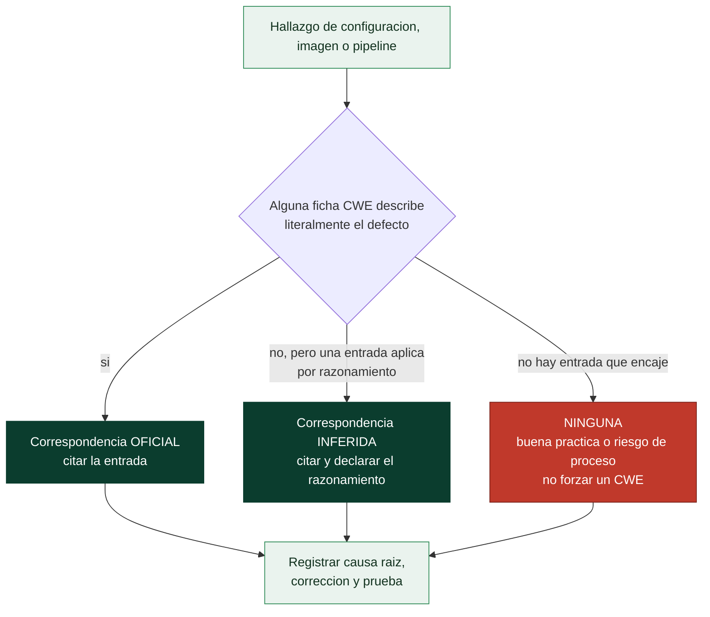

# Clase 366 — Familias CWE (4): configuración, dependencias, contenedores, APIs, nube y sistemas operativos

> Parte: **20 — Debilidades y vulnerabilidades: CWE, CVE, CVSS y su gestión** · Fuente: *MITRE CWE 5.0 (CWE-250, 276, 321, 494, 532, 732, 829, 915, 942, 1104, 1188, 1357, 1392, 1395…), OWASP Top 10:2025 (A02 y A03) y laboratorio `devsecops-pipeline`*
> ⏱️ Duración estimada: **130 min** · Nivel: **Intermedio–Avanzado**

---

## 🎯 Objetivo

Aprender a clasificar con CWE un tipo de problema que casi nunca tiene una entrada «perfecta»: los que nacen de **cómo se configura, se empaqueta, se despliega y se compone el software**. Verás qué entradas oficiales existen (valores por defecto inseguros, permisos, privilegios, dependencias vulnerables, descarga de código sin verificar), por qué una mala configuración **no es normalmente una vulnerabilidad de producto** (y por tanto no tiene CVE), y, sobre todo, cómo ser **honesto con los límites del catálogo**: no existe una entrada CWE para «contenedor como root» ni para «*bucket* público», y forzarla es el error que esta clase quiere evitarte. Para ello usarás una herramienta de pensamiento concreta: distinguir la correspondencia **oficial**, la **inferida** y la **inexistente**, y la aplicarás a los defectos reales del laboratorio de pipeline.

> ⚠️ **Ética:** se analizan archivos de un repositorio de laboratorio deliberadamente inseguro. No se despliega nada ni se prueba contra sistemas ajenos.

## 📚 Resultados de aprendizaje

Al finalizar, el alumno podrá:

1. **Explicar** por qué una mala configuración propia no es una vulnerabilidad de producto en el sentido del CVE Program, y cuándo sí puede serlo.
2. **Clasificar** problemas de valores por defecto, permisos y privilegios con entradas CWE vigentes.
3. **Distinguir** correspondencia oficial, inferida y ninguna, y justificarla por escrito.
4. **Relacionar** dependencias vulnerables y fallos de cadena de suministro con `CWE-1395`, `CWE-1104`, `CWE-494`, `CWE-829` y `CWE-1357`, y reconocer lo que el catálogo no cubre.
5. **Identificar** debilidades de API (asignación masiva, límites, CORS) y su correspondencia.
6. **Aplicar** el mínimo privilegio y el endurecimiento a contenedores, pipelines y sistemas operativos con criterio.
7. **Auditar** un Dockerfile, un workflow de CI y un archivo de configuración y entregar un mapa con tipo de correspondencia.
8. **Leer** críticamente las categorías OWASP A02 y A03 de 2025 y su relación con el catálogo.

## 🗺️ Temas

| # | Tema | Por qué importa |
| --- | --- | --- |
| 1 | Configuración frente a vulnerabilidad de producto | Decide si hay o no un CVE y cómo se gestiona |
| 2 | Valores por defecto inseguros (CWE-1188, 1392, 1393, 276) | La raíz de muchas intrusiones «sin exploit» |
| 3 | Permisos y privilegios (CWE-732, 250, 269, 668, 1327) | El amplificador de cualquier otro fallo |
| 4 | Dependencias y cadena de suministro (CWE-1395, 1104, 1329, 494, 829, 1357) | La categoría nueva del Top 10 de 2025 |
| 5 | APIs (CWE-915, 639, 770, 942, 1021) | Superficie moderna de ataque |
| 6 | Contenedores y nube: lo que el catálogo no tiene | Aprender a no forzar correspondencias |
| 7 | Sistemas operativos (CWE-276, 426, 427, 367) | Permisos, rutas de búsqueda y temporales |
| 8 | Tres tipos de correspondencia | Un método honesto de clasificar |
| 9 | Auditoría del laboratorio de pipeline | De la teoría a un informe defendible |
| 10 | Caso Siemens Software Center (CVE-2026-110936) | Búsqueda de bibliotecas en rutas no controladas |

## 🧱 Prerrequisitos

- **Clases 361 a 365**, en especial el método de mapeo (362) y la idea de que una debilidad describe un *tipo* de error en un *producto* (361).
- **Contenedores e imágenes** (clases 022 y 221–235): una imagen es una plantilla en capas; un contenedor es un proceso aislado que se ejecuta a partir de ella. Lo que se escribe en una capa (una variable de entorno, un archivo) permanece en la imagen y puede leerse con las herramientas del propio motor.
- **CI/CD** (clases 236–248): un *workflow* es una receta automatizada que se ejecuta ante eventos de un repositorio, a menudo con credenciales de despliegue.
- **SBOM y cadena de suministro** (clase 246): lista de ingredientes de un software; la clase 240 trata el análisis de dependencias.
- **Mínimo privilegio** (clase 364): dar a cada componente solo los permisos que necesita.

## 🧠 Explicación en profundidad

### Configuración frente a vulnerabilidad de producto

Empecemos por una distinción que ordena toda la clase. El CVE Program define *vulnerabilidad* como **una instancia de una o más debilidades en un producto** que puede explotarse. La palabra clave es *producto*: un componente que alguien publica, versiona y distribuye. Tres situaciones muy distintas se confunden a menudo:

| Situación | ¿Vulnerabilidad de producto (CVE)? | Cómo se gestiona |
|---|---|---|
| El producto *viene* con una credencial por defecto o un permiso laxo de fábrica | **Sí**, puede tenerla: el defecto está en el producto | Parche o aviso del fabricante |
| Tu equipo despliega el producto con la depuración activada o un *bucket* público | **No**: es un error de **tu** despliegue | Corrección interna; guías de endurecimiento y *benchmarks* |
| Una dependencia que usas tiene un fallo conocido | **Sí**, en *esa* dependencia (su propio CVE) | Actualizar y vigilar (clases 240 y 245) |

Esta distinción tiene una consecuencia práctica enorme: **no puedes buscar en una base de datos de CVE tus malas configuraciones**, porque no están ahí. Lo que sí puedes hacer es *clasificarlas* con CWE para tus informes internos, con la salvedad de que el catálogo se pensó para debilidades de producto. De hecho, el catálogo 5.0 marca como **obsoleta** la agrupación `CWE-16` («Configuration»), que antes servía de cajón de sastre.

OWASP lo refleja en su edición 2025: **A02 Security Misconfiguration** subió del quinto al segundo puesto, con un 3,00 % de las aplicaciones probadas con una o más de sus **16 debilidades**, y OWASP lo atribuye a que el software depende cada vez más de la configuración. Esas 16 entradas, tal como las registra el catálogo de MITRE, son un buen mapa de lo que significa «mala configuración» en términos CWE: `CWE-15` (control externo de la configuración del sistema), `CWE-260` (contraseña en archivo de configuración), `CWE-489` (código de depuración activo), `CWE-526` (información sensible en una variable de entorno), `CWE-547` (constantes de seguridad codificadas), `CWE-611` (entidades XML externas), `CWE-614` y `CWE-1004` (atributos de cookie), `CWE-942` (política entre dominios permisiva), `CWE-776`, y varias variantes específicas de J2EE y ASP.NET. Fíjate en que **no hay** una entrada por «contenedor» ni «nube» entre ellas.

### Valores por defecto inseguros: `CWE-1188`, `CWE-1392`, `CWE-1393`, `CWE-276`

Un valor por defecto es una decisión del fabricante que casi nadie revisa. El catálogo lo recoge con varias entradas, todas *Base* y «Allowed»: `CWE-1188` (*Initialization of a Resource with an Insecure Default*), `CWE-1392` (*Use of Default Credentials*, y su hija `CWE-1393` para contraseñas por defecto), y `CWE-276` (*Incorrect Default Permissions*, hija de `CWE-732`). La diferencia con una credencial *codificada* (`CWE-798`, clase 364) es sutil pero útil: la codificada está **dentro del código** y la corrige quien programa; la *por defecto* es un **valor de fábrica** que debe cambiar quien instala.

Esta es la rara situación en que una mala configuración **sí** puede ser una vulnerabilidad de producto: si el fabricante distribuye algo seguro solo tras un cambio manual que nadie recuerda hacer, el defecto de diseño es suyo. Los ejemplos observados que enlaza MITRE son claros: un producto de visualización que usa claves secretas o valores de cookie por defecto si no se especifican en variables de entorno (`CVE-2021-41192`) o un producto de gestión de clústeres en la nube con una clave maestra de cifrado por defecto (`CVE-2018-3825`). La corrección ideal está en el producto: **no existir valores por defecto secretos**, sino obligar a generarlos en la primera puesta en marcha.

### Permisos y privilegios: `CWE-732`, `CWE-250`, `CWE-269`, `CWE-668`, `CWE-1327`

`CWE-732` (*Incorrect Permission Assignment for Critical Resource*) es una *Class* «Allowed-with-Review»: un recurso crítico (archivo, clave, base de datos) con permisos más amplios de los necesarios. `CWE-250` (*Execution with Unnecessary Privileges*) es la hermana de los *procesos*. Ya viste en la clase 364 que `CWE-250` es un **amplificador**: no abre la puerta, pero convierte cualquier otro fallo en un compromiso total. `CWE-1327` (*Binding to an Unrestricted IP Address*) cubre el escuchar en `0.0.0.0` cuando debía hacerse solo en local; es la que la herramienta Bandit etiqueta (mal) como `CWE-605` en el laboratorio de la clase 363.

Hay un rasgo que une todas estas entradas: **se corrigen restringiendo, no añadiendo**. El arreglo no es una función nueva sino una *eliminación*: menos permisos, menos privilegios, menos interfaces. Por eso son tan económicas de corregir y tan fáciles de olvidar: no hay nada que «instalar».

### Dependencias y cadena de suministro

`CWE-1395` (*Dependency on Vulnerable Third-Party Component*) describe literalmente que el producto «depende de un componente de terceros que contiene una o más vulnerabilidades conocidas». Es una *Class* «Allowed-with-Review», y su ficha recomienda algo que ya conoces de la clase 246: **exigir y mantener una lista de materiales (SBOM)** de todos los componentes y subcomponentes. Cuelga de `CWE-1357` (*Reliance on Insufficiently Trustworthy Component*), junto con `CWE-1104` (*Use of Unmaintained Third Party Components*) y `CWE-1329` (*Reliance on Component That is Not Updateable*): tres formas de fallar con un componente ajeno: está roto, está abandonado, o no se puede actualizar.

OWASP elevó esto a categoría propia en 2025. **A03 Software Supply Chain Failures** amplía la antigua «componentes vulnerables y desactualizados» para incluir compromisos en cualquier punto del ecosistema: dependencias, sistemas de *build* y distribución. OWASP aporta un dato revelador: la categoría tiene **solo 5 CWE** (el catálogo de MITRE le asocia seis: `CWE-447`, `CWE-477`, `CWE-1035`, `CWE-1104`, `CWE-1329` y `CWE-1395`), presencia **limitada en los datos**, pero **la media más alta de explotabilidad e impacto** en los CVE. Lo explican por la dificultad de probarla. Esa combinación es una advertencia: *lo que el catálogo y los datos no recogen bien no es lo que menos importa*.

Para el pipeline, MITRE sí tiene dos entradas literales: `CWE-494` (*Download of Code Without Integrity Check*), que describe descargar código y ejecutarlo sin verificar origen ni integridad —el patrón `curl | bash`—, y `CWE-829` (*Inclusion of Functionality from Untrusted Control Sphere*), que describe incluir funcionalidad de una fuente fuera de la esfera de control prevista. Pero otros fallos de la cadena de suministro **no tienen entrada específica**: no hay una para *typosquatting* (paquetes con nombre parecido a uno popular), ni para la confusión de dependencias, ni para un *build* comprometido. Se aproximan con `CWE-829` y `CWE-1357`, y conviene decirlo con esas palabras: *correspondencia inferida*.

### APIs

La mayoría de las debilidades de una API ya las conoces; lo nuevo es dónde se manifiestan:

- **Asignación masiva (`CWE-915`)**: el servidor acepta un objeto con múltiples campos y no controla cuáles puede modificar el cliente. La ficha recomienda usar listas permitidas de atributos modificables. Ejemplos observados por MITRE: una aplicación para usar LLM que permitía modificar una variable sensible por asignación masiva (`CVE-2024-3283`) y varios casos de 2012 en que la asignación masiva permitía cambiar atributos arbitrarios o una clave de confianza.
- **Autorización a nivel de objeto**: lo que OWASP API llama BOLA es, en la práctica, el IDOR de la clase 364 (`CWE-639`).
- **Falta de límites (`CWE-770`)**: sin cuotas ni limitación de tasa, una API entrega recursos a quien más pida (práctica `limites.py` de la clase 365).
- **Política entre dominios permisiva (`CWE-942`)**: configuraciones CORS que aceptan orígenes no confiables.
- **Marcos de interfaz (`CWE-1021`)**: restricción indebida de capas o marcos renderizados (el *clickjacking*).

### Contenedores y nube: lo que el catálogo no tiene

Aquí es donde más se fuerza la clasificación, así que seamos precisos. Buscando en el catálogo 5.0 por «docker», «kubernetes» o «bucket» **no hay ninguna entrada**; «container» solo aparece en entradas heredadas de J2EE, y «cloud» solo en la descripción de `CWE-1327`. Esto no es un descuido: el catálogo describe tipos de error, y la mayoría de los problemas de contenedores y nube son **errores de configuración y de arquitectura** que se expresan con entradas genéricas. La tabla siguiente separa lo que es hecho documentado de lo que es razonamiento nuestro:

| Fallo habitual | Entrada candidata | Tipo de correspondencia | Por qué |
|---|---|---|---|
| Secreto escrito en la imagen o en el repositorio | `CWE-798` (y `CWE-526` si va como variable de entorno) | **Oficial** | La definición describe literalmente el defecto |
| Credenciales de fábrica sin cambiar | `CWE-1392` | **Oficial** | Es lo que dice la ficha |
| Depuración activa o puerto de depurador | `CWE-489` | **Oficial / inferida** | Oficial para «código de depuración activo»; inferida si es un puerto del depurador de un lenguaje |
| Escuchar en todas las interfaces | `CWE-1327` | **Oficial** | Su descripción lo menciona |
| Imagen base con paquetes vulnerables | `CWE-1395` | **Oficial** | Es una dependencia con vulnerabilidades conocidas |
| Contenedor ejecutándose como root | `CWE-250` | **Inferida** | La ficha habla de procesos con privilegios innecesarios, no cita contenedores |
| Permisos excesivos de un token de CI | `CWE-250` | **Inferida** | Mismo razonamiento aplicado a un token |
| *Bucket* de almacenamiento público | `CWE-732` o `CWE-284` | **Inferida** | El catálogo no tiene entrada específica |
| Socket del motor de contenedores montado en el contenedor | Ninguna exacta | **Ninguna** | Es un riesgo de arquitectura; lo más cercano sería `CWE-250`/`CWE-269` |
| Etiqueta `latest` en la imagen base | `CWE-1357` | **Inferida** | Es más una práctica de reproducibilidad que una debilidad catalogada |

Un matiz importante sobre las filas de «nube»: muchos fallos reales de nube son errores de **cómo se usa** el servicio, no del servicio. Ahí el marco adecuado no es CWE sino las guías de endurecimiento (por ejemplo, los *benchmarks* de CIS) y los marcos de gobierno de la Parte 10. CWE complementa, no sustituye.

### Sistemas operativos

En el sistema operativo las mismas ideas se manifiestan con otros nombres: permisos incorrectos por defecto en archivos o claves (`CWE-276`, `CWE-732`), **rutas de búsqueda no controladas** (`CWE-426` y `CWE-427`, que son la base de la carga de bibliotecas o ejecutables desde un directorio escribible por un atacante, el *DLL hijacking* o *planting*), servicios que corren con más privilegios de los necesarios (`CWE-250`, `CWE-269`) y archivos temporales con carreras de comprobación y uso (`CWE-367`, clase 365). La corrección de estas entradas tiene rasgos comunes: **rutas absolutas** en lugar de búsqueda, **permisos mínimos**, **cuentas de servicio dedicadas** y creación atómica de archivos temporales.

### Tres tipos de correspondencia: un método honesto

Todo lo anterior se resume en un método. Antes de escribir un CWE en un informe, decide cuál de estos tres casos es:

1. **Oficial.** La definición del catálogo describe *literalmente* el defecto. Puedes citarla sin cautelas. Ejemplo: `curl | bash` y `CWE-494`: la ficha dice «descarga código ... y lo ejecuta sin verificar origen ni integridad».
2. **Inferida.** Tú razonas que una entrada se aplica, pero la ficha no menciona el contexto (contenedores, CI/CD, nube). Está bien usarla **si lo dices** y explicas el razonamiento. Ejemplo: contenedor como root y `CWE-250`.
3. **Ninguna.** El catálogo no tiene entrada que lo describa. Es una buena práctica, un riesgo de proceso o un límite de cobertura. Forzar un CWE aquí es el error: da una falsa sensación de rigor y contamina las estadísticas. Ejemplo: usar la forma *shell* de `CMD` en un Dockerfile.

La aplicación disciplinada de esta distinción hace que tus informes sean **auditables**: un lector sabe qué afirmaciones descansan en el catálogo y cuáles en tu juicio.



El diagrama es el árbol de decisión. Las tres ramas llegan al mismo destino (registrar causa, corrección y prueba): **la clasificación no cambia lo que hay que arreglar, solo cuánto crédito merece la etiqueta**. La rama roja es la más valiosa pedagógicamente: aprender a decir «no hay CWE para esto» es una señal de madurez.

### Auditoría del laboratorio de pipeline

El laboratorio `labs/devsecops-pipeline` incluye un repositorio deliberadamente inseguro (`repo-vulnerable/`) con un Dockerfile de 10 antipatrones, un workflow de CI con 8, un archivo de configuración con secretos y un `requirements.txt` con dependencias antiguas, sin fijar y con nombres sospechosos. El archivo `cwe-map.json` aplica el método anterior a **cada uno de los 28 defectos**: 13 con correspondencia oficial, 10 inferida y 5 ninguna (las pruebas del laboratorio comprueban que cada defecto plantado está clasificado). Algunos ejemplos instructivos:

- `[DKR-7]` `ENV API_TOKEN=...`: **oficial**, `CWE-798` (con `CWE-526` como alternativa). Queda grabado en una capa de la imagen y lo lee cualquiera con acceso a la imagen.
- `[DKR-8]` sin `USER`: **inferida**, `CWE-250`.
- `[DKR-10]` `CMD` en forma *shell*: **ninguna**: es gestión de señales, no una debilidad catalogada.
- `[CI-5]` el título del PR interpolado en un script: **oficial**, `CWE-78`. Es una inyección de comandos con otra puerta de entrada; la guía oficial de GitHub la llama *script injection* y recomienda pasar el valor por una variable de entorno.
- `[CI-7]` `curl ... | bash`: **oficial**, `CWE-494`.
- `[CI-6b]` `curl -k`: **oficial**, `CWE-295`: desactiva la validación del certificado, igual que en el ejemplo `CVE-2021-22909` de la ficha.
- `[CI-3]` `actions/checkout@v4`: **inferida**, `CWE-1357`; la guía de GitHub recomienda fijar las acciones a un SHA completo.
- Dependencia `requets==2.31.0` (imita a `requests`): **inferida**, `CWE-829`, con la advertencia de que el catálogo no tiene entrada para *typosquatting*.
- Dependencias sin versión (`boto3`, `lxml`): **ninguna**: no es una debilidad sino un **límite de cobertura**; lo que no se puede analizar debe declararse «fuera de cobertura» y nunca «seguro».

### Corregir y verificar

Estas correcciones comparten una forma: **restringir y fijar**. Para cada hallazgo, la verificación es una comprobación automatizable: un linter de Dockerfile que ya no se queja de la regla; un analizador de workflows que no encuentra la inyección; un escáner de secretos que no encuentra nada ni en el árbol ni en el historial; un escáner de dependencias sobre un archivo con versiones y hashes fijados; y, para permisos, una comprobación de que el proceso no corre como superusuario. En el laboratorio, la prueba `test_cwe_map.py` verifica que **cada defecto plantado está clasificado** y que el mapa no hace afirmaciones que el catálogo no sostiene.

<!-- octubre-2026-366 -->
### Caso real de octubre de 2026: la DLL que se carga desde donde no debía

`CVE-2026-110936` (Siemens Software Center, versiones anteriores a V4.0.9.8; `CWE-427`, elemento de ruta de búsqueda no controlado) entró a KEV el **2026-10-20**. El aviso describe que la aplicación carga bibliotecas dinámicas (DLL) desde una ruta de búsqueda no controlada: un atacante local autenticado que consiga colocar una DLL en un directorio que la aplicación consulta ejecuta código con los privilegios de la aplicación. Tiene CVSS 3.1 de 6,7, 4.0 de 8,4 y un EPSS de solo 1,0 %, y CISA lo clasifica con impacto técnico total.

Es el ejemplo más limpio de una **debilidad de configuración del sistema operativo y de despliegue**: el orden en que Windows busca una biblioteca incluye directorios que pueden ser escribibles por usuarios sin privilegios, y la solución es de ingeniería (cargar con ruta absoluta, restringir las ACL de los directorios de instalación, usar las opciones de carga segura de DLL y firmar los binarios) más el parche del fabricante. La enseñanza para la priorización: un CVE «local» con CVSS medio puede ser un eslabón de una cadena de escalada, y su presencia en KEV significa que alguien ya lo ha usado; qué cadena fue, el aviso no lo dice. Para verificar la corrección: versión instalada igual o superior a la V4.0.9.8 y comprobación de que ningún directorio de búsqueda es escribible por usuarios sin privilegios. Compárese con `CVE-2026-102490` (Zammad), donde procesos con privilegios ejecutan archivos escribibles por la cuenta de servicio: el mismo principio con distinto sistema operativo (clase [101](../../parte-4-seguridad-de-aplicaciones-web/101-fallos-de-autenticacion-y-bypass/README.md)).

## 📖 Definiciones y características

- **Mala configuración:** despliegue con ajustes inseguros. *Clave:* normalmente no es una vulnerabilidad de producto ni tiene CVE.
- **Valor por defecto inseguro (`CWE-1188`):** configuración de fábrica insegura. *Clave:* sí puede ser una vulnerabilidad de producto.
- **Credencial por defecto (`CWE-1392`):** valor de fábrica que debe cambiar el instalador. *Clave:* distinto de la codificada.
- **Permisos incorrectos (`CWE-732`) / privilegios innecesarios (`CWE-250`):** acceso o poder mayor del necesario. *Clave:* se corrigen quitando.
- **Dependencia vulnerable (`CWE-1395`):** componente de terceros con fallos conocidos. *Clave:* se gestiona con SBOM y actualización.
- **Descarga sin verificar (`CWE-494`):** ejecutar código remoto sin comprobar origen e integridad. *Clave:* `curl | bash`.
- **Asignación masiva (`CWE-915`):** el cliente decide qué campos de un objeto se modifican. *Clave:* lista permitida de atributos.
- **Correspondencia oficial / inferida / ninguna:** grado de apoyo del catálogo a una clasificación. *Clave:* declararlo.
- **Límite de cobertura:** lo que una herramienta no puede analizar. *Clave:* se informa como «fuera de cobertura».

## 📔 Glosario

| Término | Definición concisa |
|---------|--------------------|
| Mala configuración | Ajuste inseguro hecho por quien despliega, no un defecto del producto |
| Valor por defecto | Ajuste con el que el producto llega de fábrica |
| Credencial por defecto | Usuario o contraseña de fábrica que el instalador debería cambiar |
| Credencial codificada | Credencial escrita en el código fuente |
| Mínimo privilegio | Dar a cada componente solo los permisos que necesita |
| Imagen de contenedor | Plantilla en capas a partir de la cual se ejecuta un contenedor |
| Capa de imagen | Cambio inmutable acumulado en una imagen, legible aunque se «borre» después |
| Workflow | Receta automatizada de CI/CD que se dispara por eventos de un repositorio |
| Inyección de script | Interpolar entrada de terceros dentro de un script de shell de un workflow |
| Fijar por SHA | Referenciar un componente por su identificador de contenido inmutable |
| SBOM | Lista de materiales de software con sus componentes y versiones |
| Typosquatting | Publicar paquetes con nombres parecidos a otros populares |
| Asignación masiva | Aceptar y aplicar todos los campos que envía el cliente a un objeto |
| CORS | Mecanismo que decide qué orígenes web pueden leer respuestas de otro origen |
| Ruta de búsqueda no controlada | Lugar donde el sistema busca bibliotecas o programas y que un atacante puede escribir |
| Correspondencia oficial | La ficha CWE describe literalmente el defecto |
| Correspondencia inferida | Razonada por quien clasifica; la ficha no cubre el contexto |
| Límite de cobertura | Parte del objetivo que una herramienta no puede analizar |

## 🧰 Herramientas y preparación

```bash
# Pruebas del mapa CWE del laboratorio de pipeline (28 defectos clasificados con tipo de correspondencia)
python -m unittest discover -s labs/devsecops-pipeline/tests -v

# Fichas de las entradas de la clase
python scripts/cwe_kb.py mostrar CWE-1395
python scripts/cwe_kb.py miembros CWE-1437          # las 16 entradas de OWASP A02:2025 Security Misconfiguration
python scripts/cwe_kb.py miembros CWE-1438          # las de OWASP A03:2025 Software Supply Chain Failures
python scripts/cwe_kb.py buscar docker              # sin resultados: no existe entrada específica
```

El análisis automático completo del repositorio vulnerable (`hadolint`, `trivy`, `gitleaks`, `zizmor`, etc.) se lanza con `labs/devsecops-pipeline/auditar.sh` dentro del contenedor del laboratorio (requiere Docker). No es necesario para esta clase: el mapa ya está hecho y verificado, y tu tarea es *razonarlo*.

## 🧪 Laboratorio guiado

> Solo sobre `labs/devsecops-pipeline/repo-vulnerable/`, que es un objetivo de análisis y no se ejecuta.

1. **Lee primero, mapea después.** Abre el `Dockerfile` y el `deploy.yml` y, **sin mirar `cwe-map.json`**, anota para cada marca `[DKR-n]` y `[CI-n]` tu clasificación: entrada CWE o «ninguna», y si es oficial o inferida. Escribe una línea de motivo.
2. **Compara con el mapa** y localiza los desacuerdos. Para cada uno, decide quién tiene mejor argumento y por qué.
3. **Busca una correspondencia que el catálogo no sostiene.** Para `[DKR-9]` (puerto de depuración expuesto), lee la ficha de `CWE-489` con `cwe_kb.py mostrar` y decide si la correspondencia es oficial o inferida.
4. **Comprueba el límite de cobertura.** Ejecuta `python labs/devsecops-pipeline/priorizar.py` sobre `hallazgos-cwe-ejemplo.json` con `--instantanea` y observa que las dependencias sin versión del `requirements.txt` **no** generan hallazgos: no son seguras, están fuera de cobertura.
5. **Corrige un defecto de cada tipo.** Reescribe el `Dockerfile` con `USER` no privilegiado, imagen fijada, sin secreto en `ENV` y `CMD` en forma exec, y justifica por cada cambio el CWE (o la ausencia) que corriges.
6. **Clasifica con honestidad** estos hallazgos externos: «el *bucket* S3 de logs es de lectura pública», «el contenedor monta el socket de Docker», «la API permite enviar `{"role": "admin"}` al registrar un usuario», «el servidor SSH permite autenticación con contraseña de fábrica `admin`», «el instalador descarga un binario por HTTP y lo ejecuta».

## ✍️ Ejercicios

1. Explica por qué «el *bucket* de mi organización está público» no tiene CVE y cómo lo clasificarías con CWE, indicando el tipo de correspondencia.
2. Para cada fallo da la entrada CWE y el tipo de correspondencia: (a) `ENV PASSWORD=...` en un Dockerfile; (b) un contenedor sin `USER`; (c) `chmod 777` en un directorio de claves; (d) una acción de CI sin fijar; (e) una biblioteca de hace diez años con CVE conocidos.
3. Distingue una credencial codificada y una por defecto y propón la corrección de cada una.
4. OWASP dice que A03:2025 tiene presencia limitada en los datos pero la media más alta de explotabilidad e impacto. ¿Qué implica para decidir en qué invertir?
5. Un colega mapea «usamos `latest` en la imagen base» a `CWE-1395`. ¿Es correcto? Argumenta.
6. Explica qué es asignación masiva y diseña la lista permitida de campos para una operación «actualizar mi perfil» con campos `nombre`, `email`, `rol` y `activo`.
7. Diseña una comprobación automatizada para verificar que un Dockerfile corregido no ejecuta como root.
8. ¿Por qué no es lo mismo «sin hallazgos» que «fuera de cobertura»? Pon un ejemplo del `requirements.txt` del laboratorio.
9. Caso Siemens (octubre de 2026). Enumera cinco directorios de un Windows de prueba desde los que una aplicación podría cargar una DLL y comprueba, con `icacls`, cuáles pueden ser escritos por un usuario estándar. *Solución razonada:* los directorios de instalación en `Program Files` no suelen ser escribibles por usuarios estándar; lo son los de `%TEMP%`, algunas rutas de `ProgramData` y directorios creados por instaladores con permisos amplios; cualquier aplicación que busque en ellos es candidata a este fallo.

## ✅ Soluciones razonadas

1. Porque una **vulnerabilidad**, en el sentido del CVE Program, es una instancia de debilidades *en un producto*, y un *bucket* mal configurado es un error de uso de tu organización, no un defecto del servicio de almacenamiento. Para un informe interno puedes clasificar con `CWE-732` (permisos incorrectos sobre un recurso crítico) o `CWE-284` (control de acceso indebido), pero como **correspondencia inferida**: el catálogo no tiene una entrada específica de *buckets*. Si lo corriges con una política y una prueba (acceso anónimo denegado), eso importa más que la etiqueta.
2. (a) `CWE-798`, **oficial** (con `CWE-526` como alternativa). (b) `CWE-250`, **inferida**. (c) `CWE-732`, **oficial** (permiso excesivo sobre un recurso crítico). (d) `CWE-1357`, **inferida** (también se cita `CWE-829` según el razonamiento). (e) `CWE-1395`, **oficial**.
3. **Codificada** (`CWE-798`): el secreto está en el código; se corrige sacándolo a un gestor de secretos, rotándolo y limpiando el historial. **Por defecto** (`CWE-1392`): es un valor de fábrica; se corrige obligando a cambiarlo al instalar y no distribuyendo valores iguales para todos.
4. Implica que **la ausencia de datos no es ausencia de riesgo**: los datos de pruebas infrarrepresentan lo difícil de probar. Justifica invertir en inventario (SBOM), fijación de dependencias y verificación de integridad aunque tu escáner habitual no muestre problemas, y tratar la cadena de suministro como riesgo de **diseño**, no solo de hallazgos.
5. **No del todo.** `CWE-1395` exige un componente con vulnerabilidades *conocidas*; `latest` no implica ninguna. El problema de `latest` es de **reproducibilidad y confianza** (el contenido cambia sin revisión): como mucho, `CWE-1357`, como **inferida**; y podría decirse que no hay correspondencia. Lo correcto es declararlo.
6. Es aceptar y aplicar todos los campos de un objeto enviados por el cliente. En «actualizar mi perfil», la lista permitida del usuario corriente es `nombre` y `email`; `rol` y `activo` **no** se aceptan del cliente (se modifican por operaciones administrativas con su propia autorización). Si el cliente envía `rol`, se ignora o se rechaza, y una prueba lo comprueba (`CWE-915`).
7. Una prueba que construya la imagen y ejecute `docker run --rm imagen id -u`, esperando un valor distinto de `0`; o un análisis estático del Dockerfile (por ejemplo, la regla de `hadolint` que exige `USER`) que falle en CI si falta. Ambas son automatizables y declaran su límite: la primera ejecuta de verdad, la segunda solo lee el archivo.
8. «Sin hallazgos» significa que se analizó y no se encontró nada; «fuera de cobertura» significa que **no se pudo analizar**. En el laboratorio, `boto3` y `lxml` están sin versión fijada: el escáner de dependencias no puede resolverlas y por eso no reporta nada, pero **no son seguras**. Informar un cero ahí sería afirmar una seguridad que no se comprobó, que es el error de reporte más común en auditoría de dependencias.

## 📝 Reto verificable

**Audita un archivo real tuyo con el método de tres tipos.** Elige un `Dockerfile`, un workflow de CI o un archivo de configuración de un proyecto propio (o del laboratorio) y entrega un `cwe-map.json` con el mismo esquema que el del laboratorio: para cada defecto, archivo, marcador textual que exista de verdad en el archivo, CWE (o ninguno), tipo de correspondencia, motivo y corrección. Escribe además una **prueba** que compruebe que cada marcador existe y que los CWE usados son entradas vigentes del catálogo.

**Criterio de aceptación:** al menos 8 defectos; al menos uno de cada tipo de correspondencia; ningún CWE obsoleto, agrupación o desaconsejado para mapear; cada «inferida» declara su límite en el motivo; la prueba pasa; y se incluye un apartado de «fuera de cobertura» que enumere lo que no se pudo analizar.

## ⚠️ Errores comunes

| Síntoma / mensaje | Causa y cómo arreglar |
| --- | --- |
| Buscar tus malas configuraciones en una base de CVE | No son vulnerabilidades de producto. Usa guías de endurecimiento y auditoría propia |
| Forzar un CWE a «contenedor como root» o «bucket público» como si fuera oficial | Decláralo como inferido o «ninguna». No existe entrada específica |
| Mapear a `CWE-1395` algo que no tiene vulnerabilidad conocida | Exige un componente con vulnerabilidades *conocidas*; `latest` o un nombre dudoso es otro caso |
| Tratar «sin versión fijada» como «sin vulnerabilidades» | Es «fuera de cobertura». Fija versiones y repite el análisis |
| Dejar secretos en `ENV` de la imagen | Quedan en la capa. Inyéctalos en ejecución y rota el valor publicado |
| Interpolar `${{ ... }}` de eventos dentro de un `run:` | Es inyección de script. Pásalo por variable de entorno |
| Fijar acciones por etiqueta (`@v4`) | La etiqueta es mutable. Fija por SHA completo |
| Corregir añadiendo reglas en lugar de quitando permisos | Estas debilidades se corrigen restringiendo: menos permisos, menos puertos, menos herramientas |
| Confiar en que el escáner de imágenes ve todo | Detecta paquetes conocidos; no ve tu configuración ni tus secretos propios |

## ❓ Preguntas frecuentes

**❓ ¿Entonces CWE no sirve para nube y contenedores?** Sirve para lo que tiene correspondencia (secretos, credenciales por defecto, dependencias, privilegios) y debe usarse con honestidad para el resto. Para lo demás, los marcos de endurecimiento y gobierno son más adecuados.

**❓ ¿Por qué OWASP A03 casi no aparece en los datos si es tan grave?** OWASP lo explica: es difícil de probar. Su ausencia en las estadísticas refleja el límite de la medición, no del riesgo.

**❓ ¿Un SBOM resuelve la cadena de suministro?** Lo necesita, pero no la resuelve: es un inventario. Hay que vigilarlo contra fuentes de vulnerabilidades, fijar versiones y verificar la integridad de lo que se descarga.

**❓ ¿Una credencial por defecto puede tener CVE?** Sí, si es un defecto del producto (viene de fábrica en cada unidad). Si es tu equipo quien dejó la credencial de fábrica sin cambiar, es un fallo de despliegue.

**❓ ¿`pull_request_target` está «prohibido»?** No: tiene usos legítimos (por ejemplo, etiquetar PR) que no ejecutan el código del PR. Lo peligroso es combinarlo con el checkout y ejecución del código del PR; la documentación de GitHub dedica un apartado a usarlo de forma segura.

## 🔗 Referencias

- MITRE CWE, fichas de CWE-1395, CWE-1104, CWE-1329 y CWE-1357 — <https://cwe.mitre.org/data/definitions/1395.html> — dependencias vulnerables, no mantenidas o no actualizables, y mitigación con SBOM.
- MITRE CWE, fichas de CWE-1188, CWE-1392, CWE-1393 y CWE-276 — <https://cwe.mitre.org/data/definitions/1188.html> — valores y credenciales por defecto inseguros con sus ejemplos observados.
- MITRE CWE, fichas de CWE-250, CWE-732, CWE-1327, CWE-426 y CWE-427 — <https://cwe.mitre.org/data/definitions/250.html> — privilegios innecesarios, permisos y rutas de búsqueda.
- MITRE CWE, fichas de CWE-494, CWE-829, CWE-915, CWE-942 y CWE-1021 — <https://cwe.mitre.org/data/definitions/494.html> — descarga sin integridad, funcionalidad no confiable, asignación masiva, CORS y marcos.
- OWASP, *Top 10:2025 — Introducción* — <https://top10.owasp.org/2025/0x00_2025-Introduction/> — A02 (16 CWE, del 5.º al 2.º puesto) y A03 (cadena de suministro, 5 CWE, presencia limitada y mayor media de explotabilidad e impacto).
- GitHub Docs, *Secure use reference* de GitHub Actions — <https://docs.github.com/en/actions/reference/security/secure-use> — inyección de script, fijar acciones por SHA completo, mínimo privilegio y uso seguro de `pull_request_target`.
- CVE Program, *Glossary* — <https://www.cve.org/ResourcesSupport/Glossary> — definición de vulnerabilidad referida a un producto, base de la distinción entre configuración y vulnerabilidad.
- Siemens ProductCERT, *SSA-580366* — <https://productcert.siemens.com/productcert/html/ssa-580366.html> — versión corregida de Software Center.

## 📥 Material descargable

- 📄 [Guía en PDF](./clase-366-guia.pdf) — versión imprimible de esta clase.
- 🎞️ [Presentación (PPTX)](./clase-366-presentacion.pptx) — deck para proyectar en clase.

## ⬅️ Clase anterior

[Clase 365 — Familias CWE (3): memoria, enteros, concurrencia y recursos](../365-familias-cwe-memoria-enteros-concurrencia-recursos/README.md)

## ➡️ Siguiente clase

[Clase 367 — CVE: identificar vulnerabilidades concretas](../367-cve-identificar-vulnerabilidades-concretas/README.md)
