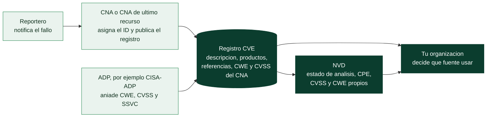

# Clase 367 — CVE: identificar vulnerabilidades concretas

> Parte: **20 — Debilidades y vulnerabilidades: CWE, CVE, CVSS y su gestión** · Fuente: *CVE Program (glosario y formato de registro 5.1), documentación de NVD (estados de vulnerabilidad, actualizada 2026-04-14) y datos medidos el 2026-10-30*
> ⏱️ Duración estimada: **120 min** · Nivel: **Intermedio**

---

## 🎯 Objetivo

Entender qué es exactamente un **CVE**, quién lo crea, qué contiene un registro, qué añade el **NVD** y, sobre todo, **qué fuentes dicen qué** sobre una misma vulnerabilidad. La idea que lo ordena todo es simple y suele ignorarse: **un CVE no tiene «una» puntuación ni «un» CWE; tiene los que aportan sus distintas fuentes, y pueden no coincidir**. Aprenderás a leer un registro CVE en su formato real, a interpretar los estados de NVD y a ver con datos medidos cuánto del «enriquecimiento» que se da por supuesto existe de verdad, a identificar los productos afectados con CPE y a detectar discrepancias entre CNA, CISA-ADP y NVD con una herramienta propia.

> ⚠️ **Ética:** se consultan solo fuentes públicas y registros de vulnerabilidades ya divulgadas.

## 📚 Resultados de aprendizaje

Al finalizar, el alumno podrá:

1. **Definir** CVE, CVE ID, registro CVE, CNA, CNA de último recurso, ADP y Root con las definiciones oficiales.
2. **Validar** un identificador CVE y leer los campos de un registro en formato JSON 5.1.
3. **Explicar** los estados del registro (*Reserved*, *Published*, *Rejected*) y los de NVD, incluido *Deferred*.
4. **Medir** qué parte de los CVE recientes lleva CVSS y CWE y de qué fuente, y sacar consecuencias para su proceso.
5. **Distinguir** qué aporta cada fuente (CNA, ADP, NVD) y por qué pueden discrepar.
6. **Identificar** productos afectados con CPE y rangos de versiones, y reconocer los límites de esa correspondencia.
7. **Detectar** discrepancias de CWE y de CVSS con la herramienta del laboratorio e interpretarlas.
8. **Tratar** correctamente CVE rechazados, disputados y duplicados.

## 🗺️ Temas

| # | Tema | Por qué importa |
| --- | --- | --- |
| 1 | Qué es CVE y qué no es | Evitar pedirle lo que no ofrece |
| 2 | Quién participa: CNA, ADP, Root y Secretariado | Saber de quién es cada dato |
| 3 | Formato del identificador y ciclo de vida del registro | Leer y validar sin ambigüedad |
| 4 | Anatomía de un registro (JSON 5.1) | Dónde está cada dato |
| 5 | NVD: qué añade y en qué estados está | La dependencia más común y peor entendida |
| 6 | Cuánto enriquecimiento existe de verdad (datos medidos) | Decidir de qué fuentes depende tu proceso |
| 7 | CPE, versiones afectadas y sus límites | Saber si te afecta |
| 8 | Discrepancias entre fuentes | Cuando no hay una única respuesta |
| 9 | Registros rechazados, disputados y «reservados pero públicos» | Casos límite que rompen los procesos automáticos |
| 10 | Tres fechas de un CVE: el caso de octubre de 2026 | Publicación, entrada a KEV y explotación no son la misma fecha |

## 🧱 Prerrequisitos

- **Clases 361 a 366**, en especial la 362 (qué es mapear a CWE) y la 361 (debilidad frente a vulnerabilidad).
- **JSON** (clase 015): un formato de texto con diccionarios y listas anidadas. Un *registro* aquí es un diccionario con campos que a su vez contienen diccionarios y listas.
- **Producto y versión** (clase 240): un *producto* es un componente de software o hardware que alguien publica y versiona; una *versión* identifica una entrega concreta.
- **Fuente primaria frente a secundaria:** la primaria es quien produce el dato (el CNA que asignó el CVE); una secundaria lo copia o enriquece (NVD). Cuando discrepan, hay que saber a cuál le corresponde cada afirmación.
- **Instantánea de datos** (clase 369): un conjunto de datos fechado. Los datos de vulnerabilidades cambian a diario, así que toda cifra debe llevar fecha.

## 🧠 Explicación en profundidad

### Qué es CVE y qué no es

El programa CVE lo define como «un esfuerzo internacional, impulsado por la comunidad, para identificar y catalogar vulnerabilidades divulgadas públicamente». Nació en 1999 de la mano de MITRE (lo cuenta la historia oficial de CWE, que surgió de aquel trabajo). Su función es **dar a cada vulnerabilidad concreta un nombre común**, para que un escáner, un parche, un aviso de fabricante y un informe de incidente hablen de lo mismo.

Conviene fijar qué *no* hace. Un CVE **no** es una puntuación, ni una prioridad, ni una garantía de que exista un parche, ni una explicación de la causa. Es un **identificador con una descripción y referencias**. Por eso necesitas CWE (la causa, clases 361–362), CVSS (la severidad, clase 368) y EPSS y KEV (la probabilidad y la explotación, clase 369). Lo definen así sus propios documentos: una *vulnerabilidad* es «una instancia de una o más debilidades en un producto que puede ser explotada, causando un impacto negativo en la confidencialidad, integridad o disponibilidad». Fíjate en que es una **instancia en un producto**: de ahí que las malas configuraciones propias (clase 366) no tengan CVE.

### Quién participa: CNA, ADP, Root y Secretariado

El glosario oficial del programa permite entender quién produce cada dato:

- **CNA** (*CVE Numbering Authority*): «una entidad autorizada, con un alcance y una responsabilidad específicos, que asigna regularmente CVE ID y publica los registros correspondientes». Puede ser un fabricante de software, un proyecto de código abierto, un centro de coordinación, un proveedor de recompensas por errores o un grupo de investigación; ser CNA es voluntario. Es la **fuente primaria** del registro.
- **CNA de último recurso** (*CNA-LR*): una CNA autorizada por un *Root* a asignar identificadores dentro de su ámbito para vulnerabilidades que no cubre ninguna otra CNA. Existe «para cuando no hay una CNA apropiada o dispuesta», a menudo con información limitada. MITRE opera una. En varios casos de la instantánea el asignador figura como `mitre` (por ejemplo, CVE-2023-34362 de MOVEit y CVE-2021-3156 de sudo), y en ellos el registro del asignador no trae CWE ni CVSS: son los ADP y NVD quienes los aportan.
- **ADP** (*Authorized Data Publisher*): «una entidad autorizada que enriquece el contenido de los registros publicados por las CNA con información adicional pertinente (por ejemplo, puntuaciones de riesgo, referencias, características de la vulnerabilidad, traducciones)». **CISA-ADP** es el ADP de CISA: aporta, entre otras cosas, CWE, CVSS y los puntos de decisión SSVC.
- **Root y Top-Level Root:** organizaciones responsables del reclutamiento, formación y gobierno de las CNA de su ámbito.
- **Secretariado:** la organización que desarrolla y mantiene la infraestructura del programa.
- **Reportero** y **proveedor** (*Supplier*): quien notifica la vulnerabilidad, y quien desarrolla o mantiene el producto afectado.

Esta cadena importa porque **cada rol aporta datos distintos y con distinta calidad**. Un CNA de un fabricante conoce su código; un CNA de último recurso suele partir de un informe externo con poca información; un ADP añade datos pero no corrige el texto del CNA. Cuando leas «según el CVE», pregúntate: ¿según quién?



El diagrama se lee de izquierda a derecha como el recorrido de un dato. El **registro CVE** (el cilindro) es el centro: lo crea y publica la CNA, y a él llegan por separado los datos que añade cada ADP. NVD no es el dueño del registro; lo **lee** y produce su propio análisis (CPE, puntuación y CWE de NVD), de modo que, al final, tu organización no recibe «un» dato sino varios, cada uno con su origen. Las dos flechas que llegan al último nodo son la clave práctica: puedes consumir el registro directamente o el análisis de NVD, y las discrepancias de la sección siguiente aparecen justo porque ambos caminos pueden decir cosas distintas. Por eso toda cifra que cites debe llevar su fuente.

### Formato del identificador y ciclo de vida

El identificador tiene la forma `CVE-AAAA-NNNN`, y el esquema oficial del registro (versión 5.1) lo define con la expresión regular `^CVE-[0-9]{4}-[0-9]{4,19}$`: el año va en cuatro dígitos y el número tiene **entre 4 y 19 dígitos**. Es decir, `CVE-2024-1234` y `CVE-2026-105134` son válidos; `CVE-2024-123` (tres dígitos) y `CVE-24-1234` no. El año suele coincidir con el de la *reserva* del identificador, no con el de la publicación: el CVE-2021-44228 (Log4Shell) se reservó el 2021-11-26 y se publicó el 2021-12-10.

Un registro CVE pasa por tres estados oficiales:

| Estado | Significa | Observación |
|---|---|---|
| **Reserved** | La CNA ha reservado el identificador; todavía no hay datos públicos | Estado inicial. NVD no incluye los registros reservados |
| **Published** | La CNA ha rellenado los datos y publicado el registro | Debe tener identificador, descripción en prosa y al menos una referencia pública |
| **Rejected** | El identificador y su registro ya no deben usarse | El registro **se conserva** en la lista para que se sepa que es inválido (duplicado, retirado por su autor, asignado por error…) |

Existe además un caso límite con nombre propio, *Reserved but Public* (RBP): un identificador reservado que ya aparece en fuentes públicas pero cuyo registro todavía no se ha publicado. Un proceso automático que consulte «el CVE» en ese momento no encontrará nada aunque el fallo sea de dominio público.

Además, un registro puede llevar **etiquetas** (*tags*): `disputed` (la asignación o el contenido se discuten), `unsupported-when-assigned` (todos los productos afectados ya no recibían correcciones de seguridad al asignarse) y `exclusively-hosted-service` (los productos afectados existen solo como servicio alojado).

### Anatomía de un registro (JSON 5.1)

El registro se publica en formato JSON (CVE Record Format 5.1). Su estructura, vista con Log4Shell, es:

```text
dataType: CVE_RECORD        dataVersion: 5.1
cveMetadata
  cveId: CVE-2021-44228     state: PUBLISHED
  assignerShortName: apache dateReserved: 2021-11-26   datePublished: 2021-12-10
containers
  cna                       ← lo que publica la CNA (fuente primaria)
    title, descriptions, affected, references, credits
    problemTypes            ← los CWE que asigna la CNA
    metrics                 ← las puntuaciones CVSS que asigna la CNA
  adp[]                     ← contribuciones de ADP (aquí: «CVE» y «CISA-ADP»)
    CISA-ADP: problemTypes (CWE), metrics (CVSS, SSVC y el aviso de KEV)
```

Léelo como un archivo con **varios autores**: el contenedor `cna` es del asignador; cada elemento de `adp` es de otra organización. Para saber quién dijo qué, nunca mezcles los contenedores. En la instantánea de casos del programa, `cwe_cna` y `cwe_adp` están separados por esa razón. Fíjate en un detalle práctico: **muchos registros de CNA no traen CWE ni CVSS** (por ejemplo, el de Heartbleed, asignado por Red Hat, declara «n/a» como tipo de problema) y es el ADP o NVD quien los aporta después.

### NVD: qué añade y en qué estados está

La **NVD** (*National Vulnerability Database*, del NIST) toma los registros de la lista CVE y los **enriquece**. Según su propia documentación, el proceso de enriquecimiento «da como resultado la asociación de etiquetas de enlaces de referencia, **CVSS, CWE y datos de aplicabilidad CPE**». Eso explica por qué se la considera la fuente «completa» y por qué no lo es siempre: el enriquecimiento depende de que NVD haya trabajado ese registro.

Cada registro de NVD está en uno de estos estados (la columna de la derecha es el nombre que devuelve la API):

| Estado en la web | Estado en la API | Qué significa (documentación de NVD) |
|---|---|---|
| Received | `Received` | Recién publicado en la lista CVE e incluido en NVD |
| Awaiting Enrichment | `Awaiting Analysis` | Marcado para enriquecer |
| Undergoing Enrichment | `Undergoing Analysis` | El equipo de NVD lo está enriqueciendo |
| Enriched | `Analyzed` | Enriquecimiento completo |
| Modified After Enrichment | `Modified` | Modificado tras el enriquecimiento; los datos de NVD pueden requerir corrección |
| **Not Scheduled** | **`Deferred`** | **No programado para enriquecimiento**: puede estar fuera del alcance declarado de NVD o no haberse priorizado «por recursos u otras razones» |
| Rejected | `Rejected` | Rechazado en la lista CVE (decisión del CVE Program, no de NVD) |

El estado `Deferred` es el más importante de entender: **un CVE puede publicarse y no recibir nunca datos de NVD**.

### Cuánto enriquecimiento existe de verdad

Para no depender de impresiones, el programa incluye un script que lo mide (`labs/devsecops-pipeline/nvd_estados.py`). Se ejecutó el 2026-10-30 sobre los **4.822 CVE publicados entre el 1 y el 10 de septiembre de 2026**:

| Estado en la API | CVE | % |
|---|---:|---:|
| `Analyzed` | 2.364 | 49,0 % |
| `Deferred` | 1.645 | 34,1 % |
| `Awaiting Analysis` | 467 | 9,7 % |
| `Received` | 199 | 4,1 % |
| `Modified` | 85 | 1,8 % |
| `Rejected` | 47 | 1,0 % |
| `Undergoing Analysis` | 15 | 0,3 % |

Una de cada tres vulnerabilidades de esa ventana estaba en `Deferred`. Pero las cifras que más enseñan son las del **origen de los datos**:

| Dato | CVE con ese dato de **cualquier** fuente | De ellos, publicado por **NVD** |
|---|---:|---:|
| CVSS 3.1 | 4.285 (88,9 %) | 399 (8,3 %) |
| CWE | 4.573 (94,8 %) | 38 (0,8 %) |
| CVSS 4.0 | 1.355 (28,1 %) de alguna fuente | — |

La lectura es clara y contraintuitiva: **casi todos los CVE recientes traen CVSS y CWE, pero casi nunca los puso NVD**: los aportan las CNA y los ADP. Quien construya su proceso suponiendo «NVD me da el CVSS y el CWE» tendría datos para menos de uno de cada doce CVE recientes si solo mirase lo que publicó NVD. Y una puntuación v4.0 ya está presente en más de uno de cada cuatro registros, de modo que un proceso que solo entienda v3.1 está perdiendo información. Cautelas honestas: es **una ventana de diez días medida un día concreto**, no una estadística general, y los estados cambian a diario; por eso el script guarda la fecha y se puede repetir.

### Quién dice qué: la instantánea de casos

La misma idea se ve en detalle con los 14 casos de la instantánea (`labs/devsecops-pipeline/datos/casos-cwe-cve.json`), que separa las fuentes. Por ejemplo, para Log4Shell los CWE los aporta el CNA (Apache: `CWE-20`, `CWE-400`, `CWE-502`) y NVD añade `CWE-917`; para Heartbleed el CNA (Red Hat) no aporta ninguno y es CISA-ADP quien da `CWE-125`, que NVD confirma como primario; para CVE-2023-34362 (MOVEit) asignó MITRE y los datos los aportan NVD y CISA-ADP.

### CPE, versiones afectadas y sus límites

Para saber si un CVE te afecta hay que relacionar el registro con **tu** inventario. NVD lo hace con **CPE** (*Common Platform Enumeration*, NIST): un nombre estructurado de producto, de la forma

```text
cpe:2.3:a:apache:log4j:2.14.1:*:*:*:*:*:*:*
        │ │      │      │
        │ │      │      └ versión (el asterisco significa «cualquiera»)
        │ │      └ producto
        │ └ fabricante
        └ tipo: a = aplicación, o = sistema operativo, h = hardware
```

Los rangos se expresan con campos como `versionStartIncluding` y `versionEndExcluding`. Así, en la instantánea, `libwebp` aparece afectado «hasta, sin incluir, 1.3.2» y `sudo` en «1.8.2 hasta 1.8.32» y «1.9.0 hasta 1.9.5». Este mecanismo tiene límites que conviene conocer:

- **Un CVE, muchos productos.** Un solo CVE puede afectar a decenas de productos que incorporan el mismo componente: CVE-2023-4863 aparece para la biblioteca `libwebp`, para el navegador Chrome y para una extensión de Windows; los datos de Log4Shell enumeran productos de Siemens que incluyen la biblioteca. Es la razón de que el inventario (SBOM, clase 246) sea la clave: sin saber qué componentes lleva tu producto, no puedes cruzar.
- **La versión no lo es todo.** El mismo número de versión puede estar corregido o no según cómo lo empaquete una distribución que aplica correcciones sin cambiar la versión, y la vulnerabilidad puede depender de una configuración. Una coincidencia de versión es una **hipótesis a verificar**, no un veredicto (clase 245).
- **Coincidencia de nombres.** Los CPE deben coincidir con nombres de fabricante y producto; un inventario mal normalizado produce falsos positivos y falsos negativos.

### Discrepancias entre fuentes

Como cada fuente aporta lo suyo, los desacuerdos son frecuentes y **no son errores a ocultar sino información**. La herramienta `labs/devsecops-pipeline/discrepancias.py` busca seis tipos (`cvss_distinto`, `puntuacion_vs_vector`, `cwe_distinto`, `nvd_sin_cwe_concreto`, `sin_cwe_primario` y `sin_cvss_en_ninguna_fuente`). Sobre los 14 casos reales detecta exactamente estos:

| CVE | Discrepancia encontrada | Lectura |
|---|---|---|
| CVE-2021-41773 (Apache 2.4.49) | CVSS 3.1: **NVD 9,8** frente a **CISA-ADP 7,5** | Cada evaluador asumió un escenario distinto (la descripción dice que depende de la configuración del servidor) |
| CVE-2024-2021 (equipo de red) | **NVD 9,8** frente a **CNA (VulDB) 6,3** | Privilegios requeridos: el CNA asumió que hacen falta, NVD que no |
| CVE-2023-50716 (Fast DDS) | **NVD 9,8** frente a **CNA 9,6**; y el registro del CNA declara **9,7** con un vector que da **9,6** | La puntuación no coincide con su propio vector: un error de la fuente |
| CVE-2024-6387 (regreSSHion) | CWE: **CNA `CWE-364`** frente a **NVD `CWE-362`** | Hija frente a padre (clase 362) |
| CVE-2023-44487 (Rapid Reset) | NVD `NVD-CWE-noinfo`; CISA-ADP aporta `CWE-400` | NVD sin dato concreto mientras otra fuente lo da |
| CVE-2021-44228 (Log4Shell) | Cuatro CWE y **ninguno primario** | Hay que decidir cuál guía la corrección |

Dos ideas para el trabajo diario: primero, **conserva la fuente de cada dato** en tus herramientas (un campo «CVSS» sin origen oculta estos desacuerdos); segundo, **valida las puntuaciones contra sus vectores**, como hace el priorizador del laboratorio: es un control barato que detecta errores reales, como el del registro de Fast DDS.

### Registros rechazados, disputados y duplicados

Un registro `Rejected` debe ignorarse, pero **permanece en la lista**: tu inventario de hallazgos puede contener un CVE que más tarde se rechazó, y hay que revisar y cerrarlos en lugar de dejarlos abiertos para siempre (en la ventana medida, 47 de 4.822 se habían rechazado en menos de dos meses). Un registro con la etiqueta `disputed` sigue siendo válido pero cuestionado: hay que leer la disputa antes de decidir. Y la duplicidad es una causa de rechazo frecuente: dos CNA asignaron identificadores a la misma vulnerabilidad. Moraleja para los procesos automáticos: **el estado del registro es un dato de entrada**, no un detalle.

<!-- octubre-2026-367 -->
### Un mes real como ejercicio de fechas: octubre de 2026

Un CVE tiene al menos **tres fechas distintas** que se confunden con facilidad: cuándo se *publicó* su registro, cuándo CISA lo *incorporó a KEV* y cuándo se *explotó* por primera vez. Los 36 CVE que entraron a KEV entre el 1 y el 31 de octubre de 2026 (catálogo versión 2026.11.10) son un conjunto cerrado y verificable para practicarlo. Los datos están en `knowledge/cve/2026-10/instantanea.json`; el [informe del mes](../../../docs/casos-reales/2026-10/README.md) explica la metodología.

| Categoría | Cuántos | Ejemplos | Qué enseña |
|---|---:|---|---|
| Registro publicado **en octubre** | 20 | `CVE-2026-0322` (PAN-OS, publicado y en KEV el 2026-10-14) | la mediana entre publicación y KEV fue de **5 días**; seis entraron a KEV *el mismo día* de su publicación |
| Registro publicado **antes de octubre** | 15 | Plex (publicado el 2026-09-23, KEV el 20-10), `CVE-2026-46300` (kernel, 2026-05-23, KEV el 28-10) | entrar a KEV en octubre no significa que sea una vulnerabilidad de octubre; hay tres de 2015-2016 |
| Registro publicado **después** de entrar a KEV | 1 | `CVE-2026-118527` (Ivanti): KEV el 2026-10-30, registro publicado el 2026-11-03 | el registro puede llegar tarde; la fecha del catálogo no es la del registro |

**Lo que estos datos dicen y lo que no.**

- **KEV da la fecha de incorporación (`dateAdded`)**, no la de la primera explotación ni la del descubrimiento. Dos descripciones del registro sí traen una fecha de explotación, porque el fabricante la escribió: `CVE-2026-110447` (Collabora) habla de «explotación en estado salvaje en septiembre y octubre de 2026» y `CVE-2026-111357` (Ivanti), de «octubre de 2026». Para el resto, la fecha de explotación **se desconoce**.
- **El número del CVE no es cronológico.** `CVE-2026-0322` se publicó el 14 de octubre y `CVE-2026-118527`, con un número mucho mayor, el 3 de noviembre; pero `CVE-2026-102489` (número alto) se publicó el 30 de septiembre, antes que ambos. Los identificadores se asignan en bloques a cada organización (CNA) y cada una los usa cuando quiere. Y `CVE-2025-61624` lleva el año 2025 pero se publicó en abril de 2026: el año del identificador es el de **reserva**, no el de publicación.
- **El estado de un CVE cambia.** El registro de Plex se publicó el 23 de septiembre y su entrada de KEV es del 20 de octubre; quien consultó el catálogo antes de esa fecha no lo encontraba en él. Por eso los datos de un caso se fechan (y la instantánea de esta clase declara su fecha de consulta).
- **CWE del registro frente a CWE de KEV.** En 4 de los 36 casos difieren (`CVE-2015-5477`: 617 en el registro, 19 en KEV; `CVE-2026-111357`: 829 frente a 306, 862 y 345; `CVE-2026-104286`: 22 frente a 22 y 158; `CVE-2026-46300`: 123 y 456 frente a solo 456). Quien clasifica debe citar la fuente.
- **Una fecha de publicación posterior a KEV es posible, no un error del lector.** Para `CVE-2026-118527` el registro CVE aparece con `datePublished` el 2026-11-03 mientras KEV lo incorpora el 2026-10-30. Los datos se tomaron tal cual; la causa (por ejemplo, que el CNA reservó el identificador con antelación y lo publicó después) **no figura en las fuentes**, así que no se afirma.

**Práctica reproducible.** Con el laboratorio de octubre de 2026 puedes calcular estas categorías en cuatro líneas:

```bash
python -m unittest discover -s labs/octubre-2026-casos-reales/tests -v
python scripts/cve_mensual.py snapshot --mes 2026-10 --salida /tmp/nueva.json
python scripts/cve_mensual.py comparar knowledge/cve/2026-10/instantanea.json /tmp/nueva.json
```

La primera ejecuta las pruebas, entre ellas la que fija que 20, 15 y 1 son las cifras de las tres categorías; la segunda reconstruye la instantánea desde las fuentes oficiales (requiere red); la tercera enumera altas, bajas y cambios de campos clave entre dos fotos, que es como detectas que un fabricante amplió las versiones afectadas. Un resultado distinto no es un error del curso: es la forma en que las fuentes cambian con el tiempo.

## 📖 Definiciones y características

- **CVE (*Common Vulnerabilities and Exposures*):** programa que asigna identificadores a vulnerabilidades divulgadas. *Clave:* identifica, no puntúa ni explica la causa.
- **CVE ID:** cadena `CVE-AAAA-NNNN` (4 a 19 dígitos). *Clave:* el año suele ser el de reserva.
- **Registro CVE:** datos estructurados (JSON 5.1) de una vulnerabilidad. *Clave:* con contenedores de CNA y de ADP.
- **CNA / CNA-LR:** quien asigna y publica; la de último recurso cubre lo no cubierto. *Clave:* fuente primaria.
- **ADP:** quien enriquece registros de otros. *Clave:* aporta CWE, CVSS y SSVC sin cambiar el texto del CNA.
- **Reserved / Published / Rejected:** estados del registro. *Clave:* rechazado no se borra.
- **NVD:** base de datos del NIST que enriquece los registros. *Clave:* no los enriquece todos (`Deferred`).
- **CPE:** nombre estructurado de producto. *Clave:* la versión es una hipótesis a verificar.
- **Discrepancia entre fuentes:** desacuerdo de CWE o CVSS entre CNA, ADP y NVD. *Clave:* información, no ruido.

## 📔 Glosario

| Término | Definición concisa |
|---------|--------------------|
| CVE | Programa y sistema de identificadores de vulnerabilidades divulgadas públicamente |
| Identificador CVE | Código con año y número, de 4 a 19 dígitos, que nombra una vulnerabilidad |
| `dateAdded` (KEV) | Fecha en que CISA incorporó un CVE al catálogo de vulnerabilidades explotadas; no es la fecha de publicación ni la de la primera explotación |
| Registro CVE | Conjunto de datos estructurados asociados a un identificador |
| CNA | Entidad autorizada a asignar identificadores y publicar registros en su ámbito |
| CNA de último recurso | CNA que cubre vulnerabilidades que ninguna otra CNA tiene en su ámbito |
| ADP | Entidad autorizada a enriquecer registros publicados por CNA |
| Root | Organización que recluta, forma y gobierna CNA dentro de un ámbito |
| Secretariado | Organización que mantiene la infraestructura del programa CVE |
| Reserved but Public | Identificador reservado que ya es citado públicamente sin registro publicado |
| Rejected | Estado de un registro que ya no debe usarse pero permanece en la lista |
| Disputed | Etiqueta de un registro cuya asignación o contenido se cuestionan |
| NVD | Base de datos de vulnerabilidades del NIST que enriquece los registros CVE |
| Enriquecimiento | Asociar CVSS, CWE, CPE y referencias etiquetadas a un registro |
| Deferred | Estado de NVD: el CVE no está programado para enriquecimiento |
| CPE | Sistema de nombres estructurados de productos usado para indicar afectación |
| Fuente primaria | Quien produce un dato, como el CNA con su registro |
| Instantánea | Copia fechada de datos que cambian con el tiempo |
| Instancia | Aparición concreta de una debilidad en un producto determinado |

## 🧰 Herramientas y preparación

```bash
# Discrepancias entre CNA, CISA-ADP y NVD en los 14 casos reales (sin red)
python labs/devsecops-pipeline/discrepancias.py
python labs/devsecops-pipeline/discrepancias.py CVE-2024-6387

# Estado de enriquecimiento de NVD para una ventana de publicación (requiere red; tarda unos minutos)
python labs/devsecops-pipeline/nvd_estados.py --desde 2026-09-01 --hasta 2026-09-10

# Reconstruir la instantánea de casos desde las fuentes oficiales (requiere red)
python labs/devsecops-pipeline/actualizar_casos.py --cves CVE-2021-44228 --salida salida/uno.json
```

La instantánea y la medición están guardadas con su fecha, de modo que todo el laboratorio funciona sin conexión.

## 🧪 Laboratorio guiado

1. **Lee un registro CVE real** (con red) y localiza cada contenedor:

   ```python
   import json, urllib.request
   url = "https://cveawg.mitre.org/api/cve/CVE-2021-44228"   # servicio público del CVE Program
   registro = json.load(urllib.request.urlopen(urllib.request.Request(url, headers={"User-Agent": "clase-367"})))
   print(registro["cveMetadata"]["state"], registro["cveMetadata"]["assignerShortName"])
   print([a["providerMetadata"]["shortName"] for a in registro["containers"]["adp"]])   # quién enriqueció además del CNA
   print([d["cweId"] for pt in registro["containers"]["cna"]["problemTypes"] for d in pt["descriptions"] if d.get("cweId")])
   ```

   Sin red, haz lo equivalente sobre `labs/devsecops-pipeline/datos/casos-cwe-cve.json` con las claves `asignador`, `cwe_cna`, `cwe_adp` y `cwe_nvd`.
2. **Valida identificadores** con la expresión regular oficial `^CVE-[0-9]{4}-[0-9]{4,19}$`. Prueba `CVE-2024-1234`, `CVE-2026-105134`, `CVE-2024-123`, `CVE-24-1234`, `cve-2024-1234`.
3. **Ejecuta el detector de discrepancias** y, para cada caso con hallazgos, escribe en una frase *por qué* crees que las fuentes difieren, antes de leer la tabla de la explicación.
4. **Interpreta la medición de NVD.** Con `datos/nvd-estados-2026-09-01_10.json`, calcula qué proporción de los CVE recientes *no* tiene CVSS 3.1 publicado por NVD y qué proporción tiene CVSS 3.1 de alguna fuente. ¿Qué cambiaría en un proceso que dependiera solo de NVD?
5. **Comprueba un CPE.** Toma `libwebp` del caso CVE-2023-4863 y decide si la versión `1.3.1` está afectada y la `1.3.2` no, a partir del rango `hasta_excluida`.
6. **Valida puntuaciones contra vectores** con `cvss.py` para los vectores del caso Fast DDS y comprueba el 9,6 frente al 9,7.

## ✍️ Ejercicios

1. Explica con tus palabras la diferencia entre un CNA, un CNA de último recurso y un ADP y di cuál de los tres escribió cada dato de CVE-2014-0160 (Heartbleed).
2. Indica cuáles de estos identificadores son válidos y por qué: `CVE-2023-4863`, `CVE-2023-48`, `CVE-2026-1234567`, `CVE-26-12345`, `CVE-2021-44228x`.
3. Un colega dice: «NVD siempre da el CVSS». Desmiéntelo con datos de la clase.
4. Explica por qué un CVE en estado `Deferred` no es «de menos importancia».
5. Un escáner te informa de CVE-2021-3156 en un servidor con `sudo` 1.9.5p2. ¿Qué compruebas antes de abrir un incidente?
6. Redacta qué hacer cuando un CVE de tu inventario pasa a estado `Rejected`.
7. Para un CVE, tres fuentes dan tres puntuaciones: 9,8, 7,5 y 6,3. Diseña la política de tu organización para elegir cuál usar y qué conservar.
8. ¿Por qué la herramienta de discrepancias valida la puntuación contra el vector? Da un ejemplo real.
9. Fechas de octubre de 2026. Elige tres CVE de `knowledge/cve/2026-10/instantanea.json` y rellena para cada uno: fecha de publicación del registro, fecha de entrada a KEV, fecha de explotación (o «desconocida»), CWE de cada fuente y la fuente de cada dato. *Solución razonada:* un ejemplo completo es `CVE-2026-96655` (Plex): registro publicado 2026-09-23, KEV 2026-10-20 (27 días), explotación desconocida, CWE-918 en ambas fuentes, CVSS 3.1 de 4,3 del CNA. La respuesta es correcta si distingue las tres fechas y deja «desconocida» donde ninguna fuente la da.

## ✅ Soluciones razonadas

1. El **CNA** asigna el identificador y publica el registro (es la fuente primaria). El **CNA de último recurso** hace lo mismo cuando ningún otro CNA cubre esa vulnerabilidad, normalmente con información limitada. El **ADP** enriquece registros ajenos. En Heartbleed, el CNA fue Red Hat (asignó y escribió el registro, con el tipo de problema «n/a»); el **CWE-125 lo aporta CISA-ADP**, y NVD lo confirma como primario; el CVSS 3.1 de 7,5 aparece en NVD y en CISA-ADP.
2. Válidos: `CVE-2023-4863` (4 dígitos), `CVE-2026-1234567` (7 dígitos, entre 4 y 19). Inválidos: `CVE-2023-48` (solo 2 dígitos), `CVE-26-12345` (el año tiene que tener 4 dígitos) y `CVE-2021-44228x` (sobra un carácter; el patrón está anclado con `^` y `$`).
3. En la ventana medida del 1 al 10 de septiembre de 2026 (4.822 CVE, consulta del 2026-10-30), **solo el 8,3 % tenía un CVSS 3.1 publicado por NVD**; el 34,1 % estaba en `Deferred` (no programado para enriquecimiento) y el 9,7 % esperaba análisis. El resto del CVSS lo aportan CNA y ADP.
4. `Deferred` solo significa que NVD **no ha programado** su enriquecimiento, por alcance o por recursos; no es una valoración del riesgo. Un CVE en `Deferred` puede estar en KEV o tener un EPSS alto. Un proceso que ignorase esos registros dejaría fuera justo los que NVD no pudo evaluar.
5. Compruebas: (a) la **versión exacta** y si la corrección está incluida (el aviso del proyecto sudo indica que se corrige en 1.9.5p2, de modo que 1.9.5p2 no estaría afectada); (b) que el escáner no haya comparado solo el número de versión sin considerar el empaquetado de la distribución; (c) el estado real del paquete en el gestor del sistema. Una coincidencia de versión es una hipótesis.
6. Cerrar el hallazgo con el motivo «CVE rechazado» y la fecha; comprobar si hay un CVE que lo sustituya (cuando el rechazo es por duplicado); informar a quien tuviera tareas de remediación abiertas para no gastar esfuerzo; y revisar que el proceso automático no reabra el hallazgo.
7. Una política razonable: **conservar todas las puntuaciones con su fuente**; usar como base la del CNA del producto cuando exista y sea coherente con su vector; contrastarla con NVD y con CISA-ADP; **recalcular con el contexto propio** (CVSS ambiental, clase 368) y, para priorizar, apoyarse en KEV y EPSS (clase 369) más que en la base. Documentar la decisión y revisarla si cambia la fuente.
8. Porque una puntuación es solo una función de su vector; si no coinciden, hay un error en uno de los dos. Ejemplo real: el registro de CVE-2023-50716 declara 9,7 con un vector (`AV:A/AC:L/PR:N/UI:N/S:C/C:H/I:H/A:H`) cuya puntuación correcta es 9,6; NVD recoge 9,6.

## 📝 Reto verificable

**Construye una ficha de CVE con sus fuentes.** Para tres CVE de la instantánea (uno con discrepancia de CVSS, uno con discrepancia de CWE y uno sin ninguna), entrega: (a) quién asignó el CVE y su estado; (b) una tabla de CWE y CVSS **por fuente**, nunca mezclados; (c) las discrepancias detectadas con `discrepancias.py` y tu interpretación; (d) los productos y rangos afectados; y (e) qué dato adicional pedirías antes de dar un veredicto. Añade una función Python propia que, dado un caso, devuelva la puntuación «recomendada» según una política que definas, con pruebas.

**Criterio de aceptación:** las discrepancias de tu ficha coinciden con la salida de la herramienta; la tabla no mezcla fuentes; la política está escrita antes del código; y las pruebas incluyen un caso en el que la política elige una fuente distinta de NVD y explican por qué.

## ⚠️ Errores comunes

| Síntoma / mensaje | Causa y cómo arreglar |
| --- | --- |
| «El CVE tiene un CVSS de 9.8» sin decir de quién | Hay varias fuentes. Anota siempre la fuente |
| Depender solo de lo que publica NVD | Solo una fracción de los CVE recientes lleva datos de NVD. Lee CNA y ADP |
| Tratar `Deferred` como «sin importancia» | Significa «no enriquecido». Puede estar en KEV |
| Mezclar CWE de CNA, ADP y NVD en un solo campo | Pierdes las discrepancias. Conserva la procedencia |
| Dar por válido un identificador sin comprobar el patrón | `CVE-2024-123` no existe. Valida con la expresión regular oficial |
| Marcar «afectado» por coincidir el número de versión | Es una hipótesis. Verifica la corrección empaquetada y la configuración |
| No revisar los CVE rechazados de tu inventario | Se quedan abiertos para siempre. Cierra y sustituye |
| Esperar un CVE para una mala configuración propia | Un CVE es una instancia en un producto. Usa guías de endurecimiento |
| Confiar en que la puntuación y su vector coinciden | Hay registros incoherentes. Recalcula y compara |

## ❓ Preguntas frecuentes

**❓ ¿CVE y NVD son lo mismo?** No. CVE es el programa que asigna identificadores y publica registros; NVD es una base del NIST que parte de esos registros y los enriquece.

**❓ ¿Quién decide si algo merece un CVE?** Una CNA dentro de su ámbito; si no hay una CNA apropiada, una CNA de último recurso. Un disputado puede llevar la etiqueta `disputed`.

**❓ ¿Por qué el CNA no pone el CWE si es quien mejor conoce el fallo?** A veces sí lo hace (Apache en Log4Shell); otras veces el CNA de último recurso parte de un informe externo con poca información y deja el campo vacío. Por eso hay ADP y NVD.

**❓ ¿Un CVE más antiguo es menos peligroso?** No: Heartbleed (2014) y BlueKeep (2019) siguen en KEV. La antigüedad no mide el riesgo.

**❓ ¿Para qué sirve conocer CPE si uso un escáner?** Para entender por qué da falsos positivos y negativos y para alimentarlo bien: el escáner solo es tan bueno como tu inventario y su normalización.

## 🔗 Referencias

- CVE Program, *Glossary* — <https://www.cve.org/ResourcesSupport/Glossary> — definiciones oficiales de CVE, CVE ID, CNA, CNA-LR, ADP, Root, estados del registro, etiquetas y *Reserved but Public*.
- CVE Program, *CVE Record Format* — <https://github.com/CVEProject/cve-schema> — esquema JSON 5.1 del registro, incluida la expresión regular del identificador.
- NIST NVD, *Vulnerability Status* — <https://nvd.nist.gov/vuln/vulnerability-status> — definiciones de los estados de NVD, el proceso de enriquecimiento y el significado de *Deferred* (documento actualizado el 2026-04-14).
- NIST NVD, API de vulnerabilidades 2.0 — <https://nvd.nist.gov/developers/vulnerabilities> — origen de los estados, CVSS, CWE y CPE medidos en la ventana de septiembre de 2026.
- NIST, *Common Platform Enumeration (CPE)* — <https://nvd.nist.gov/products/cpe> — formato de nombres de producto y su uso en NVD.
- CVE Program, *CVE Services* (registro JSON público) — <https://cveawg.mitre.org/api/cve/CVE-2021-44228> — registro de ejemplo con contenedores `cna` y `adp` usado en la anatomía y el laboratorio.
- MITRE CWE, *History* — <https://cwe.mitre.org/about/history.html> — origen de CVE en 1999 y su relación con el nacimiento de CWE.
- CVE Program, *CVE Record Format* y glosario — <https://www.cve.org/ResourcesSupport/Glossary> — significado de fechas de reserva y publicación en un registro CVE.

## 📥 Material descargable

- 📄 [Guía en PDF](./clase-367-guia.pdf) — versión imprimible de esta clase.
- 🎞️ [Presentación (PPTX)](./clase-367-presentacion.pptx) — deck para proyectar en clase.

## ⬅️ Clase anterior

[Clase 366 — Familias CWE (4): configuración, dependencias, contenedores, APIs, nube y sistemas operativos](../366-familias-cwe-configuracion-dependencias-contenedores-apis-nube-so/README.md)

## ➡️ Siguiente clase

[Clase 368 — CVSS v3.1 y v4.0: qué mide la severidad y cómo se calcula](../368-cvss-v3-1-y-v4-0-severidad/README.md)
