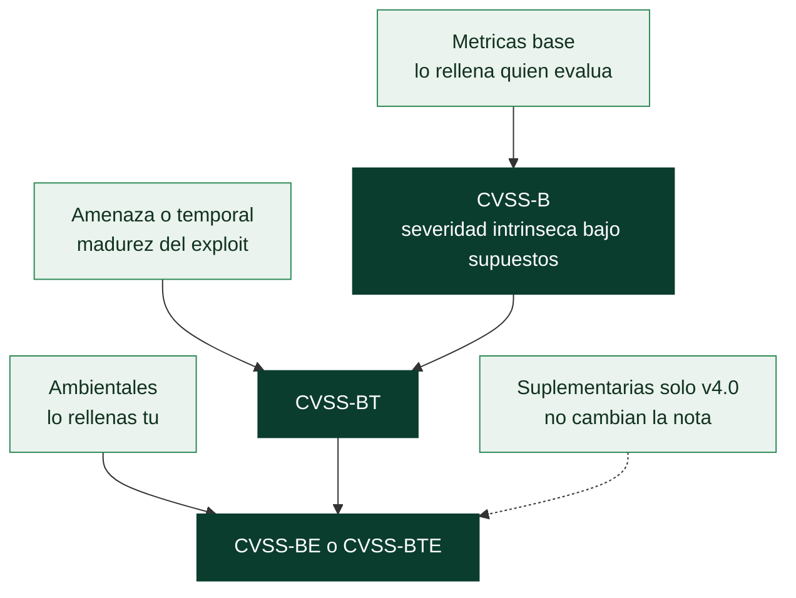

# Clase 368 — CVSS v3.1 y v4.0: qué mide la severidad y cómo se calcula

> Parte: **20 — Debilidades y vulnerabilidades: CWE, CVE, CVSS y su gestión** · Fuente: *FIRST — especificaciones oficiales de CVSS v3.1 y v4.0, calculadora oficial de v4.0 (BSD-2-Clause) y OWASP Top 10:2025*
> ⏱️ Duración estimada: **130 min** · Nivel: **Intermedio–Avanzado**

---

## 🎯 Objetivo

Entender qué significa realmente un número CVSS, cómo se calcula y por qué dos evaluadores legítimos pueden dar números distintos a la misma vulnerabilidad. Aprenderás a **leer un vector** letra a letra, a **calcular a mano** una puntuación v3.1 y a verificarla con una calculadora que reproduce las puntuaciones publicadas, a entender cómo v4.0 cambia el modelo (y por qué ya no existe una fórmula cerrada), a usar la nomenclatura que FIRST indica emplear (CVSS-B, BT, BE, BTE) y, sobre todo, a **no pedirle a CVSS lo que no ofrece**: es una medida de *severidad bajo supuestos*, no de riesgo, ni de probabilidad, ni de explotación. Es la clase donde se acaba el hábito de ordenar la gestión de vulnerabilidades por «el número más alto».

> ⚠️ **Ética:** solo se calculan puntuaciones de vulnerabilidades ya divulgadas; no se explota nada.

## 📚 Resultados de aprendizaje

Al finalizar, el alumno podrá:

1. **Descomponer** un vector CVSS v3.1 y v4.0 y explicar el significado de cada métrica y valor.
2. **Calcular** a mano la puntuación base v3.1 de un vector y comprobarla con la calculadora.
3. **Explicar** el efecto del alcance (*Scope*), del redondeo hacia arriba (*Roundup*) y de los grupos temporal y ambiental.
4. **Describir** qué cambia en v4.0: ataque requerido, sistema vulnerable y subsecuente, interacción pasiva o activa, amenaza y métricas suplementarias.
5. **Usar** la nomenclatura de FIRST (CVSS-B, CVSS-BT, CVSS-BE, CVSS-BTE) para comunicar una puntuación.
6. **Explicar** por qué hay discrepancias entre evaluadores y cómo detectar una puntuación incoherente con su vector.
7. **Aplicar** el grupo ambiental para ajustar una puntuación a un activo concreto.
8. **Argumentar** por qué CVSS-B no es riesgo y cuándo no debe ser el criterio de prioridad.

## 🗺️ Temas

| # | Tema | Por qué importa |
| --- | --- | --- |
| 1 | Qué mide CVSS y qué no | Evita el error más caro de la gestión de vulnerabilidades |
| 2 | El vector y los tres grupos de métricas | Es el dato; el número es su resumen |
| 3 | CVSS v3.1: métricas base y su significado | La versión más extendida en los datos |
| 4 | De métricas a número: la fórmula de v3.1 | Calcular a mano elimina la magia |
| 5 | Alcance, redondeo y los grupos temporal y ambiental | Donde se esconden los errores |
| 6 | CVSS v4.0: qué cambia y cómo se calcula | La versión vigente |
| 7 | Nomenclatura: decir qué número es | Un 9,8 sin etiqueta no significa nada |
| 8 | Por qué los evaluadores discrepan | Supuestos de privilegios, configuración y alcance |
| 9 | Límites de CVSS | Severidad no es riesgo |

## 🧱 Prerrequisitos

- **Clases 361 a 367**, en especial la 367 (cada fuente aporta sus puntuaciones) y la 362 (qué es una debilidad y qué es un impacto).
- **Triada CIA** (clase 001): confidencialidad, integridad y disponibilidad. CVSS puntúa el impacto en cada una.
- **Vector de ataque, privilegios y interacción del usuario:** *vector* es cómo llega el atacante (red, red adyacente, local o físico); *privilegios requeridos* es qué cuenta necesita antes; *interacción* es si hace falta que un usuario haga algo (abrir un enlace).
- **Redondeo y coma flotante:** los ordenadores representan los decimales en binario con pequeños errores (`0.1 + 0.2` no vale exactamente `0.3`). CVSS define su propio redondeo para que todas las calculadoras coincidan.
- **Prioridad frente a severidad:** *severidad* es cuán grave sería explotar el fallo; *prioridad* es qué arreglar primero, que depende además de la exposición, la explotación y el valor del activo (clase 369).

## 🧠 Explicación en profundidad

### Qué mide CVSS y qué no

El *Common Vulnerability Scoring System* lo mantiene FIRST y convierte las características de una vulnerabilidad en un número de 0,0 a 10,0 y una etiqueta cualitativa. La escala cualitativa es común a v3.1 y v4.0: **None** (0,0), **Low** (0,1–3,9), **Medium** (4,0–6,9), **High** (7,0–8,9) y **Critical** (9,0–10,0).

Lo decisivo es lo que CVSS **no** es. La especificación v4.0 lo dice con claridad al introducir su nomenclatura: «las puntuaciones numéricas de CVSS tienen significados muy diferentes según las métricas usadas para calcularlas» y «la utilidad de una puntuación CVSS es directamente proporcional a las métricas utilizadas para generarla». La puntuación base mide la **severidad intrínseca bajo ciertos supuestos**, y por diseño no conoce tu organización, ni si el fallo se explota, ni cuántas probabilidades hay de que lo sea. El FAQ de EPSS resume el problema citando el de CVSS: la puntuación base «no es riesgo». Lo veremos en la clase 369; aquí aprendemos de dónde sale el número para saber qué información contiene y cuál no.

### El vector y los tres grupos de métricas

Una puntuación CVSS no se guarda sola: se guarda su **vector**, una cadena que recoge cada métrica y su valor. Por ejemplo:

```text
CVSS:3.1/AV:N/AC:L/PR:N/UI:N/S:C/C:H/I:H/A:H
```

se lee: versión 3.1; vector de ataque **N**etwork; complejidad **L**ow; privilegios **N**one; interacción **N**one; alcance **C**hanged; confidencialidad, integridad y disponibilidad **H**igh. Es el vector de Log4Shell, y el número que sale es 10,0. El vector es el dato; el número es un resumen: dos personas con el mismo vector obtienen el mismo número, y si el número no coincide con su vector, hay un error.

CVSS organiza las métricas en grupos con significados distintos:

| Grupo | Qué recoge | Quién lo rellena | Cambia con el tiempo |
|---|---|---|---|
| **Base** | Características intrínsecas de la vulnerabilidad | Quien la evalúa (CNA, NVD, ADP) | No |
| **Temporal** (v3.1) / **Amenaza** (v4.0) | Madurez de la explotación y de la corrección | Quien evalúa, y se actualiza | Sí |
| **Ambiental** | Cómo se ajusta a *tu* activo y entorno | **Tú**, el consumidor | Según tu entorno |
| **Suplementaria** (solo v4.0) | Información adicional que **no cambia** la puntuación | El proveedor | — |



El diagrama se lee de arriba abajo como una acumulación de contexto. Las **métricas base** producen la primera nota, CVSS-B, que es la que casi todas las bases de datos publican. Si se añade la **amenaza** (v4.0) o el grupo temporal (v3.1) se obtiene CVSS-BT, que refleja si hay explotación; y si **tú** añades las métricas ambientales, CVSS-BE o CVSS-BTE, que ya es una nota sobre *tu* activo. Las métricas suplementarias de v4.0 aparecen con línea discontinua porque informan pero no modifican el número. De ahí la regla de nomenclatura de la sección siguiente: cada escalón del diagrama es una nota distinta y comparar una CVSS-B con una CVSS-BE mezcla cosas que no se parecen.

### CVSS v3.1: las ocho métricas base

La puntuación base de v3.1 se construye con ocho métricas, que dividimos en dos mitades: **explotabilidad** (cómo de fácil es atacar) e **impacto** (qué se pierde):

| Métrica | Valores | Qué pregunta responde |
|---|---|---|
| **AV** Attack Vector | Network (N), Adjacent (A), Local (L), Physical (P) | ¿Desde dónde se puede atacar? |
| **AC** Attack Complexity | Low (L), High (H) | ¿Hay condiciones fuera del control del atacante? |
| **PR** Privileges Required | None (N), Low (L), High (H) | ¿Qué cuenta necesita antes? |
| **UI** User Interaction | None (N), Required (R) | ¿Hace falta que un usuario colabore? |
| **S** Scope | Unchanged (U), Changed (C) | ¿El daño sale del componente vulnerable? |
| **C, I, A** | High (H), Low (L), None (N) | ¿Cuánto se pierde de cada propiedad? |

El **alcance** (*Scope*) es la métrica más malentendida: indica si explotar el fallo permite afectar a recursos **fuera de la autoridad de seguridad** del componente vulnerable (por ejemplo, escapar de una máquina virtual o de un *sandbox*). Es el motivo por el que dos vectores idénticos salvo el alcance dan 8,8 (*Unchanged*) y 9,9 (*Changed*), como puedes comprobar con la calculadora.

### De métricas a número: la fórmula de v3.1

La especificación oficial define la fórmula con constantes (tabla de valores) y tres sub-cálculos. Sigámosla con **Heartbleed** (`CVSS:3.1/AV:N/AC:L/PR:N/UI:N/S:U/C:H/I:N/A:N`), que NVD puntúa 7,5:

1. **Pesos.** Cada letra se traduce a un número: `AV:N`=0,85; `AC:L`=0,77; `PR:N`=0,85 (con alcance *Unchanged*); `UI:N`=0,85; `C:H`=0,56; `I:N`=0; `A:N`=0.
2. **ISS** (*Impact Sub-Score*) = 1 − (1−C)(1−I)(1−A) = 1 − (1−0,56)(1−0)(1−0) = **0,56**. Fíjate en la forma: el producto de «lo que se conserva» hace que perder un segundo eje añada menos que el primero.
3. **Impacto** = 6,42 × ISS = 6,42 × 0,56 = **3,5952** (con alcance *Unchanged*).
4. **Explotabilidad** = 8,22 × AV × AC × PR × UI = 8,22 × 0,85 × 0,77 × 0,85 × 0,85 = **3,8870**.
5. **Base** = Roundup(mínimo(Impacto + Explotabilidad, 10)) = Roundup(7,4822) = **7,5**.

Con **Log4Shell** (`S:C`, C/I/A altos) el cálculo cambia en un punto: el impacto con alcance *Changed* usa otra expresión, `7,52 × (ISS − 0,029) − 3,25 × (ISS − 0,02)^15`, con ISS = 0,9148, que da 6,0477; la explotabilidad es 3,8870 y la base es Roundup(mínimo(1,08 × (6,0477 + 3,8870), 10)) = Roundup(10) = **10,0**. El 1,08 solo se aplica con alcance cambiado, y el tope de 10 es lo que impide pasar de ahí.

**El redondeo.** CVSS define `Roundup` como «redondear *hacia arriba* a un decimal», pero con un cuidado especial: se pasa por un entero de cinco decimales para esquivar el error de coma flotante (en binario `0,1 + 0,2` vale `0,30000000000000004`, y un redondeo ingenuo hacia arriba daría `0,4`). Sin esa precaución, calculadoras distintas darían números distintos para el mismo vector. La implementación de `labs/devsecops-pipeline/cvss.py` la sigue al pie de la letra.

### Los grupos temporal y ambiental en v3.1

**Temporal.** Ajusta la base según la madurez del exploit (**E**), el nivel de corrección disponible (**RL**) y la confianza en el informe (**RC**). Es un producto de factores menores o iguales que 1 que *solo puede bajar* la nota: `E:F/RL:O/RC:C` (exploit funcional, corrección oficial, confirmado) multiplica por 0,97 × 0,95 × 1,0, y sobre la base 7,5 da Roundup(6,91) = **7,0**.

**Ambiental.** Es la parte que *te corresponde a ti*. Permite decir: «este activo solo es alcanzable desde la red local» (`MAV:A`), «la confidencialidad importa poco aquí» (`CR:L`) o «la disponibilidad es crítica» (`AR:H`). Para Heartbleed en un servidor al que solo se llega desde la misma red y donde la confidencialidad pesa poco (`MAV:A/MAC:H/CR:L`), la nota ambiental baja de 7,5 a **3,5**; con solo `MAV:L/CR:L` (acceso local y confidencialidad poco relevante), a **4,4**. El mismo fallo, en tu entorno, vale mucho menos que en el de quien lo publicó. El grupo ambiental es la herramienta de CVSS para *contextualizar*, y casi nadie la usa; eso explica en parte por qué la gente trata la base como si fuera riesgo.

### CVSS v4.0: qué cambia

La versión 4.0 se publicó en noviembre de 2023 y FIRST la declara la versión vigente. Mantiene el espíritu pero cambia el modelo en cuatro puntos:

1. **Se elimina el alcance** y se sustituye por una separación explícita del impacto: **sistema vulnerable** (`VC`, `VI`, `VA`) y **sistemas subsecuentes** (`SC`, `SI`, `SA`). Ya no hay una única métrica «el daño sale o no»: se puntúa por separado cuánto se pierde en el propio componente y en los demás. La propia especificación lo describe como la propiedad «antes conocida como Scope».
2. **Aparece «Attack Requirements» (`AT`)**: condiciones de despliegue o ejecución del sistema vulnerable que hacen posible el ataque y que **no** son contramedidas (por ejemplo, una condición de carrera que hay que ganar). Se separan de la complejidad (`AC`), que ahora recoge solo las contramedidas.
3. **La interacción del usuario** (`UI`) pasa a tener tres valores: **N**one, **P**assive (el usuario interactúa de forma limitada e involuntaria, como ver una página con contenido malicioso) y **A**ctive (el usuario debe actuar a sabiendas).
4. **La amenaza** (`E`, *Exploit Maturity*) se simplifica en un solo valor: **A**ttacked (explotación observada), **P**roof-of-concept y **U**nreported. Y se añaden **métricas suplementarias** (`S` seguridad física, `AU` automatizable, `R` recuperación, `V` densidad de valor, `RE` esfuerzo de respuesta, `U` urgencia del proveedor) que **no cambian la puntuación**: transmiten contexto para que el consumidor decida.

El resultado es que la misma vulnerabilidad puede puntuar distinto entre versiones. Para **Heartbleed**, el vector v4.0 `CVSS:4.0/AV:N/AC:L/AT:N/PR:N/UI:N/VC:H/VI:N/VA:N/SC:N/SI:N/SA:N` da **8,7** (High) frente a los **7,5** de v3.1: no es que una versión se equivoque, es que miden con modelos distintos. FIRST muestra el mismo fenómeno en un ejemplo oficial (un fallo de NGINX con ataque local: 7,0 en v3.1 y 7,3 en v4.0). **Regla práctica: nunca compares números de versiones distintas; compara siempre dentro de la misma versión.**

### Cómo se calcula v4.0: sin fórmula cerrada

En v3.1 hay una fórmula. En v4.0, **no**: la puntuación sale de una tabla. El procedimiento oficial es este:

1. Cada vector se clasifica en un **macrovector** de seis «clases de equivalencia» (EQ1 a EQ6): por ejemplo, EQ1 recoge lo fácil que es llegar al sistema (red, privilegios, interacción) y EQ3 el impacto en el sistema vulnerable.
2. Una **tabla de 270 macrovectores** da la puntuación de cada uno. Según la especificación (sección 8.1), los unos 15 millones de vectores posibles se agruparon en 270 conjuntos de gravedad cualitativa comparable, se pidió a expertos que compararan vectores de cada conjunto para ordenarlos de menos a más graves, y de ahí salen las puntuaciones.
3. Se **interpola** dentro del macrovector según la distancia del vector evaluado a los «peores» vectores de su clase, y se redondea a un decimal.

Esa tabla y el algoritmo los publica FIRST en su calculadora oficial (licencia BSD-2-Clause), y `cvss.py` los reproduce. Es la razón por la que no puedes «calcular a mano» una puntuación v4.0 como una v3.1: hace falta la tabla. También explica por qué OWASP, al construir el Top 10:2025, **no usó CVSS v4.0**: lo dice expresamente, porque el algoritmo «cambió de forma fundamental y ya no ofrece con facilidad las puntuaciones de explotabilidad e impacto por separado» como v2 y v3.

Ejemplos con la calculadora: `VC:H/VI:H/VA:H/SC:H/SI:H/SA:H` (todo máximo, sistema vulnerable y subsecuentes) da **10,0**; el mismo con los sistemas subsecuentes sin impacto (`SC:N/SI:N/SA:N`) da **9,3**; y un vector con solo confidencialidad alta en el sistema vulnerable da **8,7**. Si además se marca `E:U` (la explotación no se ha observado), baja a **6,6** y pasa de **CVSS-B** a **CVSS-BT**.

### Nomenclatura: decir qué número es

La especificación v4.0 indica que esta nomenclatura «debería usarse» (*should*) en cualquier lugar donde se muestre o comunique una puntuación numérica, para etiquetar los grupos de métricas empleados:

| Etiqueta | Métricas usadas |
|---|---|
| **CVSS-B** | Solo base |
| **CVSS-BT** | Base y amenaza |
| **CVSS-BE** | Base y ambiental |
| **CVSS-BTE** | Base, amenaza y ambiental |

La razón es que «9,8» y «5,1» no son comparables si uno es base y el otro ambiental. En la práctica, casi todo lo que verás en informes y bases de datos es **CVSS-B**, y debe leerse como lo que es: la severidad intrínseca bajo los supuestos del evaluador, sin contexto de explotación ni de entorno.

### Por qué los evaluadores discrepan

Si el número sale de un vector, ¿por qué dos fuentes dan números distintos para el mismo CVE? Porque **eligen distinto algunos valores**, casi siempre por supuestos. Los casos reales de la clase 367 lo muestran:

| CVE | Fuente A | Fuente B | Qué métrica cambió |
|---|---|---|---|
| CVE-2024-2021 | NVD **9,8** (`PR:N`, impacto alto) | CNA (VulDB) **6,3** (`PR:L`, impacto bajo) | Privilegios requeridos e impacto |
| CVE-2021-41773 (Apache 2.4.49) | NVD **9,8** (confidencialidad, integridad y disponibilidad altas) | CISA-ADP **7,5** (solo confidencialidad) | Alcance del impacto (depende de la configuración del servidor) |
| CVE-2023-50716 (Fast DDS) | NVD **9,8** (`AV:N`, `S:U`) | CNA **9,6** (`AV:A`, `S:C`) | Vector de ataque y alcance |

Ninguna de estas discrepancias es necesariamente un error: reflejan supuestos distintos sobre quién puede atacar y qué se pierde. Lo que **sí** es un error, y se detecta de forma mecánica, es una puntuación que no coincide con su propio vector: el registro del CNA de CVE-2023-50716 declara 9,7 con un vector que da 9,6. Por eso conviene **validar siempre la puntuación contra el vector** (lo hace el priorizador del laboratorio) y **conservar la fuente** de cada número.

### Límites de CVSS

Cuatro advertencias para quien use CVSS en decisiones:

1. **Severidad no es riesgo.** No incluye probabilidad de explotación, exposición ni valor del activo. Heartbleed puntúa 7,5, menos que muchas vulnerabilidades sin explotación conocida, y está en KEV.
2. **Es un número, no una decisión.** Las bandas (Critical, High...) son útiles para comunicar, pero el umbral «arreglar todo lo ≥ 9» es una política arbitraria: deja fuera lo explotado con 7,5 y trae lo no explotado con 9,8.
3. **Las versiones no se comparan.** Y en los datos conviven: v3.1 está en la mayoría, v4.0 en más de uno de cada cuatro registros recientes (clase 367), y todavía hay v2 en el histórico.
4. **Depende del evaluador.** Dos fuentes legítimas difieren (tabla anterior). Quien dice «el CVSS de este CVE es 9,8» debe decir cuál.

## 📖 Definiciones y características

- **CVSS:** sistema de puntuación de severidad de vulnerabilidades de FIRST. *Clave:* mide severidad bajo supuestos, no riesgo.
- **Vector CVSS:** cadena que lista las métricas y valores. *Clave:* es el dato; el número es su resumen.
- **Métricas base:** características intrínsecas de la vulnerabilidad. *Clave:* no cambian en el tiempo.
- **Alcance (v3.1):** si el daño sale de la autoridad de seguridad del componente. *Clave:* en v4.0 se separa en sistema vulnerable y subsecuentes.
- **Temporal / amenaza:** madurez de la explotación y de la corrección. *Clave:* solo puede bajar la nota en v3.1.
- **Ambiental:** ajuste al activo y entorno del consumidor. *Clave:* lo rellenas tú.
- **Suplementarias (v4.0):** información adicional que no cambia la puntuación. *Clave:* contexto para decidir.
- **Macrovector (v4.0):** clase de equivalencia de seis niveles de la que sale la puntuación. *Clave:* no hay fórmula cerrada.
- **CVSS-B/BT/BE/BTE:** nomenclatura que declara qué grupos se usaron. *Clave:* la especificación indica usarla siempre que se comunique una nota.
- **Roundup:** redondeo hacia arriba definido por CVSS. *Clave:* evita el error de coma flotante.

## 📔 Glosario

| Término | Definición concisa |
|---------|--------------------|
| CVSS | Sistema común de puntuación de la severidad de vulnerabilidades |
| FIRST | Foro internacional de equipos de respuesta que mantiene CVSS y EPSS |
| Vector CVSS | Cadena con las métricas y valores que originan una puntuación |
| Severidad | Cuán grave sería explotar la vulnerabilidad, bajo ciertos supuestos |
| Vector de ataque (AV) | Desde dónde puede atacarse: red, adyacente, local o físico |
| Complejidad (AC) | Si el ataque depende de condiciones fuera del control del atacante |
| Privilegios requeridos (PR) | Nivel de cuenta que el atacante necesita antes de atacar |
| Interacción del usuario (UI) | Si hace falta que un usuario colabore para que el ataque funcione |
| Alcance (Scope) | Si el impacto sale de la autoridad de seguridad del componente (v3.1) |
| ISS | Subpuntuación de impacto: combina la pérdida de confidencialidad, integridad y disponibilidad |
| Roundup | Redondeo hacia arriba a un decimal definido por CVSS |
| Puntuación temporal | Ajuste de la base por madurez de explotación y corrección |
| Puntuación ambiental | Ajuste de la base por el activo y el entorno de quien consume la puntuación |
| Sistema subsecuente | Sistema distinto del vulnerable al que el ataque también afecta (v4.0) |
| Attack Requirements (AT) | Condiciones de despliegue que hacen posible el ataque en v4.0 |
| Exploit Maturity (E) | Estado de la explotación: atacada, con prueba de concepto o no reportada |
| Macrovector | Clase de equivalencia de seis niveles de la que se deriva la puntuación v4.0 |
| Nomenclatura CVSS | Etiqueta B, BT, BE o BTE que dice qué grupos de métricas se usaron |

## 🧰 Herramientas y preparación

La calculadora del programa está en `labs/devsecops-pipeline/cvss.py`. Solo usa la biblioteca estándar y reproduce las puntuaciones publicadas de 26 vectores v3.1 de NVD/CNA, 36 vectores v4.0 de CNA y 11 ejemplos oficiales de FIRST con amenaza y entorno (las pruebas lo comprueban).

```bash
# v3.1 con el paso a paso del cálculo
python labs/devsecops-pipeline/cvss.py "CVSS:3.1/AV:N/AC:L/PR:N/UI:N/S:U/C:H/I:N/A:N" --explicar

# v4.0 con el macrovector
python labs/devsecops-pipeline/cvss.py "CVSS:4.0/AV:N/AC:L/AT:N/PR:N/UI:N/VC:H/VI:N/VA:N/SC:N/SI:N/SA:N" --explicar

# Salida en JSON, útil para integrarla en scripts
python labs/devsecops-pipeline/cvss.py "CVSS:3.1/AV:N/AC:L/PR:N/UI:N/S:C/C:H/I:H/A:H" --json

# Pruebas de la calculadora
python -m unittest labs/devsecops-pipeline/tests/test_cvss.py -v
```

Las tablas de v4.0 son de FIRST, en `labs/devsecops-pipeline/datos/cvss4/` junto con su licencia. Si necesitas una calculadora gráfica, FIRST publica la oficial en <https://www.first.org/cvss/calculator/4.0>.

## 🧪 Laboratorio guiado

1. **Descompón un vector.** Para `CVSS:3.1/AV:L/AC:L/PR:L/UI:N/S:U/C:H/I:H/A:H` (el de la vulnerabilidad de `sudo`, CVE-2021-3156) escribe qué significa cada letra en una frase y predice si la nota será más alta o más baja que la de Log4Shell, y por qué. Luego verifica con la calculadora (7,8).
2. **Calcula a mano y verifica.** Repite el cálculo de Heartbleed de la explicación (pesos, ISS, impacto, explotabilidad, base). Después ejecuta `cvss.py ... --explicar` y compara cada línea.
3. **El efecto del alcance.** Calcula `AV:N/AC:L/PR:L/UI:N/S:U/C:H/I:H/A:H` y `...S:C...`. Anota la diferencia (8,8 y 9,9) y explica en qué se diferencia el significado.
4. **Contextualiza con el grupo ambiental.** Añade a Heartbleed `MAV:A/MAC:H/CR:L` y luego `MAV:L/CR:L`; anota las notas ambientales (3,5 y 4,4) y redacta qué supuestos de entorno estás declarando en cada caso.
5. **Pasa a v4.0.** Calcula el vector v4.0 equivalente de Heartbleed (8,7) y compara con 7,5. Prueba `E:A`, `E:U` y `CR:L` y mira cómo cambian la nomenclatura y la nota.
6. **Detecta una puntuación incoherente.** Ejecuta `python labs/devsecops-pipeline/discrepancias.py CVE-2023-50716` y localiza el `puntuacion_vs_vector`; después comprueba el vector con `cvss.py`.
7. **Comunica con nomenclatura.** Escribe cómo reportarías la nota de Heartbleed en v3.1 y en v4.0 sin ambigüedad, y cómo la reportarías si tu entorno la rebaja.

## ✍️ Ejercicios

1. Descompón `CVSS:4.0/AV:N/AC:L/AT:N/PR:N/UI:N/VC:H/VI:H/VA:H/SC:N/SI:N/SA:N` y di qué parte del vector corresponde al sistema vulnerable y qué parte a los subsecuentes.
2. Calcula a mano la base v3.1 de `AV:N/AC:L/PR:N/UI:N/S:U/C:N/I:N/A:H` (denegación de servicio). Pista: un eje con valor High pesa 0,56, sea confidencialidad, integridad o disponibilidad.
3. ¿Por qué el grupo temporal de v3.1 solo puede bajar la puntuación base? Pon un ejemplo numérico.
4. ¿Qué diferencia hay entre «Attack Complexity» y «Attack Requirements» en v4.0?
5. Un informe dice «CVSS 9,1». Enumera tres preguntas que harías antes de usar ese número.
6. NVD da 9,8 y el CNA 6,3 para la misma inyección SQL. Explica qué métricas pueden explicar la diferencia y qué harías para decidir cuál aplica a tu caso.
7. Explica por qué «arreglar todo lo que sea ≥ 9,0» es una mala política de prioridad, usando un ejemplo de la clase.
8. Redacta la línea de un informe para una vulnerabilidad con base v3.1 de 7,5 que en tu entorno, con confidencialidad poco relevante y acceso solo local, vale 4,4.

## ✅ Soluciones razonadas

1. `AV:N` red; `AC:L` complejidad baja; `AT:N` sin requisitos de ataque; `PR:N` sin privilegios; `UI:N` sin interacción. Eso describe **el ataque**. **Sistema vulnerable:** `VC:H/VI:H/VA:H` (confidencialidad, integridad y disponibilidad altas). **Sistemas subsecuentes:** `SC:N/SI:N/SA:N` (ningún impacto fuera del componente). La nota es **9,3** (CVSS-B). Comparado con el 10,0 de impacto máximo en ambos, el matiz es justamente que el daño queda contenido en el propio sistema.
2. Pesos: `AV:N`=0,85; `AC:L`=0,77; `PR:N`=0,85; `UI:N`=0,85; `C=I=0`; `A:H`=0,56. ISS = 1 − (1)(1)(1−0,56) = 0,56. Impacto = 6,42 × 0,56 = 3,5952. Explotabilidad = 3,8870. Suma = 7,4822 → Roundup = **7,5**. (Es la misma cifra que Heartbleed: en v3.1, con el mismo vector de ataque, un único eje de impacto alto pesa lo mismo sea cual sea el eje, de modo que la nota no los distingue.)
3. Porque se obtiene multiplicando la base por factores que valen como máximo 1 (E, RL y RC: 1, 0,97, 0,96, 0,95, 0,94, 0,92, 0,91...). Ejemplo: base 7,5 × 0,97 (exploit funcional) × 0,95 (corrección oficial) × 1,0 (confirmado) = 6,91 → Roundup 7,0. Nunca sube de la base.
4. **Attack Complexity** recoge las **contramedidas** del sistema que el atacante debe sortear (cosas puestas *a propósito* para dificultar el ataque, como ofuscación o aleatorización). **Attack Requirements** recoge **condiciones de despliegue y ejecución** que no están ahí para impedir el ataque pero lo condicionan (por ejemplo, que el ataque solo funcione si se gana una carrera o con cierta configuración).
5. (a) ¿Qué versión es (3.1 o 4.0) y qué grupos usa (B, BT, BE, BTE)? (b) ¿Quién lo puntuó (CNA, NVD, ADP) y su vector coincide con el número? (c) ¿Qué supuestos asume sobre privilegios, alcance y configuración y se cumplen en mi entorno? Y, para priorizar: ¿se explota (KEV) y cuál es la probabilidad (EPSS)?
6. Pueden explicarlo `PR` (el CNA asume que hace falta una cuenta con privilegios bajos y NVD que no) y `C`/`I`/`A` (impacto bajo frente a alto). Para decidir cuál aplica a tu caso: lee la descripción y la referencia del fabricante, comprueba **en tu producto** si el endpoint es accesible sin autenticación, y recalcula con el grupo ambiental. Conserva ambas puntuaciones con su fuente.
7. Porque deja fuera lo explotado con puntuación menor y trae lo no explotado con puntuación mayor. Ejemplo: Heartbleed (7,5, en KEV, EPSS ≈ 1) queda por debajo del umbral, mientras CVE-2024-27565 (SSRF, 9,8, sin KEV, EPSS 0,0066) lo supera.
8. Por ejemplo: «CVE-XXXX — CVSS-B v3.1 7,5 (NVD); CVSS-BE v3.1 4,4 con `MAV:L/CR:L` (acceso solo local, confidencialidad poco relevante en este activo); sin explotación observada; prioridad media». Dice versión, grupos, fuente, supuestos de entorno y las otras señales.

## 📝 Reto verificable

**Escribe un verificador de vectores y puntuaciones.** Con `cvss.py` como biblioteca, construye un script que reciba un CSV con columnas `cve, fuente, vector, puntuacion_declarada` y emita un informe con: (a) las filas cuya puntuación no coincide con su vector (con la diferencia); (b) los CVE con puntuaciones distintas entre fuentes; (c) la versión y la nomenclatura (B, BT, BE, BTE) de cada vector; y (d) un resumen de cuántas filas son v3.1, v4.0 o inválidas. Entrega con pruebas que incluyan vectores reales (al menos tres de v3.1 y tres de v4.0 con su puntuación publicada) y un caso con puntuación mal copiada.

**Criterio de aceptación:** reproduce las puntuaciones publicadas de tus vectores de prueba; detecta el caso mal copiado y lo explica; no falla con un vector inválido (lo cuenta aparte); y el informe nunca mezcla versiones en una comparación.

## ⚠️ Errores comunes

| Síntoma / mensaje | Causa y cómo arreglar |
| --- | --- |
| Citar «CVSS 9,8» sin versión ni fuente | Etiqueta con versión, grupos (B/BT/BE/BTE) y fuente |
| Comparar una nota v3.1 con una v4.0 | Son modelos distintos. Compara dentro de la misma versión |
| Tratar la base como riesgo | Es severidad bajo supuestos. Añade EPSS, KEV y contexto |
| Fijar un umbral de prioridad en «≥ 9» | Deja fuera lo explotado con notas menores. Prioriza por explotación y exposición |
| Olvidar el grupo ambiental | Es tu herramienta para contextualizar. Úsalo en los activos clave |
| Copiar mal el número de un escáner | Valida la puntuación contra su vector |
| Confundir Scope con «alcance de la red» | Es si el daño sale de la autoridad de seguridad del componente |
| Esperar una fórmula para v4.0 | No existe: se usa la tabla oficial de macrovectores |
| Redondear a mano | Usa el `Roundup` definido por CVSS (con el truco de los cinco decimales) |

## ❓ Preguntas frecuentes

**❓ ¿Qué versión debo usar?** La vigente es v4.0 según FIRST; pero los datos históricos están en v3.1 y muchos proveedores siguen publicándola. Soporta ambas, etiquétalas y no las compares.

**❓ ¿Por qué v4.0 usa una tabla en lugar de una fórmula?** La especificación describe un método de macrovectores: agrupar los vectores posibles en 270 conjuntos, ordenarlos con comparaciones de expertos e interpolar dentro de cada conjunto. La tabla es el resultado publicado de ese proceso.

**❓ ¿Las métricas suplementarias cambian la nota?** No. Son contexto (por ejemplo, si el ataque es automatizable) para que el consumidor decida.

**❓ ¿Puedo ignorar CVSS y usar solo EPSS y KEV?** Son señales complementarias: CVSS dice cuánto duele si ocurre; EPSS, cuán probable es; KEV, si ya ocurre (clase 369). Quitar una pierde información.

**❓ ¿Cómo sé si mi calculadora es correcta?** Comprueba que reproduce las puntuaciones publicadas por fuentes oficiales y los ejemplos de FIRST; el conjunto de pruebas de `cvss.py` lo hace con más de 70 vectores.

## 🔗 Referencias

- FIRST, *CVSS v3.1 Specification Document* — <https://www.first.org/cvss/v3.1/specification-document> — fórmulas de la puntuación base, temporal y ambiental, tabla de pesos y escala cualitativa.
- FIRST, *CVSS v4.0 Specification Document* — <https://www.first.org/cvss/v4.0/specification-document> — métricas base, de amenaza, ambientales y suplementarias; nomenclatura CVSS-B, BT, BE y BTE; cambios respecto a v3.1.
- FIRST, *CVSS v4.0 Examples* — <https://www.first.org/cvss/v4-0/examples> — ejemplos oficiales con puntuaciones usados para validar la calculadora.
- FIRST, calculadora oficial de CVSS v4.0 (BSD-2-Clause) — <https://github.com/FIRSTdotorg/cvss-v4-calculator> — tablas de macrovectores y algoritmo portados a `cvss.py`.
- OWASP, *Top 10:2025 — Introducción* — <https://top10.owasp.org/2025/0x00_2025-Introduction/> — motivo por el que no usó CVSS v4.0 para puntuar categorías.
- FIRST, *EPSS FAQ* — <https://www.first.org/epss/faq> — diferencias entre CVSS, EPSS y KEV y la advertencia de que la puntuación base no es riesgo.
- NIST NVD, API de vulnerabilidades 2.0 — <https://nvd.nist.gov/developers/vulnerabilities> — origen de las puntuaciones y vectores de los casos reales.

## 📥 Material descargable

- 📄 [Guía en PDF](./clase-368-guia.pdf) — versión imprimible de esta clase.
- 🎞️ [Presentación (PPTX)](./clase-368-presentacion.pptx) — deck para proyectar en clase.

## ⬅️ Clase anterior

[Clase 367 — CVE: identificar vulnerabilidades concretas](../367-cve-identificar-vulnerabilidades-concretas/README.md)

## ➡️ Siguiente clase

[Clase 369 — EPSS, CISA KEV y priorización por riesgo: qué arreglar primero](../369-epss-cisa-kev-y-priorizacion-por-riesgo/README.md)
