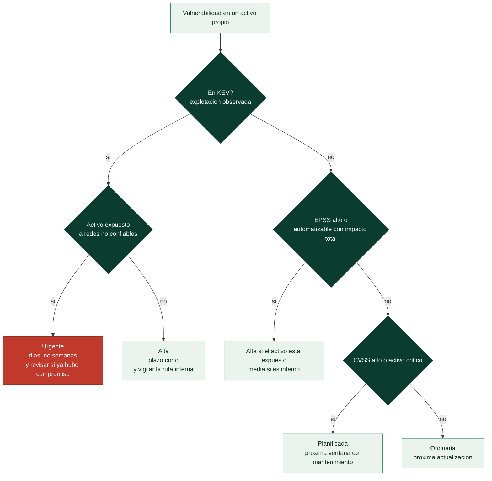

# Clase 369 — EPSS, CISA KEV y priorización por riesgo: qué arreglar primero

> Parte: **20 — Debilidades y vulnerabilidades: CWE, CVE, CVSS y su gestión** · Fuente: *FIRST (EPSS), CISA (catálogo KEV y BOD 26-04) y MITRE (Top 10 KEV Weaknesses)*
> ⏱️ Duración estimada: **130 min** · Nivel: **Intermedio–Avanzado**

---

## 🎯 Objetivo

Decidir **qué corregir primero** combinando señales que responden preguntas distintas: CVSS dice *cuánto duele si ocurre*, EPSS estima *cuán probable es que se explote* y KEV registra *que ya se está explotando*. Aprenderás a leer cada señal sin pedirle lo que no ofrece, a ver con datos reales por qué la regla «arreglar todo lo que sea ≥ 9,0» falla en las dos direcciones, a incorporar la exposición del activo (el dato que ninguna base pública puede darte) y a usar la tabla de decisión de **CISA BOD 26-04** como referencia de cómo convertir cuatro señales en un plazo. Al terminar sabrás justificar por escrito un orden de remediación y decir qué parte de esa decisión descansa en datos públicos y cuál en tu juicio.

> ⚠️ **Ética:** se trabaja con vulnerabilidades ya divulgadas y con datos públicos; no se explota nada ni se escanean sistemas ajenos.

## 📚 Resultados de aprendizaje

Al finalizar, el alumno podrá:

1. **Distinguir** severidad (CVSS), probabilidad (EPSS) y evidencia de explotación (KEV) y decir qué pregunta responde cada una.
2. **Interpretar** una puntuación y un percentil EPSS, incluyendo su fecha, sin confundirlos con riesgo ni con un umbral universal.
3. **Explicar** qué exige CISA para incluir un CVE en KEV y qué implica su ausencia.
4. **Comparar** una regla basada en CVSS con una basada en KEV y EPSS sobre casos reales y cuantificar sus errores.
5. **Aplicar** la tabla de decisión de BOD 26-04 (exposición, KEV, automatizable, impacto técnico) y razonar por qué el mismo CVE recibe plazos distintos.
6. **Ejecutar** el priorizador del laboratorio sobre una instantánea de datos y justificar su orden.
7. **Reconocer** los límites de cada señal: datos que faltan, retrasos, sesgos y cambios diarios.
8. **Redactar** un plan de remediación que declare fuentes, fechas y supuestos.

## 🗺️ Temas

| # | Tema | Por qué importa |
| --- | --- | --- |
| 1 | Tres preguntas, tres señales | Es la base de toda priorización honesta |
| 2 | EPSS: probabilidad de explotación | Pronostica lo que aún no ha ocurrido |
| 3 | CISA KEV: explotación observada | Es la evidencia más fuerte disponible públicamente |
| 4 | Qué dicen las señales sobre casos reales | Con datos se ve dónde falla el umbral de CVSS |
| 5 | La exposición y el contexto | Es la parte que solo conoce tu organización |
| 6 | BOD 26-04: una tabla de decisión | Convierte cuatro señales en un plazo |
| 7 | Debilidades (CWE) y explotación | Une la clase 361 con la gestión de vulnerabilidades |
| 8 | El algoritmo del laboratorio | Hace reproducible un criterio de prioridad |
| 9 | Límites y buenas prácticas | Datos ausentes, retrasos y sesgos |

## 🧱 Prerrequisitos

- **Clases 361 a 368**, sobre todo la 367 (de cada CVE cuelgan datos de varias fuentes) y la 368 (qué mide y qué no mide CVSS).
- **Probabilidad como estimación:** un valor de 0,05 no dice «va a ocurrir» ni «no va a ocurrir»; dice que, de muchos casos como este, se espera que ocurra uno de cada veinte en la ventana considerada. Un pronóstico se evalúa en conjunto, no caso a caso.
- **Percentil:** posición relativa. Un percentil 0,55 significa que el 55 % de los CVE puntuados tiene una probabilidad menor o igual; no es una probabilidad.
- **Superficie expuesta:** conjunto de activos alcanzables desde redes que no controlas (internet). Un activo *expuesto* puede ser atacado sin que el atacante esté ya dentro.
- **Instantánea:** copia fechada de datos que cambian a diario. Toda cifra de KEV o EPSS de esta clase vale para la fecha indicada, no para hoy.

## 🧠 Explicación en profundidad

### Tres preguntas, tres señales

Gestionar vulnerabilidades es decidir con recursos limitados. El error clásico es usar un único número para todo. La clase anterior mostró que CVSS-B mide la severidad intrínseca bajo supuestos del evaluador; no conoce tu red, ni si alguien está explotando el fallo. Para decidir hacen falta al menos tres señales independientes:

| Señal | Pregunta que responde | Naturaleza | Quién la publica | Cambia |
|---|---|---|---|---|
| **CVSS** | ¿Cuánto daño haría una explotación? | Severidad bajo supuestos | CNA, NVD, ADP (FIRST define el estándar) | Rara vez |
| **EPSS** | ¿Qué probabilidad hay de que se explote en los próximos 30 días? | Pronóstico estadístico | FIRST | A diario |
| **KEV** | ¿Hay evidencia fiable de que ya se explota? | Hecho observado | CISA | Cuando CISA añade entradas |

Una cuarta señal no la publica nadie por ti: **la exposición y el valor de tu activo**. El diagrama las relaciona.



El diagrama se lee de arriba abajo y su idea central es el **orden de las preguntas**. Primero KEV, porque es un hecho y no una estimación: si el CVE figura ahí, alguien ya lo aprovecha. Después la exposición, que decide si ese alguien puede llegar a tu activo. Solo cuando no hay evidencia de explotación se pasa a la estimación (EPSS o automatización con impacto total) y, al final, a la severidad y al valor del activo. Observa que CVSS ocupa el último escalón: no porque sea irrelevante, sino porque es la señal que menos distingue entre lo que se explota y lo que no. Es un esquema de razonamiento, no una norma; los plazos concretos los fija tu organización (la sección sobre BOD 26-04 muestra una referencia oficial).

### EPSS: probabilidad de explotación

El *Exploit Prediction Scoring System* lo mantiene FIRST. Para cada CVE publica una **probabilidad** entre 0 y 1 de que se observe explotación en los **próximos 30 días**, y un **percentil** que ordena ese valor frente al resto de CVE puntuados. Los datos se recalculan a diario y el modelo se reentrena periódicamente; la propia descarga de datos indica la versión del modelo y la fecha. Por eso un EPSS sin fecha es un dato incompleto.

Qué hay detrás: un modelo de aprendizaje automático que combina características de cada CVE con señales de explotación observada procedentes de varias fuentes de datos (FIRST menciona, entre otras, VulnCheck KEV, Shadowserver y LevelBlue). No es magia: aprende qué *tipo* de vulnerabilidad suele terminar explotada. FIRST documenta su metodología, calibración y limitaciones conocidas en la página «How EPSS Works». Cuatro consecuencias prácticas, respaldadas por el FAQ de FIRST:

1. **Es solo la probabilidad de la amenaza.** No incorpora el daño (eso es CVSS) ni tu entorno. FIRST lo dice expresamente: CVSS y EPSS miden cosas distintas y se complementan.
2. **No existe un umbral universal.** El valor 0,10 aparece a menudo como corte, pero no tiene autoridad especial: cada organización elige su umbral según su tolerancia, su capacidad de corregir y el coste de equivocarse en cada sentido.
3. **Es un pronóstico, KEV es historia.** Un CVE puede tener EPSS alto sin estar en KEV (porque no hay evidencia confirmada que cumpla los criterios de CISA, o aún no se ha añadido) y viceversa. FIRST recomienda usar KEV como complemento.
4. **El percentil engaña si se lee mal.** Casi todos los CVE tienen probabilidades pequeñas, de modo que un CVE con EPSS 0,0074 (0,74 %) cae en el percentil ≈ 0,55: queda en el «medio» de la distribución pese a que su probabilidad absoluta sea baja. El percentil sirve para ordenar; la probabilidad, para estimar.

### CISA KEV: explotación observada

El catálogo de **Vulnerabilidades Explotadas Conocidas** (*Known Exploited Vulnerabilities*) lo publica CISA. Un CVE entra cuando se cumplen tres condiciones documentadas: (1) tiene un identificador CVE; (2) hay **evidencia fiable de explotación activa** —incluidos intentos de explotación observados, por ejemplo en señuelos (*honeypots*)—; y (3) existe una **acción de corrección clara**. Quedan fuera los escaneos, la investigación y las pruebas de concepto sin uso hostil: que exista un exploit público no basta.

De esos criterios salen sus fortalezas y sus límites:

- **Fortaleza:** es un hecho observado y accionable. Un CVE en KEV tiene prueba de uso real y, por construcción, una vía de corrección.
- **Cobertura limitada:** el catálogo es una lista **curada**, no un censo de todo lo explotado. Refleja lo que CISA ha podido confirmar y que es corregible; lo que no está *no es seguro*, solo «no confirmado en el catálogo».
- **Retraso:** una explotación puede ocurrir antes de ser observada, confirmada y añadida.
- **Sesgo de entorno:** los productos de nicho o regionales pueden estar infrarrepresentados respecto de los que usa la administración y las empresas estadounidenses que reportan a CISA. Es una inferencia razonable sobre cualquier lista curada, no una cifra publicada.
- **No mide la prevalencia:** que un CVE esté en KEV no dice cuántas organizaciones han sido atacadas.

Datos del catálogo en la instantánea de la clase (versión 2026.10.29): **1.764 entradas**, de las cuales **361** (≈ 20,5 %) marcan uso conocido en campañas de *ransomware*. Las altas por año son muy irregulares: 311 (2021), 555 (2022), 187 (2023), 186 (2024), 245 (2025) y 280 (2026 hasta la fecha de la instantánea); el pico de 2021–2022 probablemente refleja la carga inicial del histórico más que una tendencia (es una inferencia, no un dato publicado). Otro dato útil para quien ordena por antigüedad: **373** entradas se añadieron cinco o más años después del año de su CVE. Una vulnerabilidad vieja no está «amortizada»: se sigue explotando. (Estos recuentos son propios, calculados sobre el feed JSON de KEV de la fecha indicada; no son estadísticas publicadas por CISA.)

### Qué dicen las señales sobre casos reales

La tabla reúne los 14 casos de la instantánea `labs/devsecops-pipeline/datos/casos-cwe-cve.json` (consulta del **2026-10-30**; KEV catálogo 2026.10.29). Está ordenada por KEV y luego por EPSS. Las dos últimas columnas son los plazos de referencia de BOD 26-04 si el activo está expuesto o es interno, calculados con los datos SSVC de CISA para cada CVE.

| Caso | CVSS 3.1 (NVD) | EPSS | KEV (alta) | SSVC (explotación / automatizable / impacto) | Plazo BOD si está expuesto | Plazo BOD si es interno |
|---|---:|---:|---|---|---|---|
| Heartbleed (`CVE-2014-0160`) | 7,5 | 99,999 % | 2022-05-04 | active / yes / partial | 3 d | 14 d |
| Struts (`CVE-2017-5638`) | 9,8 | 99,999 % | 2021-11-03 · ransomware | active / yes / total | 3 d y triaje forense | 3 d y triaje forense |
| BlueKeep (`CVE-2019-0708`) | 9,8 | 99,999 % | 2021-11-03 · ransomware | active / yes / total | 3 d y triaje forense | 3 d y triaje forense |
| Log4Shell (`CVE-2021-44228`) | 10,0 | 99,999 % | 2021-12-10 · ransomware | active / yes / total | 3 d y triaje forense | 3 d y triaje forense |
| Rapid Reset (`CVE-2023-44487`) | 7,5 | 99,999 % | 2023-10-10 | active / yes / partial | 3 d | 14 d |
| Apache 2.4.49 (`CVE-2021-41773`) | 9,8 | 99,992 % | 2021-11-03 · ransomware | active / yes / total | 3 d y triaje forense | 3 d y triaje forense |
| libwebp (`CVE-2023-4863`) | 8,8 | 99,979 % | 2023-09-13 | active / no / total | 3 d y triaje forense | 14 d |
| sudo (`CVE-2021-3156`) | 7,8 | 99,962 % | 2022-04-06 | active / no / total | 3 d y triaje forense | 14 d |
| MOVEit (`CVE-2023-34362`) | 9,8 | 99,934 % | 2023-06-02 · ransomware | active / yes / total | 3 d y triaje forense | 3 d y triaje forense |
| Spring4Shell (`CVE-2022-22965`) | 9,8 | 99,638 % | 2022-04-04 | active / yes / total | 3 d y triaje forense | 3 d y triaje forense |
| regreSSHion (`CVE-2024-6387`) | 8,1 | 99,506 % | no | poc / no / total | 14 d | próxima actualización |
| Netentsec, SQLi (`CVE-2024-2021`) | 9,8 | 0,741 % | no | poc / no / partial | 60 d | próxima actualización |
| Fast DDS (`CVE-2023-50716`) | 9,8 | 0,724 % | no | none / no / partial | 60 d | próxima actualización |
| wechat, SSRF (`CVE-2024-27565`) | 9,8 | 0,661 % | no | none / yes / total | 3 d | 60 d |

> «d» = días naturales. La nomenclatura SSVC (*active / poc / none*; *yes / no*; *total / partial*) se explica en la sección sobre BOD 26-04. Instantánea: no es el estado de hoy.

Lecturas que la tabla permite, comprobables fila a fila:

1. **La regla «CVSS ≥ 9,0» falla en las dos direcciones.** De los 14 casos, nueve pasan el corte (Struts, BlueKeep, Log4Shell, Apache 2.4.49, MOVEit, Spring4Shell, Netentsec, Fast DDS y el SSRF de wechat). Seis de esos nueve están en KEV, pero **tres no** (Netentsec, Fast DDS y wechat; EPSS inferior al 1 % los tres). Y quedan **fuera cuatro casos de KEV**: Heartbleed (7,5), Rapid Reset (7,5), libwebp (8,8) y sudo (7,8). Con ese umbral se perseguiría a tres CVE sin evidencia de uso y se dejarían sin tratar cuatro con explotación confirmada.
2. **EPSS ordena casi como KEV, pero no es KEV.** Los diez CVE de KEV tienen EPSS por encima del 99 %. Pero **regreSSHion** (CVE-2024-6387) también supera el 99 % **sin estar en KEV**: el pronóstico advierte de un riesgo que el catálogo no confirma. Es lo que cabe esperar de un pronóstico (puede adelantarse a la evidencia) y la razón de usar ambas señales.
3. **Un 9,8 puede tener probabilidad baja.** Netentsec (0,74 %), Fast DDS (0,72 %) y wechat (0,66 %) tienen CVSS 9,8 pero EPSS menor del 1 %. No son «inofensivos» —su severidad es real—, sino que *hoy* no hay señal de explotación masiva. Se corrigen por política, no por emergencia.
4. **La exposición cambia el plazo, no el CVE.** El mismo libwebp pasa de «3 días y triaje forense» (expuesto) a «14 días» (interno). Es la misma vulnerabilidad: lo que cambia es quién puede llegar a ella.
5. **El plazo no sigue a EPSS.** El SSRF de wechat tiene EPSS 0,66 % y, sin embargo, BOD 26-04 da **3 días si está expuesto**: CISA lo marca como automatizable con control total del activo. Dos criterios razonables, dos órdenes distintos; por eso el plan debe decir qué criterio usa.
6. **«Triaje forense» no es corregir.** Cuando el CVE está en KEV y el impacto es total, BOD 26-04 pide además revisar si el activo ya fue comprometido: parchear cierra la puerta, no echa a quien ya entró.

### La exposición y el contexto

Ninguna base pública conoce tu red. La **exposición** —¿se llega al activo desde internet o desde un segmento que no controlas?— es la variable que más cambia la prioridad y la única que no puede calcularse por ti. Conviene distinguir tres planos:

- **Exposición del activo:** ¿hay una ruta de red desde fuera? Un servidor detrás de un acceso por VPN con autenticación fuerte no tiene la misma exposición que uno publicado.
- **Valor del activo:** ¿qué pasa si cae? El mismo CVE en un servidor de pruebas y en el que firma las nóminas no merece el mismo plazo.
- **Controles compensatorios:** reglas de firewall, WAF, segmentación o desactivar la función afectada reducen el riesgo mientras llega el parche. **Mitigar no es corregir**: el riesgo baja, no desaparece, y debe quedar anotado con fecha y responsable.

El priorizador del laboratorio exige declarar la exposición de cada hallazgo; cuando falta, aplica un factor **conservador (0,8)** y lo avisa en el informe. No es una constante científica: es una elección explícita para no ocultar la ausencia del dato.

### BOD 26-04: una tabla de decisión

El **10 de junio de 2026** CISA publicó la directiva operativa vinculante **BOD 26-04** («Prioritizing Security Updates Based on Risk»), que **sustituye a BOD 22-01 y BOD 19-02**. Es **obligatoria solo para las agencias civiles federales de EE. UU.**; para el resto del mundo es una **referencia** valiosa porque convierte en plazos la combinación de cuatro variables:

| Variable | Pregunta | Quién la determina |
|---|---|---|
| **Exposición del activo** | ¿Es alcanzable desde redes públicas? | Tu organización |
| **KEV** | ¿El CVE está en el catálogo? | CISA |
| **Automatizable** | ¿Un adversario puede automatizar todos los pasos de la explotación? | CISA (programa Vulnrichment, metodología SSVC) |
| **Impacto técnico** | ¿Control *total* o *parcial* del activo tras explotar? | CISA (SSVC) |

Las cuatro variables binarias dan 16 filas. El módulo `labs/devsecops-pipeline/bod2604.py` las reproduce tal cual aparecen en la directiva (consultada el 2026-10-30) y las pruebas comprueban sus valores. El patrón general es fácil de recordar:

- **KEV + expuesto + control total:** 3 días **y** triaje forense.
- **Expuesto sin KEV pero automatizable y con control total:** 3 días (el riesgo es que alguien lo automatice pronto).
- **Interno y sin KEV:** de 60 días a «próxima actualización del sistema», según automatización e impacto.

Dos matices importantes. Primero, **CVSS no interviene**: el «impacto técnico» de SSVC es una decisión de dos valores (parcial o total) que se parece a la severidad pero es distinta. Segundo, los datos SSVC los publica CISA a través de su ADP (la fuente que ya conociste en la clase 367 como origen de puntuaciones y CWE); si un CVE no los tiene, no hay fila que aplicar y la decisión vuelve a ser tuya. Esa honestidad es parte del diseño: la tabla ordena, no sustituye al criterio.

### Debilidades (CWE) y explotación

Las clases 361 a 366 trabajaron con CWE; aquí se cierra el círculo. Dos listas oficiales miran la misma realidad desde ángulos distintos:

- El **Top 25 de debilidades de software 2025** de MITRE puntúa cada CWE por **frecuencia y severidad** de sus CVE; incluye, para cada una, cuántos CVE figuran en KEV.
- El **Top 10 KEV Weaknesses 2025** de MITRE y CISA clasifica las debilidades **por su presencia en KEV**: CWE-78, 416, 787, 306, 502, 22, 94, 288, 122 y 79, calculado sobre 182 CVE de KEV publicados entre junio de 2024 y junio de 2025. La propia página advierte de que los rangos son sensibles: el puesto 11 tenía solo cuatro CVE.

El contraste entre ambas es instructivo. La inyección de comandos **CWE-78** ocupa el puesto 9 del Top 25 pero tiene **20** CVE en KEV; el *cross-site scripting* **CWE-79** es el nº 1 del Top 25 y tiene **7**; el CSRF **CWE-352** (nº 3) tiene **0**. La causa probable es el mecanismo (una inferencia pedagógica, no un dato publicado): una debilidad que da ejecución de código sin autenticación es fácil de automatizar y de monetizar; una que exige engañar a un usuario autenticado, mucho menos. Por eso la clase de debilidad es una **señal de contexto** para anticipar qué se explotará: no sustituye a EPSS ni a KEV, pero ayuda a decidir qué prácticas de desarrollo cambiar para que esos CVE no vuelvan a nacer (clases 363 a 366).

Un recuento propio sobre el catálogo 2026.10.29 (campo `cwes` de KEV; un CVE puede llevar varias) arroja como más frecuentes CWE-20 (119), CWE-78 (113), CWE-787 (106), CWE-416 (95), CWE-119 (88), CWE-22 (82), CWE-94 (72), CWE-502 (71), CWE-287 (48) y CWE-306 (42). Dos precauciones al leerlo: CWE-20 es una clase muy general (la clase 362 ya advirtió contra mapear a nodos abstractos) y el campo `cwes` de KEV lo rellena CISA con su propio criterio, que puede diferir del de NVD o del CNA.

### El algoritmo del laboratorio

`labs/devsecops-pipeline/priorizar.py` aplica un orden determinista y legible:

1. **KEV primero:** los hallazgos con explotación observada van antes de cualquier otro.
2. **Después EPSS** (de mayor a menor): entre los demás, la probabilidad ordena.
3. **Por último, CVSS ajustado por la exposición** declarada (con el factor conservador cuando falta).

Con `--instantanea` usa los datos fechados del repositorio en lugar de la red (reproducible y sin claves), y con `--bod-26-04` añade a cada hallazgo el plazo de referencia. Si un CVE no figura en la instantánea, el informe lo dice: *«sin KEV / sin EPSS» significa «no sabemos», no «no se explota»*. Es el límite más importante de cualquier herramienta de este tipo: la ausencia de dato no es dato.

### Límites y buenas prácticas

1. **Toda cifra tiene fecha.** KEV y EPSS cambian a diario; un informe sin fecha de consulta es indefendible.
2. **Ausencia no es seguridad.** Un CVE fuera de KEV y con EPSS bajo puede estar siendo explotado en un entorno que nadie observa.
3. **Las señales se contradicen y está bien.** El desacuerdo entre KEV, EPSS y BOD (casos regreSSHion y wechat) es información: obliga a decidir con criterio explícito.
4. **Corregir cuesta.** Un parche tiene riesgo de regresión; por eso se distinguen plazos de 3, 14 y 60 días. Priorizar es también decidir qué *no* hacer ahora, y dejarlo escrito.
5. **Documenta la decisión.** Para cada CVE que no se corrige de inmediato: razón, control compensatorio, responsable y fecha de revisión.
6. **No mezcles niveles.** CWE (tipo de defecto) no se prioriza como un CVE (instancia); lo que se prioriza son CVE en activos concretos, y las CWE orientan la prevención.

## 📖 Definiciones y características

- **EPSS:** modelo de FIRST que estima la probabilidad de explotación en los próximos 30 días. *Clave:* es un pronóstico diario, no una medida de riesgo.
- **Percentil EPSS:** posición relativa de un CVE entre todos los puntuados. *Clave:* sirve para ordenar, no para estimar la probabilidad.
- **KEV:** catálogo de CISA de vulnerabilidades con explotación observada. *Clave:* es un hecho curado, no una lista exhaustiva.
- **Explotación activa:** evidencia fiable de uso hostil del fallo, incluido el intento observado. *Clave:* un escaneo o una PoC no lo constituyen.
- **SSVC:** *Stakeholder-Specific Vulnerability Categorization*, metodología de árbol de decisión de CISA. *Clave:* produce decisiones, no puntuaciones.
- **Automatizable:** si todos los pasos de la explotación pueden ejecutarse sin intervención humana. *Clave:* eleva la urgencia al permitir escala.
- **Impacto técnico:** control total o parcial del activo tras la explotación. *Clave:* en SSVC tiene dos valores, no la escala de CVSS.
- **BOD 26-04:** directiva de CISA de 2026 que fija plazos según exposición, KEV, automatización e impacto. *Clave:* obligatoria para agencias federales, referencia para los demás.
- **Exposición:** alcanzabilidad del activo desde redes no confiables. *Clave:* solo tú puedes determinarla.
- **Control compensatorio:** medida que reduce el riesgo sin eliminar la vulnerabilidad. *Clave:* mitigar no es corregir.
- **Triaje forense:** revisión de si un activo ya fue comprometido antes del parche. *Clave:* parchear no expulsa a un intruso ya presente.

## 📔 Glosario

| Término | Definición concisa |
|---------|--------------------|
| EPSS | Estimación de FIRST de la probabilidad de que un CVE se explote en los próximos 30 días |
| Percentil | Fracción de CVE puntuados cuya probabilidad es menor o igual a la de este |
| KEV | Catálogo de CISA de vulnerabilidades con explotación activa confirmada |
| Explotación activa | Uso hostil del fallo demostrado con evidencia fiable |
| Prueba de concepto | Código que demuestra que una vulnerabilidad es explotable, sin implicar uso hostil |
| SSVC | Marco de CISA de decisión en árbol para priorizar vulnerabilidades |
| Vulnrichment | Programa de CISA que añade datos SSVC y CWE a registros CVE |
| Automatizable | Explotación cuyos pasos pueden ejecutarse sin intervención humana |
| Impacto técnico | Grado de control sobre el activo tras explotar: parcial o total |
| BOD | Directiva operativa vinculante de CISA para agencias civiles federales de EE. UU. |
| Exposición | Alcanzabilidad de un activo desde redes que la organización no controla |
| Control compensatorio | Medida que reduce el riesgo sin corregir la causa |
| Triaje forense | Examen de un activo para detectar si ya fue comprometido |
| Instantánea | Copia fechada de datos que cambian a diario |
| Ransomware conocido | Etiqueta KEV de uso del CVE en campañas de secuestro de datos |
| Superficie de ataque | Conjunto de puntos por los que un atacante puede interactuar con un sistema |

## 🧰 Herramientas y preparación

Todo funciona sin red y sin claves, con la biblioteca estándar de Python 3:

```bash
# Priorizar con la instantánea del repositorio y añadir los plazos de BOD 26-04
python labs/devsecops-pipeline/priorizar.py --instantanea labs/devsecops-pipeline/datos/casos-cwe-cve.json --bod-26-04

# Consultar la tabla de decisión de BOD 26-04 directamente
python labs/devsecops-pipeline/bod2604.py --expuesto si --kev si --automatizable si --impacto total

# Ver dónde discrepan las fuentes de un CVE
python labs/devsecops-pipeline/discrepancias.py CVE-2024-6387

# Pruebas de los módulos de esta clase
python -m unittest discover -s labs/devsecops-pipeline/tests -v
```

Para actualizar la instantánea con datos de hoy (requiere red y usa las APIs oficiales con un identificador honesto) existe `labs/devsecops-pipeline/actualizar_casos.py`. Fuentes: catálogo en <https://www.cisa.gov/known-exploited-vulnerabilities-catalog>, EPSS en <https://www.first.org/epss/> y su API en <https://api.first.org/data/v1/epss>.

## 🧪 Laboratorio guiado

1. **Ejecuta el priorizador con plazos.** Corre el primer comando y anota el orden de los hallazgos de ejemplo. Identifica cuáles tienen la etiqueta KEV y cuál es el criterio que desempata entre los demás.
2. **Compara dos reglas.** Con la tabla de la clase, calcula qué casos recogería «CVSS ≥ 9,0» y cuáles «KEV o EPSS ≥ 0,10». Cuenta falsos positivos (corregidos sin evidencia) y falsos negativos (KEV no corregidos) de cada regla.
3. **Mueve el activo.** Con `bod2604.py`, calcula el plazo de libwebp (KEV sí, automatizable no, impacto total) con el activo expuesto y no expuesto. Escribe en una frase qué supuesto de tu red justifica cada resultado.
4. **Busca el desacuerdo.** Toma regreSSHion y wechat. Para cada uno, escribe qué dice KEV, qué dice EPSS y qué dice BOD, y decide con qué criterio lo tratarías en un servidor de internet y en uno interno, justificándolo.
5. **Lee el límite.** Ejecuta el priorizador y localiza el aviso de los CVE que no figuran en la instantánea (los hallazgos de ejemplo incluyen tres). Explica por qué decir «sin explotación» sería un error.
6. **Declara el supuesto de exposición.** Localiza el aviso del hallazgo sin exposición declarada y del factor conservador. ¿Qué cambiaría en el orden si lo declaras expuesto, y si lo declaras interno?
7. **Redacta el plan.** Con el resultado, escribe un párrafo de plan de remediación que cite la fecha de las fuentes, el criterio de orden y los activos cuya exposición hayas asumido.

## ✍️ Ejercicios

1. Explica con un ejemplo de la tabla por qué «CVSS alto» y «EPSS alto» no son lo mismo.
2. Un CVE tiene EPSS 0,03 y percentil 0,90. ¿Qué dice cada valor y por qué no se contradicen?
3. Enumera las tres condiciones de CISA para entrar en KEV y di por qué un exploit público en GitHub no cumple la segunda.
4. ¿Cuál es la diferencia entre mitigar y corregir? Pon un control compensatorio para un servicio expuesto que no puede parchearse esta semana.
5. Aplica BOD 26-04 (usa `bod2604.py`) a un CVE con KEV = no, automatizable = sí, impacto = total, en un activo expuesto y en uno interno. Explica la diferencia.
6. Un jefe pide «arreglar solo lo que tenga EPSS ≥ 0,10». Da una ventaja y dos riesgos de esa política con casos de la tabla.
7. ¿Por qué CWE-78 tiene 20 CVE en KEV y CWE-352 ninguno? Relaciónalo con el mecanismo de cada debilidad y declara qué parte es inferencia.
8. Escribe qué información mínima debe llevar la entrada de un CVE aplazado en un registro de riesgos.

## ✅ Soluciones razonadas

1. CVSS mide el daño bajo supuestos y EPSS la probabilidad de explotación. Netentsec tiene CVSS 9,8 y EPSS 0,74 %: gran daño potencial, poca probabilidad observada. Heartbleed tiene CVSS 7,5 y EPSS ≈ 100 %: menos daño por incidente, explotación segura. Ordenar por una u otra da órdenes casi inversos.
2. EPSS 0,03 es una probabilidad: de cada 100 CVE como este, se espera que se explote 3 en 30 días. El percentil 0,90 dice que el 90 % de los CVE puntuados tiene una probabilidad menor o igual. No se contradicen: la distribución está muy concentrada cerca de cero, así que una probabilidad pequeña en términos absolutos puede ser alta en términos relativos.
3. (a) Tener identificador CVE; (b) evidencia fiable de explotación activa; (c) acción de corrección clara. Un exploit público sin uso hostil observado es una prueba de concepto: demuestra que *se puede*, no que *se hace*, y CISA no cuenta escaneos, investigación ni PoC como explotación.
4. Corregir elimina la causa (parche, versión, configuración); mitigar reduce la probabilidad o el impacto sin quitarla. Ejemplos: restringir el acceso por IP o VPN, desactivar el módulo afectado, regla de WAF para el patrón de ataque, segmentar la red. Debe quedar anotado con fecha límite, porque el fallo sigue ahí.
5. Fila «expuesto, sin KEV, automatizable, total» → **3 días**. Fila «interno, sin KEV, automatizable, total» → **60 días**. La explotación aún no está confirmada, pero si es automatizable y da control total, un atacante puede escalarla pronto; en un activo interno el atacante necesita primero entrar, de ahí el margen mayor.
6. Ventaja: es una regla simple, objetiva y reproducible que concentra el esfuerzo en lo probable. Riesgos: (a) deja fuera lo severo y poco probable pero crítico para el activo, y lo que en tu entorno es la única vía de entrada; (b) EPSS cambia a diario y el valor 0,10 no tiene autoridad especial. En la tabla, los CVE con 9,8 y EPSS < 1 quedarían sin tratar aunque el activo esté expuesto y el impacto sea total (wechat: 3 días según BOD).
7. CWE-78 permite ejecutar comandos del sistema, normalmente desde red y sin interacción de un usuario: es fácil de automatizar y de aprovechar a escala. CWE-352 requiere que un usuario autenticado visite una página maliciosa y su efecto depende de lo que ese usuario pueda hacer. Esa explicación es una **inferencia** pedagógica; lo que sí es dato publicado es el recuento (20 frente a 0) y la advertencia de que la frecuencia en CVE no equivale a explotación.
8. Identificador, activo y exposición; señales con fecha (KEV, EPSS, CVSS con versión y fuente); razón del aplazamiento; control compensatorio vigente; responsable; fecha de revisión; condición que obliga a revisar antes (por ejemplo, entrada en KEV).

## 📝 Reto verificable

**Construye un comparador de políticas de prioridad.** A partir de `datos/casos-cwe-cve.json`, escribe un script que, para al menos tres políticas (`cvss>=9`, `kev_o_epss>=0.10`, `bod-26-04 expuesto con plazo de 3 días`), emita una tabla con: casos seleccionados, aciertos (KEV seleccionados), falsos negativos (KEV no seleccionados) y falsos positivos (no KEV seleccionados). Debe declarar la fecha de la instantánea y leer los datos sin red.

**Criterio de aceptación:** reproduce los recuentos de la clase para `cvss>=9` (9 seleccionados, 6 KEV, 3 falsos positivos y 4 falsos negativos); incluye pruebas unitarias con un caso sintético donde las tres políticas difieren; no falla si falta KEV o EPSS en un caso (lo trata como «desconocido», no como «no explotado»); y el informe nunca presenta la ausencia de dato como ausencia de riesgo.

## ⚠️ Errores comunes

| Síntoma / mensaje | Causa y cómo arreglar |
| --- | --- |
| Priorizar solo por CVSS | Severidad no es probabilidad ni explotación. Añade KEV y EPSS |
| Tratar EPSS como riesgo | Es solo la probabilidad de la amenaza. Combínala con exposición y valor |
| Usar 0,10 como umbral «oficial» | No lo es. Define el tuyo y documenta por qué |
| Creer que «no está en KEV» es «seguro» | KEV es curado y llega con retraso. Ausencia no es seguridad |
| Citar KEV o EPSS sin fecha | Cambian a diario. Anota la fecha de consulta |
| Parchear sin revisar si hubo compromiso | En KEV con impacto total, añade triaje forense |
| Dar por corregido lo que solo se mitigó | Registra el control compensatorio, el responsable y la fecha de revisión |
| Ignorar la exposición | Es la variable que más cambia el plazo. Determínala por activo |
| Confundir CWE con CVE al priorizar | Se priorizan CVE en activos; las CWE orientan la prevención |
| Interpretar el percentil como probabilidad | El percentil ordena; la probabilidad estima. Usa cada uno para lo suyo |

## ❓ Preguntas frecuentes

**❓ ¿Puedo usar solo KEV y olvidarme de EPSS?** KEV es la señal más fuerte pero la más estrecha: solo recoge lo confirmado y corregible. EPSS cubre el resto con un pronóstico. FIRST propone usar KEV como complemento de EPSS, no sustituirlo.

**❓ ¿EPSS sustituye a CVSS?** No. Miden cosas distintas: CVSS el daño, EPSS la probabilidad. Una política razonable usa ambas más tu contexto.

**❓ ¿Qué hago con un CVE sin EPSS?** Probablemente es muy reciente o está rechazado. Trátalo como «sin dato», revisa KEV y la descripción del proveedor y vuelve a consultar en unos días.

**❓ ¿BOD 26-04 me obliga a algo si no soy una agencia federal de EE. UU.?** No. Es una referencia pública bien razonada; tus plazos los fijas tú.

**❓ ¿Con qué frecuencia debo revisar las señales?** Al menos con la misma cadencia de tu escaneo, y de inmediato cuando entre un CVE relevante a KEV. Automatizar la consulta (con `priorizar.py` y `actualizar_casos.py`, ver «Herramientas y preparación») evita depender de la memoria.

**❓ ¿Cómo explico a dirección por qué no parcheé un 9,8?** Con la señal y su fecha: «sin entrada en KEV, EPSS de 0,7 %, activo interno, control compensatorio X y revisión el día Y». Una decisión documentada se defiende; un número aislado no.

## 🔗 Referencias

- FIRST, *EPSS — Frequently Asked Questions* — <https://www.first.org/epss/faq> — definición de EPSS (probabilidad en 30 días), actualización diaria, ausencia de umbral universal y diferencia con CVSS y KEV.
- FIRST, *EPSS — How EPSS Works* — <https://www.first.org/epss/how-it-works> — metodología del modelo, calibración y limitaciones conocidas.
- FIRST, *EPSS — Get the Data* — <https://www.first.org/epss/data> — descarga diaria en CSV y API, con versión del modelo y fecha.
- FIRST, API de EPSS — <https://api.first.org/data/v1/epss> — consulta de puntuación y percentil usada para la instantánea.
- CISA, *Known Exploited Vulnerabilities Catalog* — <https://www.cisa.gov/known-exploited-vulnerabilities-catalog> — catálogo KEV, criterios de inclusión y feed JSON.
- CISA, *BOD 26-04: Prioritizing Security Updates Based on Risk* — <https://www.cisa.gov/news-events/directives/bod-26-04-prioritizing-security-updates-based-risk> — variables, tabla de 16 filas, plazos y sustitución de BOD 22-01 y 19-02.
- CISA, *Vulnrichment* — <https://github.com/cisagov/vulnrichment> — datos SSVC (explotación, automatizable, impacto técnico) y CWE añadidos a los registros CVE.
- MITRE y CISA, *2025 CWE Top 10 KEV Weaknesses* — <https://cwe.mitre.org/top25/archive/2025/2025_kev_list.html> — debilidades más presentes en KEV, recuento de CVE y metodología.
- MITRE, *2025 CWE Top 25 Most Dangerous Software Weaknesses* — <https://cwe.mitre.org/top25/archive/2025/2025_cwe_top25.html> — puntuación por frecuencia y severidad y recuento de CVE de KEV por debilidad.

## 📥 Material descargable

- 📄 [Guía en PDF](./clase-369-guia.pdf) — versión imprimible de esta clase.
- 🎞️ [Presentación (PPTX)](./clase-369-presentacion.pptx) — deck para proyectar en clase.

## ⬅️ Clase anterior

[Clase 368 — CVSS v3.1 y v4.0: qué mide la severidad y cómo se calcula](../368-cvss-v3-1-y-v4-0-severidad/README.md)

## ➡️ Siguiente clase

[Clase 370 — Ciclo completo: de la debilidad a la corrección verificada](../370-ciclo-completo-de-la-debilidad-a-la-correccion-verificada/README.md)
