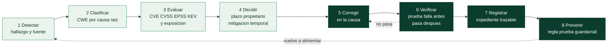

# Clase 370 — Ciclo completo: de la debilidad a la corrección verificada

> Parte: **20 — Debilidades y vulnerabilidades: CWE, CVE, CVSS y su gestión** · Fuente: *MITRE CWE (guía de mapeo por causa raíz), CISA, FIRST, OWASP y los laboratorios del programa*
> ⏱️ Duración estimada: **150 min** · Nivel: **Avanzado (integrador)**

---

## 🎯 Objetivo

Recorrer, con un caso real y un código que puedes ejecutar, **todo el ciclo de vida de una debilidad**: detectarla, clasificarla con el CWE correcto, saber si ya hay un CVE y cuánto importa, decidir el plazo, corregir en la causa, **demostrar** que la corrección funciona y que no rompe lo legítimo, dejar constancia y cambiar el proceso para que no vuelva. Es la clase que junta las ocho anteriores: sin ella, CWE, CVE, CVSS, EPSS y KEV son vocabulario; con ella son un método de trabajo que produce una evidencia comprobable. Al terminar podrás entregar, para un hallazgo, un expediente que otra persona pueda **reproducir y auditar**.

> ⚠️ **Ética:** el laboratorio trabaja sobre una aplicación didáctica vulnerable que ejecutas en tu equipo y sobre datos públicos de CVE ya corregidos. No se ataca ningún sistema ajeno.

## 📚 Resultados de aprendizaje

Al finalizar, el alumno podrá:

1. **Describir** las etapas del ciclo (detectar, clasificar, evaluar, decidir, corregir, verificar, registrar, prevenir) y la evidencia que produce cada una.
2. **Contrastar** el CWE que sugiere una herramienta con el que corresponde a la causa raíz y justificar la diferencia.
3. **Reconocer** un falso negativo de una herramienta y compensarlo con otra técnica.
4. **Enlazar** una debilidad con un CVE real del mismo tipo y valorar su prioridad con CVSS, EPSS, KEV y exposición.
5. **Elegir** una mitigación del catálogo CWE y traducirla a un cambio de código concreto.
6. **Diseñar** una prueba que falla contra el código vulnerable y pasa contra el corregido, incluyendo casos legítimos y de borde.
7. **Distinguir** una corrección verificada de un parche asumido, y explicar por qué una corrección puede ser incompleta.
8. **Redactar** un expediente de hallazgo con trazabilidad y proponer un guardarraíl para evitar la recurrencia.

## 🗺️ Temas

| # | Tema | Por qué importa |
| --- | --- | --- |
| 1 | El ciclo completo y su evidencia | Da estructura a todo lo aprendido |
| 2 | Detectar: calidad de la señal | Las herramientas se equivocan de formas previsibles |
| 3 | Clasificar: de la señal al CWE | Una etiqueta incorrecta lleva a una corrección incorrecta |
| 4 | Evaluar: CVE, CVSS, EPSS, KEV y exposición | Distingue lo urgente de lo importante |
| 5 | Decidir: plazo, propietario y mitigación temporal | Sin decisión no hay corrección |
| 6 | Corregir en la causa | Un parche del síntoma deja la debilidad |
| 7 | Verificar: la prueba que falla y luego pasa | Es lo que convierte una afirmación en evidencia |
| 8 | Registrar y comunicar | Hace la decisión auditable |
| 9 | Prevenir: cerrar el bucle | Evita corregir lo mismo cada trimestre |
| 10 | Límites del método | Evita sobrevalorar la herramienta |

## 🧱 Prerrequisitos

- **Clases 361 a 369** de esta parte. En particular: 362 (causa raíz y tipos de correspondencia), 363–366 (familias de debilidades), 367 (CVE y sus fuentes), 368 (CVSS) y 369 (EPSS, KEV y priorización).
- **Laboratorios del programa:** `labs/appsec-code` (aplicación vulnerable con ocho debilidades plantadas, su versión corregida y pruebas) y `labs/devsecops-pipeline` (priorizador, calculadora CVSS y tabla de BOD 26-04).
- **Prueba de regresión:** una prueba automatizada que garantiza que algo ya corregido no vuelva a romperse. *Regresión* significa que una función que antes era correcta deja de serlo tras un cambio.
- **Falso positivo y falso negativo:** una herramienta que avisa de algo que no es un problema (falso positivo) o que no avisa de algo que sí lo es (falso negativo). Ambos cuestan; el segundo, además, da una falsa sensación de seguridad.
- **Hechos, inferencias y supuestos:** un expediente serio separa lo que se observó, lo que se concluye y lo que se supone.

## 🧠 Explicación en profundidad

### El ciclo completo y su evidencia

Gestionar una debilidad no es «encontrar y arreglar»; es un ciclo con puntos donde se puede fallar en silencio. Cada etapa tiene una pregunta y produce un dato que la siguiente necesita:



El diagrama se lee de izquierda a derecha con dos flechas de retorno, y esas dos flechas son lo importante. La discontinua que sale de «Verificar» hacia «Corregir» dice que **una corrección que no pasa la prueba no está terminada**: es lo que separa una corrección verificada de un parche asumido. La que sale de «Prevenir» hacia «Detectar» dice que el ciclo se cierra: la regla o prueba que añades al final es la que detectará la próxima ocurrencia más pronto y más barata. Las cuatro primeras etapas (en verde claro) producen *conocimiento* sobre el problema; las cuatro últimas (en verde oscuro) producen *cambios y evidencia*. Un equipo que se queda en las primeras tiene inventarios magníficos y los mismos fallos; uno que salta a la corrección sin evaluar arregla lo equivocado primero.

| Etapa | Pregunta | Evidencia que deja |
|---|---|---|
| Detectar | ¿Qué se observó y con qué herramienta? | Salida de la herramienta, versión y fecha |
| Clasificar | ¿Cuál es la causa raíz y qué CWE la describe? | CWE, tipo de correspondencia y razonamiento |
| Evaluar | ¿Hay CVE? ¿Cuánto importa aquí y ahora? | CVSS (versión y fuente), EPSS y KEV con fecha, exposición |
| Decidir | ¿Quién lo corrige y para cuándo? | Plazo, responsable, control compensatorio |
| Corregir | ¿Qué cambio elimina la causa? | Cambio de código con referencia a la mitigación |
| Verificar | ¿Se demuestra que ya no es explotable y que nada legítimo se rompió? | Prueba que falla antes y pasa después |
| Registrar | ¿Puede otra persona auditarlo? | Expediente enlazado a todo lo anterior |
| Prevenir | ¿Cómo evitamos que reaparezca? | Regla, prueba o guardarraíl en el proceso |

### Detectar: la calidad de la señal

Una herramienta de análisis estático (SAST) no entrega verdades: entrega **sospechas con etiqueta**. En el laboratorio, el análisis de `labs/appsec-code/vulnerable_app/app.py` con Bandit 1.9.4 produce diez hallazgos sobre ocho debilidades plantadas, y su salida real, versionada en el repositorio, enseña los tres defectos típicos de la señal:

1. **Falso negativo:** Bandit no detecta el *path traversal* (CWE-22): la app abre un archivo cuyo nombre arma el atacante concatenando una ruta, y ninguna regla lo marca. Tampoco detecta la clave de AWS embebida (marca la contraseña de la línea anterior porque el nombre de la variable se parece a «password»). El ciclo no puede depender de una sola técnica.
2. **Un defecto, varios hallazgos:** `subprocess` con `shell=True` produce dos avisos (el uso peligroso y la importación del módulo) con el mismo CWE; la línea de `app.run(debug=True, host="0.0.0.0")` produce dos avisos con CWE distintos. Contar hallazgos no es contar problemas.
3. **Etiqueta de CWE dudosa:** como veremos, el CWE de la herramienta no siempre es el que corresponde.

La conclusión práctica es doble: toda herramienta se **calibra** contra casos conocidos (para eso existe la aplicación didáctica) y se **combina** con revisión humana y pruebas. La cobertura de una herramienta es una propiedad medida, no un supuesto.

### Clasificar: de la señal al CWE

La clase 362 estableció que el CWE se elige por **causa raíz**. Aquí se aplica con una herramienta del programa que relaciona cada hallazgo con el CWE recomendado del mapa del laboratorio:

```bash
python scripts/cwe_kb.py sast labs/appsec-code/tests/datos/bandit-1.9.4-app.json --mapa labs/appsec-code/cwe-map.json
```

El resultado ilustra los tres tipos de relación entre lo que dice la herramienta y lo correcto:

- **Coincide:** inyección SQL (B608 → CWE-89), inyección de comandos (B602 → CWE-78) y deserialización (B301 → CWE-502). La herramienta y el análisis humano llegan a la misma entrada.
- **Válido pero menos específico:** contraseña embebida (B105 → CWE-259, una variante para contraseñas, mientras que el defecto incluye también una clave de acceso, que encaja en el paraguas CWE-798); hash de contraseña débil (B324 → CWE-327, una clase genérica, mientras que la causa es no usar un algoritmo con coste ajustable para contraseñas, CWE-916); y depuración activa (B201 → CWE-94, que describe la *consecuencia* —el depurador ejecuta código— no la debilidad —dejar código de depuración en producción, CWE-489—).
- **Difiere:** `eval` (B307) aparece etiquetado como CWE-78 (inyección de comandos del sistema operativo), pero `eval` no ejecuta comandos del sistema operativo sino código Python; el CWE que describe el defecto es CWE-95. Y el enlace a todas las interfaces (B104) aparece como CWE-605, que no describe ese defecto.

La lección es el principio de la clase 362 convertido en práctica: **copiar el CWE de un informe de herramienta es clasificar con la etiqueta de otro**. Quien lo hace propaga el error a los informes, a las métricas por CWE y a la elección de la corrección. La verificación es barata: abrir la ficha oficial (`python scripts/cwe_kb.py mostrar CWE-95`), leer la descripción y preguntar si el hallazgo la cumple.

### Evaluar: ¿hay un CVE y cuánto importa?

Una debilidad en tu código no tiene CVE por sí misma: el CVE identifica una **vulnerabilidad concreta en un producto concreto** (clase 367). Pero casi siempre existe un CVE real del mismo tipo de debilidad que te sirve de referencia para estimar cuánto importa. El *path traversal* del laboratorio, por ejemplo, es una instancia de CWE-22, y **CVE-2021-41773** (Apache HTTP Server 2.4.49) es el caso real que lo muestra con todos los datos de la consulta del 2026-10-30:

| Dato | Valor | Fuente |
|---|---|---|
| CWE | CWE-22 (primario) | CNA (Apache) y NVD |
| CVSS 3.1 | 9,8 (NVD) y 7,5 (CISA-ADP) | NVD / CISA-ADP |
| EPSS | 99,992 % (percentil 0,99986) | FIRST |
| KEV | sí, alta 2021-11-03, uso en *ransomware* conocido | CISA |
| SSVC | active / automatizable sí / impacto total | CISA-ADP |
| Plazo BOD 26-04 | 3 días y triaje forense (expuesto o interno) | tabla BOD 26-04 |

Del caso se aprende a **leer el conjunto**, no una columna: el CVSS no coincide entre fuentes (clase 368: la descripción dice que si los archivos fuera de los directorios configurados no están protegidos por la configuración por defecto «require all denied», las peticiones prosperan, y si hay CGI puede llegar a ejecución remota; NVD asume lo peor y CISA-ADP solo la lectura), pero EPSS y KEV no dejan lugar a dudas sobre la prioridad. Lo que *tu* hallazgo vale depende de tu exposición y de tu activo: la misma debilidad en una aplicación interna de pruebas y en un servicio publicado no merece el mismo plazo.

### Decidir: plazo, propietario y mitigación temporal

Evaluar sin decidir es informar sin gestionar. La decisión produce tres cosas: un **plazo** (con la tabla de BOD 26-04 como referencia, o la política de la organización), un **propietario** (una persona o equipo con nombre) y, si el plazo exige tiempo, un **control compensatorio** con fecha de revisión (restringir la ruta en el servidor web, desactivar la función, filtrar en el WAF). Si no se corrige ya, se escribe por qué, quién lo aceptó y cuándo se revisa. Una decisión sin dueño y sin fecha es un deseo.

### Corregir en la causa

El catálogo CWE trae, para cada entrada, **mitigaciones por fase** (arquitectura y diseño, implementación, operación) que se consultan con `python scripts/cwe_kb.py mitigaciones CWE-89`. Para la inyección SQL, por ejemplo, la mitigación principal es la **parametrización**: usar mecanismos estructurados que separen datos y código, de modo que la entrada nunca se interprete como SQL. Esa es la corrección *en la causa*. Compárala con las alternativas:

| Enfoque | Qué hace | Por qué se queda corto o es válido |
|---|---|---|
| Parametrizar la consulta | Separa estructuralmente datos y código | Elimina la causa para esta consulta |
| «Escapar» comillas a mano | Intenta neutralizar caracteres especiales | Frágil: depende del contexto y de que no se olvide ningún caso |
| Filtrar palabras como `DROP` | Bloquea patrones conocidos | Se elude por codificación; trata el síntoma |
| Mínimo privilegio en la base | Limita el daño de una inyección | Reduce el impacto, no corrige; es un complemento |

El mismo razonamiento se aplica a las demás debilidades del laboratorio: pasar los argumentos del comando como lista sin intérprete de órdenes y validar el destino (CWE-78), resolver la ruta y comprobar que queda dentro del directorio permitido (CWE-22), usar un algoritmo con coste ajustable y sal para contraseñas (CWE-916), no deserializar datos no confiables con un formato capaz de ejecutar código (CWE-502), sustituir `eval` por un evaluador aritmético restringido (CWE-95), leer los secretos del entorno (CWE-798) y no dejar la depuración activa ni enlazar a todas las interfaces (CWE-489). `labs/appsec-code/vulnerable_app/app_corregida.py` implementa cada una y `SOLUCION.md` explica el porqué.

Un cuidado importante: **corregir bien es corregir lo suficiente, no lo más posible**. Un parche que cambia comportamiento legítimo puede introducir un fallo nuevo; por eso la verificación incluye casos que deben seguir funcionando.

### Verificar: la prueba que falla y luego pasa

Este es el corazón de la clase. Una corrección se demuestra con **dos ejecuciones de la misma prueba de ataque**:

1. Contra el código **original**, el ataque debe *funcionar* (la prueba confirma la debilidad).
2. Contra el código **corregido**, el mismo ataque debe *fallar* (la prueba confirma la defensa).

Si la prueba no fallara sobre el código original, no demostraría nada: pasaría igual con un código que nunca estuvo roto. El módulo `labs/appsec-code/tests/test_correcciones.py` hace esto para las ocho debilidades. Para el *path traversal*, el original abre `/var/data/../../etc/passwd` (la ruta normalizada sale del directorio), y el corregido rechaza con un 403 cinco variantes de ataque —entre ellas `../secreto.txt`, una ruta absoluta y `../datos-secretos/x.txt`, un directorio *hermano* cuyo nombre empieza igual que el permitido— mientras sigue sirviendo el archivo legítimo. Ese último caso es instructivo: una comprobación ingenua «la ruta empieza por `/var/data`» deja pasar el directorio hermano; la prueba lo captura precisamente porque se diseñó contra la forma habitual de equivocarse.

La verificación debe cubrir tres cosas, y el laboratorio las separa en pruebas distintas:

- **Que el ataque ya no funciona** (el caso de la prueba anterior).
- **Que lo legítimo sigue funcionando** (por ejemplo, un host válido sigue haciendo ping tras corregir CWE-78, y la aritmética legítima sigue evaluándose tras sustituir `eval`).
- **Que los casos de borde no derrumban la aplicación** (expresiones muy anidadas, división por cero, enlaces simbólicos).

Y existe una cuarta pregunta que separa una corrección verificada de un parche asumido: **¿la corrección está completa?** El propio registro de **CVE-2021-41773** lo muestra: la descripción advierte que la corrección en Apache 2.4.50 «se encontró incompleta» y remite a CVE-2021-42013. Quien dio el problema por cerrado al instalar 2.4.50 sin comprobar el ataque quedó expuesto. La moraleja es de método: **vuelve a ejecutar la prueba de ataque tras el parche y busca variantes** (otras codificaciones, otras rutas), no confíes en el número de versión.

### Registrar y comunicar

El expediente de un hallazgo es lo que permite a otra persona —o a ti dentro de seis meses— auditar la decisión. Debe contener, como mínimo: identificador del hallazgo; herramienta, versión y fecha; CWE con su razonamiento y tipo de correspondencia (oficial, inferida o ninguna); CVE relacionado si lo hay, con CVSS (versión y fuente), EPSS y KEV con fecha; exposición declarada; decisión (plazo, propietario, control compensatorio); cambio realizado; prueba que lo verifica y su resultado; y limitaciones. `labs/devsecops-pipeline/INFORME-PLANTILLA.md` es una plantilla de informe para el pipeline; el expediente por hallazgo sigue la misma lógica de separar lo observado de lo concluido. Un lector debe poder distinguir **hecho** («Bandit reportó B307 en la línea 68»), **inferencia** («el CWE correcto es CWE-95 porque eval ejecuta código Python») y **supuesto** («asumimos el servicio expuesto a internet»).

### Prevenir: cerrar el bucle

Corregir una instancia no corrige el hábito que la produjo. La etapa final pregunta qué cambio de proceso impide la siguiente: una **regla de análisis estático** o una prohibición en la revisión de código (no usar `shell=True`), una **prueba de regresión permanente** que ejecute en cada cambio la prueba de ataque de la verificación, una **biblioteca interna** que ofrezca la forma segura (un acceso a datos que solo admita consultas parametrizadas) o una **comprobación del pipeline** que bloquee secretos en el código. Se elige el guardarraíl más barato que haga difícil repetir el error: es la aplicación práctica de lo que MITRE llama mitigaciones de arquitectura y diseño. Y como el análisis estático tiene falsos negativos (el *path traversal* de nuestro caso), el guardarraíl más fiable suele ser la **prueba**, no la regla.

### Límites del método

- **Un ciclo bien hecho no demuestra ausencia de fallos.** Demuestra que un fallo conocido ya no es explotable por las vías que probaste.
- **Los datos son fotografías.** KEV, EPSS y las puntuaciones cambian; el expediente lleva fecha.
- **Las herramientas locales del programa no sustituyen a las oficiales.** El catálogo CWE local es una copia con trazabilidad; ante duda, manda la ficha oficial de MITRE.
- **La verificación depende de las pruebas que imaginas.** Una prueba débil da falsa confianza; por eso se diseñan contra la forma habitual de equivocarse (el directorio hermano).
- **Corregir tiene coste y riesgo.** Priorizar es decidir qué no se hace ahora y dejarlo escrito.

## 📖 Definiciones y características

- **Ciclo de vida de la debilidad:** secuencia detectar → clasificar → evaluar → decidir → corregir → verificar → registrar → prevenir. *Clave:* cada etapa deja evidencia y la última realimenta la primera.
- **Corrección verificada:** cambio acompañado de una prueba que falla contra el código original y pasa contra el corregido. *Clave:* sin prueba es un parche asumido.
- **Prueba de regresión:** prueba automática que impide que un defecto corregido vuelva. *Clave:* se ejecuta en cada cambio.
- **Falso negativo:** problema real que la herramienta no marca. *Clave:* da falsa sensación de seguridad.
- **Falso positivo:** aviso sobre algo que no es un problema. *Clave:* cuesta tiempo de revisión y erosiona la confianza.
- **Control compensatorio:** medida temporal que reduce el riesgo sin corregir la causa. *Clave:* lleva fecha de revisión.
- **Correspondencia oficial / inferida / ninguna:** tres tipos de relación entre un hallazgo y un CWE. *Clave:* se declara cuál es.
- **Guardarraíl:** control del proceso que hace difícil repetir un error. *Clave:* el más barato que funcione.
- **Expediente de hallazgo:** registro trazable de una debilidad y sus decisiones. *Clave:* separa hecho, inferencia y supuesto.
- **Corrección incompleta:** parche que no cierra todas las variantes del ataque. *Clave:* se detecta repitiendo la prueba de ataque.

## 📔 Glosario

| Término | Definición concisa |
|---------|--------------------|
| Ciclo de vida de la debilidad | Secuencia de etapas desde detectar un defecto hasta prevenir su reaparición |
| SAST | Análisis estático del código fuente sin ejecutarlo |
| Falso negativo | Problema real que una herramienta no señala |
| Falso positivo | Aviso de una herramienta sobre algo que no es un problema |
| Causa raíz | Debilidad que, de corregirse, impediría la vulnerabilidad |
| Correspondencia inferida | Relación hallazgo–CWE obtenida por razonamiento, no declarada por la fuente |
| Parametrización | Separación estructural de datos y código en consultas |
| Prueba de regresión | Prueba automática que detecta si un defecto ya corregido reaparece |
| Corrección verificada | Cambio demostrado por una prueba que falla antes y pasa después |
| Parche asumido | Corrección dada por buena sin prueba que la demuestre |
| Corrección incompleta | Parche que deja variantes del ataque sin cerrar |
| Control compensatorio | Medida que reduce el riesgo sin eliminar la causa |
| Guardarraíl | Control de proceso que dificulta repetir un error |
| Expediente de hallazgo | Registro trazable de un hallazgo, su evaluación y su corrección |
| Trazabilidad | Capacidad de reconstruir de dónde sale cada dato y cada decisión |
| Instantánea | Copia fechada de datos que cambian a diario |

## 🧰 Herramientas y preparación

Solo hace falta Python 3 (biblioteca estándar); Bandit es opcional para repetir el análisis, porque la salida verificada ya está versionada.

```bash
# 1. Qué dijo la herramienta y cómo contrasta con el CWE correcto
python scripts/cwe_kb.py sast labs/appsec-code/tests/datos/bandit-1.9.4-app.json --mapa labs/appsec-code/cwe-map.json

# 2. Ficha oficial y mitigaciones del CWE (catálogo local, CWE 5.0)
python scripts/cwe_kb.py mostrar CWE-22
python scripts/cwe_kb.py mitigaciones CWE-22

# 3. Dónde se estudia cada CWE en el programa
python scripts/cwe_kb.py clases CWE-22

# 4. Prioridad con datos fechados y plazo de referencia
python labs/devsecops-pipeline/priorizar.py --instantanea labs/devsecops-pipeline/datos/casos-cwe-cve.json --bod-26-04

# 5. La prueba que falla antes y pasa después (ocho debilidades)
python -m unittest discover -s labs/appsec-code/tests -v

# 6. Opcional: repetir el análisis con Bandit sobre la app vulnerable
pip install bandit
bandit -r labs/appsec-code/vulnerable_app -f json -o /tmp/bandit.json
```

Para el paso 6, `bandit` se instala una sola vez y no es necesario para el resto. Si lo ejecutas, tu salida puede diferir de la versionada si usas otra versión: anota siempre la versión.

## 🧪 Laboratorio guiado

Trabajarás un hallazgo completo, el *path traversal* (nº 6 del laboratorio), porque es el que la herramienta **no** detecta y por tanto exige combinar técnicas.

1. **Detectar.** Ejecuta el paso 1 de herramientas y comprueba que ningún hallazgo apunta a la función `read_file`. Anota: «Bandit 1.9.4 no marcó la vista que lee archivos» y por qué eso es un falso negativo.
2. **Encontrar a mano.** Abre `labs/appsec-code/vulnerable_app/app.py` y localiza la concatenación que arma la ruta. Escribe en una frase cómo un atacante controla el nombre del archivo.
3. **Clasificar.** Consulta `mostrar CWE-22`. Decide la correspondencia (oficial, inferida o ninguna) y escribe el razonamiento. Con `relaciones CWE-22` revisa sus hijos (CWE-23, ruta relativa; CWE-36, ruta absoluta) y su padre (CWE-706) y decide por qué CWE-22 es la elección para este código.
4. **Evaluar.** Con la tabla de CVE-2021-41773, escribe las cinco señales (CWE, CVSS con fuente, EPSS, KEV, plazo BOD) y declara la exposición que asumes para la aplicación del laboratorio.
5. **Decidir.** Redacta el plazo, un propietario y un control compensatorio temporal (por ejemplo, restringir el acceso a la ruta en el servidor) con fecha de revisión.
6. **Corregir.** Lee en `app_corregida.py` cómo se resuelve la ruta y se comprueba que queda dentro de `DATA_DIR`. Explica por qué comparar con un prefijo de texto no es suficiente (directorio hermano).
7. **Verificar.** Ejecuta las pruebas del paso 5, localiza `test_path_traversal` y comprueba el doble resultado: ataque efectivo en el original, bloqueado en el corregido, archivo legítimo servido. Añade tú una variante nueva (por ejemplo, una ruta con una barra invertida) y comprueba si se bloquea.
8. **Registrar.** Redacta el expediente del hallazgo con los apartados de la sección «Registrar y comunicar».
9. **Prevenir.** Propón un guardarraíl y justifica por qué una regla de análisis estático no basta en este caso.

## ✍️ Ejercicios

1. Para `eval` (B307), explica en tres frases por qué CWE-78 es una clasificación incorrecta y CWE-95 la correcta, citando qué ejecuta `eval`.
2. ¿Por qué el hash MD5 de contraseñas se mapea mejor a CWE-916 que a CWE-327, si Bandit dice CWE-327?
3. Un compañero dice «Bandit no marcó nada en este archivo, es seguro». Redacta tu respuesta usando el caso de `read_file`.
4. Clasifica cada caso como coincide, válido pero menos específico o difiere, y explica el efecto de copiar la etiqueta: B602, B105, B307 y B104.
5. Describe cómo demostrarías que una corrección de CWE-89 funciona. ¿Qué dos ejecuciones haces y qué tercer tipo de prueba añades?
6. ¿Por qué la comprobación «la ruta empieza por `/var/data`» es insuficiente? Construye un ejemplo de ruta que la burla.
7. CVE-2021-41773 se corrigió en 2.4.50 y luego apareció CVE-2021-42013. ¿Qué cambia en tu proceso de verificación tras conocer eso?
8. Propón un guardarraíl de proceso para cada una de estas debilidades: secretos en el código, `shell=True`, consultas armadas por concatenación.

## ✅ Soluciones razonadas

1. `eval` evalúa una cadena como código Python en el propio proceso; no invoca el intérprete de órdenes del sistema operativo. CWE-78 describe la neutralización incorrecta de elementos especiales en un comando del sistema operativo; el defecto de `eval` es generar o ejecutar código dinámicamente a partir de entrada no confiable, que es CWE-95. Mapear a CWE-78 llevaría a corregir pensando en comandos (listas de argumentos) y no en eliminar la evaluación de código.
2. CWE-327 es una clase general («algoritmo criptográfico roto o arriesgado»). La causa raíz concreta es almacenar contraseñas con un hash rápido y sin sal, en lugar de uno diseñado para contraseñas con coste ajustable, que es lo que describe CWE-916. La guía de causa raíz de MITRE prefiere la entrada más específica que describa la causa; la de la herramienta es válida pero menos específica.
3. «Una herramienta no marcó nada» solo dice que sus reglas no vieron un patrón. El archivo contiene una vista que concatena un nombre de archivo del usuario con una ruta base (CWE-22) y Bandit no la señala: es un falso negativo demostrado. La ausencia de aviso es información sobre la herramienta, no sobre el código. Se compensa con revisión manual y con la prueba de ataque.
4. **B602 → CWE-78:** coincide con el mapa. **B105 → CWE-259:** válido pero menos específico (la causa abarca también la clave de acceso, de ahí CWE-798); copiarlo subestima el alcance. **B307 → CWE-78:** difiere (el correcto es CWE-95); copiarlo clasifica mal el defecto. **B104 → CWE-605:** difiere (el defecto es exponer el servicio en todas las interfaces junto a la depuración activa, CWE-489); copiarlo desvía la corrección.
5. Primero ejecutas la prueba de ataque (una entrada con comilla y `OR 1=1`, por ejemplo) contra el original y compruebas que devuelve filas que no debería; después la misma contra el corregido y compruebas que no. El tercer tipo es de funcionalidad legítima: una búsqueda con un nombre normal (y con un apóstrofo legítimo, como en «O'Brien») debe seguir devolviendo el resultado correcto.
6. Porque la comparación textual no resuelve `..` ni distingue directorios con nombre parecido. Si el permitido es `/var/data`, la ruta `/var/data-secretos/x.txt` empieza igual y sale del directorio permitido; también `/var/data/../etc/passwd` empieza por el prefijo y apunta fuera. La corrección debe **resolver** la ruta (normalizar, seguir enlaces) y comprobar que el resultado está *dentro* del directorio con una comparación de ruta, no de texto.
7. Que el número de versión no es una prueba. Tras aplicar un parche se repite la prueba de ataque original y se prueban variantes (otras codificaciones de la ruta); se vigilan los avisos del proveedor sobre correcciones incompletas y se mantiene la prueba como regresión permanente.
8. Secretos: análisis de secretos en el pipeline que bloquee el cambio y gestión de secretos fuera del código. `shell=True`: regla de revisión o de análisis estático que lo prohíba salvo excepción justificada. Concatenación en consultas: una capa de acceso a datos que solo ofrezca consultas parametrizadas y una prueba que intente inyectar.

## 📝 Reto verificable

**Entrega el expediente completo de un segundo hallazgo** a tu elección entre la deserialización (CWE-502), el hash de contraseña (CWE-916) o la evaluación de código (CWE-95). El expediente debe incluir: la salida de la herramienta y su versión; el CWE con razonamiento y tipo de correspondencia; la comparación con la etiqueta de la herramienta; un CVE real del mismo tipo con CVSS (versión y fuente), EPSS y KEV con fecha, y la tabla de BOD 26-04 aplicada a un escenario de exposición declarado; la mitigación del catálogo CWE que aplicas; el enlace a la prueba que falla antes y pasa después y **una variante de ataque nueva que tú añades**; el guardarraíl que propones; y una sección de limitaciones.

**Criterio de aceptación:** todos los datos citados se pueden reproducir con los comandos de la clase; la prueba falla contra el original y pasa contra el corregido; al menos un caso legítimo y uno de borde están cubiertos; el expediente distingue hechos, inferencias y supuestos; y ninguna afirmación (CVE, CWE, puntuación) se da sin fuente y fecha.

## ⚠️ Errores comunes

| Síntoma / mensaje | Causa y cómo arreglar |
| --- | --- |
| Copiar el CWE del informe de la herramienta | Verifica contra la ficha oficial y elige por causa raíz |
| Contar hallazgos como si fueran defectos | Un defecto puede dar varios avisos; agrupa por causa |
| «No hay avisos, es seguro» | Es un falso negativo posible; combina con revisión y pruebas |
| Corregir sin evaluar la prioridad | Evalúa con KEV, EPSS y exposición para decidir el orden |
| Parche sin prueba | Sin prueba que falle antes y pase después es un parche asumido |
| Probar solo el ataque | Prueba también lo legítimo y los casos de borde |
| Comprobar rutas por prefijo de texto | Resuelve la ruta y compara por ruta, no por texto |
| Dar por cerrado al instalar la versión corregida | Repite la prueba de ataque y busca variantes: hubo parches incompletos |
| Expediente sin fechas ni fuentes | Anota versión de herramienta, fecha de consulta y origen de cada dato |
| No cambiar el proceso | Añade un guardarraíl o una prueba permanente para que no reaparezca |

## ❓ Preguntas frecuentes

**❓ ¿Hace falta un CVE para tratar una debilidad?** No. El CVE identifica una vulnerabilidad concreta de un producto; tu código propio tiene debilidades sin CVE. Usa CVE reales del mismo CWE como referencia de impacto y de prioridad.

**❓ ¿Qué hago si la herramienta y el análisis manual dan CWE distintos?** Anota ambos, razona cuál describe la causa raíz según la ficha oficial y declara el tipo de correspondencia. Si dudas entre un Base y una clase, la guía de MITRE prefiere el más específico que se pueda justificar.

**❓ ¿Es suficiente una prueba automática para decir que está corregido?** Es la mejor evidencia disponible pero acotada a lo que probaste. Por eso se prueban variantes y casos legítimos, y por eso se declaran las limitaciones.

**❓ ¿Con qué frecuencia repito el ciclo?** Cada vez que cambia el código afectado, que aparece un aviso nuevo del proveedor o que un CVE relacionado entra en KEV. La prueba de regresión debe ejecutarse en cada cambio.

**❓ ¿Cómo explico a un directivo que un hallazgo de CVSS bajo se corrige antes?** Con las señales fechadas: «está en KEV» o «EPSS alto y activo expuesto» pesan más que el número base. El expediente lo deja por escrito.

**❓ ¿Puedo usar esto en producción?** El método sí; las herramientas del programa son didácticas y reproducibles. Para producción, usa las herramientas y fuentes oficiales vigentes y valida los datos en su origen.

## 🔗 Referencias

- MITRE CWE, *CVE → CWE «Root Cause Mapping» Guidance* (v1.1) — <https://cwe.mitre.org/documents/cwe_usage/guidance.html> — método de mapeo por causa raíz, preferencia por Base y Variant y etiquetas de uso.
- MITRE CWE, *CWE-22, CWE-89, CWE-95, CWE-502, CWE-916* — <https://cwe.mitre.org/data/definitions/22.html> — fichas oficiales (descripción, mitigaciones y detección) en las que se basan las comparaciones; el resto siguen el patrón `/data/definitions/<número>.html`.
- Apache Software Foundation, *Apache HTTP Server 2.4 vulnerabilities* — <https://httpd.apache.org/security/vulnerabilities_24.html> — avisos del proveedor sobre CVE-2021-41773 y la corrección posterior.
- NIST NVD, *CVE-2021-41773* — <https://nvd.nist.gov/vuln/detail/CVE-2021-41773> — descripción, CWE y puntuación CVSS 3.1 de NVD.
- CISA, *Known Exploited Vulnerabilities Catalog* — <https://www.cisa.gov/known-exploited-vulnerabilities-catalog> — estado KEV del caso y fecha de alta.
- CISA, *BOD 26-04: Prioritizing Security Updates Based on Risk* — <https://www.cisa.gov/news-events/directives/bod-26-04-prioritizing-security-updates-based-risk> — tabla de plazos usada en la decisión.
- FIRST, *EPSS — Frequently Asked Questions* — <https://www.first.org/epss/faq> — interpretación de la probabilidad de explotación.
- PyCQA, *Bandit* — <https://bandit.readthedocs.io/en/latest/> — reglas B105, B301, B307, B324, B602, B608 y su descripción.
- OWASP, *Input Validation Cheat Sheet* — <https://cheatsheetseries.owasp.org/cheatsheets/Input_Validation_Cheat_Sheet.html> — validación por lista de permitidos como defensa complementaria.

## 📥 Material descargable

- 📄 [Guía en PDF](./clase-370-guia.pdf) — versión imprimible de esta clase.
- 🎞️ [Presentación (PPTX)](./clase-370-presentacion.pptx) — deck para proyectar en clase.

## ⬅️ Clase anterior

[Clase 369 — EPSS, CISA KEV y priorización por riesgo: qué arreglar primero](../369-epss-cisa-kev-y-priorizacion-por-riesgo/README.md)

## ➡️ Siguiente clase

[Volver al índice del programa](../../README.md)
