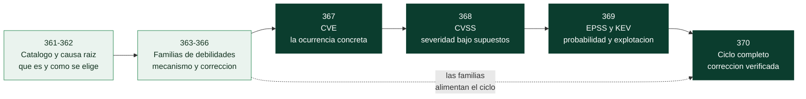

# Parte 20 — Debilidades y vulnerabilidades: CWE, CVE, CVSS y su gestión

Esta parte enseña a **nombrar, medir y ordenar** los fallos de seguridad con el vocabulario que usa toda la industria, y a convertir ese vocabulario en un método de trabajo. Tres palabras que suelen usarse como sinónimos describen cosas distintas: una **debilidad** (CWE) es un *tipo* de defecto en el software o el hardware; una **vulnerabilidad** (CVE) es una *ocurrencia concreta* de ese defecto en un producto y versión; y la **severidad y prioridad** (CVSS, EPSS, KEV) dicen cuánto importa esa ocurrencia. Quien las confunde clasifica mal, corrige lo equivocado y prioriza por un número que no responde a la pregunta que se hace. La parte no repite las Partes 4, 5, 11 y 17, que ya mencionan debilidades concretas: las **organiza bajo un mismo catálogo**, las enlaza con los datos de vulnerabilidades reales y las lleva hasta una corrección demostrada con pruebas.

## Resultado profesional

Al terminar, el estudiante puede: leer y navegar el catálogo CWE (jerarquía, abstracción, relaciones, vistas y etiquetas de uso); asignar el CWE correcto a un hallazgo por causa raíz y justificarlo; reconocer las familias de debilidades más frecuentes y su corrección; descomponer un registro CVE y distinguir lo que aporta cada fuente (CNA, CISA-ADP, NVD); calcular y leer una puntuación CVSS v3.1 y v4.0; combinar CVSS, EPSS, KEV y exposición para decidir qué corregir primero; y entregar, para un hallazgo, un expediente en el que la corrección esté verificada por una prueba que falla antes y pasa después.

## Prerrequisitos y tiempo

Se recomienda haber cursado las clases de la [Parte 4](../parte-4-seguridad-de-aplicaciones-web/README.md) (en especial la 087, OWASP Top 10) y de la [Parte 5](../parte-5-explotacion-de-sistemas-y-binarios/README.md) sobre vulnerabilidades clásicas, y saber leer código Python. Son **unas 21 horas guiadas** (1.280 minutos en diez clases), más la práctica de laboratorio y el reto de cada clase. Todo funciona **sin red y sin claves** con la biblioteca estándar de Python 3, sobre una copia local del catálogo CWE y una instantánea fechada de casos reales.

## Bloques de progresión

1. **El catálogo y la causa raíz (361–362):** qué es CWE, cómo está construido y cómo se elige el CWE correcto.
2. **Familias de debilidades (363–366):** las debilidades más frecuentes agrupadas por mecanismo, con su corrección.
3. **Vulnerabilidades concretas y su medida (367–369):** CVE, CVSS y la combinación de señales para priorizar.
4. **Integración (370):** el ciclo completo de una debilidad hasta la corrección verificada.

El diagrama se lee de izquierda a derecha y tiene una idea central: la parte avanza de lo **general a lo concreto y de lo descriptivo a lo decisorio**. Los dos primeros bloques (verde claro) trabajan con *tipos* de defecto: aprender a nombrarlos con precisión y a reconocer su mecanismo. A partir de 367 (verde oscuro) se pasa a *ocurrencias* —un CVE tiene producto, versión, fecha y fuentes— y de ahí a las preguntas de decisión: cuánto duele (CVSS), cuán probable es (EPSS) y si ya ocurre (KEV). La flecha discontinua recuerda que el ciclo final de la clase 370 vuelve a las familias: la corrección siempre se elige por la causa raíz que identificaste al principio.

## Guía clase por clase

| Capítulo enlazado | Qué enseña y por qué aparece aquí | Evidencia de aprendizaje |
|---|---|---|
| **[Clase 361 — CWE: qué es, quién lo mantiene y cómo está construido](./361-cwe-que-es-y-como-esta-construido/README.md)** | Primero hay que saber qué es el catálogo: debilidad frente a vulnerabilidad, niveles de abstracción (Pillar, Class, Base, Variant, Compound), relaciones, vistas y etiquetas de uso. Sin este mapa, los nombres de las clases siguientes son siglas sueltas. | Ficha comparativa de una familia con jerarquía, estado y uso para mapear, con cifras de procedencia |
| **[Clase 362 — Del síntoma a la causa raíz: relaciones, cadenas y mapeo CWE](./362-del-sintoma-a-la-causa-raiz-mapeo-cwe/README.md)** | Sabiendo cómo está construido el catálogo, se aprende a usarlo: elegir el CWE por causa raíz, no por síntoma ni por impacto, y a declarar si la correspondencia es oficial, inferida o ninguna. Es el método que usarán todas las clases siguientes. | Nota de mapeo de cinco vulnerabilidades reales con candidatos descartados y grado de certeza |
| **[Clase 363 — Familias CWE (1): entradas no confiables](./363-familias-cwe-entradas-no-confiables/README.md)** | La familia más extendida: datos externos que se interpretan como código u órdenes (inyecciones, XSS, SSRF, deserialización). Se estudia primero porque su patrón —mezclar datos y control— reaparece en las demás. | Ruta nueva en la aplicación corregida con defensa y pruebas sin red |
| **[Clase 364 — Familias CWE (2): identidad, acceso, criptografía y exposición de información](./364-familias-cwe-identidad-acceso-criptografia-informacion/README.md)** | Quién eres y qué puedes hacer: autenticación, autorización, secretos, hashing de contraseñas y fugas de información. Sigue a la anterior porque aquí el fallo no es interpretar datos sino decidir mal quién puede qué. | Mini sistema de autorización con política, matriz de acceso y pruebas |
| **[Clase 365 — Familias CWE (3): memoria, enteros, concurrencia y recursos](./365-familias-cwe-memoria-enteros-concurrencia-recursos/README.md)** | Fallos de bajo nivel y de tiempo: desbordamientos, enteros, carreras y agotamiento de recursos, y su carácter encadenado. Se coloca después de las anteriores porque introduce la idea de *cadena* de debilidades. | Cadena completa detectada, demostrada y corregida en su eslabón raíz |
| **[Clase 366 — Familias CWE (4): configuración, dependencias, contenedores, APIs, nube y sistemas operativos](./366-familias-cwe-configuracion-dependencias-contenedores-apis-nube-so/README.md)** | Donde el código está bien y el entorno no: configuración insegura, componentes vulnerables, contenedores, APIs y nube. Cierra las familias y obliga a decidir cuándo *no existe* un CWE adecuado. | `cwe-map.json` de un archivo real con tipo de correspondencia, corrección y prueba |
| **[Clase 367 — CVE: identificar vulnerabilidades concretas](./367-cve-identificar-vulnerabilidades-concretas/README.md)** | Con los tipos claros, se pasa a las ocurrencias: qué es un CVE, quién lo asigna, sus estados y por qué sus fuentes (CNA, CISA-ADP, NVD) pueden discrepar. Prepara el terreno para medir. | Ficha de tres CVE con CWE y CVSS por fuente y las discrepancias interpretadas |
| **[Clase 368 — CVSS v3.1 y v4.0: qué mide la severidad y cómo se calcula](./368-cvss-v3-1-y-v4-0-severidad/README.md)** | Una vez identificada la ocurrencia, se mide su severidad: vector, métricas, fórmula de v3.1, modelo de v4.0 y sus límites. Va antes de la priorización porque hay que saber qué información contiene el número para saber cuál le falta. | Verificador de vectores y puntuaciones con pruebas contra valores publicados |
| **[Clase 369 — EPSS, CISA KEV y priorización por riesgo: qué arreglar primero](./369-epss-cisa-kev-y-priorizacion-por-riesgo/README.md)** | Completa lo que CVSS no dice: probabilidad de explotación (EPSS), explotación observada (KEV), exposición y la tabla de decisión de BOD 26-04. Convierte señales en un orden de trabajo. | Comparador de políticas de prioridad con falsos positivos y negativos cuantificados |
| **[Clase 370 — Ciclo completo: de la debilidad a la corrección verificada](./370-ciclo-completo-de-la-debilidad-a-la-correccion-verificada/README.md)** | Integra todo: detectar, clasificar, evaluar, decidir, corregir, verificar, registrar y prevenir sobre el laboratorio. Es el cierre de la parte y la prueba de que el vocabulario sirve para trabajar. | Expediente de hallazgo con CVE de referencia, prueba que falla antes y pasa después, y guardarraíl |

## Cómo recorrer la parte

Lee la explicación, interpreta el diagrama y ejecuta el laboratorio antes del reto. Conserva un cuaderno con el comando, la versión de la herramienta, la fecha de los datos y la decisión. Las clases usan tres recursos del repositorio que conviene conocer desde el principio:

- **La base de conocimiento local de CWE** (`knowledge/cwe/`), con el catálogo oficial de MITRE normalizado, sus índices y su procedencia, que se consulta con `python scripts/cwe_kb.py` (`mostrar`, `buscar`, `relaciones`, `mitigaciones`, `sast`, `clases`, `top25`, `validar`). Su licencia y origen están en [`knowledge/cwe/LICENCIA-MITRE.md`](../../knowledge/cwe/LICENCIA-MITRE.md).
- **Los laboratorios** [`labs/appsec-code`](../../labs/appsec-code/README.md) (aplicación con ocho debilidades plantadas, su versión corregida y pruebas) y [`labs/devsecops-pipeline`](../../labs/devsecops-pipeline/README.md) (calculadora CVSS, priorizador, tabla de BOD 26-04 y comparación de fuentes).
- **La instantánea de casos reales** `labs/devsecops-pipeline/datos/casos-cwe-cve.json`: catorce CVE con sus datos de CNA, CISA-ADP, NVD, EPSS y KEV consultados el **2026-10-30**. Es una fotografía: KEV y EPSS cambian a diario y `actualizar_casos.py` la regenera.

Todo se ejecuta sobre ese material didáctico o sobre datos públicos de vulnerabilidades ya corregidas; no se ataca ningún sistema ajeno.

## Cómo se relaciona con el resto del programa

Esta parte es transversal: **da nombre y método a lo que otras partes practican**. La [matriz de cobertura CWE](../../docs/matriz-cobertura-cwe.md) muestra, para cada debilidad, dónde se menciona, dónde se explica, dónde hay ejercicio, laboratorio y corrección con prueba, y `python scripts/cwe_kb.py clases CWE-79` responde esa pregunta para un CWE concreto. Para el trabajo de gestión de vulnerabilidades continúa con la ruta [Gestión de vulnerabilidades](../../rutas/gestion-vulnerabilidades.md); para desarrollo seguro, con [AppSec](../../rutas/appsec.md) y [DevSecOps Engineer](../../rutas/devsecops-engineer.md); y para quien prueba sistemas, con [Pentester](../../rutas/pentester.md).

## Anatomía y evaluación

Cada clase incluye objetivo, resultados verificables, temas, explicación causal, diagramas interpretados donde aportan, definiciones, glosario, preparación, laboratorio, ejercicios con solución razonada, reto con criterio de aceptación, errores comunes, preguntas frecuentes y referencias con su propósito. La evidencia de la parte culmina en el expediente de la clase 370, que debe poder **reproducirse** con los comandos del repositorio. Las afirmaciones sobre el catálogo CWE se refieren a la **versión 5.0 (2026-10-28)** importada; si actualizas la base, la versión y la fecha quedan en `knowledge/cwe/PROCEDENCIA.json`.

## Navegación

- [Índice completo](../README.md)
