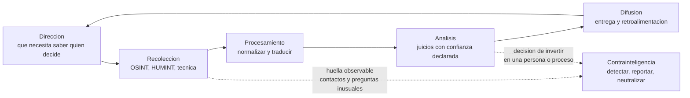

# Clase 371 — Mapa de disciplinas: espionaje, inteligencia y contrainteligencia

> Parte: **21 — Ingeniería social, espionaje y contrainteligencia** · Fuentes: *Social Engineering: The Science of Human Hacking* (C. Hadnagy) · MITRE ATT&CK · 18 U.S.C. §§ 1831–1832
> ⏱️ Duración estimada: **110 min** · Nivel: **Intermedio**

---

## 🎯 Objetivo

Construir el vocabulario y el mapa conceptual de toda la parte: qué es la inteligencia y cómo se produce, en qué se diferencian espionaje, ingeniería social y contrainteligencia, y cómo cambian los motivos, los medios y las defensas según el actor sea un Estado, una empresa o una organización criminal. Sin este mapa, las clases siguientes parecen un catálogo de trucos; con él, son piezas de un mismo sistema que el alumno aprende a **reconocer, medir y reducir**.

## ⚖️ Nota ética

Esta parte enseña a comprender y prevenir la manipulación de personas y la obtención ilícita de información. No contiene guiones de engaño listos para usar, ni instrucciones para reclutar, chantajear o vigilar a nadie. Los ejercicios usan personas y organizaciones **ficticias**; los casos reales se presentan con su estado procesal y se distinguen hechos, declaraciones y acusaciones. Ninguna ficha de este material autoriza a atribuir espionaje a una persona concreta: esa conclusión corresponde a una investigación con evidencia y garantías.

## 📚 Resultados de aprendizaje

Al finalizar, el alumno podrá:

1. **Definir** inteligencia, HUMINT, OSINT, espionaje, contrainteligencia e ingeniería social con precisión y sin confundirlos.
2. **Recorrer** el ciclo de inteligencia e indicar en qué etapa interviene cada disciplina.
3. **Distinguir** espionaje estatal, corporativo y criminal por objetivo, recursos, consecuencias jurídicas y defensa.
4. **Explicar** por qué las personas son un vector de acceso complementario a las vulnerabilidades técnicas.
5. **Clasificar** un incidente humano con una matriz de actor, objetivo, mecanismo y evidencia.
6. **Leer** la matriz de cobertura del programa y ubicar cada clase de esta parte en ella.

## 🗺️ Temas

| # | Tema | Por qué importa |
| --- | --- | --- |
| 1 | Inteligencia como producto y como proceso | Evita confundir información con inteligencia |
| 2 | Ciclo de inteligencia | Ordena dirección, recolección, análisis y difusión |
| 3 | HUMINT, OSINT y otras fuentes | Cada fuente tiene alcance y límites distintos |
| 4 | Espionaje: tradicional, industrial, económico, científico-tecnológico | Cambia el objetivo, no el principio |
| 5 | Contrainteligencia y seguridad | La defensa es una disciplina propia |
| 6 | Ingeniería social como técnica transversal | Sirve a estafadores, auditores y servicios de inteligencia |
| 7 | Actor estatal, corporativo y criminal | Determina motivos, legalidad y respuesta |
| 8 | Terminología bilingüe | Las fuentes y los informes mezclan inglés y español |

## 🧱 Prerrequisitos

- Clase 002 (panorama de amenazas y actores) y Parte 12 (OSINT e ingeniería social, clases 249–260).
- Disposición a trabajar con casos reales sin pasar de la sospecha a la acusación.

## 🧠 Explicación en profundidad

### Información no es inteligencia

Una lista de empleados descargada de una web pública es **información**. Cuando alguien la cruza con los organigramas, descubre que dos de esas personas administran los pagos y concluye que «una llamada creíble a tesorería tendría más probabilidad de éxito que una a recepción», ha producido **inteligencia**: un juicio, útil para decidir, que reduce la incertidumbre. La distinción importa porque la defensa debe interrumpir el juicio, no solo ocultar los datos. Ocultar el organigrama ayuda; verificar toda instrucción de pago por un segundo canal neutraliza la conclusión aunque el organigrama sea público.

La inteligencia se define en las fuentes oficiales como el producto de recolectar, procesar, integrar, evaluar, analizar e interpretar información para apoyar una decisión. Esa definición explica por qué una operación de espionaje y una evaluación de amenazas empresarial comparten método y se diferencian en su legitimidad: la primera obtiene datos sin autorización del titular; la segunda trabaja con fuentes legítimas y con encargo.

### El ciclo de inteligencia

El ciclo clásico tiene cinco etapas: **dirección** (qué necesita saber quien decide), **recolección** (obtener datos de las fuentes), **procesamiento** (traducir, normalizar, descifrar), **análisis** (convertir datos en juicios con una confianza declarada) y **difusión** (entregar el producto a quien decide y recibir retroalimentación). El ciclo es útil para el defensor por una razón concreta: cada etapa deja una **huella o un punto de interrupción**. Quien dirige una operación necesita una pregunta; esa pregunta (por ejemplo, «qué fabricará la empresa X el año próximo») determina qué personas parecerán valiosas. En la recolección aparecen las conductas observables que esta parte enseña a detectar: contactos inusuales, preguntas fuera de contexto, interés repentino por proyectos ajenos. En el análisis, la organización atacante decide si invierte más en una persona; en la difusión, el dato se vuelve decisión. El defensor de la clase 378 trabajará sobre las primeras etapas, donde es más barato actuar.

El diagrama lee el ciclo como una rueda que se retroalimenta y marca con líneas punteadas los dos lugares donde la contrainteligencia suele poder intervenir: en la recolección, cuando deja huellas humanas, y en la decisión de seguir invirtiendo en un objetivo, que depende de que el atacante crea que el esfuerzo funciona. Un defensor que responde de forma uniforme y verificable le quita al analista adversario la señal que necesita.

### Fuentes: HUMINT, OSINT y las demás

**HUMINT** (*Human Intelligence*, inteligencia humana) es la que se obtiene de personas: fuentes que conocen o acceden a la información, conversaciones, reclutamiento. **OSINT** (*Open Source Intelligence*, inteligencia de fuentes abiertas) usa información públicamente disponible, y ya se estudió en la Parte 12. Existen además fuentes técnicas (señales, imágenes, mediciones), que no se tratan aquí. La relación entre las dos primeras es de **apoyo mutuo**: el OSINT identifica a la persona adecuada y construye la base del acercamiento; HUMINT verifica, completa y llega adonde lo público no alcanza. Por eso la reducción de la huella pública de personas críticas, que se estudia en la clase 379, es una defensa de primer nivel: no impide el acercamiento, pero lo encarece y lo hace menos plausible.

### Espionaje y sus variantes

**Espionaje** es la obtención clandestina de información que su titular protege, normalmente para beneficiar a quien la recibe. Las variantes se distinguen por **qué se busca**, no por una técnica distinta:

- **Tradicional o político-militar:** planes, capacidades e intenciones de gobiernos y fuerzas armadas.
- **Económico:** información que favorece la posición económica de un Estado (negociaciones comerciales, política industrial).
- **Industrial o corporativo:** secretos de empresa de un competidor. Puede ser contratado por una empresa o dirigido por un Estado a favor de empresas propias.
- **Científico y tecnológico:** investigación, diseños, procesos de fabricación y modelos, hoy incluidos los de inteligencia artificial.

La frontera entre las tres últimas es difusa. El derecho estadounidense lo refleja con dos delitos vecinos: el § 1831 del título 18 del Código de EE. UU. (espionaje económico) exige que el robo beneficie a un gobierno, instrumento o agente extranjero, mientras que el § 1832 (robo de secretos comerciales) no exige ese beneficio. Que un caso se acuse bajo uno u otro describe lo que la fiscalía pretende probar, no necesariamente lo que ocurrió.

### Contrainteligencia

**Contrainteligencia** (*counterintelligence*) es el conjunto de actividades para identificar, comprender, evaluar y neutralizar la inteligencia de un adversario. Tiene un componente **defensivo** (proteger información y personas, detectar acercamientos) y uno **ofensivo** (engañar, penetrar o manipular las operaciones del adversario) que corresponde a los Estados. La contrainteligencia **empresarial**, que es la que este programa desarrolla, es casi exclusivamente defensiva: gestionar riesgo de personal, reducir exposición, reportar contactos sospechosos y colaborar con las autoridades. No incluye vigilar a empleados fuera de la ley ni contraatacar.

### Ingeniería social: técnica, no disciplina de inteligencia

La **ingeniería social** (*social engineering*) es la manipulación de personas para que realicen acciones o revelen información. El término *human hacking* subraya que se «explota» el proceso humano de decisión. Es una **técnica** que aparece en tres contextos distintos: criminal (fraude, BEC), auditoría autorizada (pruebas de red team) y operaciones de inteligencia (donde se llama técnica de acercamiento o *approach*). La misma conversación puede ser un fraude o una prueba autorizada según quién la encargó, con qué alcance y con qué reglas. Esta ambigüedad es la razón por la que la clase 380 insiste en autorización, límites y protección de las personas.

### Estatal, corporativo, criminal

| Rasgo | Estatal | Corporativo | Criminal |
| --- | --- | --- | --- |
| Objetivo típico | Secretos políticos, militares, tecnológicos; influencia | Ventaja competitiva; clientes, precios, diseños | Dinero rápido; datos revendibles |
| Horizonte temporal | Años; paciencia | Meses a años | Horas a semanas |
| Recursos | Altos, con cobertura legal propia | Variables; a veces intermediarios | Escalables y automatizados |
| Marco legal | Espionaje, defensa nacional | Secretos comerciales, competencia desleal | Fraude, extorsión, blanqueo |
| Defensa clave | Contrainteligencia y seguridad del personal | Control de secretos y de empleados | Verificación de procesos y reporte rápido |

Los tres coinciden en los **medios** (suplantación, confianza, presión, aprovechamiento de conflictos) y por eso un buen control humano sirve contra los tres. Difieren en la **paciencia**: el criminal prueba y descarta; el estatal puede cultivar una relación durante años. Una señal de largo plazo (un contacto que nunca pide nada comprometedor pero siempre está presente) es más informativa frente al segundo que frente al primero.

### Dónde encaja en ATT&CK

El marco MITRE ATT&CK incluye técnicas de ingeniería social como *Phishing* (T1566) y *Phishing for Information* (T1598), y de recopilación de información de la víctima como *Gather Victim Org Information* (T1591), todas en las tácticas de reconocimiento y acceso inicial. Ese lenguaje permite a un equipo de seguridad conectar un incidente humano con un incidente técnico, pero ATT&CK no cubre la relación de largo plazo con una persona: para eso se necesitan los modelos de las clases 374 y 375.

## 📔 Glosario

| Término (original) | Traducción | Definición sencilla / formal |
| --- | --- | --- |
| Intelligence | Inteligencia | Juicio útil para decidir, producido al analizar información. Formal: producto de recolectar, procesar, analizar y difundir información para apoyar decisiones. |
| HUMINT (*Human Intelligence*) | Inteligencia humana | Información obtenida de personas que la conocen o acceden a ella. |
| OSINT (*Open Source Intelligence*) | Inteligencia de fuentes abiertas | Inteligencia derivada de información pública. |
| Espionage | Espionaje | Obtención clandestina de información protegida por su titular. |
| Industrial espionage | Espionaje industrial | Obtención clandestina de secretos de una empresa por un competidor o sus intermediarios. |
| Economic espionage | Espionaje económico | Sustracción de información para beneficiar a un gobierno o sus agentes en lo económico (18 U.S.C. § 1831). |
| Counterintelligence | Contrainteligencia | Actividades para identificar y neutralizar la inteligencia de un adversario. |
| Social engineering | Ingeniería social | Manipulación de personas para obtener acciones o información. |
| Human hacking | «Hackeo humano» | Sinónimo informal de ingeniería social que destaca el aprovechamiento de procesos de decisión humanos. |
| Insider | Persona con acceso legítimo | Quien tiene o tuvo acceso autorizado a recursos de la organización. |
| Tradecraft | Oficio o técnica operativa | Métodos de un servicio de inteligencia para operar sin ser detectado. |

## 🧪 Laboratorio guiado (ejercicio de papel)

Organización ficticia: **Helio Tango S. A.**, fabricante de sensores. Personajes ficticios: Ana Rojas (tesorería), Boris Keller (ingeniero de diseño), Carla Muñoz (recepción).

1. Escribe una pregunta de dirección verosímil para un adversario corporativo interesado en el próximo sensor de Helio Tango.
2. Para esa pregunta, lista qué datos públicos (OSINT) servirían y a cuál de las tres personas orientarían.
3. Indica qué tipo de contacto (HUMINT) sería más plausible y qué comportamiento observable dejaría.
4. Para cada etapa del ciclo, marca el punto en que una defensa organizacional podría actuar.
5. Redacta un párrafo que diferencie lo que cambiaría si el actor fuera un Estado, un competidor o un grupo criminal.

## ✍️ Ejercicios

1. Clasifica cada caso como información o inteligencia y justifica: (a) un organigrama público, (b) un informe que concluye cuál ingeniero lidera un proyecto, (c) la fecha de una feria.
2. Explica por qué «es OSINT» no equivale a «es legítimo».
3. Distingue § 1831 de § 1832 con un ejemplo hipotético en cada caso.
4. Indica en qué etapa del ciclo es más barato interrumpir una operación y por qué.
5. Describe una conversación que podría ser fraude o prueba autorizada según el contexto y qué documento las diferencia.

**Respuestas razonadas.** (1) (a) Información: un dato sin juicio. (b) Inteligencia: un juicio que orienta una decisión. (c) Información, salvo que alguien deduzca de ella un patrón. (2) La legitimidad depende de autorización, propósito, minimización y protección de terceros; un dato accesible puede usarse para dañar. (3) § 1831 exige beneficio a un gobierno o agente extranjero; § 1832 no. Si un empleado copia planos para venderlos a un competidor local, encaja en § 1832; si lo hace para un organismo extranjero, podría encajar en § 1831. (4) En dirección y recolección: el atacante aún no ha invertido y la señal humana es visible. (5) Una llamada que pide datos de pago es fraude si nadie la encargó, y prueba autorizada si existe un contrato con alcance, reglas de enfrentamiento y contacto de escalado.

## 📝 Rúbrica de evaluación

| Criterio | Insuficiente | Competente | Sobresaliente |
| --- | --- | --- | --- |
| Definiciones | Mezcla términos | Distingue las disciplinas | Conecta cada una con el ciclo y su legitimidad |
| Clasificación de actores | Sin diferencias | Distingue objetivo y marco legal | Justifica la defensa distinta por actor |
| Uso del ciclo | Lista etapas | Ubica fuentes por etapa | Identifica puntos concretos de interrupción |
| Prudencia | Atribuye sin evidencia | Separa hecho y suposición | Declara confianza y límites |

## ⚠️ Errores comunes

- Llamar espionaje a toda recolección de información, aunque sea legítima y pública.
- Pensar que la ingeniería social es una técnica solo criminal.
- Suponer que un actor estatal se comporta como un estafador rápido.
- Confundir contrainteligencia con vigilancia general de empleados.
- Concluir que alguien es espía por su nacionalidad, relación o viajes.

## ❓ Preguntas frecuentes

**¿Una empresa puede hacer contrainteligencia?** Sí, en su vertiente defensiva: gestión de riesgo de personas, control de secretos, reporte y colaboración con las autoridades. No puede perseguir a nadie por su cuenta.

**¿Por qué estudiar espionaje en un programa de ciberseguridad?** Porque muchos accesos comienzan con una persona, y porque los incidentes de secretos industriales mezclan medios técnicos y humanos.

**¿Es lo mismo OSINT que espionaje?** No. OSINT usa fuentes públicas; el espionaje obtiene información protegida sin autorización de su titular. El OSINT puede ser una fase previa del espionaje.

## 🔗 Referencias

- Christopher Hadnagy, *Social Engineering: The Science of Human Hacking* (2.ª ed.) — definición de ingeniería social y su marco de ataque.
- MITRE ATT&CK, técnica T1566 *Phishing* — <https://attack.mitre.org/techniques/T1566/> — ingeniería social como acceso inicial.
- MITRE ATT&CK, técnica T1598 *Phishing for Information* — <https://attack.mitre.org/techniques/T1598/> — ingeniería social para reconocimiento.
- MITRE ATT&CK, técnica T1591 *Gather Victim Org Information* — <https://attack.mitre.org/techniques/T1591/> — recopilación previa sobre la organización.
- 18 U.S.C. § 1831, *Economic espionage* — <https://www.law.cornell.edu/uscode/text/18/1831> — delito que exige beneficio a un gobierno, instrumento o agente extranjero.
- 18 U.S.C. § 1832, *Theft of trade secrets* — <https://www.law.cornell.edu/uscode/text/18/1832> — delito de robo de secretos comerciales sin exigir beneficio extranjero.
- CIA, *Studies in Intelligence* — <https://www.cia.gov/resources/csi/studies-in-intelligence/> — colección de estudios de la comunidad de inteligencia usados como contexto histórico en la parte.

## 📥 Material descargable

- 📄 [Guía en PDF](./clase-371-guia.pdf) — versión imprimible de esta clase.
- 🎞️ [Presentación (PPTX)](./clase-371-presentacion.pptx) — deck para proyectar en clase.

## ⬅️ Clase anterior

[Clase 370 — Ciclo completo: de la debilidad a la corrección verificada](../../parte-20-debilidades-y-vulnerabilidades-cwe-cve-cvss/370-ciclo-completo-de-la-debilidad-a-la-correccion-verificada/README.md)

## ➡️ Siguiente clase

[Clase 372 — Psicología de la manipulación y resistencia a la presión](../372-psicologia-de-la-manipulacion-y-resistencia-a-la-presion/README.md)
