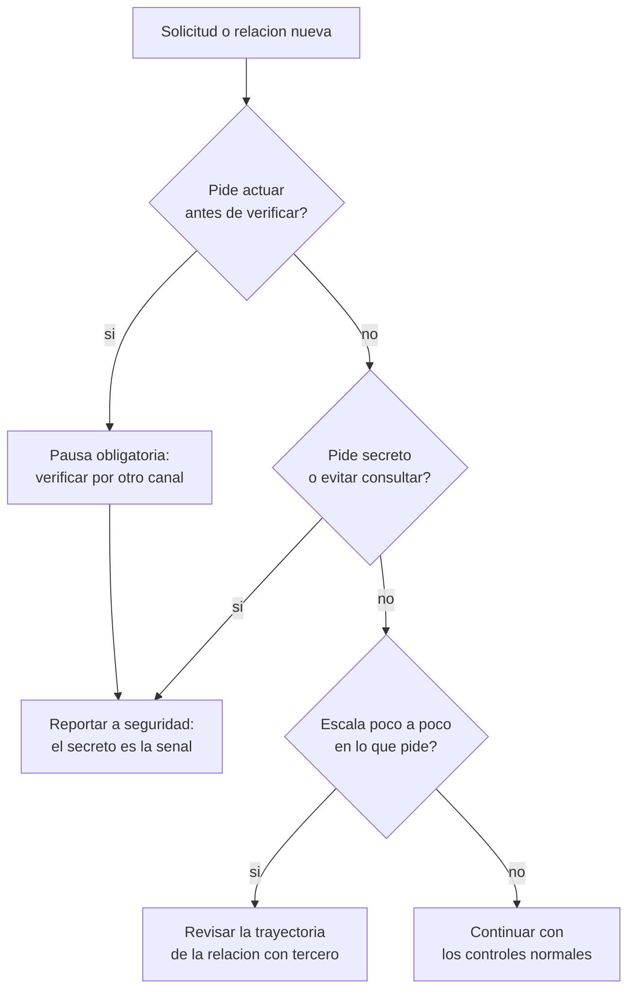

# Clase 372 — Psicología de la manipulación y resistencia a la presión

> Parte: **21 — Ingeniería social, espionaje y contrainteligencia** · Fuentes: *Influence* (R. Cialdini) · *Thinking, Fast and Slow* (D. Kahneman) · *The Art of Deception* (K. Mitnick)
> ⏱️ Duración estimada: **110 min** · Nivel: **Intermedio**

---

## 🎯 Objetivo

Entender por qué las personas competentes y prudentes toman decisiones que, vistas después, parecen ingenuas, y convertir ese conocimiento en defensas que no dependen de la fuerza de voluntad. El alumno aprenderá a explicar los mecanismos de influencia (autoridad, reciprocidad, simpatía, compromiso, escasez, prueba social), el papel del rapport y de la confianza, y a diseñar **pausas, verificaciones y rutas de reporte** que funcionen bajo presión.

## ⚖️ Nota ética

Describir los mecanismos de influencia sirve para reconocerlos y mitigarlos. No se entregan guiones de manipulación ni técnicas para quebrar a una persona concreta. Los ejercicios se hacen con personajes ficticios y nunca con compañeros sin su consentimiento informado.

## 📚 Resultados de aprendizaje

Al finalizar, el alumno podrá:

1. **Explicar** los seis principios de influencia y su efecto sobre la decisión.
2. **Distinguir** el pensamiento rápido (automático) del lento (deliberado) y decir cuándo falla el primero.
3. **Describir** cómo se construyen y se explotan el rapport y la confianza.
4. **Reconocer** presión artificial: urgencia, secreto, aislamiento y exceso de cortesía.
5. **Diseñar** una defensa que sustituya la vigilancia perfecta por un procedimiento verificable.
6. **Analizar** un caso ficticio indicando qué palanca se usó y qué control la habría interrumpido.

## 🗺️ Temas

| # | Tema | Por qué importa |
| --- | --- | --- |
| 1 | Dos modos de pensar | Explica por qué la prisa deteriora el juicio |
| 2 | Autoridad y su sesgo | La jerarquía real o aparente evita preguntas |
| 3 | Reciprocidad y compromiso | Un favor o una pequeña promesa crean deuda y coherencia |
| 4 | Simpatía y rapport | Cuanto más agrada una persona, menos se verifica |
| 5 | Escasez y prueba social | Aceleran la decisión y la imitan |
| 6 | Manipulación de la confianza | La confianza es el activo que se erosiona poco a poco |
| 7 | Señales de presión artificial | Son detectables aunque el relato sea creíble |
| 8 | Resistencia a la presión | Se consigue con diseño del proceso, no con carácter |

## 🧱 Prerrequisitos

Clases 256 y 259 (fundamentos y defensa contra la ingeniería social) y la clase 371.

## 🧠 Explicación en profundidad

### Por qué la inteligencia no protege

Daniel Kahneman describe dos modos de funcionamiento mental: uno **rápido, automático y asociativo** (Sistema 1) y otro **lento, esforzado y deliberado** (Sistema 2). El primero resuelve la mayoría de las decisiones cotidianas y lo hace bien; se equivoca de forma sistemática cuando la situación se parece a otra conocida pero difiere en un detalle importante, o cuando el contexto empuja hacia una respuesta. La manipulación eficaz no necesita convencer al Sistema 2: le basta con **no darle tiempo ni motivos para intervenir**. Por eso cualquier profesional, también un especialista en seguridad, puede fallar: la capacidad analítica solo ayuda si se activa. Los procedimientos que exigen una pausa o un segundo canal activan el Sistema 2 por diseño.

### Los principios de influencia y cómo se vuelven palancas

Robert Cialdini describe seis principios que guían respuestas automáticas útiles en la vida social. Son legítimos y beneficiosos; se vuelven vulnerabilidad cuando alguien los provoca a propósito:

- **Autoridad.** Obedecemos a quien parece tener competencia o rango. La vulnerabilidad no está en respetar la jerarquía sino en confundir *apariencia* con *verificación*: un título, una voz firme o un correo con firma institucional bastan para que muchos no pregunten. Control: toda solicitud sensible se verifica por un canal que la solicitud no proporcionó.
- **Reciprocidad.** Sentimos deuda cuando recibimos algo. Un pequeño favor, una información útil o un regalo preparan una petición posterior. Control: separar el favor de la decisión («agradezco la ayuda; esto lo decide el proceso»).
- **Compromiso y coherencia.** Tendemos a mantener lo que ya aceptamos. Una cadena de peticiones pequeñas conduce a una grande. Control: reconocer que aceptar lo primero no obliga a lo siguiente; renunciar al camino es legítimo.
- **Simpatía.** Colaboramos con quienes nos gustan, se parecen a nosotros o nos halagan. Control: separar la relación de la tarea; una persona agradable sigue necesitando autorización.
- **Escasez y urgencia.** Lo que parece limitado o inminente se valora más y se decide más rápido. Control: la urgencia que impide verificar es una señal por sí sola.
- **Prueba social.** Hacemos lo que hacen otros. «Todos en tu departamento ya lo hicieron» reduce la resistencia. Control: nadie puede verificar eso a la vez; se verifica con quien dice la política.

Las señales no actúan aisladas. Los casos reales combinan dos o tres: una supuesta autoridad con urgencia y secreto es el patrón del fraude del director; un acercamiento amable con peticiones graduales es el patrón del reclutamiento de la clase 374.

### Rapport y confianza: el activo que se construye

*Rapport* es la sensación de sintonía y confianza mutua en una relación. Se construye mediante atención, coincidencias reales o aparentes, validación emocional y reciprocidad. En una relación auténtica, el rapport es el cimiento de la colaboración; en una manipulada, es la herramienta que baja las defensas. La confianza se explota de forma gradual: primero se cultivan pequeñas coincidencias y favores, después se normaliza compartir algo privado, más tarde se solicita algo que en un primer contacto habría sido rechazado. La palabra clave es **gradualidad**: ningún paso individual parece grave y por eso el observador interno no se alarma. La defensa, en consecuencia, no puede apoyarse en preguntar «¿esta petición es razonable?», sino en comparar «dónde estaba esta relación hace seis meses y adónde va».

### Presión artificial y aislamiento

Quien manipula necesita que la víctima **decida sola y rápido**. Cuatro señales acompañan casi siempre al intento: *urgencia* (el plazo es hoy), *secreto* («no se lo digas a nadie, es confidencial»), *aislamiento* (se desincentiva consultar con colegas o familia) y *carga emocional* (miedo, halago, culpa o compasión). Cada una elimina un elemento que protege: tiempo, consulta, serenidad. La regla práctica es que **un secreto pedido a un empleado para que no lo reporte a su propia organización es, por sí solo, un motivo de reporte**.

El diagrama es un árbol de decisión que cualquier empleado puede aplicar sin conocer el relato del atacante: no pregunta *quién es* ni *si suena creíble*, sino *qué hace con el tiempo, el secreto y la trayectoria*. Por eso funciona contra pretextos que no se han visto antes.

### Resistir la presión: diseño sobre voluntad

Resistir bien no consiste en ser desconfiado, sino en que la organización haga **fácil** hacer lo correcto. Cuatro mecanismos, probados en la práctica de seguridad, ayudan: (1) *pausas obligatorias* para acciones críticas (pagos, cambios de cuenta, entrega de credenciales); (2) *doble control*, de modo que ninguna persona decida sola sobre un recurso crítico; (3) *guion de salida*: una frase aprobada que permite cortar una llamada sin conflicto («por política debo devolver la llamada por el número oficial»); y (4) *reporte sin castigo* para quien reconoce haber sido engañado, porque la vergüenza alarga el tiempo de respuesta y favorece al atacante. El guion de salida importa más de lo que parece: las personas ceden por cortesía, y se les da una forma cortés de negarse.

### Caso razonado (ficticio): la ayuda de la proveedora

Diego, analista de compras de la ficticia Helio Tango, recibe un mensaje de «Marta», que dice trabajar para un proveedor y le envía un estudio sectorial útil (reciprocidad). Dos semanas después le pide un favor: confirmar qué otras empresas compran el mismo componente (compromiso). Más tarde le propone hablar «fuera de la oficina» y le pide no comentarlo porque «los precios son delicados» (secreto, aislamiento). En el árbol de decisión, la tercera solicitud activa la segunda pregunta: el secreto pedido es motivo de reporte. Nada de lo que Marta pidió fue por sí solo ilegal, y por eso la señal estaba en la **trayectoria** y no en la petición.

## 📔 Glosario

| Término (original) | Traducción | Definición sencilla / formal |
| --- | --- | --- |
| Authority bias | Sesgo de autoridad | Tendencia a aceptar lo que dice una figura de autoridad sin verificarlo. |
| Reciprocity | Reciprocidad | Sentimiento de deber de devolver un favor recibido. |
| Commitment and consistency | Compromiso y coherencia | Preferencia por mantener conductas consistentes con compromisos previos. |
| Liking | Simpatía | Mayor disposición a colaborar con quien nos agrada. |
| Scarcity | Escasez | Mayor valoración de lo que parece limitado en tiempo o cantidad. |
| Social proof | Prueba social | Imitar lo que hacen otros como guía de conducta. |
| Rapport | Sintonía o conexión personal | Relación de confianza y afinidad entre personas. |
| System 1 / System 2 | Sistema 1 / Sistema 2 | Modos de pensamiento rápido-automático y lento-deliberado (Kahneman). |
| Elicitation | Elicitación | Obtención de información mediante conversación aparentemente casual (clase 373). |
| Gaslighting | «Luz de gas» | Manipulación que hace dudar a alguien de su propia percepción. |
| Pretext | Pretexto | Historia que justifica una solicitud (clase 373). |

## 🧪 Laboratorio guiado (ejercicio de papel)

1. Relee el caso de Diego y anota, solicitud por solicitud, el principio de Cialdini en juego.
2. Dibuja una línea de tiempo con la distancia entre «lo que Marta pidió» y «lo que Diego habría aceptado el primer día».
3. Redacta el guion de salida que Diego habría podido usar en la tercera solicitud.
4. Diseña una regla de proceso (no una advertencia) que habría impedido que la información llegara a Marta aunque Diego hubiera querido compartirla.
5. Evalúa tu regla con la pregunta: ¿funciona si el empleado está cansado, es amable y quiere ayudar?

## ✍️ Ejercicios

1. Explica por qué la urgencia reduce el control de calidad de una decisión.
2. Propón tres frases de salida corteses para rechazar una solicitud sin romper una relación.
3. Identifica qué principio explota «Es la última oportunidad y tu jefe ya aprobó».
4. Explica por qué el reporte sin castigo mejora la detección.
5. Redacta un criterio de reporte basado en comportamiento y no en sospecha sobre una persona.

**Respuestas razonadas.** (1) La prisa recorta el tiempo en que el Sistema 2 podría revisar; al decidir con el Sistema 1 se aceptan respuestas plausibles. (2) «Debo pasarlo por el proceso»; «lo confirmo por el canal oficial y le escribo»; «no puedo hacerlo hoy, hablemos con mi responsable». (3) Escasez y autoridad (y prueba social si se añade «los demás ya lo han hecho»). (4) Si la persona engañada no teme la sanción, informa a tiempo; cada hora de retraso aumenta el daño. (5) «Cualquier petición de confidencialidad hacia la propia organización, por parte de un tercero, se reporta»: describe una conducta, no a un sospechoso.

## 📝 Rúbrica de evaluación

| Criterio | Insuficiente | Competente | Sobresaliente |
| --- | --- | --- | --- |
| Mecanismos | Los enumera | Los explica con ejemplo | Combina varios en un caso y predice la escalada |
| Diseño defensivo | Pide más atención | Propone un control de proceso | Prueba el control frente a cansancio y cortesía |
| Cultura | Culpa a la víctima | Menciona reporte | Diseña reporte sin castigo y guion de salida |
| Prudencia | Etiqueta personas | Describe conductas | Declara incertidumbre y alternativas legítimas |

## ⚠️ Errores comunes

- Creer que «la gente lista no cae».
- Pedir desconfianza general en lugar de procesos que activen la verificación.
- Tratar el halago o la amabilidad como señal de ataque: son normales y la señal es la trayectoria.
- Castigar a quien reporta haber sido engañado.
- Entrenar con simulaciones que humillan en lugar de enseñar.

## ❓ Preguntas frecuentes

**¿Los principios de Cialdini son una técnica de manipulación?** Son regularidades de la conducta social. Se vuelven manipulación cuando se provocan a propósito para obtener algo que la persona no daría con información completa.

**¿Se puede entrenar la resistencia?** Se puede entrenar el reconocimiento de patrones y el uso de guiones de salida; lo más eficaz, no obstante, es el diseño de los procesos.

**¿Todo secreto es sospechoso?** No. La señal es el secreto pedido hacia la propia organización por alguien externo a ella.

## 🔗 Referencias

- Robert B. Cialdini, *Influence: The Psychology of Persuasion* — caps. sobre reciprocidad, compromiso, prueba social, simpatía, autoridad y escasez, para los seis principios.
- Daniel Kahneman, *Thinking, Fast and Slow* — parte I, modelo de dos sistemas de pensamiento.
- Kevin Mitnick y William Simon, *The Art of Deception* — casos y análisis de ingeniería social en organizaciones.
- Christopher Hadnagy, *Social Engineering: The Science of Human Hacking* (2.ª ed.) — rapport, pretexto y marco ético de la influencia.

## 📥 Material descargable

- 📄 [Guía en PDF](./clase-372-guia.pdf) — versión imprimible de esta clase.
- 🎞️ [Presentación (PPTX)](./clase-372-presentacion.pptx) — deck para proyectar en clase.

## ⬅️ Clase anterior

[Clase 371 — Mapa de disciplinas: espionaje, inteligencia y contrainteligencia](../371-mapa-de-disciplinas-espionaje-inteligencia-y-contrainteligencia/README.md)

## ➡️ Siguiente clase

[Clase 373 — Pretexting, impersonation y elicitation desde la defensa](../373-pretexting-impersonation-y-elicitation-desde-la-defensa/README.md)
