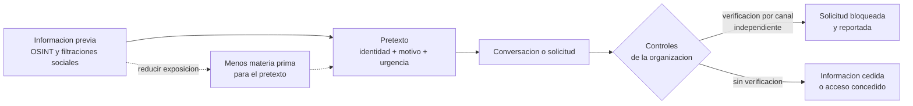

# Clase 373 — Pretexting, impersonation y elicitation desde la defensa

> Parte: **21 — Ingeniería social, espionaje y contrainteligencia** · Fuentes: *Social Engineering: The Science of Human Hacking* (C. Hadnagy) · MITRE ATT&CK · NIST SP 800-53
> ⏱️ Duración estimada: **110 min** · Nivel: **Intermedio**

---

## 🎯 Objetivo

Entender cómo se obtiene información de una persona mediante una conversación (elicitación), cómo se construye una identidad creíble (pretexto y suplantación) y cómo se diseña una organización para que esas conversaciones no filtren secretos. El enfoque es el del defensor: reconocer el **patrón de la conversación**, no memorizar frases de ataque, y practicar respuestas que protegen sin volver la vida social imposible.

## ⚖️ Nota ética

No se proporcionan guiones de pretextos operativos, listas de frases para extraer datos ni instrucciones para suplantar personas reales. Los ejercicios son análisis de escenarios ficticios y práctica de respuestas defensivas. Cualquier prueba con personas reales exige autorización escrita, alcance, reglas de enfrentamiento y contacto de escalado (clase 380).

## 📚 Resultados de aprendizaje

Al finalizar, el alumno podrá:

1. **Definir** pretexting, impersonation y elicitation y distinguirlos entre sí.
2. **Explicar** por qué la elicitación funciona sin que la persona perciba que revela algo.
3. **Reconocer** los patrones conversacionales generales de la elicitación y sus contramedidas.
4. **Evaluar** la plausibilidad de una identidad y las verificaciones que la desmontan.
5. **Clasificar** la información por sensibilidad para decidir qué se puede hablar en público.
6. **Diseñar** reglas y guiones de respuesta para conferencias, viajes, redes sociales y visitas.

## 🗺️ Temas

| # | Tema | Por qué importa |
| --- | --- | --- |
| 1 | Pretexting: la historia que justifica la petición | Es la base de la mayoría de los fraudes humanos |
| 2 | Impersonation: apropiarse de una identidad o un rol | Convierte autoridad aparente en acceso |
| 3 | Elicitation: obtener información sin pedirla | Es la técnica más difícil de notar |
| 4 | Por qué funciona: cortesía, ego y deseo de ayudar | Explica la vulnerabilidad sin culpar |
| 5 | Patrones generales y señales | Permiten detectar sin conocer el relato |
| 6 | Contramedidas conversacionales | Responden sin conflicto |
| 7 | Clasificación de información y lugares de riesgo | Define qué se habla y dónde |
| 8 | Verificación independiente | Anula la identidad fabricada |

## 🧱 Prerrequisitos

Clases 256–259 y 372. Se asume que el alumno ya conoce el concepto de verificación por canal independiente.

## 🧠 Explicación en profundidad

### Pretexting: una historia con función

Un **pretexto** es una narración que otorga a quien la cuenta un motivo creíble para pedir lo que pide. No es un simple engaño; es un *marco* que ofrece a la víctima una forma sencilla de ayudar: «soy de auditoría y necesito comprobar este acceso», «estamos preparando una propuesta para tu directora». Su eficacia depende de tres elementos: una **identidad** plausible, un **motivo** que haga razonable la petición y una **urgencia o ventaja** que frene la verificación. El pretexto se alimenta de información previa, normalmente pública (OSINT): nombres de colegas, jerga interna, sistemas utilizados, eventos recientes. Por eso reducir la exposición de datos internos en redes, ofertas de trabajo y conferencias recorta el material con que se fabrica un pretexto, aunque no lo anule.

### Impersonation: identidad y rol

*Impersonation* (suplantación) consiste en actuar como si se fuera otra persona o se ocupara un rol que otorga confianza: el técnico de mantenimiento, el nuevo proveedor, el directivo, el investigador de una agencia. Hay suplantaciones **de persona concreta** (alguien real, cuyo nombre y voz se imitan) y **de rol genérico** (un tipo de persona a la que nadie cuestionaría). Lo segundo es más difícil de detectar porque no existe un original con el que comparar. La contramedida estructural es la misma en ambas: la identidad se **acredita por un medio que el suplantador no controla**, no por lo que la persona dice, lleva puesto o sabe. Las organizaciones lo implementan con listas de visitas confirmadas por el anfitrión, escoltas obligatorias, identificaciones verificables y procedimientos de devolución de llamada.

### Elicitation: la conversación que extrae sin preguntar

La **elicitación** es la técnica de obtener información de alguien en una conversación aparentemente natural, de modo que la persona no se dé cuenta de que está revelando algo ni de que se le está interrogando. Las guías de contrainteligencia de agencias gubernamentales la describen como una de las formas más habituales de recolección humana porque es barata, legal en apariencia y deja pocas huellas. Funciona porque aprovecha tendencias sociales normales: el deseo de ser **amable y útil**, el de **corregir** a alguien que se equivoca, el de mostrar **competencia** o ser reconocido, y la tendencia a **llenar el silencio**. Una afirmación ligeramente errónea provoca la corrección; un halago profesional provoca que la persona muestre lo que sabe; una queja compartida provoca confidencias. Nada de eso es mentira ni delito por parte de quien conversa, y ahí radica la dificultad: la información se pierde dentro de una conversación cortés.

Para el defensor lo importante no es catalogar las frases, sino reconocer el **patrón**: una persona ajena que dirige la conversación hacia temas internos (proyectos, clientes, plazos, problemas técnicos, personas clave), que **cambia de tema cuando se le pregunta por sí misma**, que muestra un interés más intenso de lo que la relación justifica o que repite el contacto en eventos, redes y ocasiones distintas. Ninguna de esas señales prueba nada por separado. Tomadas en conjunto y en el tiempo, justifican reportarlas para que alguien con más contexto las evalúe.

### Contramedidas conversacionales

La respuesta práctica no es el silencio ni la sospecha, sino el **dominio de la conversación**: saber qué no se comparte y tener formas cómodas de no compartirlo. Las técnicas que las guías recomiendan son esencialmente cuatro: *desviar* (cambiar de tema con una pregunta propia), *responder con generalidades* («depende mucho del cliente»), *remitir* («eso se lo puedo preguntar a comunicaciones»), y *declinar con cortesía* («prefiero no hablar de trabajo en este contexto»). Funcionan mejor cuando se han acordado de antemano y cuando la cultura de la organización las respalda: ningún empleado debe sentirse descortés por no hablar de su trabajo. También conviene recordar que **la información sensible no siempre lo parece**: un dato inocuo (la semana de un viaje) combinado con otro (el nombre del proveedor visitado) permite deducir lo que ninguno revela solo.

### Qué se habla y dónde

La **clasificación de la información** (pública, interna, confidencial, restringida) fija dónde puede conversarse. La regla simple es que lo restringido no se comenta en lugares públicos ni en canales no aprobados, y que los lugares de mayor riesgo son los que mezclan sociabilidad y trabajo: conferencias y ferias, aeropuertos, restaurantes cercanos a la sede, eventos del sector, comunidades profesionales en línea y, en general, cualquier contexto en el que se bajen las defensas y abunde la gente del mismo oficio. Los controles técnicos de NIST SP 800-53 (familias de concienciación y entrenamiento y de protección de medios y de la información) describen la base normativa de esa clasificación.

### Verificar sin ofender

La verificación independiente tiene un coste social. Para que se haga, debe ser **normal y esperada**, y no una acusación. La mejor práctica es convertirla en política visible («aquí confirmamos todo por el canal oficial»), de modo que la persona que verifica solo cumple una regla. El impostor solo tiene dos opciones ante ella: presionar (lo que ya es una señal) o retirarse.

El esquema lee el proceso de izquierda a derecha: la información previa alimenta el pretexto, que se materializa en una conversación; solo en ese punto la organización puede bloquear (si exige verificación) o fallar. La línea punteada señala la defensa que actúa **antes**: cuanto menos material interno circule públicamente, menos verosímil resulta cualquier pretexto.

### Caso razonado (ficticio): el congreso en Lisboa

Boris Keller, ingeniero de Helio Tango, asiste a un congreso. En la cena, un asistente muy amable, «Íñigo», se muestra interesado en su charla. Comenta que había leído que el sensor tenía problemas de calibración «con los lotes de verano» (una afirmación inexacta). Boris, por reflejo profesional, corrige: no son los lotes de verano sino los de la línea B, y por una cuestión de temperatura. Íñigo lo agradece, le presenta a otros asistentes y le propone seguir hablando por mensajería. Nada ilegal ha ocurrido y, sin embargo, Boris ha revelado una debilidad del producto. La reflexión importante es que el fallo no fue de carácter sino de **contexto sin reglas**: el congreso era un entorno de riesgo, y no había una norma sobre qué temas se tocan allí. Las contramedidas serían una breve sesión previa al viaje con puntos prohibidos, una frase estándar de desvío y un canal rápido para reportar a seguridad el contacto, sin necesidad de acusar a Íñigo.

## 📔 Glosario

| Término (original) | Traducción | Definición sencilla / formal |
| --- | --- | --- |
| Pretexting | Construcción de pretexto | Uso de una historia fabricada para justificar una solicitud. |
| Pretext | Pretexto | Marco narrativo que da motivo y legitimidad a una petición. |
| Impersonation | Suplantación | Actuar como otra persona o rol para obtener confianza o acceso. |
| Elicitation | Elicitación | Obtención de información mediante conversación aparentemente casual. |
| Tailgating / piggybacking | Colarse siguiendo a otro | Entrar a un área restringida aprovechando que otra persona abre la puerta. |
| Vishing | Phishing por voz | Ingeniería social por llamada telefónica. |
| Deflection | Desvío | Contramedida: reorientar la conversación sin responder. |
| Need-to-know | Necesidad de conocer | Principio por el que solo accede a información quien la necesita para su tarea. |
| Out-of-band verification | Verificación fuera de banda | Confirmar por un canal distinto al de la solicitud. |

## 🧪 Laboratorio guiado (ejercicio de papel)

1. Analiza el caso del congreso: marca en la conversación cada punto donde una regla previa habría cambiado el resultado.
2. Escribe una lista de cinco datos de Helio Tango que son inocuos por sí solos y sensibles al combinarse.
3. Redacta cuatro respuestas de desvío naturales para un ingeniero que no quiere hablar de calibración.
4. Diseña una política de visitas que impida que un «técnico de mantenimiento» ficticio entre sin cita confirmada por el anfitrión.
5. Escribe el mensaje de reporte de 3 líneas que Boris enviaría a seguridad, describiendo hechos y no sospechas.

## ✍️ Ejercicios

1. Explica por qué la corrección de un dato erróneo es una vía de filtración.
2. Distingue pretexting de impersonation con un ejemplo de cada uno que no coincidan.
3. Enumera tres lugares de riesgo para conversaciones y una norma para cada uno.
4. Diseña un procedimiento de devolución de llamada para solicitudes de cambios bancarios.
5. Justifica por qué reportar un contacto no equivale a acusar a esa persona.

**Respuestas razonadas.** (1) Corregir es una respuesta automática de competencia y cortesía; no se percibe como revelar. (2) Un pretexto puede darse sin suplantar a nadie (un «estudiante que prepara un trabajo»); una suplantación de un directivo concreto requiere además un pretexto que justifique la petición. (3) Ferias (no hablar de proyectos no públicos), aeropuertos (no pantalla ni llamadas con datos), redes profesionales (no detalles internos de herramientas). (4) Cortar, buscar el número en el registro de proveedores, llamar a la persona registrada y confirmar la cuenta con un segundo aprobador. (5) El reporte entrega hechos a quien tiene más contexto para evaluar; la acusación sería una conclusión.

## 📝 Rúbrica de evaluación

| Criterio | Insuficiente | Competente | Sobresaliente |
| --- | --- | --- | --- |
| Conceptos | Mezcla términos | Los distingue | Los relaciona con el ciclo de la clase 371 |
| Patrones | Memoriza frases | Describe patrones | Explica por qué un patrón aislado no prueba nada |
| Contramedidas | Pide callarse | Propone desvío y remisión | Las integra con política y cultura |
| Prudencia | Etiqueta a personas | Describe hechos | Contrasta alternativas legítimas |

## ⚠️ Errores comunes

- Pensar que lo peligroso son las preguntas directas y no las conversaciones cordiales.
- Dar por buena una identidad por la ropa, el tono o la jerga.
- Responder solo con «no puedo hablar de eso», lo que hace ver que hay algo.
- Creer que la información trivial no importa.
- Reportar sin hechos concretos o con acusaciones.

## ❓ Preguntas frecuentes

**¿La elicitación es ilegal?** En sí misma no: es conversación. Lo que la hace ilícita es el contexto (secretos protegidos, fines de espionaje) y las leyes de cada país.

**¿Hay que desconfiar de todos los desconocidos en un congreso?** No. Hay que saber qué no se comparte y tener frases cómodas para no compartirlo.

**¿Cómo se verifica sin ofender?** Convirtiendo la verificación en política conocida, no en decisión personal.

## 🔗 Referencias

- Christopher Hadnagy, *Social Engineering: The Science of Human Hacking* (2.ª ed.) — pretexting y elicitation en el marco de ingeniería social.
- MITRE ATT&CK, técnica T1598 *Phishing for Information* — <https://attack.mitre.org/techniques/T1598/> — obtención de información de personas mediante engaño.
- MITRE ATT&CK, técnica T1566 *Phishing* — <https://attack.mitre.org/techniques/T1566/> — suplantación como acceso inicial.
- NIST SP 800-53 Rev. 5 — <https://csrc.nist.gov/pubs/sp/800/53/r5/upd1/final> — controles de concienciación, entrenamiento y protección de información.
- Kevin Mitnick y William Simon, *The Art of Deception* — casos de suplantación y pretextos en organizaciones.

## 📥 Material descargable

- 📄 [Guía en PDF](./clase-373-guia.pdf) — versión imprimible de esta clase.
- 🎞️ [Presentación (PPTX)](./clase-373-presentacion.pptx) — deck para proyectar en clase.

## ⬅️ Clase anterior

[Clase 372 — Psicología de la manipulación y resistencia a la presión](../372-psicologia-de-la-manipulacion-y-resistencia-a-la-presion/README.md)

## ➡️ Siguiente clase

[Clase 374 — Captación de fuentes humanas y ciclo de reclutamiento](../374-captacion-de-fuentes-humanas-y-ciclo-de-reclutamiento/README.md)
