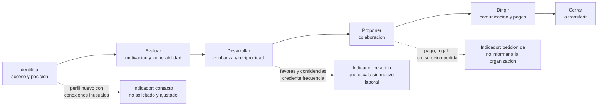

# Clase 374 — Captación de fuentes humanas y ciclo de reclutamiento

> Parte: **21 — Ingeniería social, espionaje y contrainteligencia** · Fuentes: CIA *Studies in Intelligence* · CISA *Insider Threat Mitigation Guide* · SEI/CERT *Common Sense Guide to Mitigating Insider Threats*
> ⏱️ Duración estimada: **110 min** · Nivel: **Intermedio-Avanzado**

---

## 🎯 Objetivo

Comprender, desde la perspectiva de quien debe protegerse, cómo se identifica, se evalúa, se cultiva y se recluta a una persona con acceso a información valiosa, y qué motivaciones hacen que alguien acepte colaborar o ceda a la presión. El objetivo no es aprender a reclutar sino **reconocer las fases del proceso y sus señales** para interrumpirlo en el punto más barato y más humano posible, protegiendo también a la persona acercada.

## ⚖️ Nota ética

Esta clase describe el ciclo de captación en términos generales y conceptuales. No contiene métodos para presionar, comprometer o reclutar a nadie, ni modelos de perfiles para seleccionar «víctimas». Reconocer vulnerabilidades personales (deudas, soledad, resentimiento) sirve para **ofrecer apoyo y reducir el riesgo**, nunca para estigmatizar a quien las sufre.

## 📚 Resultados de aprendizaje

Al finalizar, el alumno podrá:

1. **Describir** las fases generales del ciclo de captación: identificación, evaluación, desarrollo, reclutamiento, manejo y terminación.
2. **Explicar** el modelo de motivaciones MICE (dinero, ideología, compromiso o coerción, ego) y sus límites.
3. **Distinguir** entre fuente consciente y fuente que no sabe que lo es.
4. **Identificar** indicadores observables en cada fase que permiten intervenir.
5. **Diseñar** una respuesta de apoyo que reduzca la vulnerabilidad sin humillar.
6. **Reconocer** los sesgos de la autoevaluación: «a mí no me pasaría» y «parecía de fiar».

## 🗺️ Temas

| # | Tema | Por qué importa |
| --- | --- | --- |
| 1 | Qué es una fuente humana | Define el objeto de la captación |
| 2 | Ciclo de captación (spot, assess, develop, recruit, handle) | Da un hilo temporal para detectar |
| 3 | Motivaciones: MICE y alternativas | Orienta la prevención y el apoyo |
| 4 | Fuentes conscientes e inconscientes | Cambia la respuesta y la responsabilidad |
| 5 | Acercamientos corporativos y legítimos | No todo acercamiento es hostil |
| 6 | Señales de captación en el entorno de trabajo | Convierte la teoría en observación |
| 7 | Respuesta de apoyo y reducción de vulnerabilidad | La prevención más eficaz es humana |
| 8 | Límites del modelo | Evita estereotipos |

## 🧱 Prerrequisitos

Clases 371–373. Conviene haber leído la sección de amenazas internas de la clase 002.

## 🧠 Explicación en profundidad

### Qué es una fuente humana

Una **fuente humana** (*human source*) es una persona que proporciona información a un servicio de inteligencia, a una organización o a un actor interesado en ella. Puede ser un ciudadano que informa voluntariamente, un colaborador que actúa bajo dirección, un empleado de la organización objetivo o alguien sin conciencia de que sus comentarios alimentan un informe. Tres rasgos importan para la defensa: la fuente tiene **acceso** a lo que se busca (físico, lógico o por conocimiento), tiene **motivación** o puede ser influida y existe un **canal** por el que la información sale sin ser detectada. Reducir cualquiera de los tres reduce el riesgo.

### El ciclo de captación

La literatura sobre inteligencia describe una secuencia que, con variaciones de nombre, aparece en operaciones de Estados y, adaptada, en el espionaje industrial: **identificar** a personas con acceso (*spotting*), **evaluar** su motivación, vulnerabilidad y aptitud (*assessing*), **desarrollar** una relación de confianza (*developing*), **proponer** la colaboración (*recruiting*), **dirigir** la relación en el tiempo (*handling*) y, finalmente, **cerrarla** o transferirla (*termination*). Para un defensor esta secuencia es una escala de tiempo con puntos de intervención.

En la **identificación**, el acercamiento es amplio y de bajo coste: contactos en redes profesionales, ofertas de consultoría remunerada, invitaciones a eventos, estudios de mercado. Los indicadores son sutiles: perfiles nuevos con conexiones inusuales, mensajes que citan el puesto exacto de la persona, ofertas que parecen demasiado ajustadas al acceso que tiene. En la **evaluación**, el adversario busca información sobre su situación personal: tensiones laborales, problemas económicos, deseo de reconocimiento, viajes frecuentes. En el **desarrollo**, aparece el rapport de la clase 372: pequeños favores, intereses comunes, confidencias recíprocas y un aumento de la frecuencia del contacto. En el **reclutamiento** llega la petición, normalmente inocua y fácil de aceptar, con un incentivo y a menudo con una cláusula de discreción. Después el **manejo** introduce prácticas de comunicación discreta y pagos, y el compromiso previo hace costoso retroceder.

El diagrama presenta el ciclo como una cadena y asocia a tres fases el indicador observable que permite reportar. Se lee así: cuanto antes se interrumpe la cadena, menos se ha invertido y menos probable es que la persona se sienta atrapada; el tercer indicador, el pedido de discreción hacia la propia organización, es el más claro y el que cualquier empleado puede aplicar.

### Motivaciones: MICE y sus límites

Un modelo mnemotécnico muy difundido en contrainteligencia resume los motivos que llevan a una persona a colaborar con un servicio ajeno en cuatro categorías: **dinero** (*money*), **ideología** (*ideology*), **compromiso o coerción** (*compromise/coercion*, a veces *conflicts*) y **ego** (*ego*, que incluye resentimiento, necesidad de reconocimiento o sensación de ser infravalorado). Sirve para ordenar la conversación, no para predecir a nadie. Tiene cuatro límites que el alumno debe retener. Primero, los motivos **se combinan**: un caso suele mezclar deuda, resentimiento y adulación. Segundo, el modelo describe motivaciones *de la persona* pero no explica la **oportunidad**: sin acceso, canal y un tercero que gestione la relación, la motivación no se convierte en acto. Tercero, no es un predictor: millones de personas con deudas o resentimiento no cooperan con ningún servicio; usar el modelo para señalar a personas sería injusto e ineficaz. Cuarto, algunas versiones posteriores añaden otros elementos (como el deseo de emoción o la ingenuidad); son extensiones y conviene presentarlas como tales. El modelo tiene valor como **lista de apoyos**: si las deudas son un riesgo, hay asesoría financiera; si el resentimiento lo es, hay gestión del clima laboral y canales de queja; si el ego lo es, hay reconocimiento y carrera.

### Fuente consciente e inconsciente

Muchas operaciones no requieren una fuente consciente. Una **fuente inconsciente** (*unwitting source*) es alguien que aporta información sin saber a quién la proporciona o con qué fin: un ingeniero que explica su trabajo a un «investigador», una asistente que comparte la agenda de su jefe con un «organizador de eventos». Para la organización el riesgo es mayor porque no hay voluntad de ocultar, y por eso fallan los controles basados solo en detectar mala fe. La respuesta es doble: reglas sobre qué se comparte con externos y cultura de reportar contactos. Para el individuo, la respuesta de la organización debe ser educativa: la persona fue utilizada, no cómplice.

### Acercamientos legítimos y su ambigüedad

Una empresa que busca talento, un consultor que quiere vender o un académico que invita a un congreso hacen acercamientos legítimos, que a veces se solapan con los hostiles. Lo que distingue a unos de otros no es la apariencia sino la **transparencia del propósito**, la **proporcionalidad** de la petición y la **posibilidad de verificación**: un reclutador legítimo explica quién lo contrata, acepta que se hable con RR. HH. y no pide secreto. Cuando algo es ambiguo, el valor de un canal de consulta (no de acusación) es enorme: la persona pregunta a seguridad «¿esto es normal?» sin temor a quedar etiquetada.

### Intervenir con apoyo

La mejor intervención es **temprana y no punitiva**. Si un empleado informa que alguien le ofreció dinero por hablar de su proyecto, la organización debe agradecer, proteger la identidad del informante, evaluar el contacto y, si procede, derivar a las autoridades. Si, en cambio, alguien está en dificultad económica, las medidas de apoyo (adelantos, asesoría, programas de asistencia) reducen el riesgo mejor que la vigilancia. Y si el empleado ya ha cedido, ofrecerle una **ruta de salida** (reportar con garantías, asesoría legal, coordinación con las autoridades) es mejor que dejarle la sensación de que no hay vuelta atrás: cuanto más atrapada se siente la persona, más fácil es para el adversario seguir manejándola.

### Caso razonado (ficticio): el consultor de las ofertas

Carla Muñoz, de recepción, y Ana Rojas, de tesorería, reciben invitaciones del mismo «consultor» a un seminario pagado. A Ana le ofrece escribir un informe sobre prácticas de pago de empresas del sector con una remuneración muy superior al mercado; a Carla, enviar una lista de visitantes de la semana para «mejorar la logística». Ana acepta el primer informe, genérico; el consultor la elogia y le pide, ya con una segunda remuneración, detalles de la estructura de tesorería de su empresa «solo para comparar». La clave de lectura es doble. En el nivel de organización, dos empleados en puestos de acceso distintos fueron contactados por la misma persona: sin un canal para comparar, cada contacto parece aislado. En el nivel individual, el patrón es la escalada: del informe genérico al detalle interno con un pago creciente.

## 📔 Glosario

| Término (original) | Traducción | Definición sencilla / formal |
| --- | --- | --- |
| Human source | Fuente humana | Persona que aporta información a un actor de inteligencia o interesado. |
| Spotting | Identificación | Fase en que se localizan personas con acceso de interés. |
| Assessing | Evaluación | Valoración de motivación, vulnerabilidad y aptitud. |
| Developing | Desarrollo | Construcción gradual de una relación de confianza. |
| Recruitment | Reclutamiento | Propuesta que formaliza la colaboración. |
| Handling | Manejo o dirección | Gestión de la relación y de los contactos tras el reclutamiento. |
| MICE | MICE (dinero, ideología, compromiso/coerción, ego) | Modelo mnemotécnico de motivaciones para colaborar. |
| Unwitting source | Fuente inconsciente | Persona que aporta datos sin saber a quién ni para qué. |
| Cutout | Intermediario | Persona o canal que separa al director de la fuente. |
| Approach | Acercamiento | Primer intento de contacto con una persona objetivo. |

## 🧪 Laboratorio guiado (ejercicio de papel)

1. Sobre el caso del consultor, asigna cada contacto a una fase del ciclo.
2. Subraya los tres indicadores más claros y escribe cómo los habría detectado una organización con un canal de comparación de contactos.
3. Diseña un formulario de reporte de acercamientos de una página, sin lenguaje acusatorio.
4. Propón dos medidas de apoyo (no de vigilancia) para reducir el riesgo del motivo «dinero» en tesorería.
5. Redacta el mensaje de respuesta que la organización daría a Ana si ella informa del segundo pago, para que sienta que informar fue lo correcto.

## ✍️ Ejercicios

1. Explica por qué un modelo de motivaciones no sirve para predecir quién traicionará.
2. Diferencia fuente consciente de inconsciente y qué control atiende a cada una.
3. Describe tres indicadores de la fase de desarrollo.
4. Indica en qué fase conviene intervenir y por qué.
5. Redacta tres criterios para decidir si un acercamiento es legítimo.

**Respuestas razonadas.** (1) Porque las motivaciones son habituales y combinadas; casi nadie con ellas coopera, y el modelo ignora oportunidad y canal. (2) Consciente: control de motivación, apoyo y reporte; inconsciente: reglas de qué se comparte y cultura de contactos. (3) Frecuencia creciente de contacto, favores y regalos sin motivo laboral, confidencias personales recíprocas. (4) Lo más temprano posible: identificación y desarrollo, donde la inversión del adversario es menor y la persona aún no está comprometida. (5) Transparencia del propósito, proporcionalidad de la petición y ausencia de secreto hacia la organización.

## 📝 Rúbrica de evaluación

| Criterio | Insuficiente | Competente | Sobresaliente |
| --- | --- | --- | --- |
| Ciclo | Lista fases | Las ubica en un caso | Predice la escalada y puntos de corte |
| Motivación | Estereotipa | Usa MICE con matices | Expone límites y complementa con oportunidad y canal |
| Respuesta | Vigilancia | Reporte y apoyo | Respuesta que protege al empleado y a la organización |
| Prudencia | Concluye culpabilidad | Describe indicadores | Distingue alternativas legítimas |

## ⚠️ Errores comunes

- Usar MICE para etiquetar personas o perfiles.
- Suponer que las fuentes siempre saben lo que hacen.
- Responder a los indicios con castigo, lo que desanima a reportar.
- Considerar sospechoso cualquier acercamiento profesional.
- Ignorar el apoyo a la persona cuando ya ha cedido.

## ❓ Preguntas frecuentes

**¿Se puede evitar que una empresa sea objetivo de captación?** No del todo; se puede reducir la exposición y el valor de cada persona, y aumentar la probabilidad de detección temprana.

**¿Quién decide si un contacto es hostil?** Un equipo con contexto (seguridad, contrainteligencia, a veces autoridades), no el empleado ni su jefe directo.

**¿Es mejor esperar a tener pruebas?** No para reportar: el reporte entrega hechos; la valoración llega después.

## 🔗 Referencias

- CIA, *Studies in Intelligence* — <https://www.cia.gov/resources/csi/studies-in-intelligence/> — estudios públicos sobre operaciones y ciclo de inteligencia humana.
- CISA, *Insider Threat Mitigation Guide* — <https://www.cisa.gov/resources-tools/resources/insider-threat-mitigation-guide> — gestión de riesgo de personas y programas de mitigación.
- SEI/CERT, *Common Sense Guide to Mitigating Insider Threats* (7.ª ed.) — <https://insights.sei.cmu.edu/library/common-sense-guide-to-mitigating-insider-threats-seventh-edition/> — prácticas de apoyo y detección temprana.
- Christopher Hadnagy, *Social Engineering: The Science of Human Hacking* (2.ª ed.) — desarrollo de rapport y escalada de peticiones.

## 📥 Material descargable

- 📄 [Guía en PDF](./clase-374-guia.pdf) — versión imprimible de esta clase.
- 🎞️ [Presentación (PPTX)](./clase-374-presentacion.pptx) — deck para proyectar en clase.

## ⬅️ Clase anterior

[Clase 373 — Pretexting, impersonation y elicitation desde la defensa](../373-pretexting-impersonation-y-elicitation-desde-la-defensa/README.md)

## ➡️ Siguiente clase

[Clase 375 — Trampas románticas, honey trap, kompromat y estafas de romance](../375-trampas-romanticas-honey-trap-kompromat-y-estafas-de-romance/README.md)
