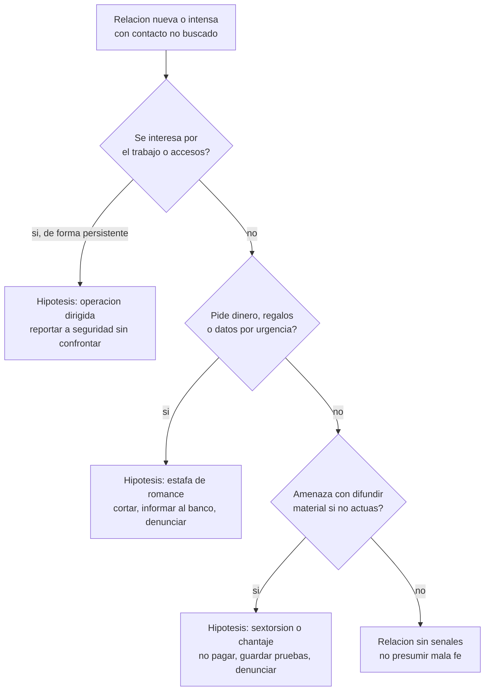

# Clase 375 — Trampas románticas, honey trap, kompromat y estafas de romance

> Parte: **21 — Ingeniería social, espionaje y contrainteligencia** · Fuentes: FBI IC3 *Internet Crime Report 2025* · M. Wolf, *Man Without a Face* · D. Wise, *Tiger Trap*
> ⏱️ Duración estimada: **120 min** · Nivel: **Intermedio-Avanzado**

---

## 🎯 Objetivo

Comprender cómo una relación afectiva, sexual o de confianza se convierte en instrumento de obtención de información, de coerción o de fraude, y por qué estas operaciones son tan eficaces como difíciles de denunciar. Se estudian la *honey trap* y la *sexpionage*, el *kompromat*, el chantaje, la sextorsión y las estafas de romance, con sus diferencias, y se desarrollan **medidas de protección y apoyo** que no culpabilizan a la víctima.

## ⚖️ Nota ética

Esta clase trata de personas reales que fueron manipuladas, de relaciones íntimas y de delitos. Se aborda desde la prevención y la protección, sin morbo y sin reproducir técnicas operativas de seducción o coerción. Las relaciones consensuadas entre adultos no son un delito ni una falta; lo que se analiza es el **uso instrumental** de una relación por un tercero que oculta su identidad o intención. En los casos reales se distingue lo documentado judicialmente de lo alegado.

## 📚 Resultados de aprendizaje

Al finalizar, el alumno podrá:

1. **Definir** honey trap, sexpionage, kompromat, chantaje, coerción, sextorsión y estafa de romance, y distinguirlos.
2. **Explicar** por qué una relación íntima es un vector de acceso y de presión.
3. **Diferenciar** una operación de inteligencia de una estafa de romance por objetivo, paciencia y evidencia.
4. **Reconocer** las señales tempranas de una relación instrumental sin presumir mala fe en toda relación.
5. **Diseñar** políticas de reporte voluntario y apoyo que reduzcan el poder de la coerción.
6. **Analizar** casos históricos y recientes distinguiendo hechos, acusaciones e hipótesis.

## 🗺️ Temas

| # | Tema | Por qué importa |
| --- | --- | --- |
| 1 | Honey trap y sexpionage | Son el uso instrumental de la intimidad con fines de inteligencia |
| 2 | Kompromat | Material comprometedor usado como palanca, real o fabricado |
| 3 | Chantaje y coerción | Transforman información privada en control |
| 4 | Romance scams | Fraude económico con apariencia de relación |
| 5 | Sextorsión | Extorsión mediante material íntimo, masiva y criminal |
| 6 | Diferencias entre operación de inteligencia y estafa | Cambian la defensa y el reporte |
| 7 | Explotación de relaciones de confianza y conflictos de interés | Ampliación a relaciones no sexuales |
| 8 | Protección, reporte y apoyo | Evita el silencio, que es la fuerza del chantaje |

## 🧱 Prerrequisitos

Clases 372 y 374. Se recomienda haber leído la sección de BEC de la clase 299 y de ingeniería social de la clase 259.

## 🧠 Explicación en profundidad

### Qué se explota: necesidad de afecto, miedo a la exposición

Las personas buscan compañía, reconocimiento y vínculo; son necesidades legítimas. Una relación entre adultos suele implicar compartir información privada. Estos dos hechos, normales, definen la vulnerabilidad: quien manipula **fabrica o aprovecha una relación** para (a) acceder a información, (b) obtener dinero o (c) crear un motivo de presión. Es una forma de ingeniería social especialmente poderosa porque combina todas las palancas de la clase 372: simpatía, reciprocidad, compromiso gradual, secreto y aislamiento, y además introduce un elemento que otras técnicas no tienen, la **vergüenza**. Cuando la víctima se da cuenta, además de perder algo, teme ser juzgada, y ese temor es lo que sostiene la segunda fase: el chantaje.

### Honey trap y sexpionage

*Honey trap* (a veces *honeypot*, aunque este término se usa también en informática con otro sentido) es una operación en que una persona establece o simula una relación romántica o sexual con un objetivo para obtener información, influir en sus decisiones o crear un material de presión. *Sexpionage* es el término periodístico y académico que recoge el uso del sexo y el afecto en el espionaje. Las dos expresiones describen un **método** y no una época: los registros históricos documentan su uso en la Guerra Fría. El caso más citado es el de los llamados «Romeos» de la inteligencia exterior de la RDA, dirigida por Markus Wolf, que según sus propias memorias y la investigación histórica cultivaba relaciones con secretarias y funcionarios de Alemania Occidental para acceder a información; en ese caso, la relación era el canal, y la coerción, cuando existía, un recurso posterior. La lección que sobrevive a la época es que **el acceso a una persona con información, más que a la información, es el objetivo**.

Hay una diferencia importante entre dos formas. En la primera, la relación es un **canal de acceso** y el vínculo se mantiene para obtener información de forma continuada; la persona puede no saber nunca que fue objetivo. En la segunda, la relación produce un **material de presión** (imágenes, grabaciones, pruebas de una infidelidad o de un delito) que se usa para forzar una conducta. La primera exige paciencia y una persona o una red dedicadas; la segunda puede ser breve y se acerca al chantaje.

### Kompromat

*Kompromat* (del ruso *kompromatirujuščij material*, «material comprometedor») es la información, real, exagerada o fabricada, que puede dañar la reputación o la posición de una persona y se acumula o se difunde para ejercer presión política, económica o personal. Importa en esta clase por tres razones. Primero, **no necesita ser verdadero**: basta con que sea creíble o que el coste de refutarlo sea alto. Segundo, su valor es **potencial**: muchas veces se guarda sin usar, y su existencia ya condiciona. Tercero, su amenaza no se limita a los servicios de un Estado; empresas, grupos criminales y particulares lo usan en conflictos laborales o competitivos. En el análisis defensivo, el kompromat se trata como un **riesgo de coerción**: una persona con acceso que tiene algo que ocultar es potencialmente manipulable, y por eso las organizaciones de seguridad piden revelar de forma confidencial los posibles factores de presión en lugar de dejar que otros los descubran.

### Chantaje y coerción

El **chantaje** (*blackmail*) amenaza con revelar información dañina salvo que la víctima actúe o pague; la **coerción** es el término más amplio de forzar una conducta mediante amenaza, daño o presión. Para el análisis, interesa el mecanismo: la víctima queda en un dilema entre la exposición y la colaboración, y el chantajista procura que **la segunda opción parezca menos costosa**. Esta dinámica explica por qué las instituciones insisten en tres principios: reportar pronto (el chantaje crece con el tiempo y cada concesión previa se convierte en nueva palanca), que reportar no implique castigo desproporcionado (si el reporte destruye la carrera, el chantajista gana) y que la organización disponga de apoyo legal y psicológico.

### Estafas de romance y sextorsión

Una **estafa de romance** (*romance scam*) es un fraude en el que el estafador simula una relación afectiva, a menudo a distancia y con identidad falsa, para obtener dinero, datos o servicios. El informe 2025 del IC3 del FBI registra en la categoría *Confidence/Romance* pérdidas reportadas de **929 287 469 dólares** en 2025, frente a **672 009 052** en 2024, de modo que el fenómeno crece y mueve cifras de otra naturaleza que los incidentes de espionaje. La **sextorsión** (*sextortion*) es la extorsión mediante material íntimo, real o simulado, cada vez más masiva y automatizada. Ambas son delitos de motivación económica, de ejecución industrial, con volumen alto y poca selección de víctimas.

| Rasgo | Operación de inteligencia (honey trap) | Estafa de romance | Sextorsión |
| --- | --- | --- | --- |
| Objetivo | Información o influencia | Dinero | Dinero o más material |
| Selección | Muy dirigida, por acceso | Amplia, por vulnerabilidad | Amplia o por oportunidad |
| Tiempo | Meses a años | Semanas a meses | Horas a días |
| Indicador | Interés persistente por el trabajo del objetivo | Petición de dinero ante una «urgencia» | Amenaza inmediata con plazo |
| Evidencia típica | Rara vez pública | Transferencias, chats | Capturas, cuentas, pagos |
| Defensa | Contrainteligencia y reporte | Verificación y bloqueo de pagos | No pagar, conservar pruebas, denunciar |

La tabla ayuda a decidir qué hacer: ante la primera se informa a seguridad y no se confronta; ante la segunda se corta el contacto y se informa a la entidad financiera; ante la tercera no se paga, se conserva la evidencia y se acude a la policía y a la plataforma. Es una guía de decisión, no de diagnóstico: una misma persona puede enfrentar varias, y la distinción entre una estafa criminal y una operación dirigida puede quedar sin resolver hasta que lo aclaren las autoridades.

El árbol parte de la conducta observable y no de la persona. Obliga a reconocer que la misma relación puede estar en varias ramas y que la respuesta a la primera difiere de las otras: se reporta sin confrontar, para no alertar a un posible actor organizado y proteger a la persona afectada.

### Explotación de relaciones de confianza y conflictos de interés

La misma lógica se aplica a vínculos no sexuales: amistades profesionales, relaciones familiares, mentores, socios, favores que crean obligaciones. Un **conflicto de interés** (*conflict of interest*) es una situación en que un interés personal puede interferir con el deber hacia la organización: un familiar en un proveedor, una inversión en un competidor, un favor recibido de un tercero interesado. No es una infracción por existir, sino por **no declararse**. Un conflicto no declarado se convierte en vulnerabilidad porque otros pueden descubrirlo y usarlo como palanca. Por eso las políticas de integridad exigen declarar conflictos y las de seguridad del personal los consideran factores de riesgo: no para sancionar sino para que la persona deje de tener algo que ocultar.

### Casos históricos y su lectura

El caso estadounidense de Katrina Leung ilustra la dificultad de leer una relación. Leung fue una colaboradora del FBI que, según la acusación, habría mantenido una relación íntima con su agente de enlace y habría entregado información a China. El agente de enlace, James J. Smith, se declaró culpable de haber mentido al FBI sobre la relación y recibió libertad condicional; los cargos contra Leung fueron desestimados por la conducta del Gobierno, según las crónicas de la época. Lo documentado es la **relación entre manejador y colaboradora** y la sentencia de Smith; la acusación de doble agente se formuló pero no se probó en juicio. David Wise lo analiza en *Tiger Trap*. La lección doble: una relación personal entre quien dirige y quien es dirigido es en sí un riesgo de integridad que obliga a controles de segregación y rotación, y una acusación de espionaje no es una condena.

## 📔 Glosario

| Término (original) | Traducción | Definición sencilla / formal |
| --- | --- | --- |
| Honey trap | Trampa de miel | Uso de una relación romántica o sexual simulada o aprovechada para obtener información o presión. |
| Sexpionage | «Sexpionaje» | Término para el uso del sexo y el afecto en el espionaje. |
| Kompromat | Material comprometedor | Información real o fabricada para dañar o presionar a alguien. |
| Blackmail | Chantaje | Amenaza de revelar información dañina salvo que la víctima actúe o pague. |
| Coercion | Coerción | Forzar una conducta mediante amenaza o presión. |
| Romance scam | Estafa de romance | Fraude que simula una relación afectiva para obtener dinero o datos. |
| Sextortion | Sextorsión | Extorsión mediante imágenes íntimas reales o simuladas. |
| Conflict of interest | Conflicto de interés | Interés personal que puede interferir con el deber hacia la organización. |
| Catfishing | Suplantación de identidad en línea | Crear una identidad falsa para engañar emocionalmente. |
| Romeo spy | «Espía Romeo» | Agente que simula una relación afectiva para obtener acceso (término histórico de la Guerra Fría). |
| Pig butchering | Estafa de inversión con engaño afectivo | Fraude que combina un vínculo afectivo y una falsa inversión. |

## 🧪 Laboratorio guiado (ejercicio de papel)

Personajes ficticios: **Elena** (analista de pagos de Helio Tango), **Rafael** (contacto en línea), **Gustavo** (director de seguridad).

1. Lee una cronología: a las 3 semanas, Rafael elogia el trabajo de Elena; a las 6, le pregunta qué bancos usa su empresa; a las 8, le pide un préstamo por una «emergencia».
2. Identifica qué ramas del árbol de decisión se activan y en qué orden.
3. Redacta el reporte de Elena a Gustavo en tres líneas, solo con hechos.
4. Redacta la respuesta de Gustavo que agradece, protege la confidencialidad y propone pasos.
5. Escribe tres reglas de la política de seguridad que reducen el poder del chantaje (reporte voluntario, sin castigo desproporcionado, asesoría).

## ✍️ Ejercicios

1. Explica por qué el reporte temprano reduce el poder del chantaje.
2. Diferencia una estafa de romance de una operación de inteligencia con tres criterios.
3. Justifica por qué un conflicto de interés declarado es menos riesgoso que uno oculto.
4. Explica por qué una acusación no equivale a una condena en el caso Leung.
5. Redacta un criterio de política para relaciones entre supervisor y supervisado en una función sensible.

**Respuestas razonadas.** (1) Cada concesión nueva da más palanca, y la exposición voluntaria desactiva el secreto, que es la fuente del poder. (2) Selección (dirigida o amplia), objetivo (información o dinero) y paciencia. (3) Lo declarado ya no se puede usar como palanca, y puede gestionarse. (4) Porque la fiscalía formuló cargos que fueron desestimados; lo comprobado fue la conducta de Smith. (5) Debe declararse y reasignarse a uno de los dos, con rotación.

## 📝 Rúbrica de evaluación

| Criterio | Insuficiente | Competente | Sobresaliente |
| --- | --- | --- | --- |
| Distinciones | Mezcla términos | Distingue cada amenaza | Elige la respuesta según el tipo y la incertidumbre |
| Cifras y casos | Sin fuente | Cita fuente | Separa hechos, acusaciones y límites |
| Política | Prohíbe relaciones | Diseña reporte | Diseña reporte y apoyo sin castigo desproporcionado |
| Trato a la víctima | Culpabiliza | Neutro | Protege dignidad y confidencialidad |

## ⚠️ Errores comunes

- Culpar a la víctima («era obvio»): el silencio que produce favorece al agresor.
- Confrontar al contacto sospechoso en lugar de reportar.
- Presumir que toda relación nueva de un empleado clave es sospechosa.
- Pagar a un extorsionador: no garantiza que cese y señala a la víctima como solvente.
- Tomar una acusación periodística como prueba.

## ❓ Preguntas frecuentes

**¿Una relación con una persona de otro país es un riesgo?** No por sí misma. El riesgo está en la ocultación, el interés por información sensible y la presión; la nacionalidad no es un indicador.

**¿Qué hago si me extorsionan?** No pagues, no borres la evidencia, corta la comunicación, informa a tu organización y denuncia ante las autoridades y la plataforma.

**¿Por qué las organizaciones piden declarar relaciones?** Para que ninguna persona dependa de que un secreto permanezca oculto.

## 🔗 Referencias

- FBI IC3, *Internet Crime Report 2025* — <https://www.ic3.gov/AnnualReport/Reports/2025_IC3Report.pdf> — pérdidas por Confidence/Romance (2025: $929 287 469; 2024: $672 009 052) y tendencia.
- Markus Wolf, *Man Without a Face* — memorias del jefe de la inteligencia exterior de la RDA, para el uso de relaciones afectivas como canal de acceso.
- David Wise, *Tiger Trap* — análisis del caso Katrina Leung y de la dificultad de gestionar relaciones personales de un manejador.
- NBC News, *Retired FBI agent gets probation in spy case* — <https://www.nbcnews.com/news/amp/wbna8621304> — declaración de culpabilidad y libertad condicional de James J. Smith.
- MITRE ATT&CK, técnica T1534 *Internal Spearphishing* — <https://attack.mitre.org/techniques/T1534/> — abuso de relaciones de confianza internas.

## 📥 Material descargable

- 📄 [Guía en PDF](./clase-375-guia.pdf) — versión imprimible de esta clase.
- 🎞️ [Presentación (PPTX)](./clase-375-presentacion.pptx) — deck para proyectar en clase.

## ⬅️ Clase anterior

[Clase 374 — Captación de fuentes humanas y ciclo de reclutamiento](../374-captacion-de-fuentes-humanas-y-ciclo-de-reclutamiento/README.md)

## ➡️ Siguiente clase

[Clase 376 — Espionaje industrial, económico y tecnológico](../376-espionaje-industrial-economico-y-tecnologico/README.md)
