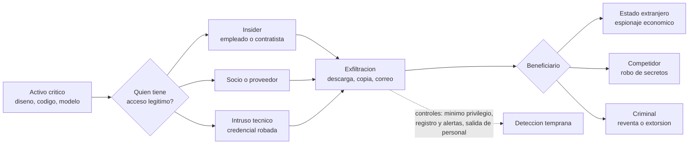

# Clase 376 — Espionaje industrial, económico y tecnológico

> Parte: **21 — Ingeniería social, espionaje y contrainteligencia** · Fuentes: 18 U.S.C. §§ 1831–1832 · CIA *Studies in Intelligence* · Departamento de Justicia de EE. UU.
> ⏱️ Duración estimada: **120 min** · Nivel: **Avanzado**

---

## 🎯 Objetivo

Entender qué se protege cuando se habla de secretos industriales, cómo se roban (con medios humanos, técnicos o mixtos), qué distingue el espionaje que sirve a un Estado del que sirve a una empresa o a un delincuente, y qué enseña la historia: desde las redes de adquisición tecnológica de la Guerra Fría hasta el caso reciente de la propiedad intelectual de modelos de inteligencia artificial. El alumno saldrá capaz de **identificar qué activos son realmente secretos**, razonar cómo se protegen y leer con criterio las acusaciones públicas.

## ⚖️ Nota ética

Se analizan casos con estado procesal distinto. Una condena es un hecho judicial; una acusación, una pretensión de la fiscalía; una noticia, un relato periodístico. Esta clase no atribuye intención a personas ni empresas más allá de lo que sostienen documentos oficiales, y señala cuándo una conclusión es inferencia. No incluye métodos para sustraer información.

## 📚 Resultados de aprendizaje

Al finalizar, el alumno podrá:

1. **Definir** secreto comercial, espionaje industrial, económico y científico-tecnológico, y distinguirlos de la competencia legítima.
2. **Explicar** qué requisitos hacen que una información sea protegible como secreto.
3. **Contrastar** los delitos de espionaje económico y de robo de secretos comerciales.
4. **Describir** los canales típicos (insider, ciberintrusión, cadena de suministro, colaboración científica, inversión).
5. **Comparar** casos históricos y modernos con una matriz común.
6. **Priorizar** activos críticos y diseñar un programa de protección proporcional.

## 🗺️ Temas

| # | Tema | Por qué importa |
| --- | --- | --- |
| 1 | Qué es un secreto comercial | Sin definición no hay protección ni delito |
| 2 | Espionaje industrial, económico y científico-tecnológico | Cambian los beneficiarios y la ley aplicable |
| 3 | Canales de obtención | Determinan los controles |
| 4 | Guerra Fría y adquisición tecnológica | Historia documentada del método |
| 5 | Casos modernos | Muestran el método actual |
| 6 | Estatal, corporativo y criminal | Afecta atribución y respuesta |
| 7 | Evaluar activos críticos | Prioriza la protección |
| 8 | Límites y ambigüedades | Evita acusaciones precipitadas |

## 🧱 Prerrequisitos

Clases 371 y 374. Para la dimensión técnica conviene haber visto la Parte 8 (detección) y la Parte 9 (forense).

## 🧠 Explicación en profundidad

### Qué se protege: el secreto y su razonabilidad

Un **secreto comercial** (*trade secret*) es información con valor económico precisamente por no ser conocida o fácilmente accesible, y que su titular protege con medidas razonables. El énfasis en las **medidas razonables** es fundamental: si una empresa no restringe el acceso, no firma acuerdos de confidencialidad y no marca la información, le resultará difícil sostener ante un juez que se trataba de un secreto. La protección legal depende, entonces, de la protección práctica. Esto cambia el sentido de la seguridad de la información: no solo evita pérdidas, también preserva el derecho a reclamarlas.

En la práctica, los secretos comerciales no son «lo confidencial» en bloque sino ciertas categorías: fórmulas, procesos de fabricación, diseños, código, listas de clientes con condiciones, resultados de investigación no publicada, parámetros y pesos de modelos de IA, estrategias de precios. Una evaluación seria comienza por **inventariar** cuáles de ellos sostienen la ventaja competitiva y quién tiene acceso a cada uno (las *joyas de la corona*, clase 378).

### Tres espionajes que se solapan

El **espionaje industrial** (*industrial espionage*) es la obtención clandestina de secretos de una empresa por un competidor o sus intermediarios. El **espionaje económico** (*economic espionage*) lo hace en beneficio de un Estado o sus instrumentos; la ley estadounidense lo tipifica en el § 1831 del título 18, que exige que el beneficio sea para un gobierno, instrumento o agente extranjero. El **espionaje científico-tecnológico** atiende a la investigación y la tecnología (a veces críticas para la defensa) y puede ser tanto industrial como económico. Por contraste, el § 1832 sanciona el robo de secretos comerciales sin exigir beneficio extranjero. Para un abogado la diferencia determina el delito; para un defensor, la señal práctica es que **un mismo robo puede ser acusado por cualquiera de los dos**, según lo que la fiscalía pueda acreditar sobre el destinatario.

### Los canales

1. **La persona con acceso (insider).** Un empleado, contratista o socio que copia, descarga o describe lo que sabe. Es el canal más común en los casos judicializados porque quien tiene acceso legítimo no necesita vulnerar nada. Se estudia en la clase 377.
2. **La intrusión técnica.** Compromiso de cuentas, malware y exfiltración desde sistemas (Partes 7 a 9). Se complementa con la ingeniería social: el phishing consigue la credencial.
3. **La cadena de suministro y la colaboración.** Proveedores, socios, universidades y programas conjuntos que reciben información en el marco de una relación legítima.
4. **Inversiones, fusiones y adquisiciones.** La *due diligence* y las ofertas de compra son ocasiones para recibir información sensible.
5. **La conversación.** Congresos, redes profesionales y visitas (clase 373).
6. **Las personas reclutadas.** El ciclo de la clase 374.

Los casos combinan canales: una persona con acceso copia, un tercero la ayuda, y una infraestructura técnica oculta el rastro.

### Historia: adquisición tecnológica en la Guerra Fría

La Guerra Fría ofrece la mejor documentación pública de un programa **sistemático** de adquisición de tecnología occidental por la Unión Soviética. Un caso muy citado es el *Farewell Dossier*: material entregado hacia 1981 a la inteligencia francesa y por esta compartida con Estados Unidos por un coronel soviético, Vladimir Vetrov, que describía una red organizada para obtener tecnología occidental. Gus Weiss, que fue asesor en la Casa Blanca, lo narra en un estudio publicado por la CIA (*Studies in Intelligence*, 1996) y atribuye a Estados Unidos una respuesta de contrainteligencia: dejar que esa red recibiera tecnología defectuosa. Lo importante para esta clase es que (a) una red de adquisición era **sistemática y burocrática**, no una colección de casos aislados; (b) fue la **contrainteligencia**, no la defensa pasiva, la que invirtió la situación; y (c) algunos pormenores del relato (en particular los efectos concretos atribuidos a la tecnología manipulada) son difíciles de corroborar de manera independiente, por lo que esta clase los trata como relato de un participante y no como hecho verificado.

Otro episodio comparable es el de los **ilegales** rusos: en junio de 2010, el Departamento de Justicia de EE. UU. anunció la detención de diez presuntos agentes que vivían con identidades falsas y habrían sido enviados a obtener información sobre política y economía estadounidenses. Todos se declararon culpables de cargos relacionados con actuar como agentes no declarados de un gobierno extranjero y fueron luego expulsados en un intercambio. La lección es de método: **paciencia y cobertura de larga duración**, un tipo de operación que las empresas rara vez enfrentan, pero que ilustra qué significa que un adversario estatal invierta años en una persona.

### Casos modernos: una persona, un acceso, una oportunidad

En enero de 2026, un jurado federal de California declaró a Linwei Ding, exingeniero de Google, culpable de 14 cargos: siete de espionaje económico y siete de robo de secretos comerciales, tras un juicio de once días. Según los documentos judiciales y los comunicados oficiales, entre mayo de 2022 y abril de 2023 sustrajo más de dos mil páginas con información confidencial de la infraestructura de inteligencia artificial de su empleador y, mientras tanto, desarrollaba un proyecto empresarial en China. La sentencia aún no se había dictado cuando se redactó esta clase. Lo que enseña el caso es exactamente lo que enseña cualquier caso de esta familia: el volumen y la naturaleza del acceso del empleado importaron más que cualquier ataque técnico; la organización detectó el patrón después y no antes; y el hecho de que la acusación se formulara bajo el § 1831 refleja lo que la fiscalía acreditó sobre los beneficiarios, no un juicio histórico sobre una potencia.

Conviene leer los casos con una matriz común:

| Dimensión | Pregunta de análisis |
| --- | --- |
| Activo | ¿Qué era secreto y por qué tenía valor? |
| Acceso | ¿Qué permiso legítimo permitió la sustracción? |
| Canal | ¿Persona, intrusión, socio, evento? |
| Beneficiario | ¿Estado, competidor, criminal, no establecido? |
| Detección | ¿Qué señal se vio y cuándo? |
| Resultado | ¿Condena, acuerdo, acusación, sin resolver? |

El diagrama sitúa lo importante en la bifurcación central: el mismo activo puede salir por tres puertas y llegar a tres tipos de beneficiario, de modo que la defensa debe controlar la **salida** y no solo la entrada. Los controles punteados actúan antes de la exfiltración o durante ella; el análisis legal sobre el beneficiario llega después y no cambia los controles.

### Estatal, corporativo y criminal: por qué no son lo mismo

Cuando se analiza un robo de propiedad intelectual, la tentación es concluir rápido quién se benefició. El rigor pide distinguir tres cosas: lo que se **sabe** (qué se sustrajo y por quién, con prueba), lo que se **alega** (el destino y los vínculos) y lo que se **infiere** (la finalidad estratégica). Por ejemplo, un secreto robado por un empleado y ofrecido a un competidor es corporativo; el mismo secreto, entregado a un organismo estatal, es económico; si se vende en un mercado ilegal, es criminal. La atribución a un Estado requiere evidencia que normalmente solo tiene un organismo oficial; los comentaristas deben hablar de «alegaciones» o «evaluaciones».

### Proteger lo que importa

La protección razonable combina: **inventario** de activos críticos y de quién accede; **mínimo privilegio** y segmentación; **registro y alertas** sobre accesos y descargas atípicas; **acuerdos** de confidencialidad y propiedad intelectual claros; **procesos de salida** de personal (clase 378); **gestión de socios** (limitar información compartida a lo necesario) y **cultura** de reportar contactos. Ninguno funciona solo; juntos elevan el coste de la sustracción y la probabilidad de detección.

## 📔 Glosario

| Término (original) | Traducción | Definición sencilla / formal |
| --- | --- | --- |
| Trade secret | Secreto comercial | Información con valor por no ser conocida y protegida con medidas razonables. |
| Industrial espionage | Espionaje industrial | Obtención clandestina de secretos por competidores o intermediarios. |
| Economic espionage | Espionaje económico | Sustracción para beneficiar a un gobierno, instrumento o agente extranjero (18 U.S.C. § 1831). |
| Theft of trade secrets | Robo de secretos comerciales | Apropiación ilícita de secretos con perjuicio al titular (18 U.S.C. § 1832). |
| Crown jewels | Joyas de la corona | Activos cuya pérdida dañaría más a la organización. |
| Exfiltration | Exfiltración | Salida no autorizada de datos de una organización. |
| Due diligence | Debida diligencia | Revisión previa a una operación, que implica compartir información. |
| Illegals | «Ilegales» | Agentes que operan bajo identidad falsa sin cobertura diplomática. |
| Farewell Dossier | Dossier Farewell | Material de Vetrov (1981) sobre una red soviética de adquisición tecnológica. |
| Line X | Línea X | Unidad soviética dedicada a obtener tecnología occidental (según el relato de Weiss). |

## 🧪 Laboratorio guiado (ejercicio de papel)

Organización ficticia: **Helio Tango**, con tres activos: el algoritmo de calibración, la lista de clientes con precios y el plan de producto a 18 meses.

1. Clasifica cada activo según valor y número de personas con acceso. Marca quién debería salir de la lista.
2. Para cada activo, indica el canal de sustracción más plausible y un control para ese canal.
3. Diseña tres alertas (acceso fuera de horario, descarga masiva, uso de dispositivo no registrado) y escribe qué decisión humana provocan.
4. Explica qué documentos necesitaría Helio Tango para sostener que su algoritmo es un secreto comercial.
5. Redacta cómo comunicarías un incidente de este tipo sin atribuir intención a una persona.

## ✍️ Ejercicios

1. Diferencia § 1831 de § 1832 con un ejemplo.
2. Explica por qué en el caso Ding importa distinguir condena de sentencia.
3. Compara la red soviética de adquisición con un caso moderno en dos dimensiones de la matriz.
4. Explica por qué «medidas razonables» une el derecho con la seguridad.
5. Razona por qué la atribución estatal no debe hacerse sin evidencia oficial.

**Respuestas razonadas.** (1) Un empleado vende planos a un competidor local: § 1832. Si el destinatario es un organismo extranjero: § 1831. (2) La condena (veredicto) está acreditada; la sentencia no se había dictado; no puede afirmarse la pena. (3) Canal: red burocrática con reclutas frente a un único insider; Beneficiario: Estado en ambos, pero con evidencia distinta. (4) Porque sin controles de acceso y acuerdos, el titular no puede probar que protegía el secreto, y los jueces lo exigen. (5) Porque la atribución depende de inteligencia y de prueba que no es pública; hacerla sin ellas puede dañar a inocentes y a la credibilidad.

## 📝 Rúbrica de evaluación

| Criterio | Insuficiente | Competente | Sobresaliente |
| --- | --- | --- | --- |
| Conceptos | Mezcla delitos | Distingue §§ 1831 y 1832 | Integra la dimensión legal con controles |
| Análisis de casos | Narra | Usa la matriz | Distingue hecho, alegación e inferencia |
| Protección | Genérica | Controles por canal | Prioriza por valor y acceso |
| Prudencia | Atribuye | Declara límites | Reconoce incertidumbre y fuentes |

## ⚠️ Errores comunes

- Considerar secreto todo lo que se marcó «confidencial».
- Creer que el espionaje industrial siempre es técnico.
- Atribuir al Estado cualquier robo de propiedad intelectual.
- Usar un relato de un participante (como Weiss) como prueba independiente.
- Olvidar que el empleado con acceso legítimo es el canal más frecuente.

## ❓ Preguntas frecuentes

**¿Es espionaje usar información de un competidor que está en su web?** No: es competencia legítima con fuentes abiertas, siempre que no se violen condiciones de uso ni se engañe para acceder.

**¿Por qué se acusa a veces bajo el § 1831?** Porque la fiscalía considera acreditable el beneficio a un gobierno o agente extranjero; no es un juicio general sobre un país.

**¿Puede una empresa pequeña tener secretos que valga la pena proteger?** Sí; las medidas razonables se miden en proporción al valor del secreto.

## 🔗 Referencias

- 18 U.S.C. § 1831, *Economic espionage* — <https://www.law.cornell.edu/uscode/text/18/1831> — delito de espionaje económico en beneficio de un gobierno, instrumento o agente extranjero.
- 18 U.S.C. § 1832, *Theft of trade secrets* — <https://www.law.cornell.edu/uscode/text/18/1832> — delito de robo de secretos comerciales y definición de medidas razonables en su capítulo.
- Gus W. Weiss, *Duping the Soviets: The Farewell Dossier*, Studies in Intelligence 39(5) — <https://www.cia.gov/resources/csi/studies-in-intelligence/1996-2/the-farewell-dossier> — relato de un participante sobre la red soviética de adquisición tecnológica.
- Departamento de Justicia de EE. UU., *Former Google Engineer Found Guilty of Economic Espionage and Theft of Confidential AI Technology* — <https://www.justice.gov/usao-ndca/pr/former-google-engineer-found-guilty-economic-espionage-and-theft-confidential-ai> — veredicto y cargos del caso Ding.
- Departamento de Justicia de EE. UU., *Ten Alleged Secret Agents Arrested in the United States* — <https://www.justice.gov/archives/opa/pr/ten-alleged-secret-agents-arrested-united-states> — anuncio de 2010 del caso de los ilegales rusos.

## 📥 Material descargable

- 📄 [Guía en PDF](./clase-376-guia.pdf) — versión imprimible de esta clase.
- 🎞️ [Presentación (PPTX)](./clase-376-presentacion.pptx) — deck para proyectar en clase.

## ⬅️ Clase anterior

[Clase 375 — Trampas románticas, honey trap, kompromat y estafas de romance](../375-trampas-romanticas-honey-trap-kompromat-y-estafas-de-romance/README.md)

## ➡️ Siguiente clase

[Clase 377 — Amenazas internas: indicadores, programas y límites](../377-amenazas-internas-indicadores-programas-y-limites/README.md)
