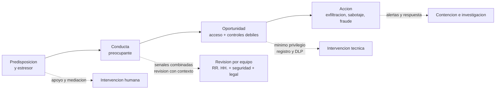

# Clase 377 — Amenazas internas: indicadores, programas y límites

> Parte: **21 — Ingeniería social, espionaje y contrainteligencia** · Fuentes: CISA *Insider Threat Mitigation Guide* · SEI/CERT *Common Sense Guide* · NIST SP 800-53 (PM-12)
> ⏱️ Duración estimada: **110 min** · Nivel: **Intermedio-Avanzado**

---

## 🎯 Objetivo

Entender la amenaza interna como un problema de **riesgo de personas con acceso legítimo**, no como una caza de culpables. El alumno aprenderá a distinguir sus tipos, a leer indicadores sin convertirlos en pruebas, a diseñar un programa que combine controles técnicos, procesos de recursos humanos y cultura, y a respetar los límites de privacidad y legalidad que lo hacen legítimo y sostenible.

## ⚖️ Nota ética

Monitorizar a empleados afecta derechos: privacidad, protección de datos, presunción de inocencia y dignidad laboral. Un programa de amenazas internas debe ser **proporcional, transparente, documentado y supervisado**. Ningún indicador de esta clase es una prueba de mala intención; las conclusiones sobre personas corresponden a un proceso de investigación con garantías (clase 380).

## 📚 Resultados de aprendizaje

Al finalizar, el alumno podrá:

1. **Definir** amenaza interna y distinguir negligente, malicioso, comprometido y colusorio.
2. **Describir** el camino típico hacia el incidente interno y sus puntos de intervención.
3. **Diferenciar** indicadores de comportamiento, técnicos y organizativos, y sus falsos positivos.
4. **Diseñar** un programa con gobierno, datos, análisis, respuesta y apoyo.
5. **Aplicar** controles de ciclo de vida del empleado (ingreso, cambio, salida).
6. **Evaluar** los límites legales y éticos del monitoreo.

## 🗺️ Temas

| # | Tema | Por qué importa |
| --- | --- | --- |
| 1 | Qué es un insider y qué es una amenaza interna | Delimita el problema |
| 2 | Tipos: negligente, malicioso, comprometido, colusorio | Cada tipo pide respuesta distinta |
| 3 | El camino hacia el incidente | Hay un hilo temporal para intervenir |
| 4 | Indicadores y sus límites | Evita falsos positivos y estigmatización |
| 5 | Controles técnicos | Mínimo privilegio, registro, DLP, segregación |
| 6 | Controles de ciclo de vida y cultura | RR. HH. y liderazgo son parte del control |
| 7 | Programa de amenazas internas | Estructura y gobierno |
| 8 | Privacidad y legalidad | Condición de legitimidad |

## 🧱 Prerrequisitos

Clases 371, 374 y 376. Para los controles técnicos, Partes 8 y 14.

## 🧠 Explicación en profundidad

### De qué hablamos

Un **insider** es una persona con acceso autorizado a los recursos de la organización: empleados, contratistas, socios, proveedores con credenciales. La **amenaza interna** (*insider threat*) es el riesgo de que esa persona, voluntaria o involuntariamente, use ese acceso de una manera que dañe a la organización: robo de información, sabotaje, fraude, violación de seguridad física o simple error. La definición enfatiza el **acceso legítimo**, que es lo que lo distingue de un atacante externo: quien ya está dentro no necesita vulnerar nada, y los controles perimetrales no lo detienen. Esa característica cambia la lógica de la defensa: hay que limitar lo que cada persona puede hacer, observar lo que hace con ello y, sobre todo, entender por qué podría querer o necesitar hacer algo inadecuado.

### Cuatro tipos con respuestas distintas

1. **Negligente.** Comete errores o elude controles por comodidad o desconocimiento: envía un archivo al correo personal «para trabajar desde casa», pierde un dispositivo. Es el tipo más frecuente. La respuesta es de formación, diseño de procesos que hagan fácil lo correcto y tecnología preventiva.
2. **Malicioso.** Actúa con intención de dañar o de obtener beneficio. Puede obrar por dinero, resentimiento, ideología, ego o por instrucción de un tercero (clase 374). La respuesta combina controles de acceso, detección y investigación formal.
3. **Comprometido.** Su acceso es usado por otro: credenciales robadas, dispositivo infectado, persona coaccionada. Aquí, la «persona» puede ser víctima. La respuesta es técnica (detección de uso anómalo, autenticación fuerte) y de apoyo a la persona.
4. **Colusorio.** Actúa con otros, internos o externos. Es más difícil de detectar porque los controles que separan funciones pueden vulnerarse entre sí.

Distinguir estos tipos evita dos errores simétricos: tratar como delincuente a quien se equivocó, y tratar como error lo que fue una acción deliberada.

### El camino hacia el incidente

Los estudios sobre casos, entre ellos los del CERT del SEI, muestran que la mayoría de los incidentes internos intencionales no son impulsivos: tienen un **recorrido**. Hay una predisposición (rasgos, tensiones, ofertas), un **estresor** (conflicto laboral, despido, deuda, ruptura), una **conducta preocupante** que a veces es visible (incumplimientos, comentarios, accesos fuera de lo habitual), una **oportunidad** (acceso y controles débiles) y, finalmente, el acto. La utilidad de este modelo está en que ofrece tantos puntos de intervención como etapas: se puede reducir el estresor (apoyo, mediación), cerrar la oportunidad (mínimo privilegio) o detectar la conducta preocupante a tiempo. Un detalle importante: en el caso del espionaje (clases 374 y 376), el estresor puede ser externo, un acercamiento o una oferta, y el recorrido empieza en otro lugar.

### Indicadores: útiles pero ambiguos

Los indicadores se agrupan en tres familias:

- **Técnicos:** accesos fuera de horario o a sistemas ajenos a su función, descargas o copias masivas, uso de dispositivos o servicios no autorizados, intentos de elusión de controles, borrado de registros, exportaciones antes de una renuncia.
- **De comportamiento y organizativos:** conflicto persistente con la dirección, ausencias extrañas, resistencia a la rotación o a las vacaciones (en puestos con riesgo de fraude), interés por proyectos sin relación con su rol, quejas por falta de reconocimiento, cambios abruptos de estilo de vida.
- **De contexto:** reorganizaciones, despidos, procesos disciplinarios, ofertas externas conocidas, acceso a información de especial valor.

Ninguno prueba intención. Un ingeniero que descarga mucho puede estar migrando un proyecto; una persona que se aísla puede atravesar un duelo. Por eso la mejor práctica es **combinar indicadores** (la coincidencia de varios en un periodo corto eleva la prioridad), **contextualizarlos** (¿cambió algo en su rol?) y **revisar con humanos** antes de actuar. Una regla útil: ningún sistema automático debería originar una sanción; solo debe originar una revisión.

El diagrama sitúa en la línea horizontal la secuencia del incidente y debajo las intervenciones: las dos primeras son humanas y las otras técnicas. Se interpreta como una invitación a actuar **lo más a la izquierda posible**, donde el coste y el daño son menores y donde el apoyo es todavía una opción.

### Controles técnicos y de proceso

Los controles técnicos más eficaces son los que reducen lo que un error o una mala intención pueden causar: **mínimo privilegio** y revisiones periódicas de acceso; **segregación de funciones** (nadie puede crear y aprobar el mismo pago); **registros** inmutables de acceso a información crítica y alertas basadas en patrones; **prevención de pérdida de datos** (DLP) para canales de salida; **gestión de dispositivos** y de medios extraíbles; **aprobación doble** para acciones críticas. Los controles de proceso incluyen **verificación previa al empleo** proporcional al puesto y a la ley local, **acuerdos** de confidencialidad claros, **revisión de cambios de rol**, y un **proceso de salida** que desactive accesos el mismo día, recupere dispositivos, recuerde obligaciones y revise la actividad reciente de quien se marcha. Esto último es especialmente relevante: los incidentes de sustracción de propiedad intelectual suelen concentrarse en las semanas anteriores a la renuncia.

### Cultura y apoyo

Los programas que solo vigilan generan resentimiento, empujan a ocultar conductas y, paradójicamente, aumentan el riesgo. Los que funcionan combinan vigilancia proporcionada con **cultura de pertenencia y reporte**: líderes que escuchan, canales de queja confiables, programas de asistencia al empleado, reconocimiento justo y transparencia sobre lo que se monitoriza y por qué. Cuando un compañero ve algo preocupante, la posibilidad de decírselo a alguien con empatía (no con acusación) multiplica la detección temprana.

### Gobierno del programa

Un **programa de amenazas internas** (*insider threat program*, previsto como control PM-12 en NIST SP 800-53) necesita: un **patrocinador** de alto nivel; un **equipo multidisciplinar** (seguridad, RR. HH., legal, TI, privacidad, a veces ética y salud ocupacional); **políticas** que definan qué se monitoriza, quién ve qué y cómo se decide; **procedimientos** de revisión y escalamiento; **métricas** (tiempo de detección, falsos positivos, casos de apoyo); y **supervisión externa** del propio programa para evitar abusos. Cada dato recopilado debe tener un fin, un plazo y un responsable.

### Privacidad y legalidad

El monitoreo laboral está limitado por leyes de protección de datos y laborales, que varían entre países. En el ámbito europeo, el Grupo de Trabajo del Artículo 29 publicó el Dictamen 2/2017 sobre el tratamiento de datos en el trabajo, que recuerda principios de **necesidad, proporcionalidad, transparencia y minimización**; el Reglamento General de Protección de Datos los recoge. Un programa legítimo informa a los empleados sobre qué se monitoriza, evita la vigilancia indiscriminada, limita el acceso a los datos, valora alternativas menos intrusivas y documenta sus decisiones. Las leyes locales deben consultarse siempre con asesoría jurídica; esta clase no es asesoría legal.

## 📔 Glosario

| Término (original) | Traducción | Definición sencilla / formal |
| --- | --- | --- |
| Insider | Persona con acceso legítimo | Quien tiene o tuvo acceso autorizado a recursos de la organización. |
| Insider threat | Amenaza interna | Riesgo de que un insider dañe a la organización, con o sin intención. |
| Negligent insider | Insider negligente | Causa daño por error o descuido. |
| Malicious insider | Insider malicioso | Actúa con intención de dañar o beneficiarse. |
| Compromised insider | Insider comprometido | Su acceso o su voluntad es controlado por un tercero. |
| Least privilege | Mínimo privilegio | Cada persona tiene solo los accesos necesarios. |
| Segregation of duties | Segregación de funciones | Dividir tareas críticas entre varias personas. |
| DLP (Data Loss Prevention) | Prevención de pérdida de datos | Controles que detectan o bloquean la salida indebida de datos. |
| Offboarding | Proceso de salida | Conjunto de pasos al terminar la relación con una persona. |
| Critical path | Camino crítico | Secuencia de factores que precede a un incidente interno. |

## 🧪 Laboratorio guiado (ejercicio de papel)

Personaje ficticio: **Nicolás**, ingeniero sénior de Helio Tango, que ha recibido una oferta externa y tiene acceso completo al repositorio del algoritmo.

1. Dibuja el camino hacia un posible incidente con tres hipótesis distintas (negligente, malicioso, comprometido).
2. Elige cinco indicadores combinados que elevarían la prioridad de revisión y señala qué contexto los explicaría de forma inocente.
3. Diseña el proceso de salida para Nicolás en 8 pasos.
4. Redacta qué información se le daría sobre el monitoreo, en lenguaje claro.
5. Define quién revisa un caso y qué decisiones nunca se toman solo con una alerta automática.

## ✍️ Ejercicios

1. Explica por qué la amenaza interna no se resuelve con perímetro.
2. Da un ejemplo en que el mismo indicador sea inocente y otro en que sea preocupante.
3. Describe tres intervenciones humanas y tres técnicas para el mismo camino.
4. Explica por qué el proceso de salida es un control crítico.
5. Enumera cuatro principios de privacidad que debe cumplir el programa.

**Respuestas razonadas.** (1) Porque el insider ya tiene acceso; se limita lo que puede hacer y se observa lo que hace. (2) Una descarga masiva durante una migración planificada es inocente; la misma tras una renuncia no anunciada y a un dispositivo personal es preocupante. (3) Humanas: mediación, apoyo, entrevista; técnicas: mínimo privilegio, DLP, alertas. (4) Porque concentra los riesgos de sustracción y de abuso de accesos que no se desactivan. (5) Necesidad, proporcionalidad, transparencia y minimización.

## 📝 Rúbrica de evaluación

| Criterio | Insuficiente | Competente | Sobresaliente |
| --- | --- | --- | --- |
| Tipos y camino | Los enumera | Los aplica a un caso | Predice puntos de intervención |
| Indicadores | Los trata como prueba | Los combina y contextualiza | Evalúa falsos positivos y alternativas |
| Programa | Solo tecnología | Incluye RR. HH. y cultura | Añade gobierno, métricas y supervisión |
| Legalidad | Ignora | Menciona privacidad | Aplica proporcionalidad y transparencia |

## ⚠️ Errores comunes

- Reducir el problema a monitorizar a todos.
- Ignorar al insider negligente por centrarse en el malicioso.
- Sancionar a partir de una alerta automática.
- Retrasar la desactivación de accesos en una salida.
- Operar el programa sin informar a los empleados ni supervisión.

## ❓ Preguntas frecuentes

**¿Se puede monitorizar sin vulnerar derechos?** Sí, con base legal, información previa, proporcionalidad y limitación de acceso a los datos.

**¿Un empleado descontento es un riesgo?** Es un factor de contexto, no una prueba; la respuesta adecuada suele ser de escucha y mediación.

**¿Cómo se mide la eficacia?** Con tiempo de detección, calidad de las alertas y casos resueltos con apoyo, no con el número de personas investigadas.

## 🔗 Referencias

- CISA, *Insider Threat Mitigation Guide* — <https://www.cisa.gov/resources-tools/resources/insider-threat-mitigation-guide> — marco de programa de mitigación y gestión del riesgo de personas.
- SEI/CERT, *Common Sense Guide to Mitigating Insider Threats* (7.ª ed.) — <https://insights.sei.cmu.edu/library/common-sense-guide-to-mitigating-insider-threats-seventh-edition/> — prácticas basadas en casos y el modelo del camino hacia el incidente.
- NIST SP 800-53 Rev. 5 — <https://csrc.nist.gov/pubs/sp/800/53/r5/upd1/final> — control PM-12, programa de amenazas internas.
- Grupo de Trabajo del Artículo 29, *Dictamen 2/2017 sobre el tratamiento de datos en el trabajo (WP249)* — <https://ec.europa.eu/justice/article-29/documentation/opinion-recommendation/files/2017/wp249_en.pdf> — proporcionalidad y transparencia en el monitoreo laboral.
- MITRE ATT&CK, técnica T1078 *Valid Accounts* — <https://attack.mitre.org/techniques/T1078/> — uso de cuentas legítimas por insiders o por atacantes que las roban.

## 📥 Material descargable

- 📄 [Guía en PDF](./clase-377-guia.pdf) — versión imprimible de esta clase.
- 🎞️ [Presentación (PPTX)](./clase-377-presentacion.pptx) — deck para proyectar en clase.

## ⬅️ Clase anterior

[Clase 376 — Espionaje industrial, económico y tecnológico](../376-espionaje-industrial-economico-y-tecnologico/README.md)

## ➡️ Siguiente clase

[Clase 378 — Contrainteligencia empresarial y seguridad del personal](../378-contrainteligencia-empresarial-y-seguridad-del-personal/README.md)
