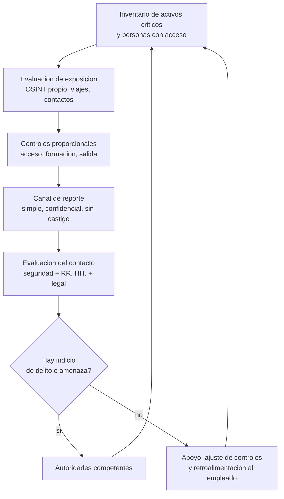

# Clase 378 — Contrainteligencia empresarial y seguridad del personal

> Parte: **21 — Ingeniería social, espionaje y contrainteligencia** · Fuentes: CISA *Insider Threat Mitigation Guide* · NIST SP 800-53 (PS, AT, PM) · SEI/CERT
> ⏱️ Duración estimada: **110 min** · Nivel: **Avanzado**

---

## 🎯 Objetivo

Construir el programa que une todo lo anterior: una **contrainteligencia empresarial** defensiva que identifica los activos que merecen protección, reduce la exposición de las personas que los conocen, detecta acercamientos hostiles y cultiva una cultura en la que reportar es normal. El alumno diseñará un programa proporcional (no un aparato de vigilancia) con protocolos de comunicación y reporte, controles de personal y métricas.

## ⚖️ Nota ética

La contrainteligencia empresarial **no es espionaje contra empleados ni contra competidores**. No incluye infiltrar a nadie, vigilar la vida privada, usar engaños contra terceros ni tomar represalias. Su límite es la ley, la proporcionalidad y la dignidad de las personas. Ante una sospecha concreta, se informa a las autoridades competentes.

## 📚 Resultados de aprendizaje

Al finalizar, el alumno podrá:

1. **Definir** el alcance de la contrainteligencia empresarial y sus fronteras.
2. **Identificar** activos críticos y personas críticas mediante una evaluación de riesgo.
3. **Diseñar** controles de seguridad del personal para todo el ciclo de vida.
4. **Establecer** protocolos de comunicación y reporte que la gente use.
5. **Preparar** a empleados para viajes, eventos y contactos externos.
6. **Medir** la eficacia del programa con indicadores que no premien la sospecha.

## 🗺️ Temas

| # | Tema | Por qué importa |
| --- | --- | --- |
| 1 | Alcance y límites de la contrainteligencia empresarial | Evita abusos y confusión |
| 2 | Activos y personas críticos | Prioriza el esfuerzo |
| 3 | Seguridad del personal: ingreso, cambio, salida | Reduce el riesgo desde el principio |
| 4 | Necesidad de conocer y compartimentación | Limita el daño de cualquier fallo |
| 5 | Protocolos de reporte y comunicación | Convierte la señal en acción |
| 6 | Concienciación, viajes y eventos | Prepara antes de la exposición |
| 7 | Cultura de seguridad | Sostiene todo lo anterior |
| 8 | Colaboración con autoridades y métricas | Cierra el ciclo |

## 🧱 Prerrequisitos

Clases 371–377 y nociones de GRC de la Parte 14.

## 🧠 Explicación en profundidad

### Alcance: proteger, detectar, responder, no perseguir

La contrainteligencia empresarial responde a tres preguntas: *¿qué nos interesaría a un adversario?*, *¿quién y qué lo expone?* y *¿cómo nos enteramos si alguien lo intenta?* Se apoya en tres funciones: **proteger** (reducir exposición y valor de cada persona y activo), **detectar** (reconocer acercamientos, anomalías e indicadores) y **responder** (reportar, contener, apoyar y, si procede, entregar a las autoridades). No incluye perseguir. Una empresa que investiga a terceros por su cuenta o presiona a empleados cruza el límite de la ley y de la ética, y degrada la confianza interna que es su principal fuente de información.

### Joyas de la corona y personas críticas

Todo comienza por un **inventario priorizado**: ¿qué información o capacidad, si se perdiera, dañaría gravemente la ventaja de la empresa o su continuidad? Son las *joyas de la corona*. A cada una se asocia un círculo de personas que la conocen o acceden a ella: autores, administradores, directivos, asistentes, proveedores. Esas personas son **críticas** no por mérito sino por acceso. El inventario permite proporcionalidad: más medidas donde más importa, ninguna medida intrusiva donde no hay valor que proteger. Una consecuencia práctica es que en toda organización las personas críticas incluyen cargos no evidentes: un asistente de dirección ve la agenda, el administrador de sistemas tiene acceso a todo, el abogado conoce operaciones futuras.

### Seguridad del personal en el ciclo de vida

Tres momentos concentran los controles:

- **Ingreso.** Verificación previa proporcional al puesto y a la ley local (identidad, antecedentes relevantes, referencias), acuerdos de confidencialidad y propiedad intelectual, y una inducción que explique políticas y canales de reporte.
- **Cambio.** Revisión de accesos cuando alguien cambia de función, se incorpora a un proyecto sensible o asume una responsabilidad crítica, y reevaluación periódica en puestos de especial riesgo.
- **Salida.** Desactivación inmediata de accesos, recuperación de activos, recordatorio de obligaciones y entrevista de salida que incluya preguntas sobre ofertas y contactos externos, sin presionar.

La verificación previa es útil pero limitada: describe el pasado y no impide que alguien sea abordado después. Por eso la parte más valiosa del ciclo es el **continuo**: la relación de apoyo, el clima laboral, el reporte de contactos.

### Necesidad de conocer y compartimentación

El principio de **necesidad de conocer** (*need-to-know*) establece que una persona accede solo a la información que necesita para su tarea. La **compartimentación** lo lleva a la estructura: los proyectos sensibles tienen su propio perímetro, de modo que quien trabaja en uno no ve el otro. Cuesta eficiencia, por lo que se reserva a los activos críticos. Su beneficio es doble: reduce el número de personas cuya pérdida es grave y hace más fácil detectar accesos anómalos. Un peligro habitual es el *privilegio acumulado*: la persona que cambia de proyecto y conserva el acceso al anterior. Las revisiones periódicas de acceso lo corrigen.

### Protocolos de comunicación y reporte

Una señal que nadie reporta no sirve. Un protocolo de reporte eficaz cumple cinco condiciones: **es simple** (un formulario breve o un contacto directo), **está disponible** (24 horas para eventos en viajes), **es confidencial** (protege a quien informa), **no castiga** (reportar un contacto no es una confesión) y **cierra el círculo** (quien informa recibe una respuesta, aunque sea «gracias, lo evaluamos»). Los criterios de qué se reporta deben describir **conductas** y no sospechas: peticiones de información fuera del rol, ofertas de pago o regalos inusuales, solicitudes de discreción hacia la propia organización, contactos reiterados inesperados, intentos de acceso a áreas o sistemas no autorizados, relaciones que se vuelven personales con alguien externo que pregunta por el trabajo.

Un segundo protocolo, igual de importante, es el de **comunicación segura**: qué canales se usan para qué clase de información, cómo se confirman instrucciones de pago o cambios de proveedor, qué se hace cuando alguien pide saltarse el procedimiento «por urgencia». La verificación por canal independiente (clase 373) es parte de él.

### Preparar viajes, eventos y contactos externos

Los entornos de mayor riesgo son los de exposición social y los de salida de la zona de control: ferias, congresos, viajes, hoteles, aeropuertos y reuniones con socios. Una **sesión previa** (*pre-travel briefing*) cubre qué temas no se tratan, qué dispositivos se llevan (limpios o dedicados), qué cuentas y datos se pueden consultar, qué hacer ante una oferta o un acercamiento inesperado y a quién llamar. Una **sesión posterior** recoge contactos y situaciones, sin juzgar. Esta práctica no supone considerar hostil a un país o a una persona; supone reconocer que la exposición cambia según el lugar y que preparar es más barato que investigar.

### Cultura de seguridad

La cultura de seguridad es la forma habitual de actuar de las personas respecto a la protección, y se sostiene con tres señales: **líderes que cumplen las reglas** (nadie se exime de la verificación), **reconocimiento a quien reporta** (aunque fuera falsa alarma) y **coherencia** entre lo que se dice y lo que se hace (si se pide seguridad, se da tiempo y herramientas para ejercerla). Las organizaciones que humillan a quien cae en una simulación o castigan el reporte de errores consiguen menos reportes y más incidentes.

### Colaboración con autoridades y medición

La contrainteligencia empresarial no sustituye a las autoridades. Una organización debe saber **a quién llamar** (policía, agencia nacional de seguridad, CERT, fiscalía) y **cuándo**: ante amenazas, extorsión, sospecha de espionaje o delito grave. Debe también preservar la evidencia sin contaminarla (clase 380). Para medir, conviene indicadores que no premien la sospecha: porcentaje de personas críticas con formación al día, tiempo medio de respuesta a un reporte, número de contactos reportados y resueltos, porcentaje de accesos revisados en plazo, resultados de simulacros evaluados con criterio educativo. Un indicador como «número de empleados investigados» incentiva la mala práctica.

El diagrama es un ciclo de mejora continua. Se lee desde el inventario hacia la retroalimentación, y subraya que el canal de reporte no termina en una investigación, sino en una decisión que alimenta de nuevo el inventario: un contacto sospechoso puede revelar que cierto activo es más visible de lo que se creía.

## 📔 Glosario

| Término (original) | Traducción | Definición sencilla / formal |
| --- | --- | --- |
| Corporate counterintelligence | Contrainteligencia empresarial | Actividades defensivas de una organización para proteger sus activos y personas de la obtención hostil de información. |
| Crown jewels | Joyas de la corona | Activos cuya pérdida sería más dañina. |
| Need-to-know | Necesidad de conocer | Acceso limitado a lo imprescindible para la tarea. |
| Compartmentation | Compartimentación | División de información o proyectos en perímetros aislados. |
| Vetting | Verificación previa | Comprobación de antecedentes y adecuación al puesto. |
| Pre-travel briefing | Sesión previa a un viaje | Preparación sobre riesgos y conducta antes de viajar. |
| Debriefing | Sesión posterior | Recogida de contactos y situaciones tras un viaje o evento. |
| Security culture | Cultura de seguridad | Modo habitual de actuar respecto a la protección. |
| Red flag | Señal de alerta | Indicio que justifica atención, no una prueba. |
| Privilege creep | Acumulación de privilegios | Permisos que se acumulan al cambiar de función. |

## 🧪 Laboratorio guiado (ejercicio de papel)

Diseña el programa de contrainteligencia de **Helio Tango** (300 empleados, tres joyas de la corona):

1. Elabora un inventario y una lista de diez personas críticas, con su justificación por acceso.
2. Define el ciclo de vida de seguridad del personal en tres columnas (ingreso, cambio, salida).
3. Redacta los criterios de reporte (diez conductas) en lenguaje claro y sin acusación.
4. Diseña un formulario de reporte de una página y un procedimiento de respuesta de 48 horas.
5. Elabora una sesión previa de viaje de 15 minutos para un ingeniero que asistirá a una feria.
6. Propón cinco indicadores de eficacia y descarta dos que fomentarían malas prácticas.

## ✍️ Ejercicios

1. Explica por qué la verificación previa al empleo es necesaria pero insuficiente.
2. Describe tres condiciones de un canal de reporte que la gente usará.
3. Identifica un riesgo de la compartimentación excesiva.
4. Explica por qué «número de empleados investigados» es un mal indicador.
5. Diseña una norma para la persona que recibe una oferta de pago por «consultoría» de un desconocido.

**Respuestas razonadas.** (1) Porque describe el pasado; no previene el acercamiento posterior ni cambios de circunstancias. (2) Simple, confidencial y sin castigo, además de respuesta visible. (3) Reduce la colaboración y crea silos donde nadie detecta anomalías ni cubre ausencias. (4) Premia el número de casos, no su calidad, y presiona a investigar sin indicios. (5) Informar antes de responder, no aceptar pagos ni compromisos y esperar la evaluación del contacto.

## 📝 Rúbrica de evaluación

| Criterio | Insuficiente | Competente | Sobresaliente |
| --- | --- | --- | --- |
| Alcance | Confunde con vigilancia | Define límites | Integra límites legales y éticos |
| Priorización | Protege todo igual | Inventaría activos y personas | Justifica proporcionalidad |
| Reporte | Formulario sin cultura | Canal simple y confidencial | Cierra el círculo y mide su uso |
| Métricas | De castigo | De actividad | De eficacia y confianza |

## ⚠️ Errores comunes

- Confundir contrainteligencia con una unidad de investigación interna.
- Proteger todo por igual y agotar la atención.
- Dar una formación anual y olvidar el reporte continuo.
- Pedir confidencialidad sin proteger al informante.
- No saber a qué autoridad llamar hasta que ocurre el incidente.

## ❓ Preguntas frecuentes

**¿Necesita una pyme un programa así?** Una versión mínima: inventario de activos, mínimo privilegio, proceso de salida, canal de reporte y relación con las autoridades.

**¿Puede la empresa revisar redes sociales de empleados?** Solo dentro de lo que permitan la ley local y una política transparente; la vida privada tiene protección.

**¿Quién dirige el programa?** Un responsable con acceso a la alta dirección y apoyo de RR. HH., legal y TI.

## 🔗 Referencias

- CISA, *Insider Threat Mitigation Guide* — <https://www.cisa.gov/resources-tools/resources/insider-threat-mitigation-guide> — componentes de un programa y ciclo de vida del personal.
- NIST SP 800-53 Rev. 5 — <https://csrc.nist.gov/pubs/sp/800/53/r5/upd1/final> — familias de seguridad del personal (PS), concienciación (AT) y gestión de programa (PM).
- SEI/CERT, *Common Sense Guide to Mitigating Insider Threats* (7.ª ed.) — <https://insights.sei.cmu.edu/library/common-sense-guide-to-mitigating-insider-threats-seventh-edition/> — prácticas de salida de personal y de cultura.
- Christopher Hadnagy, *Social Engineering: The Science of Human Hacking* (2.ª ed.) — defensa organizacional y concienciación.

## 📥 Material descargable

- 📄 [Guía en PDF](./clase-378-guia.pdf) — versión imprimible de esta clase.
- 🎞️ [Presentación (PPTX)](./clase-378-presentacion.pptx) — deck para proyectar en clase.

## ⬅️ Clase anterior

[Clase 377 — Amenazas internas: indicadores, programas y límites](../377-amenazas-internas-indicadores-programas-y-limites/README.md)

## ➡️ Siguiente clase

[Clase 379 — Protección de ejecutivos y personas con acceso estratégico](../379-proteccion-de-ejecutivos-y-personas-con-acceso-estrategico/README.md)
