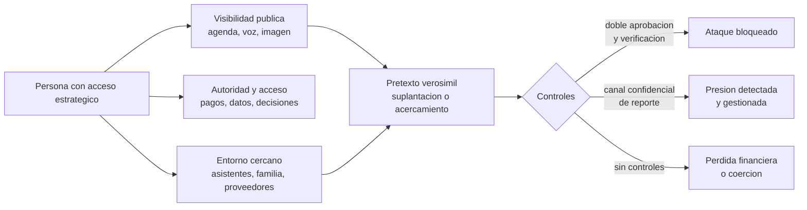

# Clase 379 — Protección de ejecutivos y personas con acceso estratégico

> Parte: **21 — Ingeniería social, espionaje y contrainteligencia** · Fuentes: MITRE ATT&CK · CISA *Insider Threat Mitigation Guide* · FBI IC3
> ⏱️ Duración estimada: **110 min** · Nivel: **Avanzado**

---

## 🎯 Objetivo

Diseñar la protección de las personas cuyo acceso, decisiones o reputación tienen valor estratégico: directivos, fundadores, asistentes, administradores, investigadores clave y quienes viajan o hablan en público. El alumno aprenderá por qué estas personas son objetivos preferentes, qué huella exponen, cómo se reduce sin invadir su vida y cómo se organiza un **apoyo de seguridad que ellos acepten**, porque una protección que el protegido evade no protege.

## ⚖️ Nota ética

La seguridad de ejecutivos toca la vida privada de personas concretas. Todo servicio debe ser **voluntario o contractual, proporcionado, transparente y confidencial**. No incluye vigilar a familiares sin su conocimiento ni investigar relaciones personales como control. Los ejercicios usan personajes ficticios, y los casos reales (clase 381) se tratan sin especular sobre vidas privadas más allá de lo documentado.

## 📚 Resultados de aprendizaje

Al finalizar, el alumno podrá:

1. **Explicar** por qué las personas con acceso estratégico concentran riesgo humano, técnico y físico.
2. **Evaluar** la huella digital de una persona crítica y proponer su reducción.
3. **Diseñar** protocolos para suplantaciones de directivos, comunicación segura y delegados.
4. **Preparar** viajes y eventos con enfoque de riesgo.
5. **Proponer** medidas de protección familiar y de dispositivos personales sin invadir.
6. **Establecer** una relación de confianza para que el ejecutivo reporte contactos y presiones.

## 🗺️ Temas

| # | Tema | Por qué importa |
| --- | --- | --- |
| 1 | Por qué son objetivos | Valor del acceso y de la decisión |
| 2 | Huella digital y exposición | Alimenta pretextos y acercamientos |
| 3 | Suplantación de ejecutivos y fraude del director | La suplantación inversa también es ataque |
| 4 | Dispositivos, cuentas y entorno personal | El atacante entra por el eslabón menos protegido |
| 5 | Viajes, eventos y exposición pública | Cambian el riesgo físico y social |
| 6 | Entorno cercano: asistentes, familia, proveedores | El acceso indirecto es frecuente |
| 7 | Relaciones personales como riesgo de coerción | Se gestiona con confianza, no con control |
| 8 | Reporte, confidencialidad y apoyo | La protección se sostiene en la confianza |

## 🧱 Prerrequisitos

Clases 372, 375 y 378. OSINT de personas (clase 250) y opsec personal (clase 260).

## 🧠 Explicación en profundidad

### Por qué se convierten en objetivo

El valor de un ejecutivo para un adversario es triple. Tiene **conocimiento** (planes, negociaciones, vulnerabilidades), tiene **autoridad** (puede aprobar pagos, abrir accesos, firmar contratos) y tiene **visibilidad** (su imagen, su voz y su agenda son públicas, lo que facilita suplantarlo). A la vez, suele estar sujeto a **presión de tiempo**, viaja, delega y comunica por canales informales, y rara vez tiene el mismo nivel de protección técnica que un sistema de producción. El resultado es un objetivo de gran valor y de bajo coste de acercamiento. El mismo razonamiento se aplica a los asistentes y a los administradores: no son «de rango alto», pero concentran información y accesos.

### La huella como materia prima

Cada información publicada es material para un pretexto o un acercamiento: la agenda de conferencias indica dónde estará; una foto familiar revela colegio, aficiones, lugares; una entrevista expone prioridades; un perfil profesional muestra contactos, proveedores y su vocabulario. Una **evaluación de huella** hace lo que haría un adversario paciente, con las fuentes de la Parte 12, pero con otro propósito: producir una lista priorizada de lo que conviene retirar, restringir o asumir. Se recomienda trabajar tres niveles: **lo que debe desaparecer** (domicilio, matrículas, datos de menores), **lo que puede restringirse** (publicaciones personales) y **lo que no puede ocultarse** (cargo, empresa, apariciones públicas). Para este último nivel, la defensa no es esconder sino **desactivar el uso**: sabiendo que un adversario conoce la agenda pública, el proceso debe impedir que un correo «del director» pueda mover dinero.

### Suplantación del ejecutivo

El esquema más habitual es el **fraude del director** o *CEO fraud*, una forma de BEC (*Business Email Compromise*): el atacante escribe como el ejecutivo a un subordinado de finanzas con una instrucción urgente y confidencial. El informe 2025 del IC3 registra pérdidas por BEC de 3 046 598 558 dólares, frente a 2 770 151 146 en 2024, lo que lo sitúa como uno de los fraudes más costosos que reciben denuncia. Las variantes actuales incorporan voz o vídeo sintéticos. La defensa no depende de detectar el engaño por la calidad técnica, que mejora y se vuelve incierta, sino de que **ninguna instrucción de pago se ejecute por un solo canal**, que existan umbrales con doble aprobación y que los ejecutivos acepten (y celebren) que se les verifique. Existe también la **suplantación inversa**: un tercero que se hace pasar por un empleado ante el ejecutivo para obtener acceso a su atención.

### Dispositivos y cuentas personales

Los atacantes cualificados prefieren el eslabón débil. Para un ejecutivo, es frecuente que sea su **correo personal**, su **teléfono** (con mensajería no gestionada), su **red doméstica**, el dispositivo de un familiar o la cuenta de su asistente. Las medidas son poco espectaculares y eficaces: autenticación resistente al phishing en cuentas críticas, dispositivos actualizados y con gestión, separación entre cuentas personales y laborales, almacenamiento seguro de los códigos de recuperación, revisión de la configuración de privacidad, y un contacto de seguridad al que llamar si algo parece raro. Si la persona usa un dispositivo personal para trabajo, debe haber una política que lo cubra y respete su privacidad.

### Viajes, eventos y exposición física

El viaje combina riesgos técnicos (redes desconocidas, dispositivos que se pierden o se revisan en fronteras) y humanos (conversaciones, acercamientos en hoteles y eventos, invitaciones a cenas). La preparación incluye revisar el perfil de riesgo del destino con fuentes oficiales de viaje, viajar con dispositivos limpios cuando proceda, definir qué se puede y no se puede hablar, acordar protocolos de contacto y un plan de contingencia. En eventos públicos, es útil conocer de antemano quién asistirá y qué actores pueden estar interesados, y acordar con el ejecutivo una *persona de enlace* que filtre las solicitudes.

### El entorno cercano

El adversario pocas veces ataca por la puerta principal. Asistentes ejecutivos, conductores, personal doméstico, familiares, médicos y proveedores de servicios tienen información o acceso. Proteger el entorno significa **informar y ofrecer ayuda**, no controlar. Un asistente que sabe que las solicitudes de agenda externas se verifican y que cuenta con un teléfono directo con seguridad es una barrera mucho mejor que uno sin formación. Y a la familia se le ofrece información voluntaria y práctica (privacidad en redes, qué hacer ante contactos extraños), nunca vigilancia.

### Relaciones personales y riesgo de coerción

Las personas con acceso estratégico son, como todas, seres sociales con vida afectiva. La clase 375 mostró que la intimidad puede usarse como palanca y que la fuerza del chantaje procede del secreto. De ahí una conclusión de diseño que parece paradójica: **la mejor defensa contra la coerción es que no haya nada que el chantajista pueda amenazar con revelar sin que la organización ya lo sepa** o, mejor, que la persona se sienta segura para informar de un acercamiento antes de que se convierta en presión. Esto se consigue con una cultura de confianza, canales confidenciales (a menudo con un profesional externo, abogado o asesor), una promesa creíble de que informar no será castigado de forma desproporcionada, y la distinción entre *un asunto privado* (que la organización no necesita conocer) y *un contacto o presión que afecta a la seguridad* (que sí debe conocer). Quien se acerca a un ejecutivo con intención hostil espera que el silencio le dé ventaja; una cultura de reporte se la quita.

El diagrama muestra que el riesgo nace de tres fuentes (visibilidad, autoridad, entorno), converge en un pretexto verosímil y solo tiene tres desenlaces según los controles. Hace explícito que las medidas relevantes no son sobre «ocultar al ejecutivo», sino sobre **verificar sus órdenes** y **hacer posible el reporte**.

### Un servicio, no una vigilancia

La protección de ejecutivos tiene éxito cuando la persona la percibe como un apoyo. Las prácticas que ayudan son: un único punto de contacto de confianza, soluciones sin fricción (gestores de contraseñas, llaves de seguridad, dispositivos ya configurados), reuniones breves de actualización de riesgos, y una comunicación que explique el porqué de cada medida. Y siempre una regla: las excepciones solicitadas por el ejecutivo se registran y se revisan; la autoridad no exime de los controles, los refuerza.

## 📔 Glosario

| Término (original) | Traducción | Definición sencilla / formal |
| --- | --- | --- |
| Executive protection | Protección de ejecutivos | Conjunto de medidas físicas, digitales y de proceso para personas de alto valor. |
| CEO fraud | Fraude del director | BEC que suplanta a un directivo para ordenar una acción financiera. |
| BEC (Business Email Compromise) | Compromiso de correo empresarial | Fraude que usa correo suplantado o tomado para inducir pagos o cambios. |
| Digital footprint | Huella digital | Rastro de información de una persona en línea. |
| Deepfake | Contenido sintético de persona | Voz o vídeo generados por IA que imitan a alguien. |
| Dual approval | Doble aprobación | Acción que exige dos personas independientes. |
| Liaison | Persona de enlace | Intermediario que filtra solicitudes a un ejecutivo. |
| Clean device | Dispositivo limpio | Equipo sin datos innecesarios, usado en viajes de riesgo. |
| Duress | Presión o coacción | Situación en que una persona actúa forzada. |

## 🧪 Laboratorio guiado (ejercicio de papel)

Personaje ficticio: **Irene Valdés**, directora general de Helio Tango, con asistente **Tomás**.

1. Elabora, con fuentes ficticias, una evaluación de huella de Irene en tres niveles (retirar, restringir, asumir).
2. Redacta el protocolo de verificación para cualquier instrucción de pago atribuida a Irene.
3. Diseña la preparación de un viaje de Irene a una feria en el extranjero.
4. Redacta una nota de una página para Tomás sobre cómo tratar solicitudes externas de agenda.
5. Diseña un canal confidencial para que Irene informe de un acercamiento sin que lo conozca toda la empresa.

## ✍️ Ejercicios

1. Explica por qué los asistentes son parte de la protección ejecutiva.
2. Argumenta por qué la detección técnica de un deepfake no debe ser la única defensa.
3. Justifica la regla «las excepciones del ejecutivo se registran».
4. Diferencia asunto privado y asunto de seguridad en una relación personal.
5. Propón tres indicadores de que el servicio de protección es aceptado.

**Respuestas razonadas.** (1) Porque tienen agenda, correo y accesos delegados. (2) Porque los modelos mejoran y la detección puede fallar; el proceso de doble aprobación resiste aunque el engaño sea perfecto. (3) Para que la autoridad no erosione los controles y para detectar patrones. (4) El primero no afecta a la seguridad ni a la organización; el segundo implica presión, acceso o contacto que sí. (5) Uso voluntario de las herramientas, reportes proactivos y solicitud de ayuda ante situaciones nuevas.

## 📝 Rúbrica de evaluación

| Criterio | Insuficiente | Competente | Sobresaliente |
| --- | --- | --- | --- |
| Riesgo | Genérico | Identifica visibilidad y autoridad | Incluye entorno y relaciones |
| Huella | Pide ocultar todo | Clasifica en tres niveles | Convierte lo no ocultable en control de proceso |
| Suplantación | Entrena a detectar | Doble aprobación | Combina proceso, cultura y tecnología |
| Respeto | Vigila | Informa | Diseña servicio voluntario y confidencial |

## ⚠️ Errores comunes

- Proteger solo al ejecutivo y olvidar su entorno.
- Exigir que la persona «tenga cuidado» sin darle herramientas.
- Aceptar excepciones al proceso de pago por rango.
- Confundir seguridad con control de la vida privada.
- Dejar el canal de reporte sin confidencialidad real.

## ❓ Preguntas frecuentes

**¿Se debe eliminar toda presencia pública?** No; es imposible y no deseable. Se retira lo innecesario y se diseñan controles para lo que permanece.

**¿Qué hago si recibo un mensaje de voz de mi jefe que pide una transferencia?** Verifica por otro canal registrado y aplica la doble aprobación.

**¿La empresa puede revisar la vida privada del ejecutivo?** No, salvo base legal y consentimiento; puede ofrecer asesoría y herramientas.

## 🔗 Referencias

- FBI IC3, *Internet Crime Report 2025* — <https://www.ic3.gov/AnnualReport/Reports/2025_IC3Report.pdf> — pérdidas por BEC (2025: $3 046 598 558; 2024: $2 770 151 146) y uso de IA en fraude.
- MITRE ATT&CK, técnica T1566 *Phishing* — <https://attack.mitre.org/techniques/T1566/> — acceso inicial mediante ingeniería social dirigida.
- MITRE ATT&CK, técnica T1591 *Gather Victim Org Information* — <https://attack.mitre.org/techniques/T1591/> — información de organización y personas usada en pretextos.
- CISA, *Recognize and Report Phishing* — <https://www.cisa.gov/secure-our-world/recognize-and-report-phishing> — guía pública de reconocimiento y reporte.
- CISA, *Insider Threat Mitigation Guide* — <https://www.cisa.gov/resources-tools/resources/insider-threat-mitigation-guide> — gestión de riesgo de personas con acceso privilegiado.

## 📥 Material descargable

- 📄 [Guía en PDF](./clase-379-guia.pdf) — versión imprimible de esta clase.
- 🎞️ [Presentación (PPTX)](./clase-379-presentacion.pptx) — deck para proyectar en clase.

## ⬅️ Clase anterior

[Clase 378 — Contrainteligencia empresarial y seguridad del personal](../378-contrainteligencia-empresarial-y-seguridad-del-personal/README.md)

## ➡️ Siguiente clase

[Clase 380 — Investigación de incidentes humanos, ética y legalidad](../380-investigacion-de-incidentes-humanos-etica-y-legalidad/README.md)
