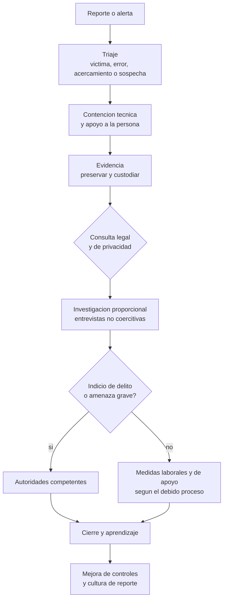

# Clase 380 — Investigación de incidentes humanos, ética y legalidad

> Parte: **21 — Ingeniería social, espionaje y contrainteligencia** · Fuentes: NIST SP 800-61 · NIST SP 800-86 · GDPR · Dictamen WP249
> ⏱️ Duración estimada: **120 min** · Nivel: **Avanzado**

---

## 🎯 Objetivo

Aprender a gestionar un incidente donde el protagonista es una persona —engañada, presionada, sospechosa o víctima—: cómo se recibe un reporte, se preserva la evidencia, se entrevista, se coordina con RR. HH., legal y autoridades, se protege a las personas y se cierra con aprendizaje. El eje es la **legalidad y la ética**: lo que hace legítima una investigación es tanto su método como sus límites.

## ⚖️ Nota ética

Esta clase **no es asesoría jurídica**. Las leyes laborales, penales y de protección de datos varían por país y cambian. El alumno debe consultar con asesoría legal local antes de cualquier medida sobre personas. Se rechazan métodos de presión, engaño contra empleados, vigilancia encubierta no autorizada o represalias. Las pruebas de ingeniería social sobre personas reales exigen autorización formal y salvaguardas (sección «Pruebas autorizadas»).

## 📚 Resultados de aprendizaje

Al finalizar, el alumno podrá:

1. **Estructurar** la respuesta a un incidente humano: triaje, contención, investigación, comunicación y cierre.
2. **Preservar** evidencia con cadena de custodia sin vulnerar derechos.
3. **Conducir** entrevistas no coercitivas con propósito claro y registro adecuado.
4. **Coordinar** a seguridad, RR. HH., legal, privacidad y dirección.
5. **Decidir** cuándo y cómo informar a las autoridades.
6. **Aplicar** principios de legalidad, proporcionalidad, presunción de inocencia y protección de datos.

## 🗺️ Temas

| # | Tema | Por qué importa |
| --- | --- | --- |
| 1 | Tipos de incidente humano | Cada uno exige un camino distinto |
| 2 | Recepción del reporte y triaje | El primer minuto condiciona todo |
| 3 | Contención y apoyo a las personas | Protege a víctimas y a la investigación |
| 4 | Evidencia y cadena de custodia | Sin ellas, nada se sostiene |
| 5 | Entrevistas | El método define la validez |
| 6 | Coordinación y comunicación | Evita errores y filtraciones |
| 7 | Legalidad, privacidad y derechos | Condiciones de legitimidad |
| 8 | Pruebas autorizadas de ingeniería social | Ética de la simulación |
| 9 | Cierre y aprendizaje | Mejora los controles |

## 🧱 Prerrequisitos

Clases 377–379, Parte 9 (forense y respuesta a incidentes) y nociones de privacidad de la Parte 14.

## 🧠 Explicación en profundidad

### Incidentes humanos: no todos son iguales

Un incidente humano puede ser: (a) una **persona engañada** que entregó credenciales o dinero; (b) una **persona acosada o extorsionada** que pide ayuda; (c) una **persona que reporta un acercamiento** sospechoso; (d) un **empleado sospechoso** de sustraer o filtrar información; (e) un **error** sin intención. El error más común es dar el mismo tratamiento a todos: investigar como a un sospechoso a quien fue víctima o apoyar como a una víctima a quien hizo daño deliberado. La primera tarea del triaje es, por eso, **clasificar sin prejuzgar**: ¿qué se sabe, de quién procede la información, qué daño es posible y qué urge proteger?

### Recepción del reporte y triaje

Quien reporta debe recibir una respuesta humana y rápida. El primer contacto recoge **hechos** (qué ocurrió, cuándo, por qué canal, qué se entregó), preserva lo que existe (mensajes, números, capturas) y asegura a la persona que reportar fue lo correcto. El triaje decide prioridad y ruta. NIST SP 800-61 Rev. 3 sitúa la respuesta a incidentes dentro de la gestión de riesgos de ciberseguridad (detección, respuesta y recuperación) y es un buen marco para estructurar roles y tiempos; en incidentes humanos añade una dimensión que los marcos técnicos tratan poco: **el cuidado de la persona**.

### Contención y apoyo

La contención tiene un componente técnico (bloquear cuentas, revocar tokens, aislar dispositivos, detener pagos, avisar al banco) y uno humano. El humano incluye apoyo emocional, asesoría legal si hay extorsión, protección de la identidad del informante y medidas de seguridad personal cuando existen amenazas. Una contención que humilla o castiga a quien cayó desalienta el reporte en el futuro y produce incidentes silenciosos. Cuando hay sospecha de acción deliberada, la contención incluye restringir accesos de forma discreta y proporcionada hasta evaluar, siempre con respaldo legal y de RR. HH.

### Evidencia y cadena de custodia

Si el incidente puede derivar en procesos disciplinarios o judiciales, la evidencia debe conservarse de modo que pueda usarse: **identificar** qué existe, **preservar** sin alterar (copias forenses, registros con sellado de tiempo), **documentar** quién la manejó y cuándo (cadena de custodia), y **limitar el acceso**. NIST SP 800-86 describe las fases de la investigación forense (recolección, examen, análisis, informe) y subraya que el método influye en la admisibilidad. Un error típico es que un directivo, con buena intención, revise por su cuenta el correo o el equipo de un empleado y contamine la evidencia o vulnere derechos. Debe existir un procedimiento y una única vía de acceso a los datos, autorizada por quien tiene competencia legal.

### Entrevistas

Una entrevista tiene como objetivo **obtener información fiable**, no una confesión. Se prepara (qué se sabe, qué falta, qué documentos), se informa a la persona de su propósito y derechos (según la normativa local, puede ser relevante la asistencia de un representante), se hace con un trato respetuoso y preguntas abiertas, y se registra con transparencia. Se evitan las amenazas, las promesas falsas, la presión por cansancio o por intimidación y el engaño sobre las consecuencias: además de poco éticos, producen declaraciones poco fiables y exponen a la organización. La víctima de una estafa no se interroga: se le escucha. La separación entre el equipo que apoya y el que investiga evita confundir roles.

### Coordinación y comunicación

Los incidentes humanos exigen una mesa mínima: **seguridad** (técnica y de personas), **RR. HH.** (derechos laborales, apoyo), **legal** (obligaciones, riesgos, evidencia), **privacidad** (datos personales), **dirección** (decisiones) y, si procede, **comunicaciones**. Los acuerdos clave son: quién decide, qué se comparte y con quién (principio de necesidad de conocer también dentro de la investigación), cómo se protegen la identidad del informante y la presunción de inocencia, y cuándo se escala a las autoridades. La comunicación interna debe ser sobria: se informa de lo imprescindible, sin nombres ni especulaciones. La externa (clientes, prensa) se coordina para no atribuir ni acusar: se habla de hechos confirmados, de acciones tomadas y de lo que se desconoce.

### Cuándo informar a las autoridades

La decisión depende del delito, de la ley local y del riesgo. Hay situaciones en que informar es obligatorio (por ejemplo, ciertos incidentes de datos personales o de infraestructuras críticas en algunas jurisdicciones) y otras en que es prudente: extorsión, amenazas, sospecha de espionaje, fraude significativo. Las autoridades tienen capacidades y garantías que la empresa no tiene. Tras informar, la organización coopera, conserva evidencia y evita acciones por su cuenta que contaminen la investigación (confrontar al sospechoso, contactar a terceros sospechosos).

### Legalidad, privacidad y derechos

Cuatro principios ordenan las decisiones. **Legalidad:** toda medida necesita una base jurídica (contrato, ley, consentimiento, interés legítimo documentado). **Proporcionalidad:** la medida debe ser adecuada, necesaria y la menos intrusiva posible; el Dictamen WP249 del Grupo de Trabajo del Artículo 29 aplica este criterio al monitoreo laboral. **Transparencia:** los empleados deben conocer, en lo posible, qué se monitoriza y con qué fin. **Presunción de inocencia y debido proceso:** nadie es culpable por una alerta; se oye a la persona, se valoran las pruebas y se decide con criterios documentados. El Reglamento General de Protección de Datos añade obligaciones de minimización, limitación de la finalidad, seguridad y plazos de conservación. A ello se suman, según el país, normas laborales (derecho a la intimidad, límites a revisión de comunicaciones), de secretos de empresa y de delitos informáticos. **Nada en esta parte autoriza a acceder a cuentas ajenas, intervenir comunicaciones o usar identidades falsas contra personas** fuera de un marco legal expreso.

### Pruebas autorizadas de ingeniería social

Una simulación sobre personas reales (phishing simulado, llamadas de prueba, intentos de acceso físico) se justifica por su valor educativo y debe proteger a los participantes. Requiere: **autorización escrita** del titular de la organización, **alcance** claro, **reglas de enfrentamiento**, **contacto de escalado** localizable, **exclusión** de personas vulnerables o en circunstancias delicadas, **minimización** de datos, **prohibición** de capturar secretos o credenciales reales, **parada inmediata** si hay daño, y **reunión de resultados** sin exposición individual humillante. Los escenarios no deben usar temas que exploten dolor real (enfermedades, despidos, duelos, deudas). La medida del éxito es la mejora de la detección y el reporte, no el número de caídas. Estas condiciones se desarrollan en la clase 258.

### Cierre y aprendizaje

Un incidente concluye cuando se han restituido los daños, protegido a las personas, documentado lo ocurrido, informado a quien debía saberlo y **corregido el sistema** que lo permitió. La revisión posterior pregunta por el proceso, no por culpables: qué señales hubo, qué control faltó o falló, cuánto tardó el reporte, qué apoyo recibieron las personas. Y se actualizan los controles de las clases anteriores: reglas de verificación, canales de reporte, formación, accesos.

El diagrama destaca dos compuertas de decisión —la legal y la de indicio de delito— que **ordenan las acciones**: nada de lo que implica intrusión se hace antes de la consulta legal, y el paso a las autoridades es una salida explícita. El ciclo termina en mejora, no en castigo, que es lo que hace sostenible el reporte.

## 📔 Glosario

| Término (original) | Traducción | Definición sencilla / formal |
| --- | --- | --- |
| Chain of custody | Cadena de custodia | Registro de quién manejó la evidencia y cuándo. |
| Triage | Triaje | Clasificación inicial para decidir prioridad y ruta. |
| Due process | Debido proceso | Garantías procedimentales antes de una decisión que afecte derechos. |
| Presumption of innocence | Presunción de inocencia | Nadie es culpable hasta que se pruebe. |
| Proportionality | Proporcionalidad | La medida es adecuada, necesaria y la menos intrusiva. |
| Data minimisation | Minimización de datos | Tratar solo los datos necesarios. |
| Rules of engagement | Reglas de enfrentamiento | Límites acordados de una prueba autorizada. |
| Legal hold | Retención legal | Orden de conservar datos por razón jurídica. |
| Whistleblower | Informante | Persona que comunica irregularidades de buena fe. |
| Lessons learned | Lecciones aprendidas | Revisión posterior para mejorar procesos. |

## 🧪 Laboratorio guiado (ejercicio de papel)

Escenario ficticio: Ana Rojas informa que «Rafael» le pidió, tras un mes de chat, datos sobre los bancos de Helio Tango y que dos días después recibió una amenaza de difundir fotos suyas.

1. Clasifica el incidente (¿víctima, acercamiento, sospecha?) y define las acciones de la primera hora.
2. Elabora la lista de evidencia a preservar y el modo de hacerlo.
3. Redacta el guion de una conversación de apoyo (no interrogatorio) con Ana.
4. Define quién participa en la mesa de decisión y qué información recibe cada cual.
5. Decide si se informa a las autoridades y justifica tu respuesta con el tipo de delito.
6. Redacta tres lecciones aprendidas que modifiquen un control concreto.

## ✍️ Ejercicios

1. Explica por qué no debe interrogarse a una víctima de extorsión.
2. Enumera tres condiciones para que una prueba de ingeniería social sea éticamente aceptable.
3. Explica por qué la cadena de custodia importa también cuando no hay juicio previsto.
4. Argumenta por qué la comunicación interna no debe incluir nombres.
5. Indica qué principio vulnera la revisión secreta del correo de un empleado sin base jurídica.

**Respuestas razonadas.** (1) Porque su rol es el de víctima; el interrogatorio la revictimiza y la disuade de colaborar; se le escucha y se le apoya. (2) Autorización escrita, minimización/protección de las personas y parada inmediata ante daño. (3) Porque los incidentes pueden escalar y porque disciplina la práctica; sin custodia es difícil probar qué ocurrió. (4) Protege la presunción de inocencia, la privacidad y la cooperación. (5) Legalidad y transparencia (y probablemente proporcionalidad).

## 📝 Rúbrica de evaluación

| Criterio | Insuficiente | Competente | Sobresaliente |
| --- | --- | --- | --- |
| Clasificación | Trata a todos igual | Distingue tipos | Adapta la ruta y protege a cada parte |
| Evidencia | Improvisa | Preserva y documenta | Integra custodia y límites legales |
| Entrevista | Busca confesión | Respeta y prepara | Separa apoyo e investigación |
| Legalidad | La ignora | Aplica principios | Identifica puntos de consulta y límites |

## ⚠️ Errores comunes

- Dejar que un directivo revise por su cuenta cuentas o equipos de un empleado.
- Confundir sospecha con culpa y comunicar nombres.
- Presionar a una víctima para que «aclare» su responsabilidad.
- Informar a las autoridades tarde y después de confrontar al sospechoso.
- Cerrar sin corregir el proceso que permitió el incidente.

## ❓ Preguntas frecuentes

**¿Puedo grabar una entrevista?** Depende de la ley local y del consentimiento; consulta a asesoría legal.

**¿Debo despedir a quien cayó en un fraude?** No como regla; se evalúa conducta, negligencia grave y política, con proporcionalidad.

**¿Cuándo es obligatorio notificar una violación de datos personales?** Depende de la jurisdicción; en la Unión Europea el RGPD impone plazos y condiciones.

## 🔗 Referencias

- NIST SP 800-61 Rev. 3 — <https://doi.org/10.6028/NIST.SP.800-61r3> — ciclo de respuesta a incidentes integrado en la gestión de riesgos.
- NIST SP 800-86, *Guide to Integrating Forensic Techniques into Incident Response* — <https://csrc.nist.gov/pubs/sp/800/86/final> — fases de la investigación forense y valor de la evidencia.
- Reglamento (UE) 2016/679 (RGPD) — <https://eur-lex.europa.eu/eli/reg/2016/679/oj> — principios de licitud, minimización, limitación de la finalidad y notificación de brechas.
- Grupo de Trabajo del Artículo 29, Dictamen 2/2017 (WP249) — <https://ec.europa.eu/justice/article-29/documentation/opinion-recommendation/files/2017/wp249_en.pdf> — proporcionalidad y transparencia en el tratamiento de datos en el trabajo.
- Christopher Hadnagy, *Social Engineering: The Science of Human Hacking* (2.ª ed.) — marco ético de las pruebas de ingeniería social autorizadas.

## 📥 Material descargable

- 📄 [Guía en PDF](./clase-380-guia.pdf) — versión imprimible de esta clase.
- 🎞️ [Presentación (PPTX)](./clase-380-presentacion.pptx) — deck para proyectar en clase.

## ⬅️ Clase anterior

[Clase 379 — Protección de ejecutivos y personas con acceso estratégico](../379-proteccion-de-ejecutivos-y-personas-con-acceso-estrategico/README.md)

## ➡️ Siguiente clase

[Clase 381 — Caso NVIDIA y análisis comparado (capstone)](../381-caso-nvidia-y-analisis-comparado-capstone/README.md)
