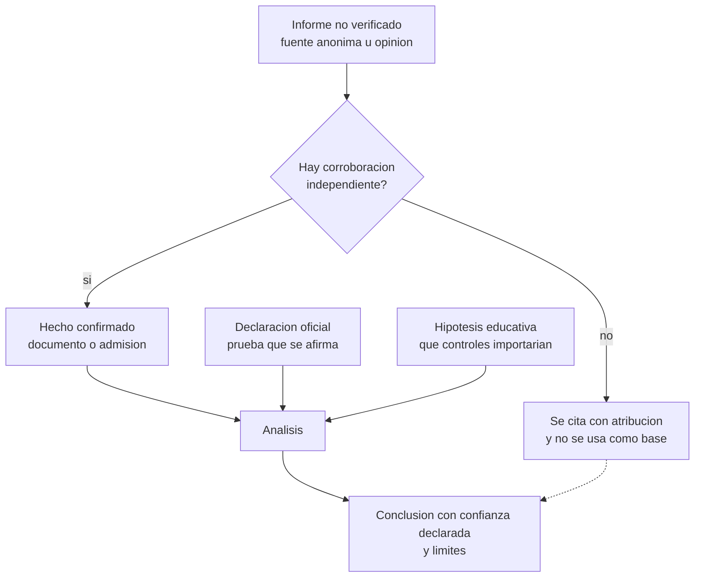

# Clase 381 — Caso NVIDIA y análisis comparado (capstone)

> Parte: **21 — Ingeniería social, espionaje y contrainteligencia** · Fuentes: comunicado de la junta de NVIDIA (8-nov-2026) · prensa con atribución · Departamento de Justicia de EE. UU. · CIA *Studies in Intelligence*
> ⏱️ Duración estimada: **150 min** · Nivel: **Avanzado**

---

## 🎯 Objetivo

Aplicar todo el bloque a un caso vivo y a varios históricos sin cometer los errores que el bloque enseñó a evitar: confundir acusación con prueba, relato con evidencia e hipótesis con hecho. El alumno producirá un **análisis comparado** que separa hechos confirmados, declaraciones oficiales, afirmaciones no verificadas e hipótesis educativas, y propondrá controles aplicables a cualquier organización, no a una persona concreta.

## ⚖️ Nota ética y de veracidad (léela primero)

El caso NVIDIA de noviembre de 2026 **sigue abierto** y se desarrolla mientras se escribe esta clase (la información se recopiló hasta el **12 de noviembre de 2026**). Contiene personas reales a las que no se acusa de delito alguno aquí. Esta clase no afirma que alguien haya cometido espionaje, ni que información de NVIDIA se haya comprometido: lo único que la junta de la empresa declaró es lo contrario («no hay razón para creer» que se comprometió seguridad nacional o información confidencial), y una investigación independiente está en curso. Lo que aquí se hace es **estudiar un patrón de riesgo** con el material público disponible. Antes de citar cualquier dato, verifica su estado actual: pueden existir novedades posteriores a esta redacción, incluidas discrepancias en prensa sobre la situación del cargo del director ejecutivo.

## 📚 Resultados de aprendizaje

Al finalizar, el alumno podrá:

1. **Clasificar** cada afirmación de un caso como hecho confirmado, declaración oficial, acusación o informe no verificado, e hipótesis educativa.
2. **Aplicar** la matriz de análisis (contexto, actores, objetivos atribuidos, evidencia, mecanismo, consecuencias, señales, medidas, preguntas, lecciones).
3. **Comparar** el caso con otros documentados (Leung, ilegales rusos, Farewell, Ding) identificando semejanzas y diferencias.
4. **Derivar** controles aplicables a cualquier organización con ejecutivos y relaciones comerciales sensibles.
5. **Redactar** una conclusión profesional con confianza declarada y límites.
6. **Reconocer** cómo se contamina el análisis con titulares, opiniones y analogías.

## 🗺️ Temas

| # | Tema | Por qué importa |
| --- | --- | --- |
| 1 | Reglas de análisis de un caso abierto | Disciplina epistémica |
| 2 | Cronología y estado de cada afirmación | Distingue lo que se sabe |
| 3 | Mecanismo conceptual: relación, acceso e influencia | Conecta con las clases 372–375 |
| 4 | Dimensión comercial y regulatoria | Evita reducir el caso a lo personal |
| 5 | Casos comparables | Contexto histórico y modernidad |
| 6 | Señales y controles aplicables | Utilidad para el defensor |
| 7 | Preguntas de análisis | Entrenan el juicio |
| 8 | Proyecto integrador | Evidencia de aprendizaje |

## 🧱 Prerrequisitos

Todo el bloque 371–380. Especialmente 375 (relaciones), 376 (espionaje tecnológico) y 379 (protección de ejecutivos).

## 🧠 Explicación en profundidad

### Regla de oro: cuatro cajones

Ante un caso de este tipo se clasifica cada frase en uno de cuatro cajones. **Hecho confirmado:** lo sustenta un documento primario, una resolución, una admisión o un registro verificable. **Declaración oficial:** lo que una parte afirma, que prueba que lo afirma y no que sea cierto. **Acusación o informe no verificado:** lo que una fuente anónima, un opinador o un medio atribuye sin corroboración independiente. **Hipótesis educativa:** una construcción nuestra para pensar qué controles importarían; no describe lo que ocurrió. Esta disciplina no es un trámite: el caso NVIDIA mezcla en pocos días los cuatro cajones, y la tentación de escribir un relato coherente es fuerte.

### Qué se sabe y quién lo dice (a 12 de noviembre de 2026)

| Afirmación | Cajón | Fuente y matiz |
| --- | --- | --- |
| La junta de NVIDIA anunció el 8 de noviembre una investigación independiente tras informes de que su fundador y director ejecutivo, Jensen Huang, fue objetivo de un esfuerzo de inteligencia extranjera | Declaración oficial | Comunicado de la junta: la supervisa un comité de directores independientes con asesoría externa |
| La junta afirmó que «no hay razón para creer» que se hayan comprometido la seguridad nacional o información confidencial de NVIDIA, que respalda a Huang y que este colabora | Declaración oficial | Mismo comunicado; es una posición de la empresa, y la investigación continúa |
| Huang reconoció ante la junta una relación íntima con una ejecutiva de Megaspeed, empresa de Singapur cliente de NVIDIA, y pidió disculpas públicas por su infidelidad | Hecho reconocido, según prensa | Fox Business (9-nov) y otros medios que citan al *New York Times*; las fechas exactas varían entre medios |
| La ejecutiva fue descrita por la prensa como presunto contacto del servicio de inteligencia chino (MSS) | Acusación / informe no verificado | Se atribuye a fuentes anónimas y a evaluaciones no públicas; no hay documento público que la pruebe |
| El Ministerio de Exteriores de China calificó la acusación de infundada y de «difamación» | Declaración oficial | Portavoz, 9-nov, según agencias y prensa |
| Megaspeed ha sido objeto de investigaciones por supuesta desviación de chips avanzados; NVIDIA afirma que acusaciones previas fueron investigadas y descartadas | Informe no verificado / declaración de parte | Varias notas de prensa; el estado de las investigaciones no es público |
| Existirían otros ejecutivos objetivo de operaciones similares («al menos 20», según un exjefe de estación de la CIA citado en una columna de opinión) | Afirmación no corroborada | Fuente única; opinión; no se usa como dato |
| Hubo una advertencia interagencial en 2026 y se había informado a la Presidencia | Informe atribuido | Columna de opinión de D. Ignatius, que cita fuentes; no verificado por documentos |
| Comités del Congreso pidieron a Huang una sesión informativa cerrada | Informe de prensa | Solicitud, no citación judicial |
| Una demanda de accionistas alegaría que se engañó a inversores | Informe de prensa | Alegaciones de parte demandante |

La tabla muestra algo más importante que cada fila: **lo confirmado es poco** y se refiere a hechos humanos (una relación reconocida) y a declaraciones; lo que da al caso su gravedad —que la relación fuera una operación de un servicio extranjero y que hubiera consecuencias para la información o las políticas— está en los otros cajones. Un análisis honesto lo dice.

### El mecanismo, en abstracto

Si, como hipótesis educativa, se aceptara que una relación íntima con una persona vinculada a una operación pudiera ser un canal de influencia, los conceptos del bloque ofrecen un vocabulario: **captación** (clase 374: identificar, evaluar, desarrollar), **honey trap** como canal más que como chantaje (clase 375: la relación sostenida da acceso aunque no haya coerción), **explotación de un conflicto de interés** (la persona tendría una relación personal con alguien vinculado a un cliente en una etapa de decisiones comerciales sensibles) y **exposición** (clase 379: agenda, viajes y eventos públicos que permiten encontrar al objetivo). Conviene subrayar una discusión que la clase 375 prepara: la fuerza de esta clase de operaciones no es siempre el chantaje; puede ser el **acceso sostenido**. Que no se hubiera documentado una coerción no demuestra ausencia de influencia, ni su presencia; simplemente deja la pregunta sin responder.

### La dimensión comercial y regulatoria

Un error de lectura frecuente es reducir el caso a lo personal. El contexto es industrial y regulatorio: los chips de IA de gama alta están sujetos a controles de exportación de Estados Unidos, los distribuidores y clientes intermedios han sido investigados en diversas ocasiones y las decisiones sobre a quién se vende, cuánto y con qué verificaciones tienen consecuencias económicas y de seguridad nacional. Para un defensor, la lección es que **las personas con poder de decisión sobre activos regulados son, por razón de su cargo, un objetivo de influencia legítima e ilegítima**, y que la protección debe cubrir tanto el secreto (diseños) como la decisión (a quién se vende, qué se aprueba). Un secreto técnico puede no haberse filtrado y aun así haber habido interés en condicionar una decisión.

### Casos comparables

| Caso | Hechos documentados | Lo que no está probado | Lección principal |
| --- | --- | --- | --- |
| **Katrina Leung / James J. Smith** (EE. UU., principios de los 2000) | Relación íntima entre colaboradora y su manejador en el FBI; Smith se declaró culpable de mentir al FBI y recibió libertad condicional; los cargos contra Leung fueron desestimados por la conducta del Gobierno | Que Leung fuera doble agente: se alegó, no se probó en juicio | Una relación personal en la cadena de manejo es un riesgo de integridad; una acusación no es una condena |
| **Ilegales rusos** (EE. UU., 2010) | Diez personas detenidas por actuar como agentes no declarados; se declararon culpables y fueron intercambiadas | La magnitud real de lo obtenido | Operaciones de largo plazo con identidades falsas existen y se detectan con contrainteligencia |
| **Farewell Dossier** (Guerra Fría, 1981) | Un coronel soviético reveló una red de adquisición tecnológica; hay relato de un participante en un estudio de la CIA | Efectos concretos de la tecnología manipulada | La contrainteligencia ofensiva puede invertir una red; los relatos de participantes no son pruebas independientes |
| **Linwei Ding / Google** (EE. UU., 2022–2026) | Veredicto de 29-ene-2026: 14 cargos (7 por § 1831, 7 por § 1832); más de dos mil páginas sustraídas por un empleado con acceso | La pena; los pormenores del destino final | El insider con acceso legítimo es el canal más común; la detección llegó tras la sustracción |
| **NVIDIA** (2025–2026, abierto) | Relación reconocida; investigación independiente en curso; declaración de que no hay razón para creer que se comprometieron secretos | Que fuera operación de inteligencia; consecuencias para secretos o políticas | Separar relación, atribución y daño; el riesgo existe aunque no se pruebe el daño |

Observa lo que la tabla permite ver: en ningún caso la **atribución completa** (quién, para quién, con qué resultado) estaba a la vista cuando se publicó la primera noticia. Leung, por ejemplo, ilustra además un riesgo de sentido contrario: que el sistema judicial no logre probar lo que el público da por sentado.

El diagrama es la regla de oro de la clase en forma de flujo: solo los hechos confirmados y las declaraciones (como declaraciones) alimentan el análisis; lo no verificado queda a la vista pero fuera de la base, y las hipótesis se etiquetan. La conclusión resultante lleva su confianza y sus límites, que es lo que distingue un análisis profesional de una opinión.

### Señales de riesgo y controles (aplicables a cualquier organización)

Sin presumir nada del caso, el bloque permite listar **señales de riesgo** que cualquier compañía puede vigilar: relaciones personales no declaradas entre decisores y representantes de clientes, proveedores o distribuidores; exposición pública de agenda y viajes; decisiones comerciales críticas concentradas en una sola persona; ausencia de un canal confidencial para informar contactos; falta de sesiones informativas defensivas para ejecutivos con acceso estratégico; y gobierno que no separe a quien decide de quien verifica. Los **controles** correspondientes: política de declaración de relaciones y conflictos de interés con rutas confidenciales y no punitivas (clases 375 y 378); doble aprobación y segregación en decisiones sobre clientes de riesgo regulatorio (clase 377); protección del ejecutivo y de su entorno (clase 379); sesiones informativas con autoridades competentes cuando existan; gobierno de la junta con un comité que pueda investigar de manera independiente (el ejemplo, en este caso, de lo que la junta de NVIDIA anunció); y una comunicación pública prudente, que no atribuya ni especule (clase 380).

### Preguntas de análisis

1. ¿Qué parte del caso es hecho y cuál declaración? ¿Qué cambiaría si la investigación independiente concluyera algo distinto?
2. ¿Por qué «no hay razón para creer que se comprometieron secretos» no equivale a «no hubo riesgo»?
3. ¿Qué distingue un conflicto de interés declarado de uno oculto, y qué sistema habría convertido uno en el otro?
4. ¿Qué diferencia hay entre el acceso sostenido y la coerción como mecanismo de influencia? ¿Cuál es más difícil de detectar?
5. ¿Qué evidencia necesitaría un analista profesional antes de atribuir una operación a un servicio de inteligencia?
6. ¿Qué papel juegan los incentivos de los medios, de las partes y de los comentaristas en la forma en que se cuenta el caso?

## 📔 Glosario

| Término (original) | Traducción | Definición sencilla / formal |
| --- | --- | --- |
| Attribution | Atribución | Asignar una operación a un actor con evidencia y nivel de confianza. |
| Confidence level | Nivel de confianza | Grado declarado de certeza de un juicio analítico. |
| Alleged | Presunto | Afirmado sin probar. |
| Unverified report | Informe no verificado | Información sin corroboración independiente. |
| Official statement | Declaración oficial | Posición formal de una parte. |
| Defensive briefing | Sesión informativa defensiva | Información de autoridades a un objetivo potencial sobre amenazas. |
| Export controls | Controles de exportación | Reglas que limitan la venta de ciertos productos o tecnologías. |
| MSS | Ministerio de Seguridad del Estado (China) | Servicio de inteligencia civil de China. |
| Independent committee | Comité independiente | Directores sin vínculo con la gestión que supervisan una investigación. |
| Hypothesis | Hipótesis | Explicación provisional que debe ponerse a prueba. |

## 🧪 Proyecto integrador (ejercicio de papel con personajes ficticios)

Escenario: **Helio Tango** vende sensores a un distribuidor en otro país. Irene Valdés, directora general, mantiene una relación personal con una ejecutiva del distribuidor, **Mirta Quinteros**, que no ha declarado. Un consultor externo, **Víctor Lamas**, ha invitado varias veces a Irene a eventos.

1. Clasifica en cuatro cajones diez afirmaciones que se te darán (cinco hechos, tres rumores, dos declaraciones).
2. Aplica la matriz de análisis (contexto, actores, objetivos atribuidos, evidencia, mecanismo, consecuencias, señales, medidas, preguntas, lecciones).
3. Redacta un informe de una página con conclusión, confianza y límites, sin atribuir intención a Mirta ni a Víctor.
4. Diseña la política de declaración de relaciones y el canal confidencial que habría convertido el conflicto oculto en declarado.
5. Elabora el plan de respuesta en las primeras 72 horas desde el reporte de Irene, con los roles de la clase 380.
6. Compara tu caso con dos de los cinco de la tabla y señala una semejanza y una diferencia en cada uno.

**Criterios de aceptación:** ninguna afirmación del informe supera lo que sostiene su fuente; hay al menos tres controles de proceso y no solo de vigilancia; se protege la dignidad de las personas; se declaran los límites.

## ✍️ Ejercicios

1. Reescribe tres titulares ficticios sobre el caso sin cambiar los hechos, eliminando atribuciones sin prueba.
2. Explica por qué una opinión de un exfuncionario, aunque experta, no es evidencia del caso concreto.
3. Argumenta si el riesgo documentado en el caso Ding es el mismo que el del caso NVIDIA.
4. Identifica un control que habría funcionado en tres de los cinco casos de la tabla.
5. Redacta una conclusión de tres frases con confianza declarada para el caso NVIDIA.

**Respuestas razonadas.** (1) Se sustituye «espía» por «presunta», se añade la fuente y se separa lo declarado de lo comprobado. (2) La opinión informa sobre patrones generales y el criterio profesional, no sobre hechos de este caso; solo documentos o resoluciones los establecen. (3) No: en Ding, un insider sustrajo documentos (riesgo al secreto); en el caso NVIDIA, el riesgo discutido es de influencia sobre una persona con poder de decisión, sin sustracción documentada. (4) Una política de declaración y reporte confidencial: habría servido en Leung/Smith (relación en la cadena de manejo), en NVIDIA (relación con un cliente) y, parcialmente, en Ding (declaración de actividades externas). (5) «A 12-nov-2026 está confirmada una relación y una investigación independiente; la atribución a un servicio extranjero y cualquier daño a secretos no están probados públicamente. La confianza en la hipótesis de operación de inteligencia es baja, por depender de fuentes anónimas; los controles de declaración y reporte son útiles en cualquier caso.»

## 📝 Rúbrica de evaluación

| Criterio | Insuficiente | Competente | Sobresaliente |
| --- | --- | --- | --- |
| Clasificación | Mezcla hechos y rumores | Usa los cuatro cajones | Justifica cada fila y declara el estado de la fuente |
| Comparación | Narra casos | Compara en una matriz | Extrae lecciones transferibles con límites |
| Controles | Solo vigilancia | Proceso, cultura y gobierno | Prueba los controles frente a casos distintos |
| Prudencia y ética | Atribuye o especula | Declara incertidumbre | Protege la dignidad y corrige sus propias inferencias |

## ⚠️ Errores comunes

- Presentar como hecho lo que es declaración, alegación u opinión.
- Convertir una relación reconocida en prueba de espionaje.
- Usar analogías históricas como si demostraran el caso actual.
- Citar columnas de opinión como fuentes de hechos.
- Olvidar que el caso sigue abierto y que puede cambiar.

## ❓ Preguntas frecuentes

**¿Por qué estudiar un caso que no está resuelto?** Porque enseña a razonar bajo incertidumbre, que es la situación habitual del analista; pero se hace con cautela y con fecha de corte.

**¿Se puede decir que fue una operación de inteligencia?** Con la información pública, no. Puede decirse que es una hipótesis que investigan terceros y que la parte señalada niega.

**¿Qué pasa si las novedades contradicen esta clase?** Se actualiza la clase y se anota el cambio; el método (cuatro cajones) sigue válido.

## 🔗 Referencias

- NVIDIA, *Statement from NVIDIA Board of Directors* (8-nov-2026) — <https://investor.nvidia.com/news/press-release-details/2026/Statement-from-NVIDIA-Board-of-Directors/> — texto oficial de la investigación independiente y de la posición de la junta.
- Fox Business, *Jensen Huang probe raises fears over Nvidia trade secrets* — <https://www.foxbusiness.com/economy/nvidia-case-highlights-risks-alleged-honeypot-schemes-targeting-executives> — reconocimiento de Huang, investigación de la junta y opiniones expertas generales, con atribución.
- Foreign Policy / D. Ignatius, *The Nvidia Spy Scandal Was Hiding in Plain Sight* — <https://foreignpolicy.com/2026/11/10/jensen-huang-nvidia-spy-scandal-alice-huang-us-intelligence/> — columna de opinión usada como ejemplo de afirmaciones atribuidas y no verificadas.
- The Boston Globe, *China dismisses spy plot claim involving Nvidia CEO* — <https://www.bostonglobe.com/2026/11/09/world/china-dismisses-spy-plot-claim-involving-nvidia-ceo/> — respuesta oficial de China del 9 de noviembre.
- Departamento de Justicia de EE. UU., *Former Google Engineer Found Guilty of Economic Espionage and Theft of Confidential AI Technology* — <https://www.justice.gov/usao-ndca/pr/former-google-engineer-found-guilty-economic-espionage-and-theft-confidential-ai> — veredicto del caso Ding como contraste.
- NBC News, *Retired FBI agent gets probation in spy case* — <https://www.nbcnews.com/news/amp/wbna8621304> — hechos judiciales del caso Smith/Leung.
- Departamento de Justicia de EE. UU., *Ten Alleged Secret Agents Arrested in the United States* — <https://www.justice.gov/archives/opa/pr/ten-alleged-secret-agents-arrested-united-states> — caso de los ilegales rusos.
- Gus W. Weiss, *Duping the Soviets: The Farewell Dossier* — <https://www.cia.gov/resources/csi/studies-in-intelligence/1996-2/the-farewell-dossier> — relato de un participante sobre la red de adquisición soviética.
- David Wise, *Tiger Trap* — análisis del caso Leung y de los riesgos de la relación manejador-colaborador.

## 📥 Material descargable

- 📄 [Guía en PDF](./clase-381-guia.pdf) — versión imprimible de esta clase.
- 🎞️ [Presentación (PPTX)](./clase-381-presentacion.pptx) — deck para proyectar en clase.

## ⬅️ Clase anterior

[Clase 380 — Investigación de incidentes humanos, ética y legalidad](../380-investigacion-de-incidentes-humanos-etica-y-legalidad/README.md)

## ➡️ Siguiente clase

[Volver al índice del programa](../../README.md)
