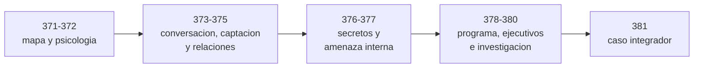

# Parte 21 — Ingeniería social, espionaje y contrainteligencia

> [⬅️ Volver al programa](../../README.md) · [📚 Índice completo](../README.md) · [⏮️ Parte anterior](../parte-20-debilidades-y-vulnerabilidades-cwe-cve-cvss/README.md)

**11 clases** · rango 371–381 · Manipulación de personas, inteligencia humana, espionaje industrial y su defensa

**Fuentes de referencia de esta parte:**

- Christopher Hadnagy — *Social Engineering: The Science of Human Hacking* (2.ª ed.).
- Robert Cialdini — *Influence: The Psychology of Persuasion*.
- Daniel Kahneman — *Thinking, Fast and Slow*.
- Kevin Mitnick y William Simon — *The Art of Deception*.
- Markus Wolf — *Man Without a Face*; David Wise — *Tiger Trap*.
- CISA, *Insider Threat Mitigation Guide*; SEI/CERT, *Common Sense Guide to Mitigating Insider Threats*.
- 18 U.S.C. §§ 1831 y 1832; informes del Departamento de Justicia de EE. UU.; CIA *Studies in Intelligence*.
- FBI IC3, *Internet Crime Report 2025*; MITRE ATT&CK; NIST SP 800-53, 800-61 y 800-86.

---

## 🎯 ¿De qué trata esta parte?

Muchos accesos comienzan con una persona, no con una vulnerabilidad. La [Parte 12](../parte-12-osint-e-ingenieria-social/README.md) enseñó a recolectar información abierta y a reconocer y simular ingeniería social con autorización. Esta parte **continúa ese hilo** hacia donde la ingeniería social se vuelve una operación sostenida: relaciones que se cultivan durante meses, personas con acceso a secretos que son abordadas, empleados que filtran o son presionados, y organizaciones, de Estados a empresas y bandas criminales, que invierten en obtener lo que otros protegen.

Su enfoque es **comprender, detectar y prevenir**. No enseña a reclutar, seducir, chantajear ni vigilar a nadie. Enseña a leer los mecanismos psicológicos (clase 372), las técnicas conversacionales (373), el ciclo de captación (374), la explotación de las relaciones afectivas (375), el espionaje industrial y tecnológico (376), las amenazas internas (377), la contrainteligencia empresarial (378), la protección de personas con acceso estratégico (379), la investigación y la legalidad (380) y un caso integrador vivo, con método para no equivocarse (381).

## 🧩 Problemas que resuelve

- Distinguir espionaje, ingeniería social, fraude y competencia legítima, y los marcos legales de cada uno.
- Diseñar defensas que no dependan de la atención perfecta: verificación independiente, doble aprobación, reporte sin castigo.
- Reconocer a tiempo un acercamiento, una escalada de peticiones o una presión, sin estigmatizar relaciones normales.
- Proteger a ejecutivos y a quienes tienen acceso estratégico respetando su vida privada.
- Gobernar un programa de amenazas internas legal, proporcional y transparente.
- Investigar incidentes que involucran personas protegiendo evidencia, derechos y dignidad.
- Analizar casos abiertos separando hecho, declaración, acusación e hipótesis.

## 🎓 Resultados de aprendizaje

Al terminar la parte, el alumno podrá:

- Aplicar el ciclo de inteligencia para ubicar dónde interviene cada disciplina y dónde puede interrumpirse.
- Explicar los principios de influencia y los patrones de presión artificial, y diseñar controles de proceso.
- Reconocer elicitación, pretexto y suplantación, y responder sin romper la relación.
- Describir el ciclo de captación y las motivaciones con sus límites, y diseñar una respuesta de apoyo.
- Diferenciar honey trap, romance scam, sextorsión, chantaje y kompromat, y la acción que corresponde.
- Comparar espionaje estatal, corporativo y criminal con matrices de casos.
- Diseñar el ciclo de vida de seguridad del personal, el canal de reporte y las métricas de un programa de contrainteligencia empresarial.
- Planificar una investigación de incidente humano con cadena de custodia, entrevistas no coercitivas y consulta legal.
- Producir un análisis profesional con confianza declarada y límites.

## 🧱 Prerrequisitos

- Partes 0 y 12 (fundamentos y OSINT e ingeniería social), en especial las clases 249, 256–259 y 260.
- Nociones de respuesta a incidentes (Parte 9) y GRC (Parte 14) para las clases 377–380.
- Disposición a trabajar con casos reales con rigor y respeto por las personas.

## 🗺️ Estructura temática

| Bloque | Clases | Enfoque |
|--------|--------|---------|
| Marco y psicología | 371–372 | Disciplinas, ciclo de inteligencia, mecanismos de influencia |
| Obtención de información y captación | 373–375 | Elicitation, pretexto, reclutamiento, trampas románticas y coerción |
| Espionaje y amenaza interna | 376–377 | Secretos industriales, casos y programas de insiders |
| Defensa organizacional | 378–380 | Contrainteligencia empresarial, ejecutivos, investigación y legalidad |
| Integración | 381 | Caso NVIDIA y análisis comparado |

## 🧭 Recorrido pedagógico clase a clase

1. **[Clase 371 — Mapa de disciplinas](371-mapa-de-disciplinas-espionaje-inteligencia-y-contrainteligencia/README.md).** Aparece primero porque fija el vocabulario: sin distinguir inteligencia, espionaje, contrainteligencia e ingeniería social, el resto parece un catálogo de trucos. Conecta con la 249 (ciclo de inteligencia aplicado a fuentes abiertas) y 256 (ingeniería social como técnica). *Evidencia:* una clasificación de actores y un recorrido del ciclo con puntos de interrupción.
2. **[Clase 372 — Psicología de la manipulación](372-psicologia-de-la-manipulacion-y-resistencia-a-la-presion/README.md).** Explica por qué la competencia no basta como defensa y qué procesos sí funcionan. Profundiza los principios de la 256. *Evidencia:* un análisis de caso y una regla de proceso probada contra el cansancio y la cortesía.
3. **[Clase 373 — Pretexting, impersonation y elicitation](373-pretexting-impersonation-y-elicitation-desde-la-defensa/README.md).** Toma el pretexto de la 257 y añade la elicitación y la suplantación. *Evidencia:* guiones de desvío y una política de visitas y verificación.
4. **[Clase 374 — Captación de fuentes humanas](374-captacion-de-fuentes-humanas-y-ciclo-de-reclutamiento/README.md).** Pasa de la conversación puntual a la relación sostenida. *Evidencia:* ubicación de indicadores por fase y un formulario de reporte no acusatorio.
5. **[Clase 375 — Trampas románticas, honey trap, kompromat y estafas de romance](375-trampas-romanticas-honey-trap-kompromat-y-estafas-de-romance/README.md).** Aborda el caso más sensible: la intimidad como vector. Distingue operaciones dirigidas, estafas masivas y sextorsión. *Evidencia:* un árbol de decisión y una política de reporte voluntario.
6. **[Clase 376 — Espionaje industrial, económico y tecnológico](376-espionaje-industrial-economico-y-tecnologico/README.md).** Sitúa lo anterior en su motivo: los secretos. Historia, ley y casos modernos. *Evidencia:* inventario de activos críticos y matriz de casos.
7. **[Clase 377 — Amenazas internas](377-amenazas-internas-indicadores-programas-y-limites/README.md).** Aparece tras el espionaje porque el insider es su canal más frecuente. *Evidencia:* camino al incidente, indicadores combinados y proceso de salida.
8. **[Clase 378 — Contrainteligencia empresarial](378-contrainteligencia-empresarial-y-seguridad-del-personal/README.md).** Reúne lo anterior en un programa. *Evidencia:* un programa para una organización ficticia con métricas.
9. **[Clase 379 — Protección de ejecutivos](379-proteccion-de-ejecutivos-y-personas-con-acceso-estrategico/README.md).** Especializa la defensa en las personas más expuestas. Conecta con la 260 (OPSEC personal). *Evidencia:* evaluación de huella y protocolo de verificación de pagos.
10. **[Clase 380 — Investigación de incidentes humanos, ética y legalidad](380-investigacion-de-incidentes-humanos-etica-y-legalidad/README.md).** Cierra el ciclo cuando la prevención falla y fija los límites de todo lo anterior. Conecta con la Parte 9. *Evidencia:* plan de las primeras 72 horas con roles y consulta legal.
11. **[Clase 381 — Caso NVIDIA y análisis comparado](381-caso-nvidia-y-analisis-comparado-capstone/README.md).** Aplica el método a un caso abierto y a cuatro históricos sin atribuir nada que la evidencia no sostenga. *Evidencia:* un informe con hechos, declaraciones, no verificado e hipótesis separados.

## ⚖️ Nota ética y legal

Todo el contenido se enseña con fines **defensivos, educativos y de pruebas autorizadas**. No se facilitan guiones de engaño, métodos de coerción ni técnicas de vigilancia. Los casos reales se presentan con su estado procesal; **ninguna afirmación atribuye delitos a personas sin evidencia suficiente**. Los ejercicios usan personajes ficticios. Esta parte no es asesoría jurídica: las leyes de protección de datos, laborales y penales cambian según el país.

## 📎 Auditoría y matriz de cobertura

La auditoría que motivó la parte, el mapa de disciplinas, la matriz de cobertura (EXISTE / PARCIAL / FALTA / NO APLICA), la justificación de las clases nuevas y los pendientes están en [docs/auditoria-ampliacion-espionaje-contrainteligencia.md](../../docs/auditoria-ampliacion-espionaje-contrainteligencia.md).

## Navegación

- [Índice completo](../README.md)
