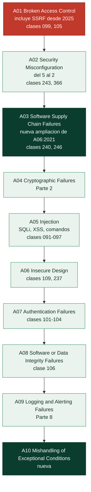

# Clase 087 — OWASP Top 10: panorama general

> Parte: **4 — Seguridad de aplicaciones web** · Fuente: *OWASP Top 10:2025 (con la edición 2021 como referencia histórica) y MITRE CWE 5.0*
> ⏱️ Duración estimada: **75 min** · Nivel: **Fundamentos**

---

## 🎯 Objetivo

Dominar el **OWASP Top 10** como marco de referencia y taxonomía: qué representa cada categoría, cómo se relacionan entre sí, cómo se conecta con el catálogo **CWE** (cada categoría es una agrupación de debilidades concretas) y cómo usarlo para estructurar una auditoría web. Trabajaremos con la edición **2025**, la vigente, y con la **2021**, porque muchos informes, certificaciones y herramientas siguen citándola y hay que saber traducir entre ambas. Es el mapa que da nombre y contexto a todo lo que atacaremos en el resto de la parte.

## 📚 Resultados de aprendizaje

Al finalizar, el alumno podrá:

1. **Enumerar** las 10 categorías del OWASP Top 10:2025 y su significado, y reconocer las de la edición 2021.
2. **Mapear** una vulnerabilidad concreta a su categoría correspondiente a través de su CWE.
3. **Explicar** qué cambió entre 2021 y 2025 (dos categorías nuevas y una consolidación) y por qué ocurrió.
4. **Distinguir** una categoría OWASP (una agrupación) de una debilidad CWE (la que se asigna a un hallazgo).
5. **Priorizar** hallazgos usando el enfoque de riesgo de OWASP y entender por qué el Top 10 no sustituye a KEV, EPSS ni a CVSS.
6. **Distinguir** el Top 10 de estándares más exhaustivos como ASVS y WSTG.

## 🗺️ Temas

| # | Tema | Por qué importa |
|---|------|-----------------|
| 1 | A01 Broken Access Control | La categoría más grave hoy; absorbió SSRF |
| 2 | A02 Security Misconfiguration | Subió del 5.º al 2.º puesto |
| 3 | A03 Software Supply Chain Failures | Amplía «componentes vulnerables» a todo el ecosistema |
| 4 | A04–A09 | Criptografía, inyección, diseño, autenticación, integridad, registro |
| 5 | A10 Mishandling of Exceptional Conditions | Categoría nueva: errores y condiciones anómalas |
| 6 | De la categoría al CWE | Evita clasificar con una etiqueta que no se puede asignar |
| 7 | 2021 frente a 2025 | Permite leer informes de ambas ediciones |
| 8 | Metodología de riesgo OWASP | Convierte hallazgos en prioridades |

## 🧠 Explicación en profundidad

### Un mapa consensuado del riesgo web, no una lista de bugs

El **OWASP Top 10** es el documento de referencia de la seguridad web: un consenso de la industria, revisado cada pocos años, sobre las diez **categorías** de riesgo más críticas en aplicaciones web. La edición vigente es la de **2025**, la octava; la anterior es la de 2021. Es importante entender qué es y qué no es. **No** es una lista de vulnerabilidades concretas ni un estándar de cumplimiento exhaustivo; es un instrumento de **concienciación y priorización** que agrupa fallos por su naturaleza. Su valor para esta parte es doble: ordena las 30 clases dándoles un marco común, y es el vocabulario con el que un informe de pentest web se comunica con desarrolladores y dirección.

La metodología importa. OWASP combina datos aportados por organizaciones (entre ellos, la proporción de aplicaciones probadas que presentan al menos una de las debilidades de cada categoría y las puntuaciones medias de explotabilidad e impacto de los CVE asociados) con una **encuesta a la comunidad**. En 2025 se ordenaron doce categorías por los datos y se permitió que dos fueran promovidas por la encuesta, por una razón explícita: los datos miran al pasado, porque pasan semanas o años hasta que una prueba nueva se integra en herramientas y procesos, y hay riesgos importantes que quizá nunca se puedan probar a escala. Por eso el orden cambia entre ediciones y refleja cómo evoluciona el ecosistema.



El diagrama es un índice: cada caja es una categoría de 2025 y dice en qué clases del programa se estudia. Se lee en dos filas de izquierda a derecha, en el orden oficial. La caja roja es la categoría que encabeza la lista; las dos oscuras, **A03** y **A10**, son las novedades de la edición. El orden no es una escala de gravedad por categoría sino un ranking de cuán a menudo y con qué consecuencias aparecen sus debilidades en los datos.

### Las categorías de 2025

**A01 Broken Access Control** mantiene el primer puesto: según los datos aportados, de media el 3,73 % de las aplicaciones probadas presentaba al menos una de las **40** debilidades de la categoría, el máximo que OWASP permite por categoría. Su ascenso desde 2021 cuenta una historia: el fallo más extendido no es técnicamente sofisticado, es **dejar que un usuario acceda a lo que no le corresponde** —ver el pedido de otro cambiando un número (IDOR, `CWE-639`), llamar a una función de administración sin ser administrador (`CWE-862`, `CWE-863`), salir del directorio permitido (`CWE-22`)—. En 2025 la categoría **absorbió SSRF** (`CWE-918`), que en 2021 era la A10: el servidor hace una petición a un destino que el usuario no debería poder alcanzar, que es un fallo de control de acceso desde el servidor.

**A02 Security Misconfiguration** pasa del quinto al segundo puesto: el 3,00 % de las aplicaciones tenía al menos una de sus 16 debilidades, y OWASP lo atribuye a que cada vez más comportamiento de la aplicación depende de la configuración. Aquí cae, por ejemplo, el procesamiento XML con entidades externas habilitadas (`CWE-611`) y el código de depuración activo (`CWE-489`).

**A03 Software Supply Chain Failures** es una **ampliación** de «Vulnerable and Outdated Components» (A06:2021): ya no se trata solo de usar un componente con un fallo conocido, sino de cualquier compromiso en dependencias, sistemas de construcción e infraestructura de distribución. Tiene solo **5** debilidades y poca presencia en los datos, pero OWASP señala que es porque cuesta probarla, y que es la categoría con las puntuaciones medias más altas de explotabilidad e impacto en los CVE asociados. La estudiarás en las clases 240 y 246 y en la 366 de la Parte 20.

**A04 Cryptographic Failures** baja del segundo al cuarto puesto (32 debilidades, 3,80 % de las aplicaciones). Agrupa los datos sensibles mal protegidos: sin cifrar en tránsito o en reposo, con algoritmos rotos (`CWE-327`), con hash de contraseñas débil (`CWE-916`), con claves o aleatoriedad inadecuadas (`CWE-326`, `CWE-330`). Es todo lo de la Parte 2 visto desde el fallo.

**A05 Injection** baja del tercero al quinto, aunque sigue siendo una de las categorías más probadas y la que más CVE concentra entre sus 38 debilidades. OWASP la describe como un espectro: desde el *cross-site scripting* (`CWE-79`, mucha frecuencia y poco impacto individual) hasta la inyección SQL (`CWE-89`, poca frecuencia y gran impacto), pasando por la inyección de comandos (`CWE-78`) y de código (`CWE-94`, `CWE-95`). Su idea común: datos del usuario interpretados como código o comando.

**A06 Insecure Design** (heredada de 2021, ahora en sexto lugar) recoge los fallos que **no** son bugs de implementación sino de **diseño**: controles que nunca se pensaron. No se arreglan parcheando código; se arreglan modelando amenazas antes de programar (clase 237). OWASP observa que la industria ha mejorado en modelado de amenazas y en diseño seguro, y por eso ha bajado dos puestos.

**A07 Authentication Failures** conserva el séptimo puesto con un cambio de nombre (antes «Identification and Authentication Failures») para reflejar mejor sus 36 debilidades. OWASP cree que el uso creciente de marcos de autenticación estandarizados está reduciendo las incidencias. Contiene la falta de autenticación (`CWE-306`), los intentos sin límite (`CWE-307`) y, de forma que sorprende, las credenciales embebidas en el código (`CWE-798`, `CWE-259`).

**A08 Software or Data Integrity Failures** se centra en no mantener las fronteras de confianza ni verificar la integridad de código, software y datos, a un nivel más bajo que A03; la deserialización insegura (`CWE-502`) es su ejemplo clásico.

**A09 Security Logging & Alerting Failures** cambia «monitorización» por «alerta»: registrar sin alertar tiene muy poco valor para detectar un incidente. OWASP avisa de que esta categoría estará siempre infrarrepresentada en los datos y que la encuesta de la comunidad la mantuvo en la lista.

**A10 Mishandling of Exceptional Conditions** es **nueva** en 2025, con 24 debilidades: manejo incorrecto de errores, errores lógicos, «fallar abierto» y otras situaciones que surgen de condiciones anómalas, como la desreferencia de un puntero nulo (`CWE-476`) o los mensajes de error que revelan datos.

### De la categoría al CWE

Una confusión frecuente es tratar la categoría como si fuera la debilidad. **No lo es**: «A05:2025 Injection» es, en el catálogo CWE 5.0, una **agrupación** (`CWE-1440`) que contiene 38 debilidades, y las agrupaciones **no se usan para mapear** un hallazgo. A un hallazgo se le asigna una debilidad concreta (la inyección SQL es `CWE-89`), y la categoría OWASP se deriva de ella. En total, OWASP asocia **248 CWE** a sus diez categorías (en el catálogo local, las agrupaciones van de `CWE-1436` a `CWE-1445`). La derivación puede consultarse con la herramienta local del programa:

```bash
python scripts/cwe_kb.py miembros CWE-1440    # las debilidades de A05:2025 Injection
python scripts/cwe_kb.py top25                 # el Top 25 de MITRE con su categoría OWASP 2025
```

Dos consecuencias que conviene recordar. Primera: **una misma debilidad puede cambiar de categoría entre ediciones** (la falsificación de peticiones en servidor, `CWE-918`, era A10 en 2021 y es A01 en 2025), de modo que un informe debe indicar con qué edición clasificó. Segunda: **no toda debilidad grave está en el Top 10**. Los fallos de seguridad de memoria (`CWE-787`, `CWE-416`, `CWE-125`, `CWE-120`) pertenecen a ninguna de las diez categorías porque OWASP trata aplicaciones web; sin embargo, `CWE-787` ocupa el 5.º puesto del Top 25 de MITRE de 2025. Cada lista responde a una pregunta distinta (clase 361).

### 2021 frente a 2025

| 2021 | 2025 | Qué cambió |
|---|---|---|
| A01 Broken Access Control | A01 Broken Access Control | Se mantiene primera y absorbe SSRF |
| A05 Security Misconfiguration | A02 Security Misconfiguration | Sube del 5.º al 2.º |
| A06 Vulnerable and Outdated Components | A03 Software Supply Chain Failures | Se amplía a todo el ecosistema de dependencias y distribución |
| A02 Cryptographic Failures | A04 Cryptographic Failures | Baja del 2.º al 4.º |
| A03 Injection (incluye XSS) | A05 Injection | Baja del 3.º al 5.º |
| A04 Insecure Design | A06 Insecure Design | Baja dos puestos |
| A07 Identification and Authentication Failures | A07 Authentication Failures | Cambia el nombre |
| A08 Software and Data Integrity Failures | A08 Software or Data Integrity Failures | Se mantiene |
| A09 Security Logging and Monitoring Failures | A09 Security Logging & Alerting Failures | Se subraya la alerta |
| A10 Server-Side Request Forgery | — (integrada en A01) | Consolidación |
| — | A10 Mishandling of Exceptional Conditions | Categoría nueva |

La conclusión práctica que ordena la parte: el Top 10 es el **índice mental** con el que se aborda cualquier aplicación. Ante un objetivo nuevo, recorrerlo categoría por categoría —«¿tiene control de acceso roto? ¿inyecciones? ¿mala configuración? ¿una cadena de suministro frágil?»— garantiza cobertura y evita el sesgo de ir solo a la vulnerabilidad que uno domina. Para una checklist más exhaustiva y verificable existe **OWASP ASVS** (clase 115), pero el Top 10 es el punto de partida de todo pentest web.

### El Top 10 no es una lista de prioridades de corrección

Hay un error de uso muy común: tomar el orden de las categorías como el orden en que corregir. El Top 10 dice **qué tipos de fallo** son más frecuentes y graves en conjunto; no dice qué CVE de **tus** sistemas se explota ahora. Para eso están las señales de la Parte 20: la explotación observada (KEV), la probabilidad (EPSS), la severidad bajo supuestos (CVSS) y la exposición de tu activo (clase 369). Un ejemplo: la inyección de comandos (`CWE-78`) está en A05, que ocupa el quinto puesto, y sin embargo es la debilidad con más CVE en el catálogo KEV de la edición 2025 del Top 10 de debilidades explotadas de MITRE y CISA (20); el XSS (`CWE-79`), en la misma categoría, tiene 7. La categoría orienta qué buscar; la priorización de un hallazgo concreto exige más datos.

## 📖 Definiciones y características

- **OWASP Top 10**: documento de concienciación con las 10 categorías de riesgo web más críticas. Característica: es un punto de partida, no una checklist completa.
- **Categoría de riesgo**: agrupación de debilidades por causa común. Característica: en el catálogo CWE es una agrupación, no una debilidad, y no se asigna a un hallazgo.
- **Broken Access Control (A01)**: usuarios acceden a datos o funciones fuera de sus permisos. Característica: primera en 2021 y 2025; en 2025 incluye SSRF.
- **Software Supply Chain Failures (A03)**: compromisos en dependencias, construcción y distribución. Característica: amplía los componentes vulnerables de 2021.
- **Insecure Design (A06)**: fallo por diseño, no por implementación. Característica: no se corrige con un parche puntual.
- **Mishandling of Exceptional Conditions (A10)**: manejo incorrecto de errores y situaciones anómalas. Característica: novedad de 2025.
- **SSRF**: el servidor hace peticiones a destinos controlados por el atacante. Característica: categoría propia en 2021 e integrada en A01 en 2025.
- **Riesgo = probabilidad × impacto**: fórmula que OWASP usa para ordenar. Característica: guía la priorización, no la sustituye por criterio.

## 📔 Glosario

| Término | Definición concisa |
|---------|--------------------|
| OWASP Top 10 | Consenso de las diez categorías de riesgo web más críticas |
| Categoría de riesgo | Agrupación de debilidades por naturaleza, no un defecto concreto |
| Agrupación (Grouping) | Entrada del catálogo CWE que reúne otras; no es una debilidad y no se usa para mapear |
| Prevalencia | Con qué frecuencia aparece un fallo en aplicaciones reales |
| A01 Broken Access Control | Acceder a lo que no corresponde; primera en 2021 y 2025 |
| A02 Security Misconfiguration | Inseguro por defecto o mal configurado |
| A03 Supply Chain Failures | Compromiso de dependencias, construcción o distribución del software |
| A04 Cryptographic Failures | Datos sensibles mal protegidos |
| A05 Injection | Datos interpretados como código; incluye XSS |
| A06 Insecure Design | Fallo de diseño, no de implementación |
| A07 Authentication Failures | Identificación y autenticación débiles |
| A08 Integrity Failures | Software o datos sin verificar |
| A09 Logging & Alerting Failures | Falta de registro y de alerta |
| A10 Exceptional Conditions | Errores y condiciones anómalas mal manejados |
| OWASP ASVS | Estándar de verificación más detallado que el Top 10 |

## 🧰 Herramientas y preparación

- Documento **OWASP Top 10:2025** (online, gratuito) y, como referencia histórica, el de 2021.
- Herramienta local del programa para consultar las agrupaciones: `python scripts/cwe_kb.py miembros CWE-1440` (requiere haber importado el catálogo; ver la Parte 20).
- **OWASP Juice Shop** (cada reto está etiquetado con su categoría).
- Hoja de cálculo o plantilla para mapear hallazgos → CWE → categoría → severidad.

## 🧪 Laboratorio guiado

> Ejercicio aplicado de taxonomía y priorización (no ofensivo aún).

1. Abre el sitio oficial del Top 10:2025 y lee la ficha de cada categoría (A01–A10).
2. Crea una tabla con columnas: categoría, ejemplo real, **CWE concreta**, control preventivo.
3. Con `python scripts/cwe_kb.py miembros CWE-1436` (A01) y `miembros CWE-1440` (A05) comprueba que tus CWE de la tabla están realmente en esa categoría. Anota cuáles no encontraste y por qué.
4. En Juice Shop, abre el **Score Board** (`/#/score-board`) y filtra retos por categoría. Comprueba con qué edición del Top 10 están etiquetados los retos antes de comparar.
5. Elige 5 retos de categorías distintas y anota a qué A0X pertenecen en 2025 y en 2021, y por qué.
6. Para cada uno, redacta en una frase el impacto de negocio si se explotara.
7. Ordena tus 5 hallazgos hipotéticos por riesgo (probabilidad × impacto) y justifica; después discute qué otros datos (KEV, EPSS, exposición) cambiarían ese orden.

## ✍️ Ejercicios

1. Asocia cada una de estas CWE a su categoría de 2025 y a la de 2021: `CWE-89`, `CWE-79`, `CWE-352`, `CWE-918`, `CWE-611`.
2. Explica por qué «Injection» incluye XSS desde 2021 y qué dice OWASP del contraste frecuencia/impacto entre XSS e inyección SQL.
3. Da un ejemplo propio de Insecure Design que no sea un bug de código.
4. Diferencia A02 (configuración) de A03 (cadena de suministro) con un caso concreto.
5. Justifica por qué Broken Access Control encabeza la lista y por qué SSRF se integró en ella.
6. Explica por qué `CWE-787` no pertenece a ninguna categoría del Top 10 aunque sea la 5.ª del Top 25 de MITRE.
7. Propón un control preventivo para cada categoría del Top 10:2025.

## ✅ Soluciones razonadas

1. `CWE-89` y `CWE-79`: A05 Injection en 2025, A03 en 2021. `CWE-352`: A01 en ambas. `CWE-918`: A01 en 2025 y A10 en 2021. `CWE-611` (XXE): A02 Security Misconfiguration en 2025 y A05 en 2021. Se puede comprobar con `miembros CWE-1436`, `CWE-1437` y `CWE-1440`.
2. Comparte causa raíz: datos no confiables interpretados como código en un contexto de salida (HTML, SQL...). OWASP describe la categoría como un espectro, desde el XSS (muy frecuente, impacto individual menor) hasta la inyección SQL (menos frecuente, impacto alto).
3. Un flujo de recuperación de contraseña que depende de una pregunta secreta que cualquiera puede averiguar es un fallo de diseño: el código puede implementarla perfectamente y seguir siendo inseguro.
4. Una consola de administración publicada con credenciales por defecto es A02; usar una biblioteca con un CVE conocido, o un paquete de nombre parecido a otro (*typosquatting*), es A03.
5. Porque es el fallo más extendido (3,73 % de las aplicaciones con al menos una de 40 debilidades) y de impacto directo. SSRF se integró porque es, en esencia, hacer que el servidor acceda a un recurso que el usuario no debería alcanzar: un fallo de control de acceso, aunque lo ejecute el servidor.
6. Porque el Top 10 de OWASP describe riesgos de aplicaciones web y su selección de 248 CWE no incluye las de seguridad de memoria. El Top 25 de MITRE puntúa por frecuencia y severidad de los CVE de cualquier software.
7. A01 comprobación de autorización en el servidor; A02 configuración como código y revisión de valores por defecto; A03 inventario, fijación y verificación de dependencias; A04 algoritmos y bibliotecas estándar; A05 consultas parametrizadas y codificación de salida; A06 modelado de amenazas; A07 autenticación con marcos probados y límites de intentos; A08 verificar la integridad y no deserializar datos no confiables; A09 registrar y alertar sobre eventos de seguridad; A10 manejar los errores de forma explícita y cerrar por defecto.

## 📝 Reto verificable

Entrega una **matriz Top 10:2025** con las 10 categorías, un ejemplo concreto por cada una, su **CWE principal** (no la categoría), su categoría equivalente en 2021 y un control de mitigación.
**Criterio de aceptación**: las 10 categorías están cubiertas, los ejemplos son distintos y realistas, cada CWE existe y está dentro de la categoría indicada (comprobado con `cwe_kb.py miembros`), y cada control mitiga la causa raíz (no solo el síntoma).

## ⚠️ Errores comunes

| Síntoma / mensaje | Causa y cómo arreglar |
|-------------------|------------------------|
| Tratar el Top 10 como checklist completa | Es concienciación; usa ASVS/WSTG para cobertura |
| Asignar «A05» como si fuera el CWE de un hallazgo | Una categoría es una agrupación que no se usa para mapear; asigna la debilidad concreta |
| Mezclar ediciones sin decirlo | Indica la edición (2021 o 2025): SSRF, por ejemplo, cambió de categoría |
| Ignorar A06 por ser «abstracta» | El diseño inseguro es causa de muchos bugs |
| Seguir el orden del Top 10 para corregir | Prioriza hallazgos concretos con KEV, EPSS, CVSS y exposición (clase 369) |
| Buscar los fallos de memoria en el Top 10 | No están en sus categorías; se estudian en la Parte 5 y en la clase 365 |
| Usar la versión 2017 | Cambió el orden y las categorías; usa 2025 y, para informes antiguos, 2021 |

## ❓ Preguntas frecuentes

**❓ ¿El Top 10 basta para certificar seguridad?**
No. Es concienciación. Para verificación usa OWASP ASVS y para testing la WSTG.

**❓ ¿Con qué frecuencia cambia?**
Cada tres o cuatro años aproximadamente: la edición de 2021 fue seguida por la de 2025.

**❓ ¿Dónde encaja XSS ahora?**
Dentro de A05 Injection (era A03 en 2021), porque comparte causa raíz: datos no confiables interpretados como código.

**❓ ¿Mi certificación pregunta por la edición 2021?**
Posiblemente. Estudia ambas y revisa el temario oficial de tu examen: muchos exámenes tardan en actualizarse.

## 🔗 Referencias

- OWASP, *Top 10:2025 — Introducción* — <https://top10.owasp.org/2025/0x00_2025-Introduction/> — lista de las diez categorías, cambios respecto a 2021, número de debilidades por categoría y metodología.
- OWASP, *Top 10:2021* — <https://owasp.org/Top10/2021/> — edición anterior, para leer informes y certificaciones que aún la citan.
- MITRE CWE, ficha de la agrupación `CWE-1440` (OWASP A05:2025 Injection) — <https://cwe.mitre.org/data/definitions/1440.html> — ejemplo de cómo el catálogo registra cada categoría de OWASP como una agrupación que contiene las debilidades de esa categoría.
- MITRE y CISA, *2025 CWE Top 10 KEV Weaknesses* — <https://cwe.mitre.org/top25/archive/2025/2025_kev_list.html> — recuento de CVE en KEV por debilidad (CWE-78: 20; CWE-79: 7).
- OWASP ASVS — <https://owasp.org/www-project-application-security-verification-standard/> — estándar de verificación más detallado.
- OWASP Risk Rating Methodology — <https://owasp.org/www-community/OWASP_Risk_Rating_Methodology> — método de riesgo probabilidad × impacto.

## 📥 Material descargable

- 📄 [Guía en PDF](./clase-087-guia.pdf) — versión imprimible de esta clase.
- 🎞️ [Presentación (PPTX)](./clase-087-presentacion.pptx) — deck para proyectar en clase.

## ⬅️ Clase anterior

[Clase 086 — Arquitectura web moderna y superficie de ataque](../086-arquitectura-web-moderna-y-superficie-de-ataque/README.md)

## ➡️ Siguiente clase

[Clase 088 — Burp Suite: configuración y flujo de trabajo](../088-burp-suite-configuracion-y-flujo-de-trabajo/README.md)
