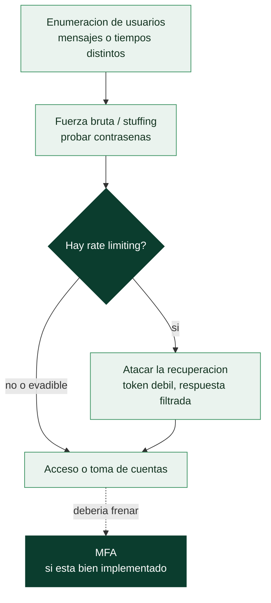

# Clase 101 — Fallos de autenticación y bypass

> Parte: **4 — Seguridad de aplicaciones web** · Fuente: *The Web Application Hacker's Handbook (Stuttard & Pinto)*
> ⏱️ Duración estimada: **120 min** · Nivel: **Avanzado**

---

## 🎯 Objetivo

Auditar los mecanismos de **autenticación** y descubrir formas de saltárselos: enumeración de usuarios, fuerza bruta, fallos en recuperación de contraseña, MFA débil y lógica de login rota. La autenticación es la puerta de la aplicación; romperla suele ser el hallazgo de mayor impacto.

> ⚠️ **Ética**: solo en labs propios/autorizados. La fuerza bruta y el bypass sobre cuentas ajenas son delitos.

## 📚 Resultados de aprendizaje

Al finalizar, el alumno podrá:

1. **Detectar** enumeración de usuarios por diferencias en respuestas/tiempos.
2. **Ejecutar** fuerza bruta controlada y credential stuffing en un lab.
3. **Explotar** fallos en flujos de recuperación de contraseña.
4. **Evaluar** la robustez de la MFA y sus bypass comunes.
5. **Recomendar** controles: rate limiting, MFA correcta, mensajes genéricos.

## 🗺️ Temas

| # | Tema | Por qué importa |
|---|------|-----------------|
| 1 | Enumeración de usuarios | Primer paso del ataque |
| 2 | Fuerza bruta y stuffing | Ataque directo a credenciales |
| 3 | Rate limiting y su evasión | Defensa clave y sus grietas |
| 4 | Recuperación de contraseña | Flujo frecuentemente roto |
| 5 | MFA: tipos y bypass | Segunda barrera, no infalible |
| 6 | Lógica de login rota | Bypass sin adivinar credenciales |
| 7 | Defensa en profundidad | Cierre del fallo |
| 8 | Casos KEV de octubre de 2026: Ivanti, BeyondTrust, Ahsay, Zammad | Autenticación, autorización y escalada de privilegios no son lo mismo |

## 🧠 Explicación en profundidad

### La puerta de entrada, y todas las formas de forzarla

La autenticación es el control que responde "¿quién eres?", y sus fallos (A07 en OWASP) son
especialmente graves porque **saltarse el login abre todo lo que hay detrás**. Esta clase recorre
la cadena completa de ataques a la autenticación web, y su hilo conductor es que la robustez de una
puerta se mide por su eslabón más débil: de nada sirve una contraseña fuerte si el sistema **revela
qué usuarios existen**, no **limita los intentos**, o tiene una **recuperación de contraseña** rota.

### Enumeración de usuarios: el fallo que habilita todo lo demás

Antes de atacar una contraseña, el atacante quiere saber **qué cuentas existen**, y muchas
aplicaciones se lo dicen sin querer. Si el login responde "usuario no encontrado" frente a
"contraseña incorrecta", **distingue** las cuentas válidas de las inexistentes. Aunque el mensaje
sea idéntico, un **tiempo de respuesta distinto** (porque solo se calcula el hash de la contraseña
cuando el usuario existe) filtra la misma información —un canal lateral temporal, como en la clase
060—. El registro y la recuperación de contraseña también enumeran ("ese correo ya está
registrado"). La enumeración convierte el ataque a credenciales de la clase 081 de disparar a
ciegas a disparar sobre blancos confirmados, y por eso la defensa es dar **respuestas y tiempos
idénticos** existan o no las cuentas.

### Fuerza bruta, rate limiting y su evasión

Con la lista de usuarios, entran la **fuerza bruta**, el **password spraying** y el **credential
stuffing** de la clase 081. La defensa es el **rate limiting** —limitar los intentos—, pero su
implementación falla de formas conocidas que hay que probar: límites **por IP** se evaden rotando
direcciones (proxies, botnets); límites **por cuenta** se evaden con spraying (una contraseña contra
muchas cuentas); y a veces el límite se aplica en la interfaz web pero **no en la API** que hay
detrás, o hay endpoints alternativos (una app móvil, un login legacy) sin protección. Probar si el
rate limiting es real, consistente y aplicado en todas las vías es parte del trabajo.

### Recuperación de contraseña y MFA: dónde se rompen

La **recuperación de contraseña** es a menudo el eslabón más débil porque es un **camino
alternativo** al login que recibe menos atención. Los fallos típicos: tokens de reseteo
**predecibles** o de vida demasiado larga, tokens que **no se invalidan** tras usarse, preguntas de
seguridad con respuestas averiguables por OSINT, o el envío del enlace a un correo que el atacante
controla por otro fallo. Un reseteo roto entrega la cuenta sin tocar la contraseña original.

La **MFA** (segundo factor) es la defensa decisiva contra el robo de credenciales, pero **no es
infalible** y hay que saber cómo se ataca: códigos OTP sin límite de intentos (fuerza bruta del
código de 6 dígitos), la **fatiga de MFA** (bombardear al usuario con notificaciones push hasta que
acepte una por cansancio), el robo del token de sesión **después** del MFA (que lo hace irrelevante),
y factores débiles como el **SMS**, interceptable por SIM swapping. Los factores **resistentes a
phishing** (FIDO2/passkeys) cierran la mayoría de estos huecos. El mensaje de la clase es la
**defensa en profundidad**: ningún control aislado protege la autenticación —hacen falta a la vez
respuestas neutras, rate limiting real, recuperación robusta, MFA bien implementado y gestión de
sesión sólida (clase 102)—.

### Cómo lo nombra el catálogo CWE y qué cambia al priorizar

En el catálogo CWE, «autenticación rota» no es una entrada sino una **familia** con una raíz que MITRE desaconseja usar: `CWE-287` (*autenticación incorrecta*) es de nivel *Class* y figura como «desaconsejada» (*Discouraged*) para mapear, porque es demasiado general. Debajo cuelgan entradas más precisas, que son las que usarías en un informe. `CWE-306` (*falta de autenticación en una función crítica*) es la que corresponde a «no hay puerta»; `CWE-1390` (*autenticación débil*) agrupa las puertas mal hechas: `CWE-307` (intentos excesivos sin restricción), `CWE-640` (recuperación de contraseña débil), `CWE-308` (un solo factor) y, a través de `CWE-1391` (credenciales débiles), `CWE-521` (requisitos de contraseña débiles). La **enumeración de usuarios** que viste como «el fallo que habilita todo lo demás» se describe como una discrepancia observable en la respuesta (`CWE-204`), que cuelga de la exposición de información.

Los datos de explotación van en la misma dirección que tu intuición: `CWE-306` es la 21.ª del Top 25 de 2025 con **11 CVE en KEV**, y su hija `CWE-288` (autenticación evitada por una ruta o canal alternativo) aparece en el Top 10 de debilidades de KEV; es decir, **la ausencia de autenticación en una función crítica es de las que más se explota**, y por eso la categoría A07 de OWASP merece una auditoría deliberada de qué rutas quedaron sin proteger. La clasificación fina de cada defecto —y la corrección verificada de la autorización relacionada— se practica en la [clase 364](../../parte-20-debilidades-y-vulnerabilidades-cwe-cve-cvss/364-familias-cwe-identidad-acceso-criptografia-informacion/README.md).

<!-- octubre-2026-101 -->
### Casos reales de octubre de 2026: tres preguntas distintas que se confunden

Cuando alguien dice «bypass de autenticación» suele mezclar tres preguntas: *¿quién eres?* (autenticación), *¿qué puedes hacer?* (autorización) y *¿con qué identidad corre lo que ejecutas?* (privilegio). Los casos KEV de octubre de 2026 las separan bien. Fuente de todos los datos: registro CVE y entrada KEV de cada uno (consulta del 2026-11-10).

| CVE | Producto | Qué falla según el registro | CWE | En KEV |
|---|---|---|---|---|
| `CVE-2026-104935` | Ivanti Connect Secure | suplantación que permite a un atacante remoto **sin autenticar** ejecutar comandos; afecta antes de 25.1.3.0, no a 22.7R2.14 ni anteriores | 290 | 2026-10-13 |
| `CVE-2026-102764` | BeyondTrust Remote Support | los componentes internos no validan el **origen** de los mensajes; bajo ciertas condiciones, operaciones sobre archivos del aparato; corregido en 26.2.3 | 290 | 2026-10-16 |
| `CVE-2026-105133` | Ahsay AhsayCBS | autenticación incorrecta en `checkSysPwd` de la API | 287 | 2026-10-14 |
| `CVE-2026-102489` | Zammad 6.3.0–6.5.4 | **fijación de sesión** que lleva a ejecución remota como el usuario `zammad` | 384 | 2026-10-02 |
| `CVE-2026-102490` | Zammad (paquetes DEB/RPM) | un atacante local con escritura como la cuenta `zammad` escala a **root** porque procesos que corren como root ejecutan archivos escribibles por esa cuenta | 269 | 2026-10-02 |
| `CVE-2026-114625` | Arista VeloCloud Orchestrator | **cualquier usuario autenticado** obtiene privilegios de operador y funciones internas | 89 | 2026-10-23 |
| `CVE-2026-111357` | Ivanti Connect Secure 22.8R2.4 | el *broker* confía en datos de configuración de caché; escalada a root | 829 (registro); 306, 862 y 345 (KEV) | 2026-10-30 |

**Cómo leer la tabla.**

- **Autenticación (¿quién eres?).** Ivanti (`CWE-290`, *Authentication Bypass by Spoofing*) y Ahsay (`CWE-287`) fallan en esta pregunta: aceptan una identidad que no se ha demostrado. En BeyondTrust el mismo `CWE-290` aparece por otra razón: el problema es **el origen de un mensaje interno**, no el inicio de sesión de una persona. Es una buena ilustración de que un CWE nombra una debilidad, y que dos productos pueden compartirlo con mecánicas muy distintas.
- **Gestión de sesión.** Zammad `CVE-2026-102489` (`CWE-384`) es el caso clásico: si el identificador de sesión no se renueva al autenticarse, quien lo conocía de antes hereda la sesión. La corrección habitual es regenerar el identificador en cada cambio de privilegio. El registro añade un matiz útil: las versiones 7.0.0 a 7.1.2 contienen el mismo error pero **no son explotables** por cambios en el marco subyacente. Que un error exista y que se pueda explotar son dos hechos distintos.
- **Autorización y escalada (¿qué puedes hacer?).** Arista (`CVE-2026-114625`) exige estar autenticado: el fallo está en que cualquier usuario autenticado accede a funciones reservadas. Zammad `CVE-2026-102490` y Ivanti `CVE-2026-111357` son escaladas locales hacia root: no eluden el inicio de sesión, convierten un acceso limitado en total. Un control que solo mira «¿hay sesión?» no los ve.

**Dos hallazgos sobre los propios datos.** Primero, **la etiqueta CWE no siempre coincide con la descripción ni entre fuentes**: Arista figura como `CWE-89` (inyección SQL) en el registro y en KEV, aunque la descripción habla de privilegios de operador y no menciona SQL; e Ivanti `CVE-2026-111357` tiene `CWE-829` en el registro frente a `CWE-306`, `CWE-862` y `CWE-345` en KEV. Quien clasifica debe decir con qué fuente lo hizo (clase [367](../../parte-20-debilidades-y-vulnerabilidades-cwe-cve-cvss/367-cve-identificar-vulnerabilidades-concretas/README.md)). Segundo, los tres CVE de Ivanti de octubre (`CVE-2026-104935`, `CVE-2026-111357` y `CVE-2026-118527`) comparten referencia al mismo aviso del fabricante en la entrada KEV. Eso no prueba que se encadenen en los ataques observados; es una **hipótesis de trabajo** que el analista debe contrastar con el aviso antes de afirmarla.

**Controles y verificación.** Para el acceso remoto (VPN, soporte remoto) la prioridad es reducir la exposición de la interfaz de administración y aplicar la versión corregida; para las sesiones, regenerar identificadores al autenticar; para la autorización, comprobar el permiso **en cada operación del servidor** y no solo ocultar la función en la interfaz. Verifica la corrección comprobando la versión instalada contra la corregida del aviso, y con una prueba de regresión que intente reutilizar una sesión previa al inicio de sesión y que invoque una función de operador con una cuenta de bajo privilegio. Como en toda la serie, no se publican aquí pasos de explotación: la práctica está en el laboratorio de la clase y en la comprobación de versiones.

Para la urgencia, el modelo de BOD 26-04 (clase [369](../../parte-20-debilidades-y-vulnerabilidades-cwe-cve-cvss/369-epss-cisa-kev-y-priorizacion-por-riesgo/README.md)) dará 3 días y triaje forense a `CVE-2026-104935` si el activo está expuesto, porque CISA lo marca como automatizable con impacto técnico total: un VPN es, por definición, un activo expuesto.

## 📖 Definiciones y características

- **Enumeración de usuarios**: determinar qué cuentas existen por diferencias en las respuestas. Característica: habilita ataques dirigidos.
- **Credential stuffing**: probar credenciales filtradas de otras brechas. Característica: explota la reutilización de contraseñas.
- **Rate limiting**: límite de intentos por tiempo/IP. Característica: defensa esencial contra fuerza bruta.
- **MFA (autenticación multifactor)**: segundo factor además de la contraseña. Característica: reduce el riesgo pero tiene bypass conocidos.
- **Token de reset**: valor temporal para recuperar contraseña. Característica: si es predecible o no expira, es explotable.
- **Response timing**: diferencias de tiempo que filtran información. Característica: canal lateral de enumeración.

## 📔 Glosario

| Término | Definición concisa |
|---------|--------------------|
| Autenticación | Control que verifica la identidad del usuario |
| Enumeración de usuarios | Descubrir qué cuentas existen por respuestas o tiempos |
| Canal lateral temporal | Tiempo de respuesta distinto que filtra si la cuenta existe |
| Respuestas neutras | Mensaje y tiempo idénticos existan o no las cuentas |
| Fuerza bruta | Probar muchas contraseñas contra una cuenta |
| Password spraying | Una contraseña común contra muchas cuentas |
| Credential stuffing | Reutilizar credenciales filtradas de otras brechas |
| Rate limiting | Limitar el número de intentos |
| Evasión de rate limiting | Rotar IPs, spraying, o atacar la API sin límite |
| Recuperación de contraseña | Camino alternativo al login, a menudo el más débil |
| Token de reseteo | Debe ser impredecible, corto y de un solo uso |
| MFA | Segundo factor; la defensa decisiva pero no infalible |
| Fatiga de MFA | Bombardear con push hasta que la víctima acepte |
| FIDO2 / passkeys | Factores resistentes a phishing |

## 🧰 Herramientas y preparación

- **PortSwigger labs** de autenticación y **DVWA**.
- **Burp Intruder** para fuerza bruta y enumeración.
- Listas de usuarios/contraseñas de SecLists.

## 🧪 Laboratorio guiado

> ⚠️ Solo en labs propios.

1. Prueba el login con un usuario inexistente y otro existente; compara mensajes y tiempos (enumeración).
2. Con Intruder, enumera usuarios válidos por diferencia de respuesta.
3. Ejecuta fuerza bruta de contraseña sobre un usuario válido en un lab sin rate limiting.
4. Analiza el flujo de **recuperación de contraseña**: ¿el token es predecible?, ¿expira?, ¿se puede reusar?
5. Prueba un **bypass de MFA**: reenviar la petición sin el paso 2, reutilizar código, o forzar el código (si no hay límite).
6. Busca lógica rota: acceder a `/account` con un estado de sesión parcial.
7. Documenta cada debilidad con evidencia y su corrección.

## ✍️ Ejercicios

1. Detecta enumeración de usuarios por mensaje y por tiempo, por separado.
2. Diseña un ataque de credential stuffing y explica su defensa (MFA, detección de reuso).
3. Analiza un token de reset y evalúa su entropía y expiración.
4. Enumera 4 bypass de MFA reales y cómo prevenirlos.
5. Explica por qué los mensajes de error deben ser genéricos.
6. Diseña una política de rate limiting sensata (por cuenta y por IP).
7. Casos de octubre de 2026. Clasifica en una tabla de tres columnas (autenticación, autorización, privilegio del proceso) los CVE `CVE-2026-104935`, `CVE-2026-102764`, `CVE-2026-102489`, `CVE-2026-102490` y `CVE-2026-114625`, y para cada uno escribe la prueba de regresión que demostraría la corrección. *Solución razonada:* 104935 y 102489 → autenticación/sesión (probar que una identidad suplantada o una sesión previa ya no se acepta); 102764 → validación de origen de mensajes internos (probar que un mensaje con origen no autorizado se descarta); 114625 → autorización (probar que una cuenta autenticada de bajo privilegio recibe denegación al invocar una función de operador); 102490 → privilegio del proceso (probar que ningún proceso con privilegios ejecuta archivos escribibles por la cuenta del servicio).

## 📝 Reto verificable

Resuelve un lab de PortSwigger que combine **enumeración de usuarios + fuerza bruta** y accede a la cuenta objetivo, o un lab de **bypass de MFA**.
**Criterio de aceptación**: el lab queda resuelto, documentas la señal que reveló el usuario válido (o el fallo de MFA), la credencial/técnica y los controles que lo habrían evitado.

## ⚠️ Errores comunes

| Síntoma / mensaje | Causa y cómo arreglar |
|-------------------|------------------------|
| Bloqueo tras pocos intentos | Rate limiting; rota IPs (en lab) o busca otro vector |
| Mensajes idénticos siempre | Sin enumeración por mensaje; prueba por tiempo |
| Token de reset aleatorio | Bien diseñado; busca reuso o falta de expiración |
| MFA no bypasseable | Implementación correcta; documenta como fortaleza |
| Fuerza bruta sin éxito | Contraseña fuerte; prueba stuffing con listas reales |

## ❓ Preguntas frecuentes

**❓ ¿La MFA elimina la fuerza bruta?**
Reduce mucho el riesgo, pero un segundo factor mal implementado (sin límite, reusable) puede saltarse.

**❓ ¿Por qué importan los tiempos de respuesta?**
Porque una diferencia consistente entre usuario válido e inválido filtra información aunque los mensajes sean iguales.

**❓ ¿Bloquear la cuenta es buena defensa?**
Puede provocar denegación de servicio. Mejor combinar rate limiting, MFA y detección de anomalías.

## 🔗 Referencias

- Stuttard & Pinto, *The Web Application Hacker's Handbook*, cap. 6.
- OWASP Authentication Cheat Sheet.
- OWASP WSTG — Authentication Testing.
- PortSwigger Authentication: <https://portswigger.net/web-security/authentication>
- CVE Program, registros de `CVE-2026-104935`, `CVE-2026-102764`, `CVE-2026-105133`, `CVE-2026-102489`, `CVE-2026-102490`, `CVE-2026-114625` y `CVE-2026-111357` — <https://www.cve.org/CVERecord?id=CVE-2026-104935> — descripciones, versiones afectadas y corregidas, CWE.
- BeyondTrust, boletín BT26-05 — <https://www.beyondtrust.com/trust-center/security-advisories/bt26-05> — versión corregida de Remote Support (26.2.3).
- Ivanti, aviso de seguridad de Connect Secure `CVE-2026-104935` — <https://forums.ivanti.com/s/article/Security-Advisory-Ivanti-Connect-Secure-CVE-2026-104935> — referencia compartida por tres CVE de Ivanti en KEV.

## 📥 Material descargable

- 📄 [Guía en PDF](./clase-101-guia.pdf) — versión imprimible de esta clase.
- 🎞️ [Presentación (PPTX)](./clase-101-presentacion.pptx) — deck para proyectar en clase.

## ⬅️ Clase anterior

[Clase 100 — XML External Entities (XXE)](../100-xml-external-entities-xxe/README.md)

## ➡️ Siguiente clase

[Clase 102 — Gestión de sesiones y ataques asociados](../102-gestion-de-sesiones-y-ataques-asociados/README.md)
