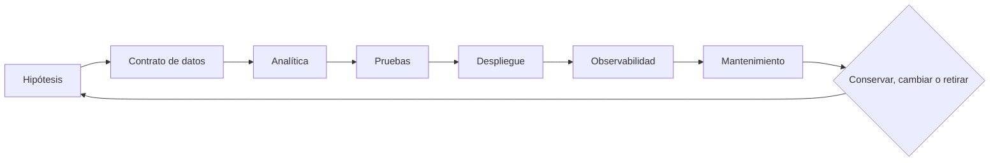

# Clase 199 — Ingeniería de detección como disciplina

> Parte: **8 — Blue Team, detección y SOC** · Fuente: *The Sigma Specification* · *MITRE ATT&CK* · prácticas de Detection Engineering
> ⏱️ Duración estimada: **110 min** · Nivel: **Avanzado**

---

## 🎯 Objetivo

Tratar la detección como ingeniería, no como un conjunto de reglas sueltas: un ciclo de vida con requisitos, desarrollo, pruebas, despliegue, versionado y retiro, gestionado como código (detection-as-code) con CI/CD. Aprenderás a documentar detecciones, medir su calidad, validarlas contra ataques reales y evitar la degradación silenciosa de tu cobertura.

## 📚 Resultados de aprendizaje

Al finalizar, el alumno podrá:

1. **Aplicar** el ciclo de vida de una detección (idea → desarrollo → prueba → producción → retiro).
2. **Gestionar** detecciones como código en un repositorio con CI/CD.
3. **Documentar** cada detección con metadatos, contexto y respuesta esperada.
4. **Validar** detecciones con Atomic Red Team y pruebas automatizadas.
5. **Medir** calidad (precisión, falsos positivos, cobertura, deuda de detección).

## 🗺️ Temas

| # | Tema | Por qué importa |
|---|------|-----------------|
| 1 | Detection Engineering como disciplina | De reglas ad hoc a proceso |
| 2 | Ciclo de vida de una detección | Estructura repetible y auditable |
| 3 | Detection-as-code y control de versiones | Trazabilidad y revisión |
| 4 | CI/CD para detecciones | Validación automática |
| 5 | Documentación y metadatos | Contexto para el analista |
| 6 | Validación con Atomic Red Team | Probar que realmente detecta |
| 7 | Calidad y deuda de detección | Evitar degradación silenciosa |
| 8 | Colaboración red↔blue (puente a purple) | Mejorar con adversario real |
| 9 | Detección de abuso de identidades de aplicación (caso ConnectWise, octubre de 2026) | Reglas verificables con eventos sintéticos y métricas |

## 🧠 Explicación en profundidad

La ingeniería de detección trata cada analítica como producto mantenible. Comienza con hipótesis y contrato de datos, no con sintaxis del SIEM. El contrato declara fuentes, campos, semántica, latencia y calidad mínima; así una falla upstream se distingue de una evasión.

Detection-as-code incluye regla, metadatos, mapeos y fixtures positivos y negativos. CI valida esquema, conversión, resultados y coste. En producción se vigilan tasa, latencia, campos nulos y distribución por entidad. Una caída de alertas puede significar éxito, pipeline roto o evasión. Toda regla necesita dueño, revisión y retiro; acumular contenido sin mantenimiento aumenta deuda y fatiga.

### La detección como producto

MITRE ATT&CK Detection Strategies conecta comportamiento, analítica y fuentes posibles; Sigma ofrece una especificación portable; Atomic Red Team aporta procedimientos controlados. Ninguna fuente completa sola el ciclo. El ingeniero parte de riesgo y comportamiento, declara telemetría, implementa la analítica, la prueba y observa su operación.

El contrato de datos nombra productor, campos, tipos, significado, latencia, retención y umbrales de calidad. Para detectar creación remota de servicio, por ejemplo, no basta `service_name`: se requieren host, usuario, origen o proceso según la hipótesis. Si un campo crítico queda nulo, la regla puede seguir ejecutándose y producir silencio; el contrato permite alertar sobre esa degradación.

### Repositorio y pruebas

Detection-as-code no es guardar consultas en Git. El repositorio incluye regla, explicación, ATT&CK justificado, datos requeridos, fixtures, conversión, propietario, severidad, excepciones y changelog. La revisión evalúa lógica y efecto operativo. CI valida esquema, positivo mínimo, negativos cercanos y traducción; cuando existe entorno de prueba, ejecuta la consulta y mide tiempo o cardinalidad.

Atomic Red Team puede generar un procedimiento conocido, pero ejecutar un test no demuestra cobertura completa de la técnica. Valida esa variante, sistema y configuración. Se registra comando, prerequisitos, versión, cleanup y eventos esperados. Las pruebas negativas contienen administración legítima parecida para evitar una regla que detecte únicamente la herramienta.

### Desplegar, observar y retirar

El rollout puede comenzar en modo hunting, después alertar a un grupo y finalmente ampliar. Se vigilan coincidencias, entidades únicas, latencia, errores, campos nulos y esfuerzo de triaje. Un aumento puede ser ataque, cambio de software o duplicación; una caída, prevención eficaz, datos rotos o evasión. La observabilidad no interpreta sola: orienta investigación del producto.

Excepciones tienen alcance y vencimiento. La regla se revisa cuando cambia amenaza, plataforma o fuente. Si ya no responde a riesgo, se retira con motivo y reemplazo. El catálogo de miles de reglas no es madurez si nadie sabe cuáles funcionan; una cartera pequeña, probada y vinculada a decisiones puede ofrecer más capacidad.

### Calidad y deuda de detección

La deuda aparece cuando reglas no tienen dueño, fixtures, datos confiables, documentación o revisión. También cuando varias reglas duplican conducta con excepciones distintas. Se inventaría y prioriza por riesgo: una regla crítica sin health check puede requerir atención antes que diez reglas ruidosas de baja severidad.

Calidad incluye fidelidad, cobertura declarada, coste, explicabilidad y utilidad de respuesta. Precisión sola puede favorecer una regla demasiado estrecha; recall teórico sin ground truth es incierto. Las pruebas y ejercicios aportan muestras conocidas, mientras incidentes reales revelan variantes.

### Colaboración entre red y blue

Red team describe procedimiento, prerequisitos y variaciones; blue team declara datos y lógica. No se entrega únicamente el IOC al final, porque eso crea una detección frágil. Juntos identifican qué conducta permaneció estable y qué control debería observarla. El ingeniero convierte el resultado en test de regresión, y operaciones confirma que la alerta contiene contexto accionable. Esta colaboración prepara la clase 200: purple team es el ciclo de trabajo, no un color adicional en el organigrama.

### Hardware: detectar conexión, conducta y atribución son productos distintos

Las prácticas de hardware de las clases [177](../../parte-7-red-team-y-operaciones-ofensivas/177-red-teaming-fisico/README.md) y [268–272](../../parte-13-seguridad-movil-iot-e-inalambrica/268-analisis-de-hardware-uart-jtag-y-spi/README.md) exigen contratos específicos. Una fuente PnP/USBGuard puede demostrar que apareció una interfaz; EDR o red puede mostrar el proceso, ruta o asociación posterior; inventario físico y custodia pueden vincular el equipo examinado. Ninguna capa debe rellenar las otras por inferencia.

Una detección portable se diseña como correlación temporal, no como una lista de marcas: *nuevo dispositivo USB con interfaz HID o red no inventariada* seguido de *conducta sensible* dentro de una ventana. El fixture positivo conserva descriptores e interfaz más la acción inocua de la Clase 177; los negativos incluyen un teclado de reemplazo y un dock corporativo. En WiFi, el positivo combina SSID protegido, BSSID fuera de inventario y RSN/certificado incompatible; el negativo contiene APs legítimos nuevos y redes vecinas. Si la fuente no aporta un campo, la regla declara el hueco en vez de inventarlo.

<!-- octubre-2026-199 -->
### Un caso real convertido en detección: identidades de aplicación abusadas

Un buen ejercicio de ingeniería de detección parte de un incidente publicado y se pregunta: *¿qué evidencia habría delatado esto, y cómo demuestro que mi regla funciona?* El incidente de octubre de 2026 de **ConnectWise Cloud Backup** (antes SkyKick) es adecuado porque el informe de Huntress documenta el comportamiento con detalle suficiente y reconoce sus límites. Los hechos que usamos, todos de ese informe: una credencial de aplicación del proveedor, ya autorizada en muchos inquilinos de Microsoft 365, se usó desde una dirección de un proveedor de alojamiento y no desde el rango habitual del proveedor; entre el 13 y el 15 de octubre hubo pulverización de contraseñas, principales de servicio que se asignaron roles de directorio (en un inquilino, Administrador Global) y adiciones de secretos a otras aplicaciones; Huntress confirmó 162 inquilinos con inicios de sesión no autorizados el 16 de octubre y advierte de que es una cota inferior.

**De la observación a cuatro reglas.** El laboratorio ([README](../../../labs/octubre-2026-casos-reales/README.md), `deteccion_identidad_app.py`) traduce lo observado a reglas con datos **sintéticos** (identificadores, direcciones y esquema de eventos ficticios):

| Regla | Condición | Técnica ATT&CK que describe la conducta | Falso positivo previsible |
|---|---|---|---|
| R1 | una aplicación se asigna a sí misma un rol de directorio | T1098.003 *Additional Cloud Roles* | un proveedor que se concede permisos al incorporarse; mitiga una lista de cambios aprobados |
| R2 | se añade una credencial a una aplicación y el actor no figura como propietario | T1098.001 *Additional Cloud Credentials* | un administrador que rota secretos; mitiga el inventario de propietarios |
| R3 | inicio de sesión de un principal de servicio desde fuera de los rangos conocidos de su proveedor | (acceso con credenciales válidas) | proveedor que cambia de infraestructura; mitiga la comunicación del cambio |
| R4 | ≥ 8 cuentas distintas fallan desde un mismo origen en una hora | T1110.003 *Password Spraying* | pruebas autorizadas de seguridad |

Las técnicas se verificaron en la matriz de ATT&CK (v20.1) el 2026-11-11. Conviene decir lo que **no** se afirma: que el atacante real usara exactamente estas técnicas con estos nombres es una interpretación del defensor sobre lo descrito, no un hecho del informe; y la regla R3 se apoya en un rango de direcciones que **en la realidad cambia** y requiere mantenimiento.

**Medir antes de confiar.** `medir` calcula, sobre la verdad de terreno sintética, cuántos eventos maliciosos detecta (todos, en las semillas probadas, 1 a 5 y 7) y cuántos falsos positivos produce (cero con el inventario de propietarios). La prueba `test_sin_inventario_de_propietarios_el_cambio_legitimo_alerta` muestra el contrapunto: **sin el inventario, R2 alerta sobre el cambio legítimo del administrador**. La conclusión de ingeniería es que la calidad de la regla está en el *dato de contexto* que la acompaña, no solo en la condición. Un resultado perfecto sobre datos sintéticos no prueba el rendimiento en producción: es una prueba de que la lógica hace lo que dice, que es el primer paso, no el último. Para probar en tu entorno, exporta tus eventos reales y aplica las mismas métricas.

**Lo que el informe no permite concluir.** Huntress señala que las lecturas de Graph no dejan rastro de auditoría, así que ninguna regla de este laboratorio podría detectar la lectura de datos; solo el uso de la credencial y los cambios de configuración. Es una limitación del origen de datos (clase de fuentes de telemetría), no de la regla. Las respuestas defendibles (deshabilitar —sin eliminar— las aplicaciones, revisar roles y credenciales añadidos desde el 13 de octubre, revisar exclusiones de acceso condicional) están en el informe y se retoman en la clase [222](../../parte-10-seguridad-en-la-nube-y-contenedores/222-iam-en-la-nube-identidades-roles-y-permisos/README.md).

## 📔 Glosario

- **Contrato de datos:** requisitos verificables de telemetría.
- **Detection-as-code:** contenido versionado y probado.
- **Fixture:** evento de prueba con resultado esperado.
- **CI:** validaciones automáticas previas a integrar.
- **Drift:** cambio del entorno que degrada una regla.
- **Observabilidad de regla:** métricas sobre ejecución.
- **Retiro:** desactivación documentada.

## 📖 Definiciones y características

- **Ingeniería de detección:** disciplina de crear, probar y mantener detecciones con rigor de ingeniería. Característica: ciclo de vida, calidad medible y mejora continua.
- **Detection-as-code:** gestionar reglas como código versionado (Sigma en Git). Característica: revisión por pares, historial y reproducibilidad.
- **CI/CD de detecciones:** pipeline que valida sintaxis, convierte y prueba reglas automáticamente. Característica: previene reglas rotas en producción.
- **Metadatos de detección:** contexto de la regla (autor, ATT&CK, falsos positivos, respuesta). Característica: acelera el triaje y el mantenimiento.
- **Validación:** ejecutar la técnica y comprobar que la regla dispara. Característica: distingue cobertura real de teórica.
- **Deuda de detección:** reglas obsoletas, ruidosas o sin dueño. Característica: degrada la señal si no se gestiona.
- **Precisión de detección:** proporción de alertas verdaderas sobre el total. Característica: mide la calidad, no la cantidad.

## 🔍 Producto completo — ciclo de una detección

La historia de usuario defensiva define que el SOC necesita reconocer creación remota de servicios en servidores críticos. El contrato declara eventos, host, servicio, identidad, origen, proceso y latencia. La regla se implementa con metadatos y fixtures; Atomic Red Team genera una variante autorizada y un procedimiento administrativo legítimo sirve como negativo.

CI valida esquema y resultados. El despliegue inicia en modo observación, mide volumen y luego crea alertas para un grupo. En producción se vigilan último evento por fuente, coincidencias, campos nulos y tiempo de consulta. Una actualización cambia el campo de servicio y el test falla antes de desplegar: ese fallo es el valor práctico de detection-as-code.

Meses después la plataforma migra y la regla es sustituida. Se retira con motivo, reemplazo y dependencias, manteniendo historial. El producto cubrió un ciclo completo, no solo el momento de escritura.

## ✅ Criterio de dominio

El alumno entrega repositorio reproducible, contrato, pruebas, rollout, métricas y retiro. Una regla activa sin dueño, datos vigilados ni negativo conocido se considera deuda.

## 🧰 Herramientas y preparación

- Un **repositorio Git** para tus reglas Sigma (clase 186) como fuente de verdad.
- **sigma-cli/pySigma** en un pipeline de CI (GitHub Actions/GitLab CI) para validar y convertir.
- **Atomic Red Team** para validar que cada detección dispara ante su técnica.
- Tu SIEM de laboratorio como destino de despliegue.
- Una plantilla de metadatos por detección.

Las validaciones con Atomic Red Team se ejecutan solo en tu laboratorio propio y aislado.

## 🧪 Laboratorio guiado — Un pipeline de detección como código

1. **Estructura el repo.** Crea `detections/` con tus reglas Sigma y una plantilla de metadatos (título, ATT&CK, fuente de datos, falsos positivos, respuesta).
2. **Añade validación de sintaxis.** Un job de CI que corra `sigma check` sobre todas las reglas al hacer push.
3. **Convierte automáticamente.** Otro paso que compile cada regla a tu backend (`sigma convert`) y falle si alguna no compila.
4. **Escribe una detección nueva.** Por ejemplo, ejecución de `certutil` descargando un archivo (T1105).
5. **Valida con Atomic.** Ejecuta el test atómico correspondiente en tu laboratorio y confirma que la regla dispara en el SIEM.
6. **Documenta la respuesta.** Añade a la regla qué debe hacer el analista cuando dispare (triaje, contención).
7. **Gestiona el ciclo.** Marca una regla vieja y ruidosa para retiro; registra la decisión en el historial de Git.
8. **Mide.** Calcula la precisión de 3 detecciones con datos de tu laboratorio y anota tu deuda de detección.

## ✍️ Ejercicios

1. Diseña la plantilla de metadatos de una detección completa.
2. Escribe el pipeline de CI (pseudo-YAML) que valide y convierta reglas.
3. Valida una detección con el test de Atomic Red Team adecuado.
4. Define criterios objetivos para retirar una detección.
5. Calcula la precisión de una regla con TP/FP de ejemplo.
6. Explica cómo el versionado ayuda a auditar cambios de detección.
7. Diseña contratos separados para conexión USB, conducta posterior y atribución física; indica qué decisión puede tomar el SOC con cada uno.
8. Caso ConnectWise (octubre de 2026). Ejecuta las pruebas de `Deteccion` y: (a) desactiva R3 y comprueba qué eventos dejan de detectarse; (b) cambia `umbral_spray` a 20 y explica el efecto; (c) escribe la consulta equivalente a R2 para tu SIEM en pseudocódigo y lista los datos de contexto que necesita. *Solución razonada:* (a) los inicios de sesión del principal de servicio desde el origen hostil dejan de alertar, pero R1 y R2 siguen cubriendo la fase posterior: defensa en profundidad entre reglas; (b) con 20 la pulverización de 18 cuentas del caso sintético ya no se detecta, ilustrando el compromiso umbral/sensibilidad; (c) necesita el inventario de propietarios por aplicación y el origen del actor.

## 📝 Reto verificable

Entrega un mini repositorio de detección como código con al menos tres reglas documentadas, un pipeline que valida y convierte sintaxis, y la evidencia de que una de ellas fue validada con Atomic Red Team en tu laboratorio. **Criterio de aceptación:** el pipeline falla ante una regla con sintaxis inválida y pasa con las correctas, cada detección incluye metadatos y respuesta esperada, y demuestras que la técnica ejecutada con Atomic dispara la regla correspondiente en el SIEM.

## ⚠️ Errores comunes

| Síntoma / mensaje | Causa y cómo arreglar |
|-------------------|-----------------------|
| Regla rota llega a producción | Sin CI de validación; añade `sigma check` al pipeline |
| Nadie sabe qué hace una alerta | Falta documentación/respuesta; exige metadatos por regla |
| Cobertura "teórica" que no dispara | No validada; prueba con Atomic Red Team |
| Reglas ruidosas acumuladas | Deuda de detección sin gestionar; revisa y retira periódicamente |
| Cambios sin trazabilidad | Detecciones fuera de control de versiones; muévelas a Git |

## ❓ Preguntas frecuentes

**❓ ¿Por qué tratar detecciones como software?**
Porque comparten problemas: calidad, regresiones, mantenimiento y colaboración. Aplicar control de versiones, revisión y CI evita que tu cobertura se degrade sin que nadie lo note.

**❓ ¿Toda detección debe validarse con Atomic?**
Cuando exista un procedimiento seguro y representativo, conviene validarlo. Una prueba atómica demuestra la respuesta ante esa variante, datos y configuración; no acredita todas las implementaciones de la técnica. Si no puede ejecutarse, se documenta la limitación y se usan fixtures u otra evidencia controlada.

**❓ ¿Cuándo retiro una detección?**
Cuando su ratio de falsos positivos es insostenible, la técnica ya no aplica, o otra regla la cubre mejor. Documenta la decisión: retirar también es ingeniería.

> 🔗 **Conexión con el abuso de recursos de IA (LLMjacking) — Parte 8 · Blue Team.** La ingeniería de detección también aplica a telemetría de IA: los registros de invocación de modelos son una fuente nueva, y el laboratorio [`llmjacking-defense`](../../../labs/llmjacking-defense/README.md) muestra cómo una regla de anomalías con señales explicables se mide con precisión, recall, falsos positivos y latencia. Es la misma disciplina de esta clase aplicada a un dato distinto; el detalle conceptual está en la clase 295.

## 🔗 Referencias verificables y alcance

- Sigma Rules Specification: especificación oficial usada para estructura, validación y conversión de reglas portables — <https://sigmahq.io/sigma-specification/specification/sigma-rules-specification.html>
- MITRE ATT&CK Detection Strategies: contenido oficial para relacionar estrategia, analíticas y componentes de datos — <https://attack.mitre.org/detectionstrategies/>
- Atomic Red Team: documentación oficial de pruebas focalizadas, prerrequisitos, permisos y limpieza; una prueba valida el procedimiento y entorno ejecutados, no toda variante de una técnica — <https://www.atomicredteam.io/docs/atomic-red-team>
- Palantir, *Alerting and Detection Strategy Framework*: marco público para documentar objetivos, lógica, respuesta y prueba; se usa como referencia de diseño, no como estándar normativo — <https://github.com/palantir/alerting-detection-strategy-framework>
- SigmaHQ Rules: repositorio comunitario de contenido que debe adaptarse, probarse, versionarse y mantenerse localmente — <https://github.com/SigmaHQ/sigma>
- USBGuard Rule Language: campos y semántica verificables para decisiones de autorización USB; VID/PID, nombre y serie no constituyen identidad criptográfica — <https://usbguard.github.io/documentation/rule-language>
- Microsoft SetupAPI device installation log: alcance real del registro de instalación de dispositivos en Windows — <https://learn.microsoft.com/windows-hardware/drivers/install/setupapi-device-installation-log-entries>
- Huntress, *ConnectWise (SkyKick) Vendor Credentials Abused in M365 Attacks* — <https://www.huntress.com/blog/vendor-credential-enables-unauthorized-access> — cronología, señales de detección, recuentos de inquilinos y límites de lo conocido.
- MITRE ATT&CK, *Additional Cloud Roles* (T1098.003) — <https://attack.mitre.org/techniques/T1098/003/> — técnica citada en la regla R1.
- MITRE ATT&CK, *Password Spraying* (T1110.003) — <https://attack.mitre.org/techniques/T1110/003/> — técnica citada en la regla R4.

## 📥 Material descargable

- 📄 [Guía en PDF](./clase-199-guia.pdf) — versión imprimible de esta clase.
- 🎞️ [Presentación (PPTX)](./clase-199-presentacion.pptx) — deck para proyectar en clase.

## ⬅️ Clase anterior

[Clase 198 — Casos de estudio de detección](../198-casos-de-estudio-de-deteccion/README.md)

## ➡️ Siguiente clase

[Clase 200 — Purple team desde el lado defensivo](../200-purple-team-desde-el-lado-defensivo/README.md)
