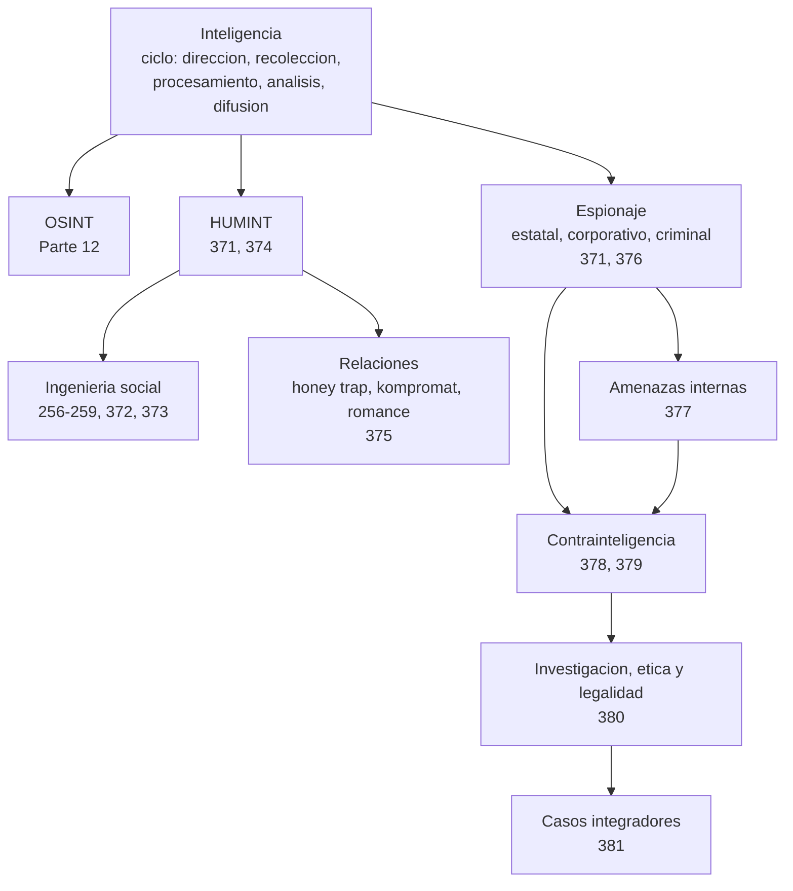

# Auditoría: ampliación a ingeniería social, espionaje y contrainteligencia

> Fecha de la revisión: **12 de noviembre de 2026**. Estado de partida verificado con `scripts/validar_estructura.py`: 21 partes y 370 clases. Estado de llegada: **22 partes y 381 clases**. No se creó ningún sistema informático nuevo; el trabajo es curricular. No se renumeró ninguna clase.

## 1. Auditoría y diagnóstico

**Qué se leyó:** `README.md`, `AGENTS.md`, `classes/README.md`, la Parte 12 completa (clases 249–260 y su README), las clases de amenazas internas, DLP, GRC y respuesta a incidentes que mencionan *insider*, el registro de fuentes (`sources/bibliography.json`), el glosario global, las rutas, y los validadores y generadores (`scripts/`).

**Diagnóstico de la Parte 12.** Es sólida en lo que cubre: ciclo de inteligencia aplicado a fuentes abiertas (249–255), principios de influencia (256), pretexting y vishing (257), simulaciones con GoPhish (258), defensa sistémica (259) y OPSEC personal (260). Su enfoque es el de **un ataque puntual** (un correo, una llamada, una campaña). No cubre, o solo menciona de pasada:

- inteligencia humana más allá de la cita de HUMINT en la clase 249;
- elicitación y suplantación como técnicas propias;
- captación y relaciones sostenidas en el tiempo;
- trampas románticas, kompromat, chantaje y estafas de romance;
- espionaje tradicional, industrial, económico y tecnológico, y su marco legal;
- contrainteligencia (el término no aparecía en ninguna clase);
- amenazas internas como programa (aparecían menciones dispersas en las clases 001, 002, 215, 237 y 291);
- protección de ejecutivos y de personas con acceso estratégico;
- investigación de incidentes donde el protagonista es una persona, y su legalidad;
- análisis de casos abiertos con separación entre hecho, declaración, acusación e hipótesis.

**Dependencias comprendidas antes de intervenir.** La numeración es global y secuencial (001–370), `validar_estructura.py` exige enlaces desde el README de cada parte, `generar_navegacion.py` deriva los enlaces anterior/siguiente, `verify-sources` exige que toda cita esté en el registro, y el catálogo móvil, el manual, el sitio y el glosario se regeneran de las clases. Insertar clases dentro de la Parte 12 habría obligado a renumerar 110 clases y romper enlaces, rutas, autoevaluaciones y la app. Por eso se creó una **Parte 21 al final**, conservando intacta la numeración existente.

## 2. Mapa de disciplinas

| Eje | Qué es | Dónde se desarrolla |
| --- | --- | --- |
| Ingeniería social | Técnica de manipulación de personas, usada por criminales, auditores y servicios | 256–259 (existente), 372–373 |
| Espionaje e inteligencia | Obtención clandestina de información protegida y su producto | 371, 374, 376 |
| Manipulación mediante relaciones | Afecto y confianza como vector de acceso, presión o fraude | 375 |
| Defensa | Personal, cultura, reporte, ejecutivos, contrainteligencia empresarial | 377–380 |
| Historia e investigación | Casos documentados y comparación | 374–376, 381 |

## 3. Matriz de cobertura

Estados: **EXISTE** (ya estaba desarrollado), **PARCIAL** (mencionado o tratado de forma limitada), **FALTA** (no estaba), **NO APLICA** (excluido por diseño). La columna final indica el estado **después** de esta ampliación.

| Concepto | Antes | Después | Dónde |
| --- | --- | --- | --- |
| Social engineering / human hacking | EXISTE | EXISTE (profundizado) | 256–259, 372 |
| Pretexting | EXISTE | EXISTE (profundizado) | 257, 373 |
| Elicitation | PARCIAL | EXISTE | 373 |
| Impersonation | PARCIAL | EXISTE | 373, 379 |
| Rapport building | FALTA | EXISTE | 372, 374 |
| Authority bias | PARCIAL | EXISTE | 372 |
| Reciprocity | PARCIAL | EXISTE | 372 |
| Manipulación de confianza y relaciones | PARCIAL | EXISTE | 372, 374, 375 |
| Espionaje tradicional | FALTA | EXISTE | 371, 374 |
| Espionaje industrial / económico / científico-tecnológico | FALTA | EXISTE | 376 |
| HUMINT | PARCIAL | EXISTE | 371, 374 |
| OSINT | EXISTE | EXISTE | 249–255, 371 |
| Contrainteligencia | FALTA | EXISTE | 371, 378 |
| Captación de fuentes humanas | FALTA | EXISTE | 374 |
| Amenazas internas | PARCIAL | EXISTE | 377 |
| Honey trap / sexpionage | FALTA | EXISTE | 375 |
| Romance scams y diferencias con operaciones | FALTA | EXISTE | 375 |
| Kompromat | FALTA | EXISTE | 375 |
| Chantaje y coerción | PARCIAL | EXISTE | 375 |
| Conflictos de interés como vulnerabilidad | PARCIAL | EXISTE | 375, 381 |
| Indicadores de manipulación | PARCIAL | EXISTE | 372–375 |
| Protección de personas con acceso estratégico | FALTA | EXISTE | 379 |
| Seguridad del personal ejecutivo | FALTA | EXISTE | 379 |
| Prevención de filtraciones | PARCIAL | EXISTE | 376–378 |
| Cultura de seguridad | PARCIAL | EXISTE | 378 |
| Protocolos de comunicación y reporte | PARCIAL | EXISTE | 378, 380 |
| Resistencia a la presión | FALTA | EXISTE | 372 |
| Contrainteligencia empresarial | FALTA | EXISTE | 378 |
| Operaciones documentadas de inteligencia humana | FALTA | PARCIAL | 374, 375, 376, 381 |
| Trampas románticas históricas | FALTA | PARCIAL | 375, 381 |
| Espionaje tecnológico en la Guerra Fría | FALTA | PARCIAL | 376 |
| Casos modernos de secretos industriales | FALTA | EXISTE | 376, 381 |
| Diferencias estatal / corporativo / criminal | PARCIAL | EXISTE | 371, 376 |
| Guiones operativos de engaño, seducción o chantaje | NO APLICA | NO APLICA | Excluidos por diseño |
| Herramientas de vigilancia o espionaje | NO APLICA | NO APLICA | Excluidas por diseño |
| Sistemas informáticos nuevos | NO APLICA | NO APLICA | Fuera de alcance por el encargo |

Quedan en **PARCIAL** los tres puntos históricos porque se desarrollan con casos seleccionados y verificables (Leung/Smith, ilegales rusos de 2010, Farewell Dossier, Ding) y no con un archivo exhaustivo. Una historia más amplia exigiría fuentes primarias que no se pudieron comprobar (véase pendientes).

## 4. Propuesta justificada de nuevas clases

La propuesta del encargo tenía 14 unidades. Se fusionaron en **11 clases** porque algunas no tienen contenido propio suficiente y crearlas habría sido artificial:

| Unidad propuesta | Resolución |
| --- | --- |
| 1 Fundamentos de ingeniería social | Ya existe en 256; se enlaza y se añade el marco general en **371** |
| 2 Psicología de la manipulación | **372** |
| 3 Inteligencia humana | **371** (marco) y **374** (captación) |
| 4 Obtención de información mediante interacción humana | **373** |
| 5 Trampas románticas y explotación de confianza | **375** |
| 6 Espionaje industrial y tecnológico | **376** |
| 7 Contrainteligencia | **378** |
| 8 Amenazas internas | **377** |
| 9 Protección de ejecutivos | **379** |
| 10 Historia y análisis comparado | Integrada en **374–376** (casos) y **381** (comparación) |
| 11 Detección y prevención | Transversal: cada clase termina en controles; consolidada en **378** |
| 12 Investigación y gestión de incidentes humanos | **380** |
| 13 Ética, derechos y legalidad | Sección de cada clase y núcleo de **380** |
| 14 Casos integradores | **381** |

## 5. Contenido curricular efectivamente integrado

- **Parte 21** con 11 clases (371–381) y README con el recorrido clase por clase.
- Cada clase incluye objetivo, nota ética, resultados, tabla de temas, prerrequisitos, explicación en profundidad, diagrama interpretado, glosario bilingüe, práctica de papel con personajes ficticios, ejercicios con respuestas razonadas, rúbrica, errores comunes, preguntas frecuentes y referencias con su propósito.
- Batería de **12 preguntas** de autoevaluación (Parte 21).
- Rutas ampliadas: Threat Intelligence Analyst y CISO.
- Registro de fuentes: **21 entradas nuevas** (4 libros, 3 normas o textos legales y 14 documentaciones y noticias).
- Cifras, índices, hoja de ruta, silabo, app móvil, manual y catálogo actualizados a 381 clases y 22 partes.

## 6. Casos de estudio y ejercicios

| Caso | Clase | Estado de la evidencia |
| --- | --- | --- |
| NVIDIA, noviembre de 2026 | 381 | Abierto. Declaración oficial y relación reconocida confirmadas; atribución a un servicio extranjero y daño a secretos **no verificados**. Corte: 12-nov-2026 |
| Katrina Leung / James J. Smith | 375, 381 | Smith se declaró culpable de mentir al FBI; los cargos contra Leung se desestimaron; la acusación de doble agente no se probó en juicio |
| Ilegales rusos (2010) | 376, 381 | Comunicado del DOJ; declaraciones de culpabilidad e intercambio |
| Farewell Dossier | 376, 381 | Relato de un participante (Weiss, CIA); efectos concretos no corroborados de forma independiente |
| Linwei Ding / Google | 376, 381 | Veredicto del 29-ene-2026 (14 cargos); sentencia no dictada al redactar |
| Estafas de romance y BEC | 375, 379 | Cifras del informe 2025 del IC3 |

El caso NVIDIA se trata con un método de **cuatro cajones** (hecho confirmado, declaración oficial, informe no verificado, hipótesis educativa). No se atribuye espionaje ni delito a ninguna persona. Los ejercicios usan Helio Tango, Ana Rojas, Boris Keller, Carla Muñoz, Diego, Elena, Irene Valdés y demás personajes **ficticios**.

## 7. Glosario bilingüe ampliado

Los términos están en el glosario de cada clase y se consolidan en `docs/GLOSARIO-GLOBAL.md` con `scripts/generar_glosario_global.py`. Resumen de los principales:

| Original | Traducción | Clase |
| --- | --- | --- |
| Intelligence cycle | Ciclo de inteligencia | 371 |
| HUMINT / OSINT | Inteligencia humana / de fuentes abiertas | 371 |
| Counterintelligence | Contrainteligencia | 371, 378 |
| Authority bias · Reciprocity · Rapport | Sesgo de autoridad · Reciprocidad · Sintonía | 372 |
| Pretexting · Impersonation · Elicitation | Construcción de pretexto · Suplantación · Elicitación | 373 |
| Spotting · Developing · Handling · MICE | Identificación · Desarrollo · Manejo · MICE | 374 |
| Honey trap · Sexpionage · Kompromat | Trampa de miel · «Sexpionaje» · Material comprometedor | 375 |
| Trade secret · Economic espionage | Secreto comercial · Espionaje económico | 376 |
| Insider threat · Least privilege | Amenaza interna · Mínimo privilegio | 377 |
| Need-to-know · Compartmentation | Necesidad de conocer · Compartimentación | 378 |
| CEO fraud · Digital footprint | Fraude del director · Huella digital | 379 |
| Chain of custody · Due process | Cadena de custodia · Debido proceso | 380 |
| Attribution · Confidence level | Atribución · Nivel de confianza | 381 |

## 8. Fuentes verificables

Las 21 entradas nuevas están en `sources/bibliography.json`, con localizador, estado de verificación, fecha de consulta y clases que las usan. Los libros llevan ISBN-13 con dígito de control válido, comprobado en Open Library el 2026-11-12. Los sitios del DOJ, el FBI y varios organismos de EE. UU. y del Reino Unido bloquean la descarga automática (HTTP 403); sus URL **no se citaron cuando no se pudo comprobar su existencia** (se dejaron fuera, por ejemplo, las páginas del FBI y de MI5/NPSA sobre elicitation y *Think Before You Link*). Las cifras del IC3 se extrajeron del PDF original. Las noticias sobre el caso NVIDIA se citan con su atribución y, cuando son opinión, así se declara.

## 9. Resultados de validaciones

Ejecutadas el 12-nov-2026 en local; el CI de GitHub repite las mismas comprobaciones.

| Comando | Resultado |
| --- | --- |
| `python scripts/validar_estructura.py` | OK: 22 partes, 381 clases, 0 enlaces `.md` rotos |
| `python scripts/generar_navegacion.py --check` | OK: navegación bidireccional coherente en 381 clases |
| `python scripts/validar_rutas.py` | OK: catálogo 001–381 íntegro, sin guías huérfanas ni anclas rotas |
| `python scripts/validar_encoding.py` | OK: sin mojibake, todo UTF-8 |
| `python scripts/verify-sources` | OK: 820 entradas, 100 % de las citas resueltas; 4 avisos preexistentes |
| `python scripts/generar_glosario_global.py --check` y pruebas | OK: 2.710 términos; 5 pruebas |
| `python scripts/generar_curriculum_movil.py --check` | OK: 381 clases, 22 partes, 417 diagramas |
| `python scripts/cwe_kb.py validar` y `cobertura --check` | OK (sin cambios por esta ampliación) |
| `npx markdownlint-cli2@0.23.0 "**/*.md"` | 0 errores en 560 archivos |
| `python scripts/generar_sitio.py` | OK: 536 páginas HTML |
| PDF y PPTX de las clases 371–381 y 256, 259; manual (1.594 páginas) | Regenerados; el manual contiene la clase 381 |

## 10. Informe de cambios y pendientes

**Cambios.** Véase la sección 5. No se modificaron las clases 249–260 salvo notas de enlace hacia la Parte 21, ni laboratorios, licencias ni arquitectura.

**Pendientes y límites declarados.**

1. El caso NVIDIA sigue abierto: hay discrepancias de prensa sobre la continuidad del cargo del director ejecutivo y la investigación independiente no ha concluido. La clase fija su fecha de corte y debe revisarse cuando haya resultado.
2. La sentencia de Linwei Ding no se había dictado al redactar; debe actualizarse.
3. No se pudieron leer los textos completos de los comunicados del DOJ (bloqueo HTTP 403); los hechos del caso Ding y de los ilegales rusos se contrastaron con cobertura de prensa y los títulos oficiales. Conviene verificarlos manualmente.
4. No se leyó el texto de CNN sobre el caso NVIDIA (error 451 desde la región de acceso); no se usó como base.
5. La fecha de la nota de NBC sobre Smith no se pudo confirmar; la clase solo afirma lo que la nota sostiene.
6. Las referencias a capítulos de libros se limitan a lo comprobable; no se verificaron páginas.
7. No hay laboratorio de código nuevo, por decisión del encargo; la práctica es de papel con personajes ficticios.
8. Una ampliación futura podría añadir fuentes primarias en español y casos latinoamericanos.
